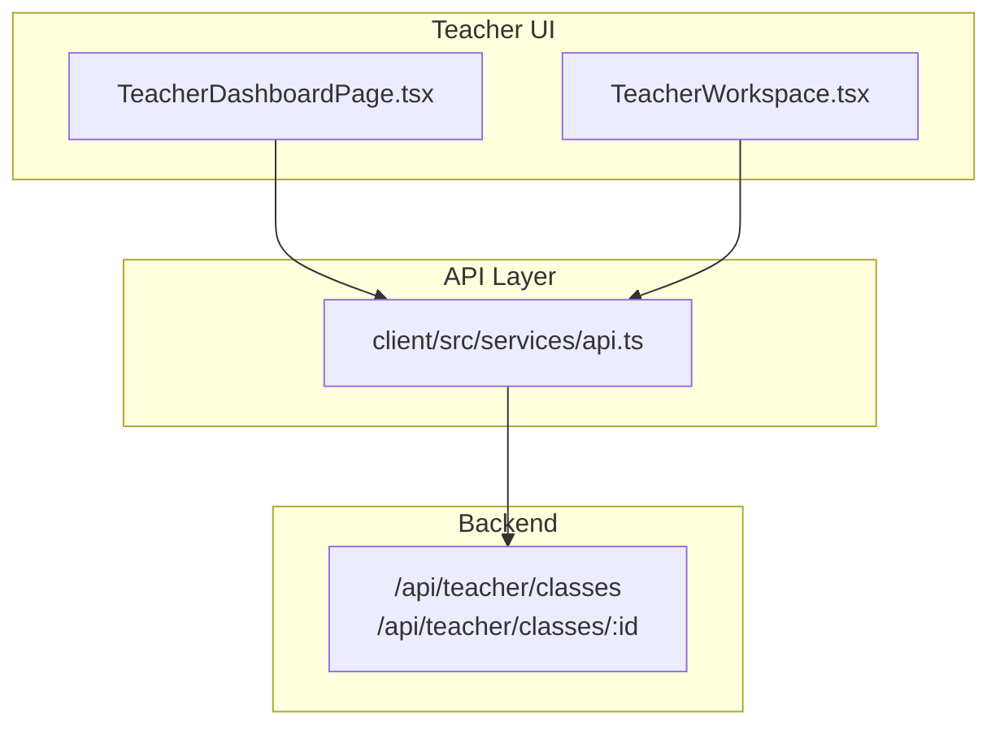
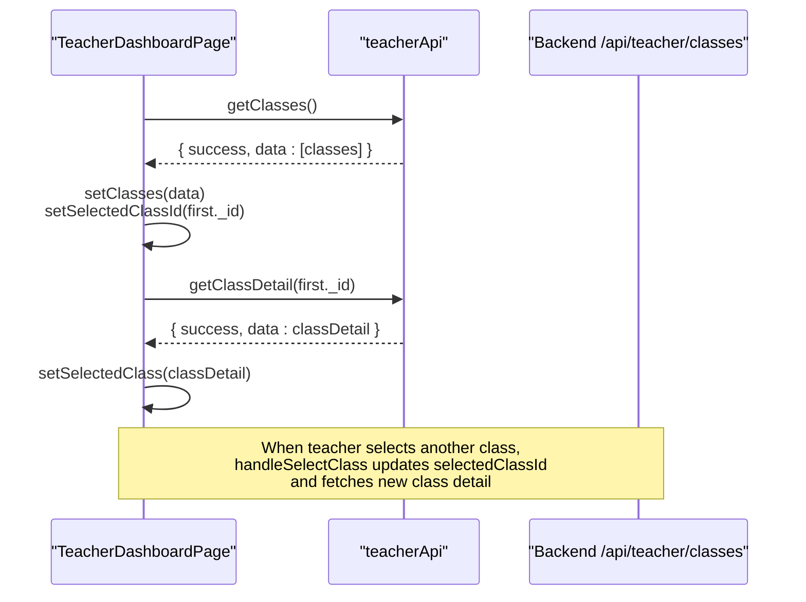
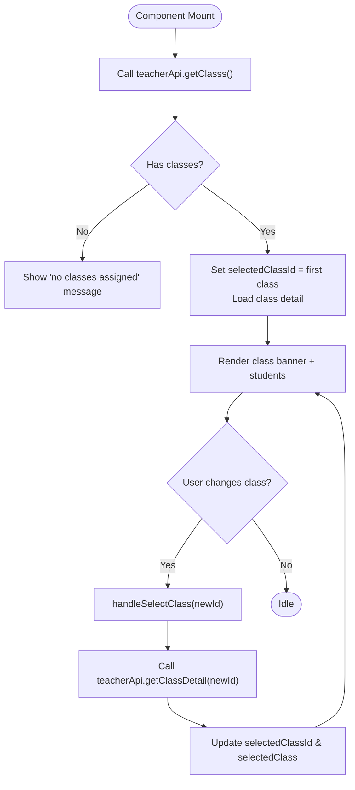
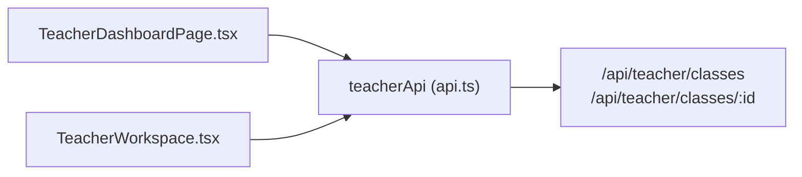

# Class Selection System

<cite>
**Referenced Files in This Document**
- [TeacherDashboardPage.tsx](file://client/src/dashboards/teacher/TeacherDashboardPage.tsx)
- [TeacherWorkspace.tsx](file://client/src/dashboards/teacher/TeacherWorkspace.tsx)
- [api.ts](file://client/src/services/api.ts)
</cite>

## Table of Contents
1. [Introduction](#introduction)
2. [Project Structure](#project-structure)
3. [Core Components](#core-components)
4. [Architecture Overview](#architecture-overview)
5. [Detailed Component Analysis](#detailed-component-analysis)
6. [Dependency Analysis](#dependency-analysis)
7. [Performance Considerations](#performance-considerations)
8. [Troubleshooting Guide](#troubleshooting-guide)
9. [Conclusion](#conclusion)

## Introduction
This document explains the class selection system used by teachers to switch between multiple classes, how the user interface supports class navigation, and how state is managed during switching. It also documents the class data structure, available properties, backend API integration for retrieving and displaying class information, error handling when no classes are available, and responsive design considerations across screen sizes.

## Project Structure
The class selection feature spans two main teacher-facing components and a shared API layer:
- Teacher dashboard page with an integrated class selector and roster view
- Teacher workspace pages that list classes and navigate to class detail
- Shared API client that calls backend endpoints for class listing and details

**Diagram sources**
- [TeacherDashboardPage.tsx:128-184](file://client/src/dashboards/teacher/TeacherDashboardPage.tsx#L128-L184)
- [TeacherWorkspace.tsx:21-21](file://client/src/dashboards/teacher/TeacherWorkspace.tsx#L21-L21)
- [api.ts:195-196](file://client/src/services/api.ts#L195-L196)

**Section sources**
- [TeacherDashboardPage.tsx:128-184](file://client/src/dashboards/teacher/TeacherDashboardPage.tsx#L128-L184)
- [TeacherWorkspace.tsx:21-21](file://client/src/dashboards/teacher/TeacherWorkspace.tsx#L21-L21)
- [api.ts:195-196](file://client/src/services/api.ts#L195-L196)

## Core Components
- TeacherDashboardPage: Main teacher dashboard with tabs; includes a class selector dropdown and displays the selected class’s students and metrics.
- TeacherWorkspace: Workspace layout with a “My classes” list and a class detail page for managing students and assignments.
- api.ts: Centralized HTTP client exposing teacherApi methods including getClasses and getClassDetail.

Key responsibilities:
- Load assigned classes on dashboard initialization
- Allow teachers to select a different class via a dropdown
- Fetch detailed class data (students, academic year, age group) and update UI state
- Provide fallback UI when no classes are assigned

**Section sources**
- [TeacherDashboardPage.tsx:51-55](file://client/src/dashboards/teacher/TeacherDashboardPage.tsx#L51-L55)
- [TeacherDashboardPage.tsx:196-205](file://client/src/dashboards/teacher/TeacherDashboardPage.tsx#L196-L205)
- [TeacherWorkspace.tsx:21-21](file://client/src/dashboards/teacher/TeacherWorkspace.tsx#L21-L21)
- [api.ts:195-196](file://client/src/services/api.ts#L195-L196)

## Architecture Overview
The class selection flow integrates React state, component lifecycle hooks, and the API client to fetch and display class data.

**Diagram sources**
- [TeacherDashboardPage.tsx:135-148](file://client/src/dashboards/teacher/TeacherDashboardPage.tsx#L135-L148)
- [TeacherDashboardPage.tsx:196-205](file://client/src/dashboards/teacher/TeacherDashboardPage.tsx#L196-L205)
- [api.ts:195-196](file://client/src/services/api.ts#L195-L196)

## Detailed Component Analysis

### Class Data Model
The class object returned by the backend contains at least the following fields, which are used throughout the UI:
- _id: Unique identifier for the class
- name: Display name of the class
- ageGroupCode: Age group code (e.g., “3-4”)
- academicYear: Academic year string
- students: Array of student objects associated with the class
- status: Optional status label shown in class cards
- assignments: Optional array of assignment references shown in class detail

Example shape (for illustration only):
- {
    "_id": "class_1",
    "name": "KCE English Kids - Level A",
    "ageGroupCode": "3-4",
    "academicYear": "2026-2027",
    "status": "Active",
    "students": [
      {
        "_id": "student_1",
        "name": "Alice",
        "ageGroupCode": "3-4",
        "avatarUrl": "...",
        "contact": "Parent contact",
        "stats": { "totalStars": 12, "averageScore": 85 }
      }
    ],
    "assignments": []
  }

Notes:
- The dashboard uses optional chaining to safely render fields like name, academicYear, ageGroupCode, and students.length.
- The workspace class card shows name, status, ageGroupCode, academicYear, and students count.

**Section sources**
- [TeacherDashboardPage.tsx:702-725](file://client/src/dashboards/teacher/TeacherDashboardPage.tsx#L702-L725)
- [TeacherWorkspace.tsx:21-21](file://client/src/dashboards/teacher/TeacherWorkspace.tsx#L21-L21)

### Class Selection State Management
State variables involved in class selection:
- classes: List of assigned classes
- selectedClassId: Currently selected class ID
- selectedClass: Full class detail object
- loading: Global loading indicator while initializing data

Initialization flow:
- On mount, load classes via teacherApi.getClasses()
- If classes exist, set selectedClassId to the first class and load its detail via teacherApi.getClassDetail()
- Update selectedClass with the fetched detail

Switching flow:
- handleSelectClass updates selectedClassId immediately
- Then fetches the new class detail and updates selectedClass
- Errors are caught and logged without breaking the UI

**Diagram sources**
- [TeacherDashboardPage.tsx:135-148](file://client/src/dashboards/teacher/TeacherDashboardPage.tsx#L135-L148)
- [TeacherDashboardPage.tsx:196-205](file://client/src/dashboards/teacher/TeacherDashboardPage.tsx#L196-L205)

**Section sources**
- [TeacherDashboardPage.tsx:51-55](file://client/src/dashboards/teacher/TeacherDashboardPage.tsx#L51-L55)
- [TeacherDashboardPage.tsx:135-148](file://client/src/dashboards/teacher/TeacherDashboardPage.tsx#L135-L148)
- [TeacherDashboardPage.tsx:196-205](file://client/src/dashboards/teacher/TeacherDashboardPage.tsx#L196-L205)

### UI Patterns for Class Navigation
- Dropdown selector:
  - Visible only when more than one class exists
  - Displays class name and age group code per option
  - Updates selected class on change
- Class banner:
  - Shows current class name, academic year, and age group
  - Displays total student count
- Empty state:
  - When no classes are assigned, a friendly message prompts contacting admin

Responsive behavior:
- The class selector banner adapts from stacked layout on small screens to horizontal layout on medium+ screens
- Student grid switches from single column to multi-column based on breakpoints

Accessibility:
- Uses unique IDs for form controls to associate labels and inputs
- Provides clear visual states for active tab and selected class

**Section sources**
- [TeacherDashboardPage.tsx:696-725](file://client/src/dashboards/teacher/TeacherDashboardPage.tsx#L696-L725)
- [TeacherDashboardPage.tsx:682-689](file://client/src/dashboards/teacher/TeacherDashboardPage.tsx#L682-L689)
- [TeacherDashboardPage.tsx:762-800](file://client/src/dashboards/teacher/TeacherDashboardPage.tsx#L762-L800)

### Backend Integration
Endpoints used:
- GET /api/teacher/classes: Returns list of classes assigned to the teacher
- GET /api/teacher/classes/:id: Returns detailed class data including students and related info

Client methods:
- teacherApi.getClasss(): Calls the list endpoint
- teacherApi.getClassDetail(id): Calls the detail endpoint

Error handling:
- Network or server errors throw exceptions from the base API client
- Component-level try/catch blocks log errors and keep the UI stable
- Empty class lists trigger a dedicated empty-state UI

**Section sources**
- [api.ts:195-196](file://client/src/services/api.ts#L195-L196)
- [TeacherDashboardPage.tsx:135-148](file://client/src/dashboards/teacher/TeacherDashboardPage.tsx#L135-L148)
- [TeacherDashboardPage.tsx:196-205](file://client/src/dashboards/teacher/TeacherDashboardPage.tsx#L196-L205)

### Example Class Objects
Below are example shapes for class and student objects as used by the UI. These are illustrative and not copied from source files.

Class object:
- {
    "_id": "c1",
    "name": "KCE English Kids - Level B",
    "ageGroupCode": "4-5",
    "academicYear": "2026-2027",
    "status": "Active",
    "students": ["s1", "s2"],
    "assignments": []
  }

Student object:
- {
    "_id": "s1",
    "name": "Bob",
    "ageGroupCode": "4-5",
    "avatarUrl": "...",
    "contact": "Parent phone/email",
    "stats": { "totalStars": 10, "averageScore": 80 }
  }

These fields align with what the dashboard and workspace render.

[No sources needed since this section provides conceptual examples]

### Error Handling When No Classes Are Available
When the teacher has no assigned classes:
- The dashboard shows a centered alert card explaining that no class assignment exists and instructs contacting the administrator
- The workspace “My classes” list shows an empty state indicating no classes assigned yet

This ensures a clear, non-technical message guides users toward resolution.

**Section sources**
- [TeacherDashboardPage.tsx:682-689](file://client/src/dashboards/teacher/TeacherDashboardPage.tsx#L682-L689)
- [TeacherWorkspace.tsx:21-21](file://client/src/dashboards/teacher/TeacherWorkspace.tsx#L21-L21)

### Responsive Design Considerations
- Mobile-first layout:
  - Single-column grids for students and content
  - Stacked banner layout for class selector and stats
- Tablet and desktop:
  - Multi-column grids for students and cards
  - Horizontal banner layout with side-by-side controls and metrics
- Breakpoints:
  - Small screens: compact controls, full-width elements
  - Medium screens: two-column grids, improved spacing
  - Large screens: three-column grids, wider containers

These patterns ensure usability across devices while keeping the class selection prominent and accessible.

**Section sources**
- [TeacherDashboardPage.tsx:696-725](file://client/src/dashboards/teacher/TeacherDashboardPage.tsx#L696-L725)
- [TeacherDashboardPage.tsx:762-800](file://client/src/dashboards/teacher/TeacherDashboardPage.tsx#L762-L800)

## Dependency Analysis
The class selection system depends on:
- React state and hooks for local UI state
- Router for navigation within the workspace
- API client for fetching class data
- Backend endpoints for class list and detail

**Diagram sources**
- [TeacherDashboardPage.tsx:135-148](file://client/src/dashboards/teacher/TeacherDashboardPage.tsx#L135-L148)
- [TeacherWorkspace.tsx:21-21](file://client/src/dashboards/teacher/TeacherWorkspace.tsx#L21-L21)
- [api.ts:195-196](file://client/src/services/api.ts#L195-L196)

**Section sources**
- [TeacherDashboardPage.tsx:135-148](file://client/src/dashboards/teacher/TeacherDashboardPage.tsx#L135-L148)
- [TeacherWorkspace.tsx:21-21](file://client/src/dashboards/teacher/TeacherWorkspace.tsx#L21-L21)
- [api.ts:195-196](file://client/src/services/api.ts#L195-L196)

## Performance Considerations
- Minimize redundant requests:
  - Only fetch class detail when switching classes
  - Cache selectedClass locally to avoid re-fetching unless necessary
- Optimize rendering:
  - Use memoization for filtered lists if search is added
  - Avoid unnecessary re-renders by separating concerns (e.g., class selector vs. student list)
- Network resilience:
  - Keep loading indicators visible during requests
  - Graceful fallbacks for network failures

[No sources needed since this section provides general guidance]

## Troubleshooting Guide
Common issues and resolutions:
- No classes displayed:
  - Verify teacher account has assigned classes
  - Check backend response for /api/teacher/classes
  - Confirm authentication token is present in headers
- Switching class does nothing:
  - Ensure selectedClassId is updated before fetching detail
  - Inspect console for API errors
- Student list not updating after switch:
  - Confirm selectedClass is refreshed with new detail
  - Validate that students field exists in the response

Logs to check:
- Console errors from failed API calls
- Network tab for request/response payloads

**Section sources**
- [TeacherDashboardPage.tsx:196-205](file://client/src/dashboards/teacher/TeacherDashboardPage.tsx#L196-L205)
- [api.ts:11-60](file://client/src/services/api.ts#L11-L60)

## Conclusion
The class selection system provides a straightforward, responsive way for teachers to switch between multiple classes. It leverages React state for local management, a consistent API layer for data retrieval, and clear UI patterns for navigation and feedback. With robust error handling and empty-state messaging, it remains usable even when no classes are assigned. Future enhancements could include caching, optimistic updates, and richer filtering/search capabilities.