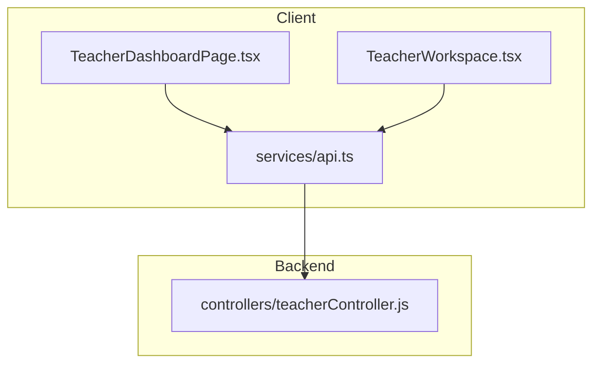
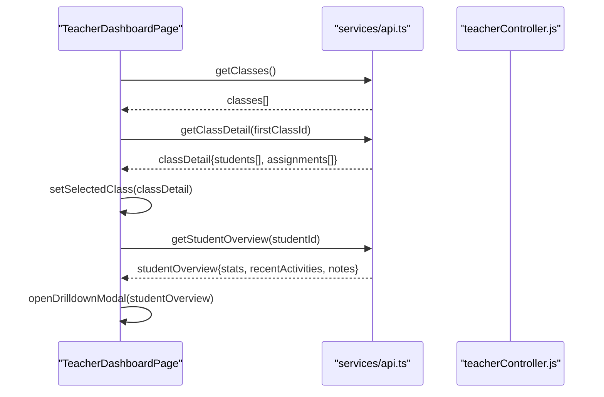
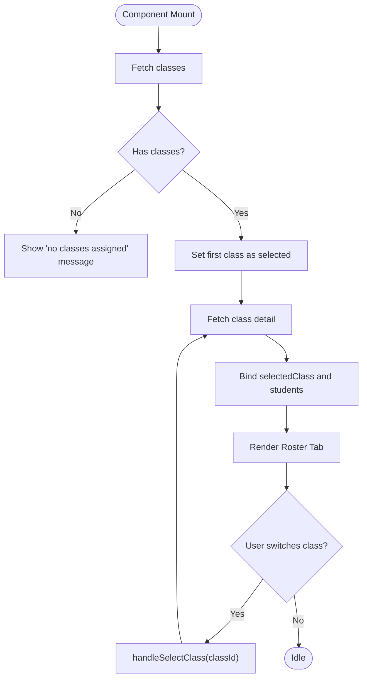
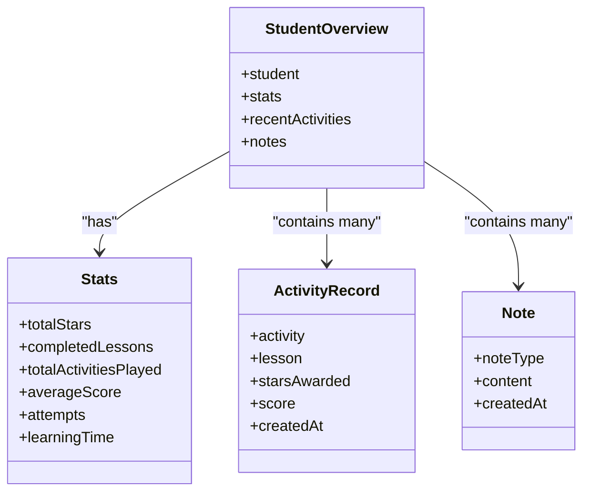
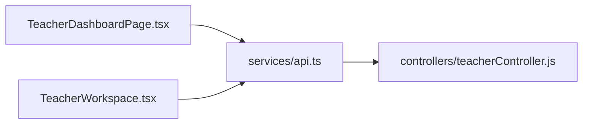

# Classroom Management Interface

<cite>
**Referenced Files in This Document**
- [TeacherDashboardPage.tsx](file://client/src/dashboards/teacher/TeacherDashboardPage.tsx)
- [TeacherWorkspace.tsx](file://client/src/dashboards/teacher/TeacherWorkspace.tsx)
- [api.ts](file://client/src/services/api.ts)
- [teacherController.js](file://KCEnglishKids_BE/src/controllers/teacherController.js)
- [index.css](file://client/src/index.css)
</cite>

## Table of Contents
1. [Introduction](#introduction)
2. [Project Structure](#project-structure)
3. [Core Components](#core-components)
4. [Architecture Overview](#architecture-overview)
5. [Detailed Component Analysis](#detailed-component-analysis)
6. [Dependency Analysis](#dependency-analysis)
7. [Performance Considerations](#performance-considerations)
8. [Troubleshooting Guide](#troubleshooting-guide)
9. [Conclusion](#conclusion)

## Introduction
This document explains the classroom management interface used by teachers to manage multiple classes, view student rosters, and visualize learning progress. It covers:
- Class selection and multi-class support
- Student roster display with avatars, stars, and completion indicators
- Classroom statistics and student drilldown metrics
- Responsive design for mobile, tablet, and large screens
- Backend API integration for real-time data updates
- State management patterns for class switching and student data synchronization

The teacher-facing UI is primarily implemented in a dashboard page that provides tabs for teaching content, class roster, assignments, and pedagogical notes. A secondary workspace layout provides additional navigation and summary views.

## Project Structure
The classroom management interface lives under the teacher dashboards and services layers:
- Teacher dashboard page: main UI for class selection, roster, assignments, notes, and student drilldown
- Teacher workspace layout: alternative workspace with overview metrics and navigation
- Services layer: centralized API client wrappers for teacher endpoints
- Backend controller: server-side logic for fetching classes, class details, and student overviews
- Global styles: responsive font scaling and base theme

**Diagram sources**
- [TeacherDashboardPage.tsx:128-205](file://client/src/dashboards/teacher/TeacherDashboardPage.tsx#L128-L205)
- [TeacherWorkspace.tsx:13-21](file://client/src/dashboards/teacher/TeacherWorkspace.tsx#L13-L21)
- [api.ts:192-239](file://client/src/services/api.ts#L192-L239)
- [teacherController.js:19-29](file://KCEnglishKids_BE/src/controllers/teacherController.js#L19-L29)

**Section sources**
- [TeacherDashboardPage.tsx:38-100](file://client/src/dashboards/teacher/TeacherDashboardPage.tsx#L38-L100)
- [TeacherWorkspace.tsx:13-21](file://client/src/dashboards/teacher/TeacherWorkspace.tsx#L13-L21)
- [api.ts:192-239](file://client/src/services/api.ts#L192-L239)
- [teacherController.js:19-29](file://KCEnglishKids_BE/src/controllers/teacherController.js#L19-L29)

## Core Components
- Class selection system: dropdown to switch between assigned classes; defaults to first class on load
- Student roster display: grid of student cards showing avatar, name, age group, parent contact (optional), stars, and completed lessons
- Classroom statistics visualization: KPIs for total stars, completed lessons, activity count, and average score in student drilldown
- Multi-class support: teacher can manage multiple classes simultaneously via class selector and per-class detail fetch
- Assignment management: create, filter, update status, and delete assignments
- Pedagogical notes: add qualitative observations per student

Key responsibilities:
- Load initial classes and selected class detail
- Switch class and refresh student list
- Open student drilldown modal to show performance metrics and history
- Render assignment list with filters and actions
- Submit pedagogical notes tied to current class students

**Section sources**
- [TeacherDashboardPage.tsx:128-205](file://client/src/dashboards/teacher/TeacherDashboardPage.tsx#L128-L205)
- [TeacherDashboardPage.tsx:692-816](file://client/src/dashboards/teacher/TeacherDashboardPage.tsx#L692-L816)
- [TeacherDashboardPage.tsx:818-1031](file://client/src/dashboards/teacher/TeacherDashboardPage.tsx#L818-L1031)
- [TeacherDashboardPage.tsx:1036-1184](file://client/src/dashboards/teacher/TeacherDashboardPage.tsx#L1036-L1184)

## Architecture Overview
The classroom management flow connects React components to backend controllers through a typed API service. The dashboard initializes state, loads classes, selects the first class, and fetches its detail including students and assignments. When a teacher switches classes or opens a student drilldown, the component calls the appropriate API methods and updates local state.

**Diagram sources**
- [TeacherDashboardPage.tsx:128-205](file://client/src/dashboards/teacher/TeacherDashboardPage.tsx#L128-L205)
- [TeacherDashboardPage.tsx:207-219](file://client/src/dashboards/teacher/TeacherDashboardPage.tsx#L207-L219)
- [api.ts:192-206](file://client/src/services/api.ts#L192-L206)
- [teacherController.js:19-29](file://KCEnglishKids_BE/src/controllers/teacherController.js#L19-L29)
- [teacherController.js:54-56](file://KCEnglishKids_BE/src/controllers/teacherController.js#L54-L56)

## Detailed Component Analysis

### Class Selection System and Multi-Class Support
- On mount, the dashboard requests all classes assigned to the logged-in teacher and sets the first class as selected
- The Roster tab shows a class selector when there are multiple classes
- Selecting a class triggers a call to fetch class detail, which includes populated student records and assignments
- The UI binds the selected class ID and displays class metadata such as name, academic year, and age group

Implementation highlights:
- Initial load: fetch classes, set default selected class, fetch class detail
- Class switch handler: update selected class ID and reload class detail
- Conditional rendering: if no classes are assigned, show an informative message

**Diagram sources**
- [TeacherDashboardPage.tsx:128-184](file://client/src/dashboards/teacher/TeacherDashboardPage.tsx#L128-L184)
- [TeacherDashboardPage.tsx:196-205](file://client/src/dashboards/teacher/TeacherDashboardPage.tsx#L196-L205)
- [TeacherDashboardPage.tsx:692-739](file://client/src/dashboards/teacher/TeacherDashboardPage.tsx#L692-L739)

**Section sources**
- [TeacherDashboardPage.tsx:128-184](file://client/src/dashboards/teacher/TeacherDashboardPage.tsx#L128-L184)
- [TeacherDashboardPage.tsx:196-205](file://client/src/dashboards/teacher/TeacherDashboardPage.tsx#L196-L205)
- [TeacherDashboardPage.tsx:692-739](file://client/src/dashboards/teacher/TeacherDashboardPage.tsx#L692-L739)

### Student Roster Display
- The roster tab renders a responsive grid of student cards
- Each card shows:
  - Avatar image or fallback icon
  - Student name
  - Age group code
  - Parent contact (if available)
  - Stars earned
  - Completed lessons count
  - “Details” button to open the student drilldown modal

Responsiveness:
- Grid adapts from single column on small screens to two columns on medium screens
- Cards use hover states and rounded corners for clarity

Data binding:
- Students come from the selected class detail response
- Stats are merged into each student object by the backend

**Section sources**
- [TeacherDashboardPage.tsx:741-816](file://client/src/dashboards/teacher/TeacherDashboardPage.tsx#L741-L816)
- [teacherController.js:24-29](file://KCEnglishKids_BE/src/controllers/teacherController.js#L24-L29)

### Classroom Statistics Visualization and Student Drilldown
- Opening a student’s details loads a comprehensive overview including:
  - Performance KPIs: total stars, completed lessons, total activities played
  - Pedagogical notes attached to the student
  - Recent activity history with scores and stars awarded
- The drilldown modal is responsive and scrollable on smaller screens

Data source:
- Student overview endpoint aggregates progress, activity results, sessions, and notes
- Backend computes aggregate stats like average score and learning time

**Diagram sources**
- [TeacherDashboardPage.tsx:1036-1184](file://client/src/dashboards/teacher/TeacherDashboardPage.tsx#L1036-L1184)
- [teacherController.js:54-56](file://KCEnglishKids_BE/src/controllers/teacherController.js#L54-L56)

**Section sources**
- [TeacherDashboardPage.tsx:1036-1184](file://client/src/dashboards/teacher/TeacherDashboardPage.tsx#L1036-L1184)
- [teacherController.js:54-56](file://KCEnglishKids_BE/src/controllers/teacherController.js#L54-L56)

### Assignments Management
- Teachers can filter assignments by status
- Create assignment modal supports:
  - Target class or individual student
  - Curriculum unit → lesson → optional specific activity
  - Due date and instructions
- Actions include updating status and deleting (cancelling) assignments

State management:
- Local form state for assignment creation
- Refresh assignment list after successful submission

**Section sources**
- [TeacherDashboardPage.tsx:818-943](file://client/src/dashboards/teacher/TeacherDashboardPage.tsx#L818-L943)
- [TeacherDashboardPage.tsx:1186-1379](file://client/src/dashboards/teacher/TeacherDashboardPage.tsx#L1186-L1379)

### Pedagogical Notes
- Teachers can add qualitative notes per student
- Note types include interest, vocabulary mastery, participation, reinforcement, and general
- Notes are saved and reflected in the student drilldown

Integration:
- Form binds to current class students
- After saving, the component optionally refreshes the drilldown if viewing the same student

**Section sources**
- [TeacherDashboardPage.tsx:945-1029](file://client/src/dashboards/teacher/TeacherDashboardPage.tsx#L945-L1029)
- [TeacherDashboardPage.tsx:1111-1142](file://client/src/dashboards/teacher/TeacherDashboardPage.tsx#L1111-L1142)

### Workspace Layout and Overview Metrics
- The workspace layout provides a sidebar navigation and top-level metrics:
  - Assigned classes, total children, active assignments, needing attention
  - Learning summary: average score, stars earned, completed assignments
  - Recent assignments and learning sessions
- Additional pages for classes, sessions, content, assignments, and students

Data flow:
- Dashboard metric endpoint returns aggregated data
- Classes page lists assigned classes with student counts
- Content browsing allows previewing curriculum units and lessons

**Section sources**
- [TeacherWorkspace.tsx:13-21](file://client/src/dashboards/teacher/TeacherWorkspace.tsx#L13-L21)
- [TeacherWorkspace.tsx:21-39](file://client/src/dashboards/teacher/TeacherWorkspace.tsx#L21-L39)

## Dependency Analysis
- Frontend components depend on the API service for all data operations
- API service wraps HTTP requests and attaches authentication headers
- Backend controller handles authorization, population of related documents, and aggregation of statistics

**Diagram sources**
- [TeacherDashboardPage.tsx:128-205](file://client/src/dashboards/teacher/TeacherDashboardPage.tsx#L128-L205)
- [TeacherWorkspace.tsx:13-21](file://client/src/dashboards/teacher/TeacherWorkspace.tsx#L13-L21)
- [api.ts:192-239](file://client/src/services/api.ts#L192-L239)
- [teacherController.js:19-29](file://KCEnglishKids_BE/src/controllers/teacherController.js#L19-L29)

**Section sources**
- [api.ts:1-61](file://client/src/services/api.ts#L1-L61)
- [api.ts:192-239](file://client/src/services/api.ts#L192-L239)
- [teacherController.js:19-29](file://KCEnglishKids_BE/src/controllers/teacherController.js#L19-L29)

## Performance Considerations
- Data loading uses sequential API calls during initialization; consider batching where possible
- Student overview aggregates multiple collections; ensure backend indexing and pagination for large datasets
- Avoid unnecessary re-renders by memoizing derived data (e.g., filtered assignments, curriculum options)
- Use optimistic UI updates sparingly; prefer explicit success/error handling for critical operations like assignment creation and note submission

[No sources needed since this section provides general guidance]

## Troubleshooting Guide
Common issues and resolutions:
- No classes assigned:
  - Symptom: Roster tab shows a message indicating no classes assigned
  - Resolution: Confirm teacher role and class assignment in admin settings
- Failed to load class detail:
  - Symptom: Error logs when switching classes
  - Resolution: Verify teacher has permission to access the class; check network and token validity
- Student overview not loading:
  - Symptom: Drilldown modal shows spinner indefinitely
  - Resolution: Ensure student exists and teacher has access; verify backend aggregation queries
- Assignment creation fails:
  - Symptom: Alert indicates missing fields or error
  - Resolution: Validate required fields (class, lesson); confirm curriculum options loaded correctly

Error handling patterns:
- Try/catch blocks around API calls log errors and update UI state
- Alerts provide user feedback for validation failures and server errors

**Section sources**
- [TeacherDashboardPage.tsx:128-184](file://client/src/dashboards/teacher/TeacherDashboardPage.tsx#L128-L184)
- [TeacherDashboardPage.tsx:196-219](file://client/src/dashboards/teacher/TeacherDashboardPage.tsx#L196-L219)
- [TeacherDashboardPage.tsx:221-255](file://client/src/dashboards/teacher/TeacherDashboardPage.tsx#L221-L255)

## Conclusion
The classroom management interface provides a robust, multi-class environment for teachers to manage rosters, assign work, and track student progress. Its responsive design ensures usability across devices, while clear state management and API integration deliver accurate, up-to-date information. The combination of visual KPIs, detailed student profiles, and flexible assignment workflows supports effective classroom instruction and ongoing pedagogical observation.

[No sources needed since this section summarizes without analyzing specific files]