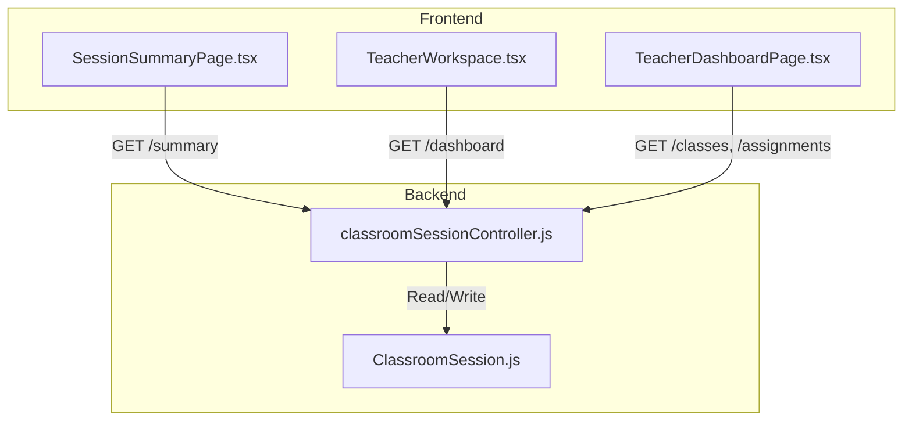
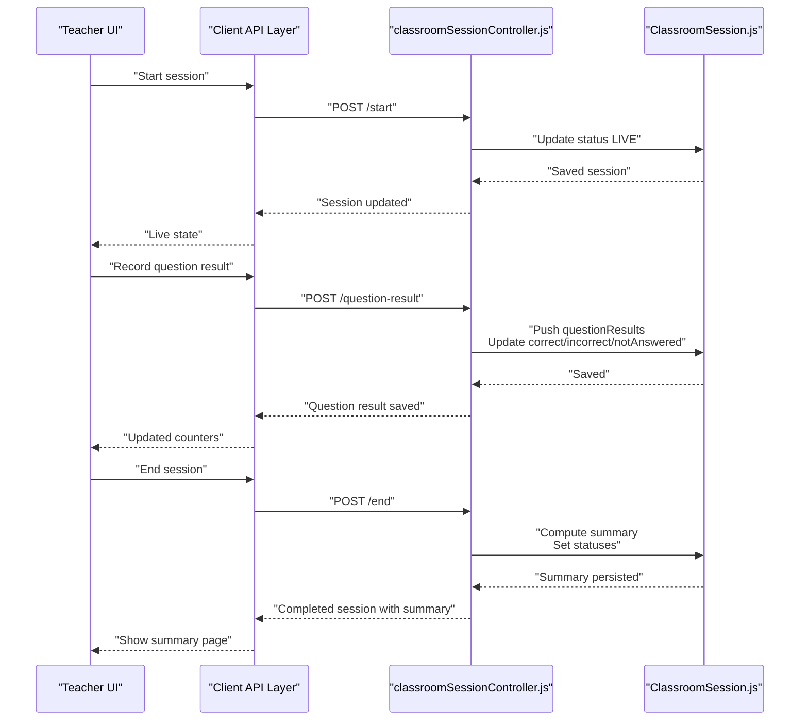
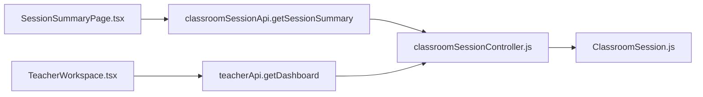

# Classroom Statistics Visualization

<cite>
**Referenced Files in This Document**
- [SessionSummaryPage.tsx](file://client/src/dashboards/teacher/SessionSummaryPage.tsx)
- [TeacherWorkspace.tsx](file://client/src/dashboards/teacher/TeacherWorkspace.tsx)
- [TeacherDashboardPage.tsx](file://client/src/dashboards/teacher/TeacherDashboardPage.tsx)
- [classroomSessionController.js](file://KCEnglishKids_BE/src/controllers/classroomSessionController.js)
- [ClassroomSession.js](file://KCEnglishKids_BE/src/models/ClassroomSession.js)
</cite>

## Table of Contents
1. [Introduction](#introduction)
2. [Project Structure](#project-structure)
3. [Core Components](#core-components)
4. [Architecture Overview](#architecture-overview)
5. [Detailed Component Analysis](#detailed-component-analysis)
6. [Dependency Analysis](#dependency-analysis)
7. [Performance Considerations](#performance-considerations)
8. [Troubleshooting Guide](#troubleshooting-guide)
9. [Conclusion](#conclusion)

## Introduction
This document explains the classroom statistics visualization component used by teachers to view aggregate class data after a live classroom session. It covers how average progress scores, participation rates, and performance trends are calculated on the backend, how those metrics are consumed and displayed on the frontend, which chart-like visualizations are used, and how real-time updates flow through the system. It also includes examples of statistical calculations, configuration patterns for responsive layouts, and performance considerations for large classes.

The primary visualization is not a traditional chart library; instead, it uses metric cards, tables, leaderboards, and status badges to present aggregated statistics clearly and responsively across screen sizes.

## Project Structure
The classroom statistics visualization spans both frontend React components and backend aggregation logic:

- Frontend teacher dashboard pages render session summaries, class-level metrics, and student results.
- Backend controller computes session summary metrics when a session ends and exposes them via an API endpoint.
- The database model defines per-student score rows and question result records that feed into the summary.

**Diagram sources**
- [SessionSummaryPage.tsx:53-58](file://client/src/dashboards/teacher/SessionSummaryPage.tsx#L53-L58)
- [classroomSessionController.js:416-437](file://KCEnglishKids_BE/src/controllers/classroomSessionController.js#L416-L437)
- [ClassroomSession.js:44-121](file://KCEnglishKids_BE/src/models/ClassroomSession.js#L44-L121)

**Section sources**
- [SessionSummaryPage.tsx:1-458](file://client/src/dashboards/teacher/SessionSummaryPage.tsx#L1-L458)
- [TeacherWorkspace.tsx:1-39](file://client/src/dashboards/teacher/TeacherWorkspace.tsx#L1-L39)
- [TeacherDashboardPage.tsx:1-800](file://client/src/dashboards/teacher/TeacherDashboardPage.tsx#L1-L800)
- [classroomSessionController.js:1-460](file://KCEnglishKids_BE/src/controllers/classroomSessionController.js#L1-L460)
- [ClassroomSession.js:1-122](file://KCEnglishKids_BE/src/models/ClassroomSession.js#L1-L122)

## Core Components
- Session summary page: Displays post-session metrics such as participation count, average accuracy, total stars, duration, and a detailed student results table. It also highlights top performers and students needing practice.
- Teacher workspace dashboard: Shows high-level teaching overview metrics including assigned classes, total children, active assignments, need-for-attention counts, average score, and stars earned.
- Backend session controller: Computes and persists session summary metrics, updates per-student status flags, and provides endpoints for scoring, bulk scoring, recording question results, and retrieving session summaries.
- Classroom session model: Defines per-student score rows, question result arrays, and the generated summary structure.

Key responsibilities:
- Backend calculates aggregate metrics from per-student answer counters and stores them in the session summary.
- Frontend consumes these metrics and renders them using metric cards, tables, and highlight panels.
- Real-time updates occur during a live session through scoring and question-result endpoints, while final statistics are finalized when the session ends.

**Section sources**
- [SessionSummaryPage.tsx:102-129](file://client/src/dashboards/teacher/SessionSummaryPage.tsx#L102-L129)
- [SessionSummaryPage.tsx:131-239](file://client/src/dashboards/teacher/SessionSummaryPage.tsx#L131-L239)
- [TeacherWorkspace.tsx:19-19](file://client/src/dashboards/teacher/TeacherWorkspace.tsx#L19-L19)
- [classroomSessionController.js:190-260](file://KCEnglishKids_BE/src/controllers/classroomSessionController.js#L190-L260)
- [ClassroomSession.js:4-20](file://KCEnglishKids_BE/src/models/ClassroomSession.js#L4-L20)
- [ClassroomSession.js:22-42](file://KCEnglishKids_BE/src/models/ClassroomSession.js#L22-L42)
- [ClassroomSession.js:102-113](file://KCEnglishKids_BE/src/models/ClassroomSession.js#L102-L113)

## Architecture Overview
The visualization architecture follows a clear separation between data computation and presentation:

- Data ingestion: During a live session, student answers and scoring actions update per-student counters and question results.
- Aggregation: When the session ends, the backend aggregates participation, accuracy, stars, points, and identifies top performers and students needing practice.
- Presentation: The frontend displays these metrics using metric cards, tables, and highlight sections.

**Diagram sources**
- [classroomSessionController.js:169-184](file://KCEnglishKids_BE/src/controllers/classroomSessionController.js#L169-L184)
- [classroomSessionController.js:358-411](file://KCEnglishKids_BE/src/controllers/classroomSessionController.js#L358-L411)
- [classroomSessionController.js:190-260](file://KCEnglishKids_BE/src/controllers/classroomSessionController.js#L190-L260)

## Detailed Component Analysis

### Session Summary Page (Frontend Visualization)
The session summary page is the main visualization surface for post-session statistics. It fetches the session summary, computes derived values like duration, and renders:

- Metric cards for participation, average accuracy, total stars, and duration.
- A student results table showing correct/wrong counts, accuracy percentage, stars, points, and status.
- Highlight panels for top performers and students needing practice.
- Session info panel and action buttons to send parent reports or navigate back to the classroom.

Responsive design patterns:
- Grid layouts adapt from two columns on small screens to four columns on larger screens for metric cards.
- The student results table scrolls horizontally on narrow screens.
- Right-side highlights stack vertically on smaller screens and align beside the table on larger screens.

Real-time behavior:
- The page loads once per session ID and shows loading states and error handling for missing sessions.
- Parent report modal composes per-student stats and sends notifications.

Statistical calculations on the frontend:
- Per-student accuracy is computed as correctCount divided by total answered, rounded to a percentage.
- Duration is computed from startedAt and endedAt timestamps.

Chart types used:
- No traditional chart libraries are used. Instead, metric cards, tables, and highlight panels serve as the visualization primitives.

Example snippet paths:
- Metrics grid rendering: [SessionSummaryPage.tsx:102-129](file://client/src/dashboards/teacher/SessionSummaryPage.tsx#L102-L129)
- Student results table: [SessionSummaryPage.tsx:131-183](file://client/src/dashboards/teacher/SessionSummaryPage.tsx#L131-L183)
- Top performers and needs-practice panels: [SessionSummaryPage.tsx:185-226](file://client/src/dashboards/teacher/SessionSummaryPage.tsx#L185-L226)
- Duration calculation: [SessionSummaryPage.tsx:39-44](file://client/src/dashboards/teacher/SessionSummaryPage.tsx#L39-L44)
- Per-student accuracy calculation: [SessionSummaryPage.tsx:151-179](file://client/src/dashboards/teacher/SessionSummaryPage.tsx#L151-L179)

**Section sources**
- [SessionSummaryPage.tsx:46-86](file://client/src/dashboards/teacher/SessionSummaryPage.tsx#L46-L86)
- [SessionSummaryPage.tsx:102-239](file://client/src/dashboards/teacher/SessionSummaryPage.tsx#L102-L239)
- [SessionSummaryPage.tsx:272-313](file://client/src/dashboards/teacher/SessionSummaryPage.tsx#L272-L313)
- [SessionSummaryPage.tsx:316-455](file://client/src/dashboards/teacher/SessionSummaryPage.tsx#L316-L455)

### Teacher Workspace Dashboard (Aggregate Teaching Metrics)
The teacher workspace dashboard presents aggregate teaching metrics fetched from the backend:

- Assigned classes, total children, active assignments, and need-for-attention counts.
- Learning summary including average score, stars earned, and completed assignments.
- Recent assignments and recent learning sessions lists.

Data source:
- The dashboard calls the teacher API to get a dashboard object containing metrics and lists.

Statistical calculations on the frontend:
- Average score for assignment results is computed by summing scores and dividing by result count.

Responsive design patterns:
- Metric cards use responsive grids to adapt from two columns on small screens to four columns on larger screens.
- Lists and detail sections scale gracefully across breakpoints.

Example snippet paths:
- Dashboard metrics rendering: [TeacherWorkspace.tsx:19-19](file://client/src/dashboards/teacher/TeacherWorkspace.tsx#L19-L19)
- Assignment detail average score calculation: [TeacherWorkspace.tsx:34-34](file://client/src/dashboards/teacher/TeacherWorkspace.tsx#L34-L34)

**Section sources**
- [TeacherWorkspace.tsx:13-19](file://client/src/dashboards/teacher/TeacherWorkspace.tsx#L13-L19)
- [TeacherWorkspace.tsx:34-34](file://client/src/dashboards/teacher/TeacherWorkspace.tsx#L34-L34)

### Backend Session Controller (Aggregation Logic)
The backend controller is responsible for:

- Creating sessions with per-student score rows initialized to zero.
- Starting and ending sessions, updating status and timestamps.
- Recording individual and bulk scores, updating per-student counters.
- Recording question results and updating per-student correct/incorrect/not-answered counters.
- Generating the session summary when the session ends, including:
  - Participation count: number of students who answered at least one question.
  - Average accuracy: total correct divided by total answered across all participating students, expressed as a percentage.
  - Total stars and total points: sums across all students.
  - Students needing practice: students with no participation or less than 50% accuracy.
  - Top performers: top three students by stars then points.
- Updating per-student status flags based on accuracy thresholds.

Real-time updates:
- Scoring and question-result endpoints update the session incrementally during a live session.
- Final statistics are computed and persisted only when the session ends.

Example snippet paths:
- End session summary generation: [classroomSessionController.js:190-260](file://KCEnglishKids_BE/src/controllers/classroomSessionController.js#L190-L260)
- Score student endpoint: [classroomSessionController.js:267-306](file://KCEnglishKids_BE/src/controllers/classroomSessionController.js#L267-L306)
- Bulk score endpoint: [classroomSessionController.js:313-355](file://KCEnglishKids_BE/src/controllers/classroomSessionController.js#L313-L355)
- Record question result endpoint: [classroomSessionController.js:358-411](file://KCEnglishKids_BE/src/controllers/classroomSessionController.js#L358-L411)
- Get session summary endpoint: [classroomSessionController.js:416-437](file://KCEnglishKids_BE/src/controllers/classroomSessionController.js#L416-L437)

**Section sources**
- [classroomSessionController.js:74-136](file://KCEnglishKids_BE/src/controllers/classroomSessionController.js#L74-L136)
- [classroomSessionController.js:169-184](file://KCEnglishKids_BE/src/controllers/classroomSessionController.js#L169-L184)
- [classroomSessionController.js:190-260](file://KCEnglishKids_BE/src/controllers/classroomSessionController.js#L190-L260)
- [classroomSessionController.js:267-355](file://KCEnglishKids_BE/src/controllers/classroomSessionController.js#L267-L355)
- [classroomSessionController.js:358-437](file://KCEnglishKids_BE/src/controllers/classroomSessionController.js#L358-L437)

### Classroom Session Model (Data Structures)
The model defines:

- Per-student score schema: fields for points, stars, correctCount, incorrectCount, notAnswered, and status enum.
- Per-question result schema: activityId, questionIndex, promptText, promptImageUrl, and studentAnswers array with result enums.
- Classroom session schema: references to classroom, teacher, lesson; lifecycle fields like status, startedAt, endedAt; activities list; currentActivityIndex; studentScores array; questionResults array; and generated summary object.

Indexes:
- Indexes on classroom+status and teacher+createdAt optimize queries for listing and filtering sessions.

Example snippet paths:
- Student score schema: [ClassroomSession.js:4-20](file://KCEnglishKids_BE/src/models/ClassroomSession.js#L4-L20)
- Question result schema: [ClassroomSession.js:22-42](file://KCEnglishKids_BE/src/models/ClassroomSession.js#L22-L42)
- Classroom session schema and summary: [ClassroomSession.js:44-121](file://KCEnglishKids_BE/src/models/ClassroomSession.js#L44-L121)

**Section sources**
- [ClassroomSession.js:1-122](file://KCEnglishKids_BE/src/models/ClassroomSession.js#L1-L122)

## Dependency Analysis
The visualization depends on several layers:

- Frontend components depend on API services to fetch session summaries and dashboard metrics.
- Backend controller depends on Mongoose models to read/write session data and populate related entities.
- Database indexes support efficient querying for teacher dashboards and session listings.

**Diagram sources**
- [SessionSummaryPage.tsx:53-58](file://client/src/dashboards/teacher/SessionSummaryPage.tsx#L53-L58)
- [TeacherWorkspace.tsx:19-19](file://client/src/dashboards/teacher/TeacherWorkspace.tsx#L19-L19)
- [classroomSessionController.js:416-437](file://KCEnglishKids_BE/src/controllers/classroomSessionController.js#L416-L437)
- [ClassroomSession.js:118-119](file://KCEnglishKids_BE/src/models/ClassroomSession.js#L118-L119)

**Section sources**
- [SessionSummaryPage.tsx:53-58](file://client/src/dashboards/teacher/SessionSummaryPage.tsx#L53-L58)
- [TeacherWorkspace.tsx:19-19](file://client/src/dashboards/teacher/TeacherWorkspace.tsx#L19-L19)
- [classroomSessionController.js:416-437](file://KCEnglishKids_BE/src/controllers/classroomSessionController.js#L416-L437)
- [ClassroomSession.js:118-119](file://KCEnglishKids_BE/src/models/ClassroomSession.js#L118-L119)

## Performance Considerations
For large class sizes and frequent real-time updates:

- Backend aggregation:
  - Summary computation runs once at session end, minimizing repeated heavy calculations during live sessions.
  - Per-student counters are updated incrementally via scoring and question-result endpoints.
  - Database indexes on classroom+status and teacher+createdAt improve query performance for listing sessions and dashboards.

- Frontend rendering:
  - Tables and lists should be paginated or virtualized if the number of students grows significantly.
  - Avoid unnecessary re-renders by memoizing derived values and limiting state updates.
  - Use responsive grids to ensure layout efficiency across devices.

- Caching strategies:
  - Cache dashboard metrics and session summaries client-side until the next user interaction or explicit refresh.
  - Implement optimistic UI updates for scoring actions to improve perceived responsiveness.
  - Consider server-side caching for frequently accessed class details and curriculum options.

[No sources needed since this section provides general guidance]

## Troubleshooting Guide
Common issues and resolutions:

- Session not found:
  - Ensure the session ID is valid and the teacher has access.
  - Check backend authorization helpers and session existence.

- Cannot score after session ends:
  - Scoring endpoints reject updates once the session status is COMPLETED.
  - Verify session lifecycle and avoid scoring after end.

- Missing summary data:
  - Summary is generated only when the session ends.
  - Confirm that endSession was called successfully and summary fields are populated.

- Incorrect accuracy percentages:
  - Accuracy is computed from total correct divided by total answered across participating students.
  - Ensure correctCount and incorrectCount are updated correctly via scoring and question-result endpoints.

- Responsive layout issues:
  - Check Tailwind grid breakpoints and ensure content wraps appropriately on small screens.
  - Validate table overflow behavior and card stacking order.

**Section sources**
- [classroomSessionController.js:190-260](file://KCEnglishKids_BE/src/controllers/classroomSessionController.js#L190-L260)
- [classroomSessionController.js:267-355](file://KCEnglishKids_BE/src/controllers/classroomSessionController.js#L267-L355)
- [SessionSummaryPage.tsx:60-73](file://client/src/dashboards/teacher/SessionSummaryPage.tsx#L60-L73)

## Conclusion
The classroom statistics visualization combines backend aggregation and frontend presentation to deliver actionable insights about class performance. Aggregate metrics such as participation rate, average accuracy, stars, and points are computed from per-student counters and presented through metric cards, tables, and highlight panels. Real-time updates occur during live sessions via scoring and question-result endpoints, while final statistics are consolidated when the session ends. The design emphasizes clarity, responsiveness, and scalability, with opportunities for further optimization through pagination, virtualization, and caching strategies.

[No sources needed since this section summarizes without analyzing specific files]