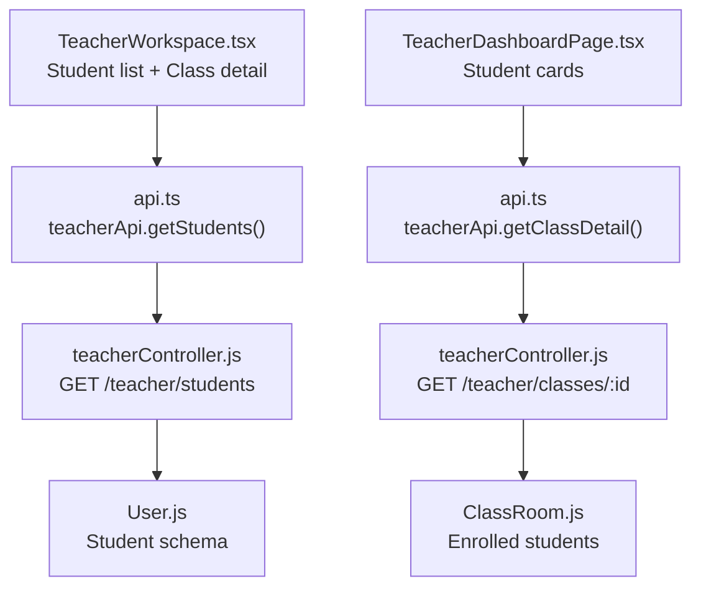
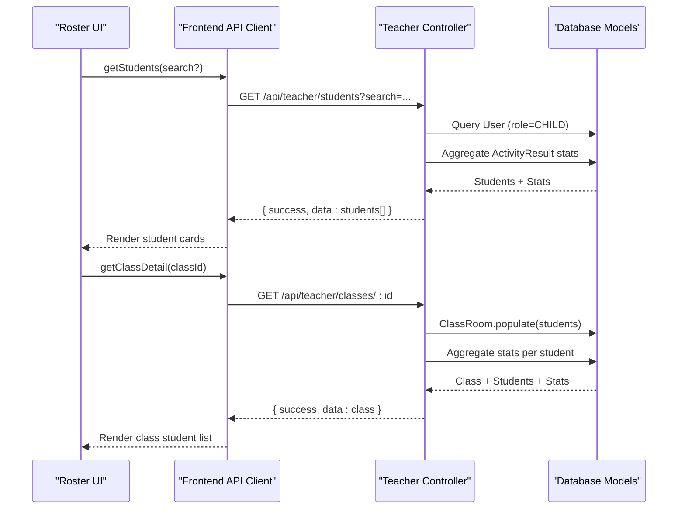
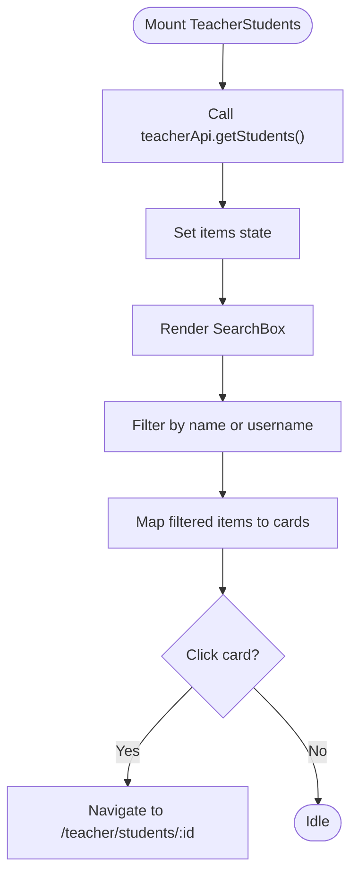
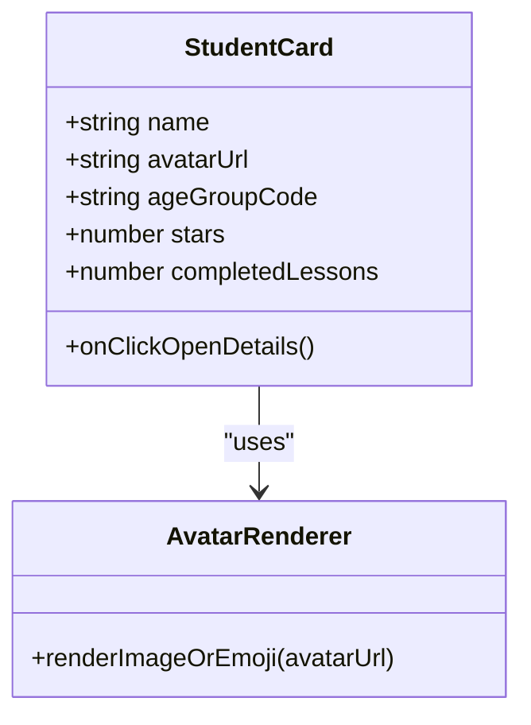
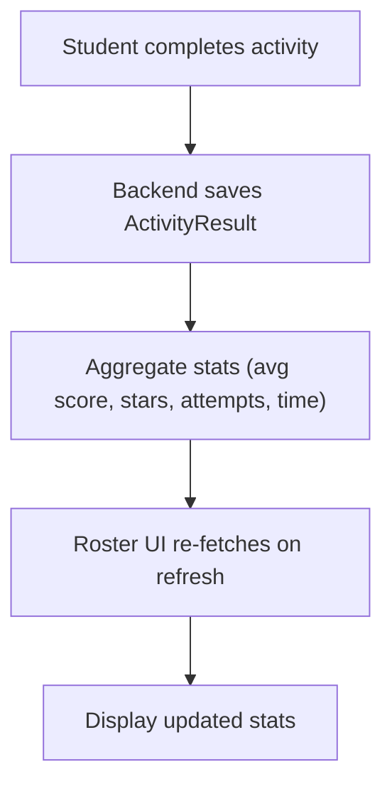
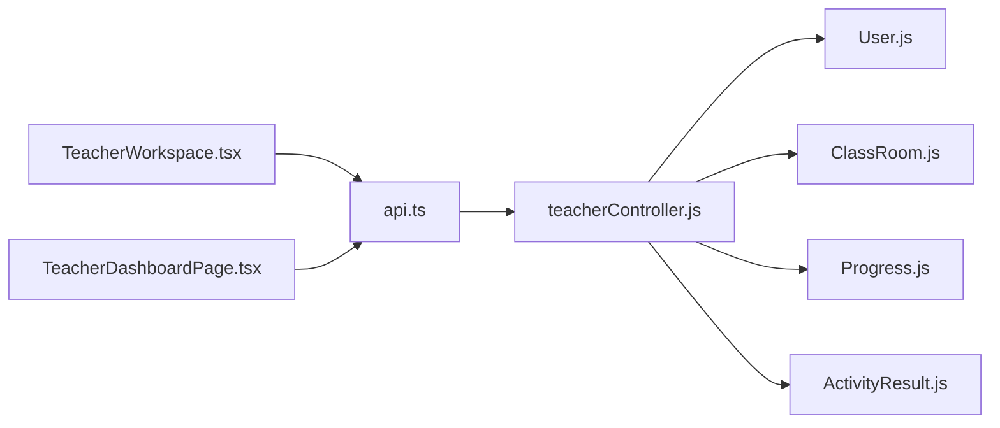

# Student Roster Display

<cite>
**Referenced Files in This Document**
- [TeacherWorkspace.tsx](file://client/src/dashboards/teacher/TeacherWorkspace.tsx)
- [TeacherDashboardPage.tsx](file://client/src/dashboards/teacher/TeacherDashboardPage.tsx)
- [api.ts](file://client/src/services/api.ts)
- [index.ts](file://client/src/types/index.ts)
- [User.js](file://KCEnglishKids_BE/src/models/User.js)
- [ClassRoom.js](file://KCEnglishKids_BE/src/models/ClassRoom.js)
- [teacherController.js](file://KCEnglishKids_BE/src/controllers/teacherController.js)
- [Progress.js](file://KCEnglishKids_BE/src/models/Progress.js)
- [ActivityResult.js](file://KCEnglishKids_BE/src/models/ActivityResult.js)
</cite>

## Table of Contents
1. [Introduction](#introduction)
2. [Project Structure](#project-structure)
3. [Core Components](#core-components)
4. [Architecture Overview](#architecture-overview)
5. [Detailed Component Analysis](#detailed-component-analysis)
6. [Dependency Analysis](#dependency-analysis)
7. [Performance Considerations](#performance-considerations)
8. [Troubleshooting Guide](#troubleshooting-guide)
9. [Conclusion](#conclusion)

## Introduction
This document explains the student roster display used by teachers to browse, filter, and inspect students. It covers how avatars are rendered, how progress indicators and performance metrics are shown, the student data model, interactive features (click-to-view details, filtering, search), example data shapes, and how updates flow when student progress changes.

## Project Structure
The student roster is primarily implemented in the teacher dashboard workspace:
- The “Students” list is rendered by a component that fetches students via the teacher API, supports text search, and links to each student’s detail page.
- The class detail view also lists enrolled students with quick stats and navigation to their profiles.
- The main teacher dashboard shows a grid of student cards with avatar, name, age group, stars, completed lessons, and a button to open detailed analytics.

**Diagram sources**
- [TeacherWorkspace.tsx:36-36](file://client/src/dashboards/teacher/TeacherWorkspace.tsx#L36-L36)
- [TeacherDashboardPage.tsx:762-813](file://client/src/dashboards/teacher/TeacherDashboardPage.tsx#L762-L813)
- [api.ts:193-203](file://client/src/services/api.ts#L193-L203)
- [teacherController.js:50-56](file://KCEnglishKids_BE/src/controllers/teacherController.js#L50-L56)
- [User.js:4-66](file://KCEnglishKids_BE/src/models/User.js#L4-L66)
- [ClassRoom.js:3-48](file://KCEnglishKids_BE/src/models/ClassRoom.js#L3-L48)

**Section sources**
- [TeacherWorkspace.tsx:36-36](file://client/src/dashboards/teacher/TeacherWorkspace.tsx#L36-L36)
- [TeacherDashboardPage.tsx:762-813](file://client/src/dashboards/teacher/TeacherDashboardPage.tsx#L762-L813)
- [api.ts:193-203](file://client/src/services/api.ts#L193-L203)

## Core Components
- Student list component:
  - Fetches all students assigned to the current teacher using `teacherApi.getStudents()`.
  - Provides a search box that filters by student name or username.
  - Renders each student as a card with an avatar placeholder, name, assigned class, age group, average score, and stars.
  - Clicking a card navigates to the student detail route.
- Class detail student list:
  - Shows students enrolled in a specific class with quick stats and a remove action.
- Main dashboard student cards:
  - Displays a grid of student cards with avatar image or fallback emoji, name, age group, parent contact, stars, completed lessons, and a “Details” button.

Key implementation paths:
- Student list rendering and search: [TeacherWorkspace.tsx:36-36](file://client/src/dashboards/teacher/TeacherWorkspace.tsx#L36-L36)
- Class detail student rows: [TeacherWorkspace.tsx:25-25](file://client/src/dashboards/teacher/TeacherWorkspace.tsx#L25-L25)
- Dashboard student cards: [TeacherDashboardPage.tsx:762-813](file://client/src/dashboards/teacher/TeacherDashboardPage.tsx#L762-L813)

**Section sources**
- [TeacherWorkspace.tsx:25-25](file://client/src/dashboards/teacher/TeacherWorkspace.tsx#L25-L25)
- [TeacherWorkspace.tsx:36-36](file://client/src/dashboards/teacher/TeacherWorkspace.tsx#L36-L36)
- [TeacherDashboardPage.tsx:762-813](file://client/src/dashboards/teacher/TeacherDashboardPage.tsx#L762-L813)

## Architecture Overview
The student roster UI follows a simple client-server pattern:
- Frontend components call teacher API endpoints to retrieve student lists and details.
- Backend controllers aggregate student records with computed statistics from activity results and progress records.
- Data models define the structure of users (students), classes, progress, and activity results.

**Diagram sources**
- [api.ts:193-203](file://client/src/services/api.ts#L193-L203)
- [teacherController.js:50-56](file://KCEnglishKids_BE/src/controllers/teacherController.js#L50-L56)
- [teacherController.js:24-29](file://KCEnglishKids_BE/src/controllers/teacherController.js#L24-L29)

## Detailed Component Analysis

### Student List Component (TeacherWorkspace)
Responsibilities:
- Load students for the current teacher.
- Filter by name or username.
- Render a responsive grid of student cards.
- Navigate to student detail on click.

Rendering details:
- Avatar: Uses a small initials-based avatar component for simplicity.
- Progress indicators: Average score percentage and total stars are displayed per student.
- Interactions: Search input filters locally; clicking a card navigates to `/teacher/students/:studentId`.

Relevant code path:
- [TeacherWorkspace.tsx:36-36](file://client/src/dashboards/teacher/TeacherWorkspace.tsx#L36-L36)

**Diagram sources**
- [TeacherWorkspace.tsx:36-36](file://client/src/dashboards/teacher/TeacherWorkspace.tsx#L36-L36)

**Section sources**
- [TeacherWorkspace.tsx:36-36](file://client/src/dashboards/teacher/TeacherWorkspace.tsx#L36-L36)

### Class Detail Student Rows
Responsibilities:
- Show students enrolled in a selected class.
- Display quick stats (average score, stars).
- Provide actions (e.g., remove student from class).

Relevant code path:
- [TeacherWorkspace.tsx:25-25](file://client/src/dashboards/teacher/TeacherWorkspace.tsx#L25-L25)

**Section sources**
- [TeacherWorkspace.tsx:25-25](file://client/src/dashboards/teacher/TeacherWorkspace.tsx#L25-L25)

### Dashboard Student Cards
Responsibilities:
- Present a visually rich card per student with:
  - Avatar image if available, otherwise a default emoji.
  - Name, age group, parent contact.
  - Stars and completed lessons.
  - A “Details” button to navigate to the student overview.

Avatar rendering logic:
- If `avatarUrl` exists, render the image.
- Otherwise, show a default lion emoji.

Progress and metrics:
- Stars count and completed lessons are taken from `student.stats`.

Relevant code path:
- [TeacherDashboardPage.tsx:762-813](file://client/src/dashboards/teacher/TeacherDashboardPage.tsx#L762-L813)

**Diagram sources**
- [TeacherDashboardPage.tsx:762-813](file://client/src/dashboards/teacher/TeacherDashboardPage.tsx#L762-L813)

**Section sources**
- [TeacherDashboardPage.tsx:762-813](file://client/src/dashboards/teacher/TeacherDashboardPage.tsx#L762-L813)

### Student Data Model
The student object exposed to the UI includes:
- Identity fields: `_id`, `name`, optional `username`, optional `email`, optional `contact`.
- Visual identity: `avatar` (emoji key) and `avatarUrl` (image URL).
- Classification: `ageGroupCode` (e.g., “3-4”, “4-5”, “5-6”).
- Enrollment: `assignedClass` (populated class reference).
- Performance stats (computed by backend):
  - `stats.averageScore`: average score across activities.
  - `stats.stars`: total stars earned.
  - `stats.attempts`: number of attempts.
  - `stats.learningTime`: total learning time in seconds.

Example shape (conceptual):
- `{ _id, name, username?, email?, contact?, avatar, avatarUrl, ageGroupCode, assignedClass, stats: { averageScore, stars, attempts, learningTime } }`

Backend aggregation:
- `getStudents` returns students with `stats` populated from `ActivityResult` aggregation.
- `getClassDetail` enriches each student with aggregated stats.

Relevant code paths:
- [teacherController.js:50-52](file://KCEnglishKids_BE/src/controllers/teacherController.js#L50-L52)
- [teacherController.js:24-29](file://KCEnglishKids_BE/src/controllers/teacherController.js#L24-L29)
- [User.js:4-66](file://KCEnglishKids_BE/src/models/User.js#L4-L66)
- [ClassRoom.js:33-38](file://KCEnglishKids_BE/src/models/ClassRoom.js#L33-L38)

**Section sources**
- [teacherController.js:50-52](file://KCEnglishKids_BE/src/controllers/teacherController.js#L50-L52)
- [teacherController.js:24-29](file://KCEnglishKids_BE/src/controllers/teacherController.js#L24-L29)
- [User.js:4-66](file://KCEnglishKids_BE/src/models/User.js#L4-L66)
- [ClassRoom.js:33-38](file://KCEnglishKids_BE/src/models/ClassRoom.js#L33-L38)

### Interactive Features
- Click-to-view details:
  - Student cards link to `/teacher/students/:studentId`.
  - The detail page loads the student overview including recent activities, notes, and assignments.
- Filtering and search:
  - Local search filters by name or username in the student list.
  - Server-side search is supported via query parameters (`search=name_or_username`).
- Class enrollment management:
  - Add/remove students from a class through dedicated endpoints.

Relevant code paths:
- Navigation to student detail: [TeacherWorkspace.tsx:36-36](file://client/src/dashboards/teacher/TeacherWorkspace.tsx#L36-L36)
- Search filtering: [TeacherWorkspace.tsx:36-36](file://client/src/dashboards/teacher/TeacherWorkspace.tsx#L36-L36)
- Server-side search endpoint: [api.ts:201-201](file://client/src/services/api.ts#L201-L201)
- Add/remove students: [api.ts:198-200](file://client/src/services/api.ts#L198-L200)

**Section sources**
- [TeacherWorkspace.tsx:36-36](file://client/src/dashboards/teacher/TeacherWorkspace.tsx#L36-L36)
- [api.ts:198-201](file://client/src/services/api.ts#L198-L201)

### Real-Time Updates and Progress Changes
Current behavior:
- The UI does not implement WebSocket-based real-time updates.
- When a student completes an activity or progresses, the next time the teacher refreshes the roster or opens the student detail, the updated stats are fetched from the server.

Data sources for progress:
- `ActivityResult` stores per-activity scores, stars, attempts, and duration.
- `Progress` tracks lesson-level completion and highest scores.
- Backend aggregates these into `stats` for the roster and overview.

Relevant code paths:
- Aggregation helper: [teacherController.js:9-9](file://KCEnglishKids_BE/src/controllers/teacherController.js#L9-L9)
- Student overview aggregation: [teacherController.js:54-56](file://KCEnglishKids_BE/src/controllers/teacherController.js#L54-L56)
- Models:
  - [Progress.js](file://KCEnglishKids_BE/src/models/Progress.js)
  - [ActivityResult.js](file://KCEnglishKids_BE/src/models/ActivityResult.js)

**Diagram sources**
- [teacherController.js:9-9](file://KCEnglishKids_BE/src/controllers/teacherController.js#L9-L9)
- [teacherController.js:54-56](file://KCEnglishKids_BE/src/controllers/teacherController.js#L54-L56)

**Section sources**
- [teacherController.js:9-9](file://KCEnglishKids_BE/src/controllers/teacherController.js#L9-L9)
- [teacherController.js:54-56](file://KCEnglishKids_BE/src/controllers/teacherController.js#L54-L56)
- [Progress.js](file://KCEnglishKids_BE/src/models/Progress.js)
- [ActivityResult.js](file://KCEnglishKids_BE/src/models/ActivityResult.js)

## Dependency Analysis
Frontend dependencies:
- Components depend on `teacherApi` methods to fetch student data and class details.
- Types provide shared interfaces for roles, age groups, and session-related structures.

Backend dependencies:
- Controllers depend on Mongoose models: `User`, `ClassRoom`, `Progress`, `ActivityResult`, `LearningSession`, `Assignment`, `TeacherNote`.
- Aggregations compute performance metrics from `ActivityResult`.

**Diagram sources**
- [TeacherWorkspace.tsx:36-36](file://client/src/dashboards/teacher/TeacherWorkspace.tsx#L36-L36)
- [TeacherDashboardPage.tsx:762-813](file://client/src/dashboards/teacher/TeacherDashboardPage.tsx#L762-L813)
- [api.ts:193-203](file://client/src/services/api.ts#L193-L203)
- [teacherController.js:50-56](file://KCEnglishKids_BE/src/controllers/teacherController.js#L50-L56)
- [User.js:4-66](file://KCEnglishKids_BE/src/models/User.js#L4-L66)
- [ClassRoom.js:3-48](file://KCEnglishKids_BE/src/models/ClassRoom.js#L3-L48)
- [Progress.js](file://KCEnglishKids_BE/src/models/Progress.js)
- [ActivityResult.js](file://KCEnglishKids_BE/src/models/ActivityResult.js)

**Section sources**
- [api.ts:193-203](file://client/src/services/api.ts#L193-L203)
- [teacherController.js:50-56](file://KCEnglishKids_BE/src/controllers/teacherController.js#L50-L56)

## Performance Considerations
- Server-side aggregation:
  - Use MongoDB aggregation pipelines to compute average score, stars, attempts, and learning time efficiently.
- Pagination and limits:
  - For large rosters, consider paginating student lists and limiting populated fields.
- Selective population:
  - Only populate necessary references (e.g., `assignedClass.name`) to reduce payload size.
- Client-side caching:
  - Cache student lists briefly to avoid repeated network calls during short interactions.
- Avatar optimization:
  - Lazy-load images and use appropriate sizing to minimize bandwidth.

[No sources needed since this section provides general guidance]

## Troubleshooting Guide
Common issues and resolutions:
- Empty student list:
  - Verify the teacher has assigned classes and students.
  - Check `teacherApi.getStudents()` response and ensure `stats` are present.
- Missing avatar image:
  - If `avatarUrl` is absent, the UI falls back to a default emoji. Ensure `avatarUrl` is set correctly in the database.
- Incorrect stats:
  - Confirm `ActivityResult` entries exist for the student and that aggregation runs successfully.
- Access denied:
  - Ensure the teacher has permission to access the requested student or class.

Relevant code paths:
- Student list loading: [TeacherWorkspace.tsx:36-36](file://client/src/dashboards/teacher/TeacherWorkspace.tsx#L36-L36)
- Class detail loading: [TeacherWorkspace.tsx:25-25](file://client/src/dashboards/teacher/TeacherWorkspace.tsx#L25-L25)
- Dashboard cards loading: [TeacherDashboardPage.tsx:762-813](file://client/src/dashboards/teacher/TeacherDashboardPage.tsx#L762-L813)

**Section sources**
- [TeacherWorkspace.tsx:25-25](file://client/src/dashboards/teacher/TeacherWorkspace.tsx#L25-L25)
- [TeacherWorkspace.tsx:36-36](file://client/src/dashboards/teacher/TeacherWorkspace.tsx#L36-L36)
- [TeacherDashboardPage.tsx:762-813](file://client/src/dashboards/teacher/TeacherDashboardPage.tsx#L762-L813)

## Conclusion
The student roster display provides teachers with a clear, interactive view of enrolled students, their avatars, and performance metrics. It supports local search, navigation to detailed student profiles, and integrates with backend aggregation to reflect up-to-date progress. While real-time updates are not currently implemented, the design allows for future enhancements such as WebSocket-driven live updates and more advanced filtering and visualization options.

[No sources needed since this section summarizes without analyzing specific files]