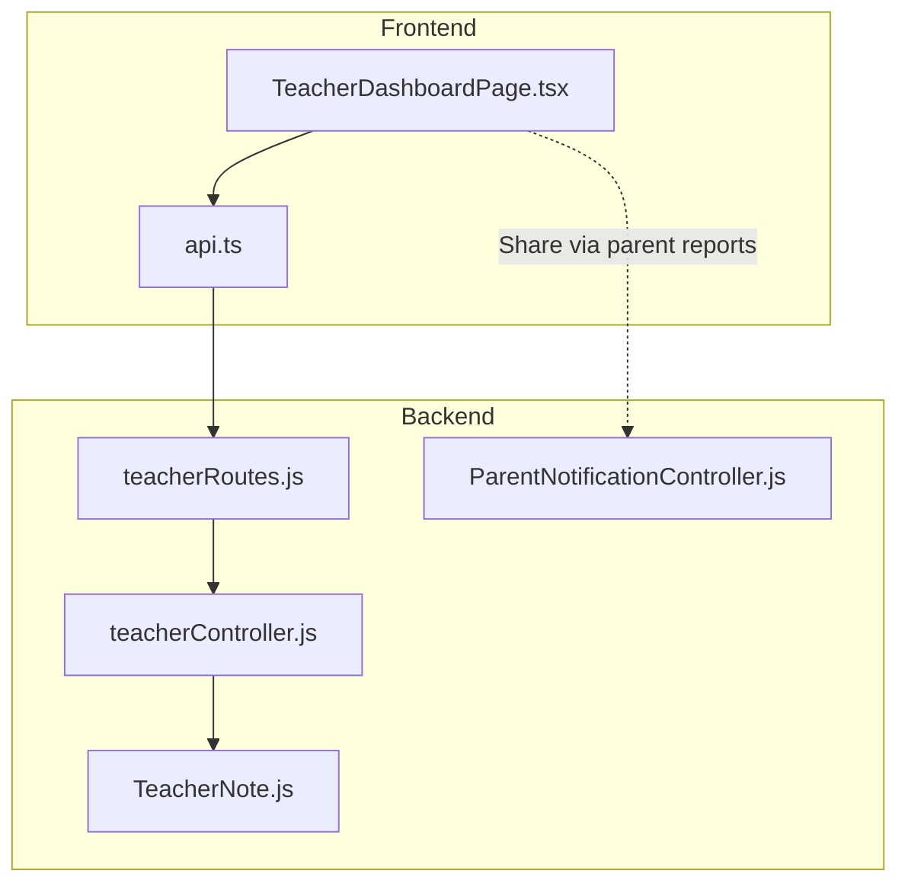
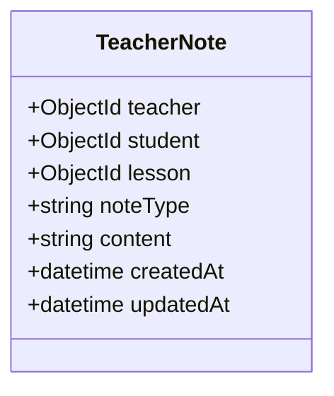
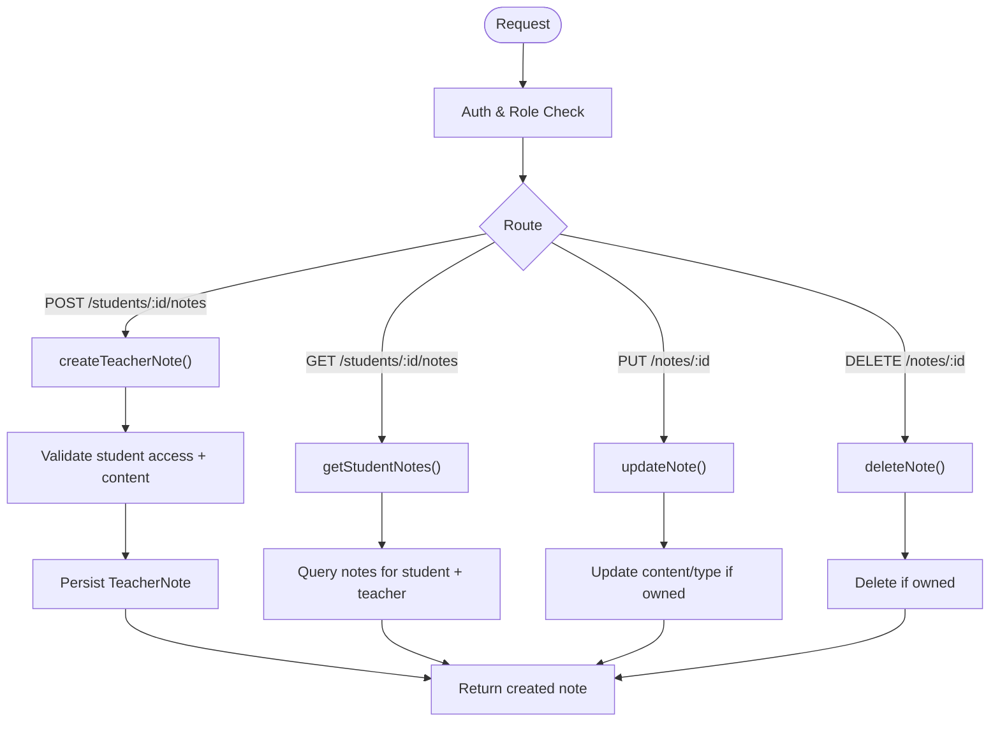
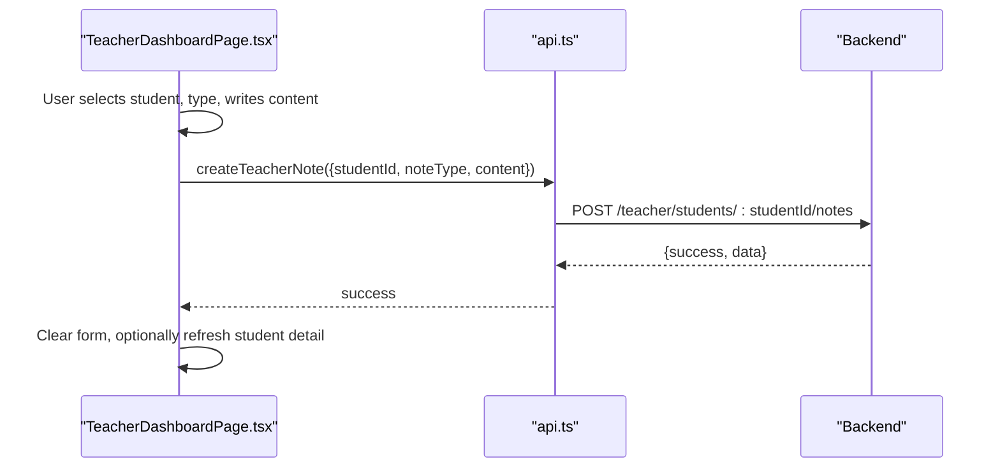
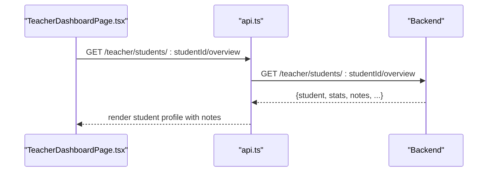
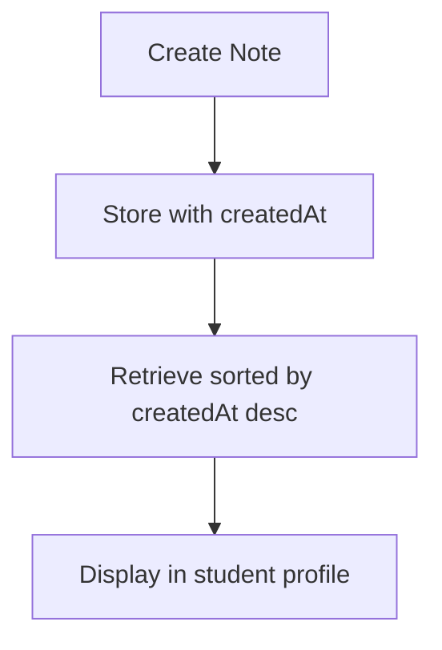
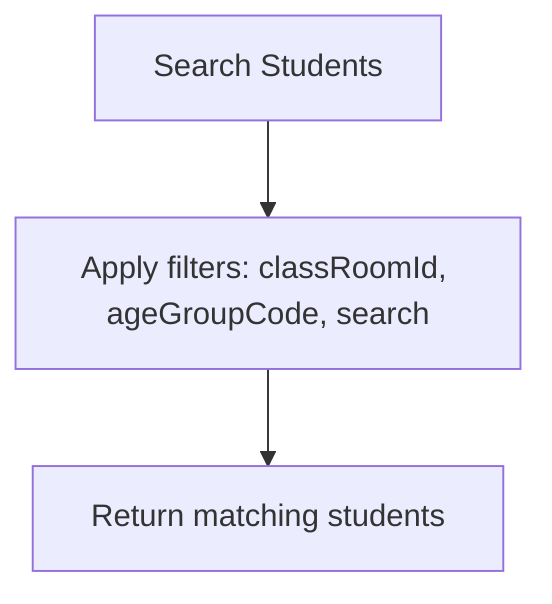
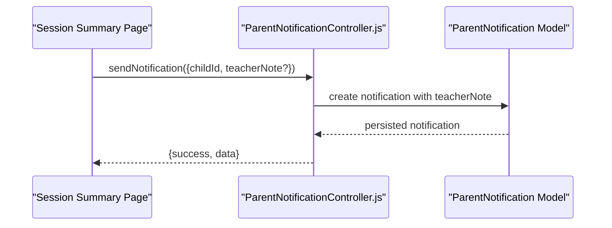
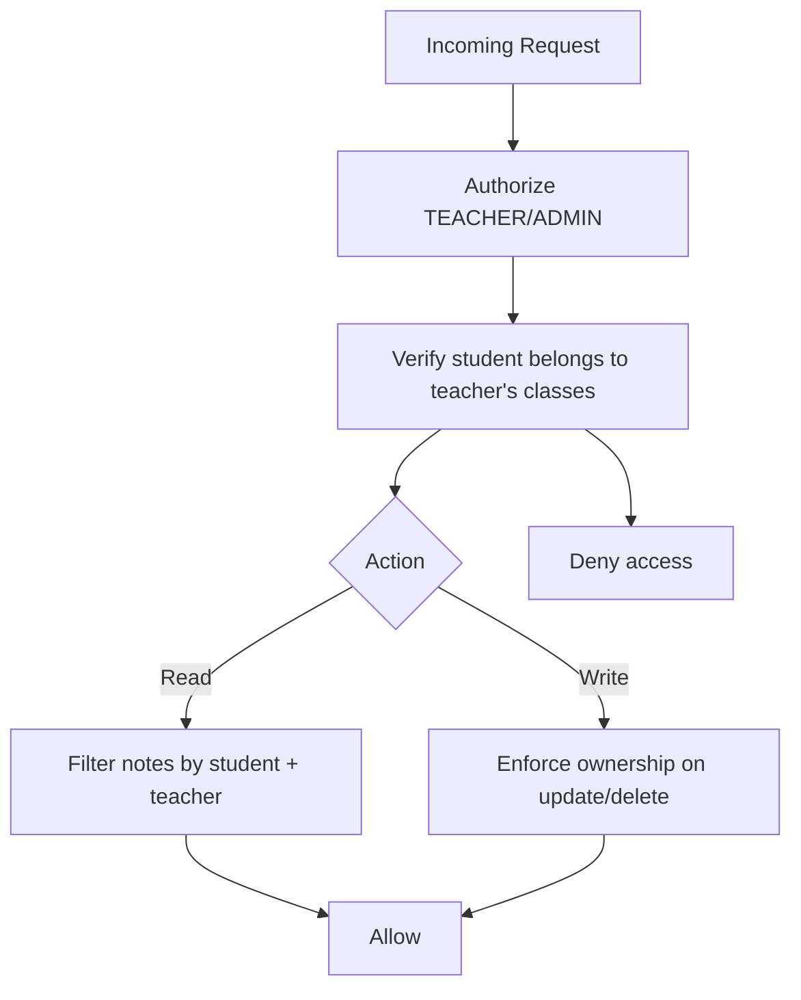
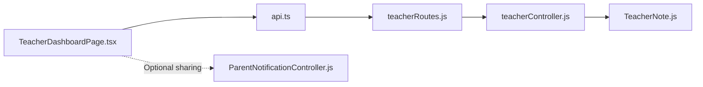

# Pedagogical Notes System

<cite>
**Referenced Files in This Document**
- [TeacherNote.js](file://KCEnglishKids_BE/src/models/TeacherNote.js)
- [teacherController.js](file://KCEnglishKids_BE/src/controllers/teacherController.js)
- [teacherRoutes.js](file://KCEnglishKids_BE/src/routes/teacherRoutes.js)
- [api.ts](file://client/src/services/api.ts)
- [TeacherDashboardPage.tsx](file://client/src/dashboards/teacher/TeacherDashboardPage.tsx)
- [ParentNotificationController.js](file://KCEnglishKids_BE/src/controllers/parentNotificationController.js)
</cite>

## Table of Contents
1. [Introduction](#introduction)
2. [Project Structure](#project-structure)
3. [Core Components](#core-components)
4. [Architecture Overview](#architecture-overview)
5. [Detailed Component Analysis](#detailed-component-analysis)
6. [Dependency Analysis](#dependency-analysis)
7. [Performance Considerations](#performance-considerations)
8. [Troubleshooting Guide](#troubleshooting-guide)
9. [Conclusion](#conclusion)

## Introduction
This document explains the pedagogical notes system used by teachers to record observations and assessments about students. It covers note categorization, creation and editing interfaces, student association, history tracking, search capabilities, integration with student profiles, export/sharing options for parents or other educators, and privacy controls for sensitive educational observations.

## Project Structure
The notes feature spans backend models, controllers, routes, and frontend components:
- Backend model defines the note schema and allowed categories.
- Controller implements validation, authorization, CRUD operations, and retrieval of notes per student.
- Routes expose REST endpoints for creating, reading, updating, and deleting notes.
- Frontend provides a teacher dashboard form to create notes and a student drilldown view to display saved notes.
- Parent notification controller supports sharing learning updates (including optional teacher notes) with parents.



**Diagram sources**
- [TeacherDashboardPage.tsx](file://client/src/dashboards/teacher/TeacherDashboardPage.tsx)
- [api.ts](file://client/src/services/api.ts)
- [teacherRoutes.js](file://KCEnglishKids_BE/src/routes/teacherRoutes.js)
- [teacherController.js](file://KCEnglishKids_BE/src/controllers/teacherController.js)
- [TeacherNote.js](file://KCEnglishKids_BE/src/models/TeacherNote.js)
- [ParentNotificationController.js](file://KCEnglishKids_BE/src/controllers/parentNotificationController.js)

**Section sources**
- [TeacherNote.js:1-34](file://KCEnglishKids_BE/src/models/TeacherNote.js#L1-L34)
- [teacherController.js:1-79](file://KCEnglishKids_BE/src/controllers/teacherController.js#L1-L79)
- [teacherRoutes.js:1-50](file://KCEnglishKids_BE/src/routes/teacherRoutes.js#L1-L50)
- [api.ts:205-239](file://client/src/services/api.ts#L205-L239)
- [TeacherDashboardPage.tsx:79-100](file://client/src/dashboards/teacher/TeacherDashboardPage.tsx#L79-L100)

## Core Components
- Note data model: stores teacher, student, optional lesson, category, content, and timestamps.
- Teacher controller: validates inputs, enforces access control, persists notes, and returns histories.
- Teacher routes: define REST endpoints for notes and student overview including notes.
- Frontend dashboard: provides note creation UI and displays notes within student profile drilldown.
- Parent notifications: allows sending learning updates that can include teacher notes as part of shared reports.

Key responsibilities:
- Categorization: predefined types for structured observation.
- Creation interface: select student, choose type, write content, submit.
- Student association: notes are linked to a specific child and optionally a lesson.
- History tracking: notes are returned sorted by creation time; student overview aggregates them.
- Search: student listing supports name/username search; notes themselves do not have dedicated server-side search.
- Integration: student overview includes notes alongside progress and activities.
- Export/share: parent notification system can include teacher notes when sending reports.
- Privacy: notes are scoped to the requesting teacher and only accessible for children in the teacher’s classes.

**Section sources**
- [TeacherNote.js:3-31](file://KCEnglishKids_BE/src/models/TeacherNote.js#L3-L31)
- [teacherController.js:74-77](file://KCEnglishKids_BE/src/controllers/teacherController.js#L74-L77)
- [teacherRoutes.js:33-37](file://KCEnglishKids_BE/src/routes/teacherRoutes.js#L33-L37)
- [TeacherDashboardPage.tsx:278-307](file://client/src/dashboards/teacher/TeacherDashboardPage.tsx#L278-L307)
- [ParentNotificationController.js:15-99](file://KCEnglishKids_BE/src/controllers/parentNotificationController.js#L15-L99)

## Architecture Overview
The pedagogical notes flow from the teacher dashboard to the backend and database, with optional sharing through parent notifications.

```mermaid
sequenceDiagram
participant TeacherUI as "Teacher Dashboard"
participant ClientAPI as "Client API Layer"
participant Router as "Teacher Routes"
participant Ctrl as "Teacher Controller"
participant DB as "TeacherNote Model"
participant ParentNotify as "Parent Notification Controller"
TeacherUI->>ClientAPI : Create note (studentId, noteType, content)
ClientAPI->>Router : POST /teacher/students/ : studentId/notes
Router->>Ctrl : createTeacherNote()
Ctrl->>DB : create({teacher, student, lesson?, noteType, content})
DB-->>Ctrl : persisted note
Ctrl-->>ClientAPI : {success, data}
ClientAPI-->>TeacherUI : success
Note : Notes appear in student overview
TeacherUI->>ClientAPI : GET /teacher/students/ : studentId/overview
ClientAPI->>Router : GET /teacher/students/ : studentId/overview
Router->>Ctrl : getStudentOverview()
Ctrl->>DB : find notes for student + teacher
DB-->>Ctrl : notes[]
Ctrl-->>ClientAPI : {student, stats, notes, ...}
ClientAPI-->>TeacherUI : render notes list
Optional : Share via parent report
TeacherUI->>ParentNotify : sendNotification(teacherNote?)
ParentNotify->>DB : create ParentNotification
ParentNotify-->>TeacherUI : {success, data}
```

**Diagram sources**
- [teacherRoutes.js:33-37](file://KCEnglishKids_BE/src/routes/teacherRoutes.js#L33-L37)
- [teacherController.js:54-56](file://KCEnglishKids_BE/src/controllers/teacherController.js#L54-L56)
- [teacherController.js:74-77](file://KCEnglishKids_BE/src/controllers/teacherController.js#L74-L77)
- [ParentNotificationController.js:15-99](file://KCEnglishKids_BE/src/controllers/parentNotificationController.js#L15-L99)

## Detailed Component Analysis

### Data Model: TeacherNote
- Fields:
  - teacher: reference to User (the authoring teacher).
  - student: reference to User (the observed child).
  - lesson: optional reference to Lesson.
  - noteType: enum of predefined categories.
  - content: trimmed text of the observation.
  - timestamps: createdAt, updatedAt.

Predefined categories supported by the model:
- INTEREST
- VOCABULARY
- PARTICIPATION
- LISTENING
- SPEAKING
- STRENGTH
- DIFFICULTY
- REINFORCEMENT
- GENERAL

Pedagogically relevant categories requested in the objective:
- Interest: INTEREST
- Vocabulary retention: VOCABULARY
- Participation: PARTICIPATION
- Reinforcement needs: REINFORCEMENT



**Diagram sources**
- [TeacherNote.js:3-31](file://KCEnglishKids_BE/src/models/TeacherNote.js#L3-L31)

**Section sources**
- [TeacherNote.js:1-34](file://KCEnglishKids_BE/src/models/TeacherNote.js#L1-L34)

### API Endpoints for Notes
- POST /teacher/students/:studentId/notes — create a note for a student (body includes studentId, lessonId?, noteType, content).
- POST /teacher/notes — alternative create endpoint without path-bound studentId.
- GET /teacher/students/:studentId/notes — retrieve notes for a student authored by the current teacher.
- PUT /teacher/notes/:id — update an existing note (content, noteType).
- DELETE /teacher/notes/:id — delete an existing note.

All endpoints require authentication and authorization for TEACHER or ADMIN roles.



**Diagram sources**
- [teacherRoutes.js:33-37](file://KCEnglishKids_BE/src/routes/teacherRoutes.js#L33-L37)
- [teacherController.js:74-77](file://KCEnglishKids_BE/src/controllers/teacherController.js#L74-L77)

**Section sources**
- [teacherRoutes.js:33-37](file://KCEnglishKids_BE/src/routes/teacherRoutes.js#L33-L37)
- [teacherController.js:74-77](file://KCEnglishKids_BE/src/controllers/teacherController.js#L74-L77)

### Frontend: Note Creation Interface
- The teacher dashboard includes a form with:
  - Student selector.
  - Note type dropdown with pedagogical categories.
  - Content textarea.
  - Submit button to save the note.
- On successful submission, the UI clears the content and refreshes the student detail if open.



**Diagram sources**
- [TeacherDashboardPage.tsx:278-307](file://client/src/dashboards/teacher/TeacherDashboardPage.tsx#L278-L307)
- [api.ts:205-239](file://client/src/services/api.ts#L205-L239)

**Section sources**
- [TeacherDashboardPage.tsx:79-100](file://client/src/dashboards/teacher/TeacherDashboardPage.tsx#L79-L100)
- [TeacherDashboardPage.tsx:983-1025](file://client/src/dashboards/teacher/TeacherDashboardPage.tsx#L983-L1025)
- [api.ts:205-239](file://client/src/services/api.ts#L205-L239)

### Student Association and Profile Integration
- Notes are associated with a student and optionally a lesson.
- The student overview endpoint returns notes along with progress, recent activities, sessions, and assignments.
- In the student drilldown modal, notes are displayed with their category label and date.



**Diagram sources**
- [teacherController.js:54-56](file://KCEnglishKids_BE/src/controllers/teacherController.js#L54-L56)
- [TeacherDashboardPage.tsx:1111-1142](file://client/src/dashboards/teacher/TeacherDashboardPage.tsx#L1111-L1142)

**Section sources**
- [teacherController.js:54-56](file://KCEnglishKids_BE/src/controllers/teacherController.js#L54-L56)
- [TeacherDashboardPage.tsx:1111-1142](file://client/src/dashboards/teacher/TeacherDashboardPage.tsx#L1111-L1142)

### Note History Tracking
- Notes are stored with timestamps and retrieved sorted by creation time descending.
- The student overview aggregates notes for the current teacher and the selected student, enabling historical review.



**Diagram sources**
- [TeacherNote.js:29-31](file://KCEnglishKids_BE/src/models/TeacherNote.js#L29-L31)
- [teacherController.js:75](file://KCEnglishKids_BE/src/controllers/teacherController.js#L75)

**Section sources**
- [TeacherNote.js:29-31](file://KCEnglishKids_BE/src/models/TeacherNote.js#L29-L31)
- [teacherController.js:75](file://KCEnglishKids_BE/src/controllers/teacherController.js#L75)

### Search Functionality
- Student listing supports filtering by class, age group, and searching by name or username.
- Notes themselves do not have dedicated server-side search endpoints; they are viewed per student.



**Diagram sources**
- [teacherController.js:50-52](file://KCEnglishKids_BE/src/controllers/teacherController.js#L50-L52)

**Section sources**
- [teacherController.js:50-52](file://KCEnglishKids_BE/src/controllers/teacherController.js#L50-L52)

### Export Capabilities and Sharing with Parents/Educators
- The parent notification system allows sending learning updates that can include a teacher note field.
- While notes are private to the teacher and student context, teachers can compose a message (teacherNote) when sending session reports or progress updates to parents.



**Diagram sources**
- [ParentNotificationController.js:15-99](file://KCEnglishKids_BE/src/controllers/parentNotificationController.js#L15-L99)

**Section sources**
- [ParentNotificationController.js:15-99](file://KCEnglishKids_BE/src/controllers/parentNotificationController.js#L15-L99)

### Privacy Controls for Sensitive Observations
- Access control:
  - All note endpoints are protected and restricted to TEACHER or ADMIN roles.
  - Student access is validated: only children assigned to the teacher’s classes are accessible.
- Ownership:
  - Notes are scoped to the requesting teacher; users cannot edit/delete others’ notes.
- Data scoping:
  - Retrieval of notes is filtered by both student and teacher IDs.



**Diagram sources**
- [teacherRoutes.js:8](file://KCEnglishKids_BE/src/routes/teacherRoutes.js#L8)
- [teacherController.js:8](file://KCEnglishKids_BE/src/controllers/teacherController.js#L8)
- [teacherController.js:75-77](file://KCEnglishKids_BE/src/controllers/teacherController.js#L75-L77)

**Section sources**
- [teacherRoutes.js:8](file://KCEnglishKids_BE/src/routes/teacherRoutes.js#L8)
- [teacherController.js:8](file://KCEnglishKids_BE/src/controllers/teacherController.js#L8)
- [teacherController.js:75-77](file://KCEnglishKids_BE/src/controllers/teacherController.js#L75-L77)

## Dependency Analysis
- Frontend depends on client API layer for HTTP calls.
- Client API layer calls teacher routes.
- Teacher routes delegate to teacher controller.
- Teacher controller uses TeacherNote model and related models (User, Lesson) for population.
- Parent notification controller is independent but can be used to share teacher notes as part of messages.



**Diagram sources**
- [TeacherDashboardPage.tsx](file://client/src/dashboards/teacher/TeacherDashboardPage.tsx)
- [api.ts](file://client/src/services/api.ts)
- [teacherRoutes.js](file://KCEnglishKids_BE/src/routes/teacherRoutes.js)
- [teacherController.js](file://KCEnglishKids_BE/src/controllers/teacherController.js)
- [TeacherNote.js](file://KCEnglishKids_BE/src/models/TeacherNote.js)
- [ParentNotificationController.js](file://KCEnglishKids_BE/src/controllers/parentNotificationController.js)

**Section sources**
- [teacherController.js:1-3](file://KCEnglishKids_BE/src/controllers/teacherController.js#L1-L3)
- [teacherRoutes.js:1-8](file://KCEnglishKids_BE/src/routes/teacherRoutes.js#L1-L8)

## Performance Considerations
- Use pagination or limits when retrieving large sets of notes per student to avoid heavy payloads.
- Index fields frequently queried (e.g., student, teacher, createdAt) to optimize lookups.
- Avoid unnecessary population of lesson data if not needed in all views.
- Cache student overview responses at the edge or application layer where appropriate.

[No sources needed since this section provides general guidance]

## Troubleshooting Guide
Common issues and resolutions:
- “A permitted child and note content are required.”
  - Ensure the selected student belongs to the teacher’s classes and content is non-empty.
- “You do not have access to this child.”
  - Verify the student is assigned to one of the teacher’s classes.
- “You can only edit/delete your own note.”
  - Confirm the note was created by the current teacher account.

Operational checks:
- Validate role and permissions at route level.
- Confirm student existence and assignment before creating notes.
- Ensure content trimming and validation are applied consistently.

**Section sources**
- [teacherController.js:74-77](file://KCEnglishKids_BE/src/controllers/teacherController.js#L74-L77)

## Conclusion
The pedagogical notes system provides a secure, categorized, and integrated way for teachers to record and manage observations about students. Notes are tied to students and optionally lessons, displayed within student profiles, and protected by strict access controls. While there is no dedicated server-side search for notes, student search helps locate students whose notes can then be reviewed. For sharing, the parent notification system enables teachers to include brief teacher notes in reports sent to parents. Future enhancements could include server-side note search, richer export formats, and granular privacy flags for sensitive observations.