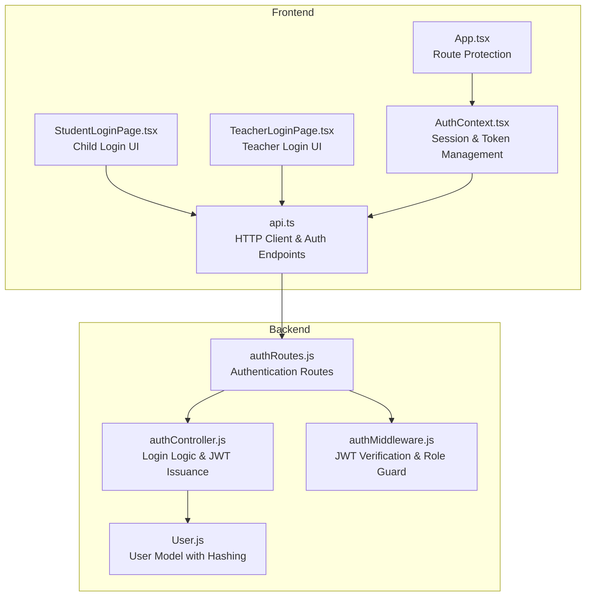
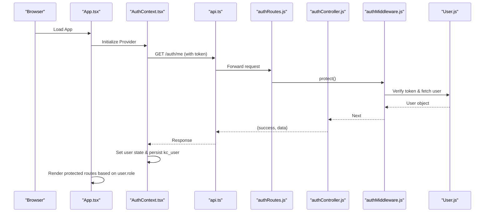
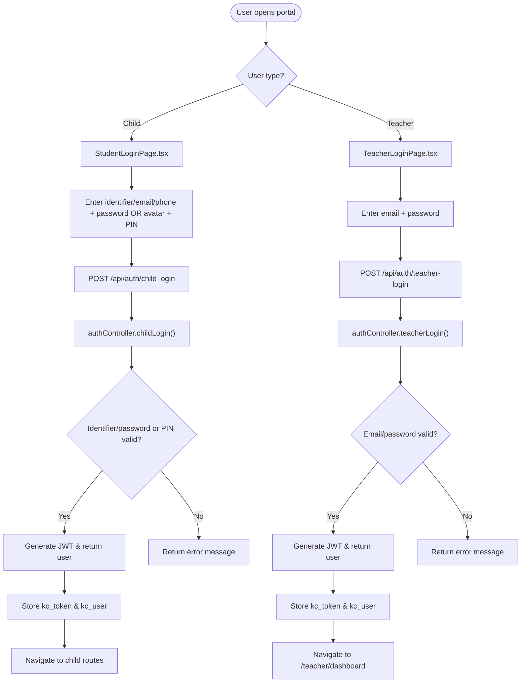
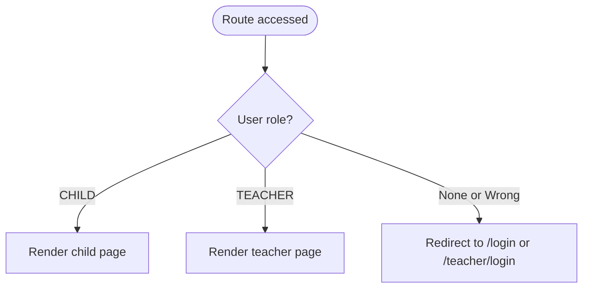
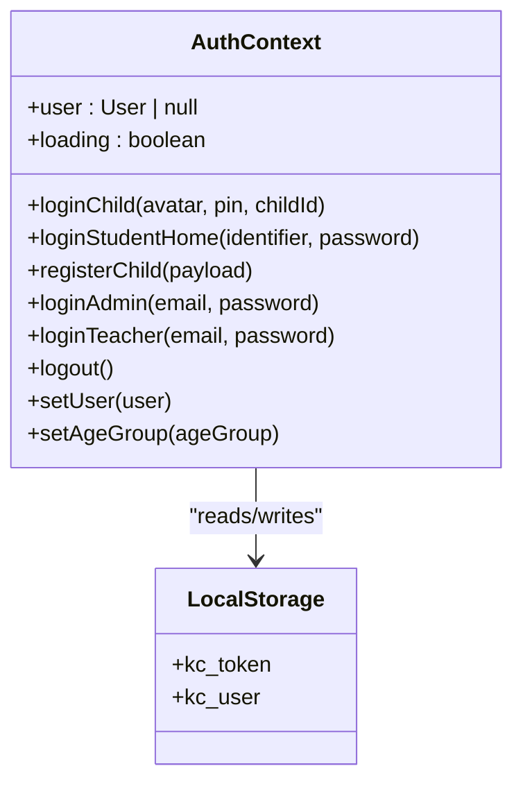
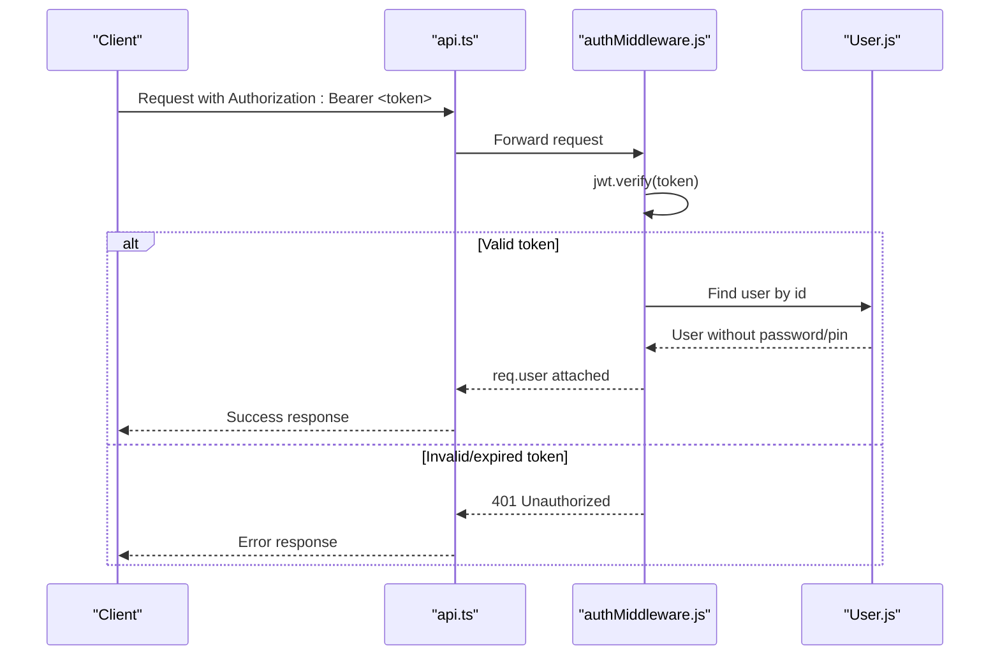
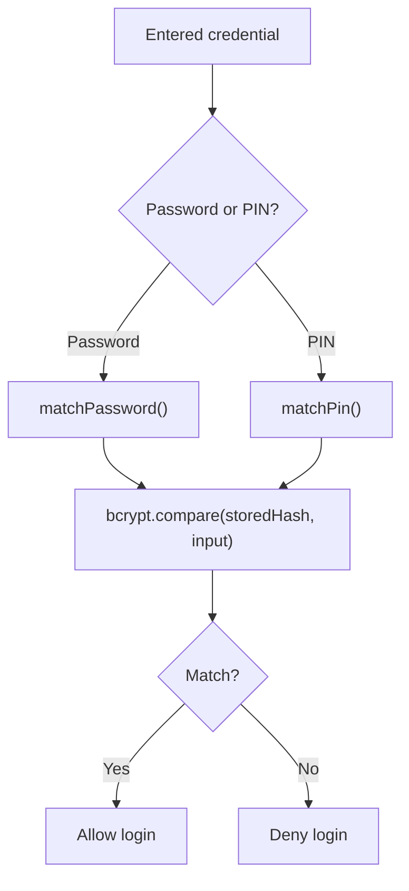
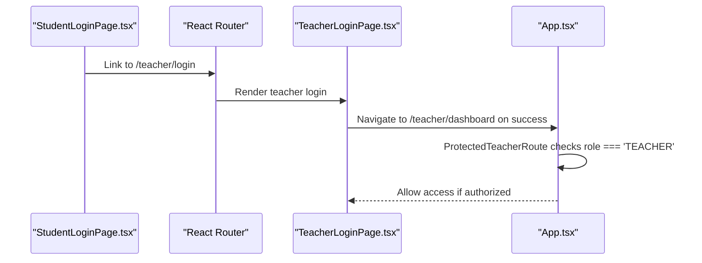
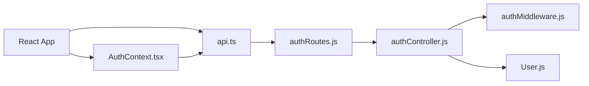

# Teacher Authentication System

<cite>
**Referenced Files in This Document**
- [App.tsx](file://client/src/App.tsx)
- [AuthContext.tsx](file://client/src/context/AuthContext.tsx)
- [StudentLoginPage.tsx](file://client/src/pages/child/StudentLoginPage.tsx)
- [TeacherLoginPage.tsx](file://client/src/dashboards/teacher/TeacherLoginPage.tsx)
- [api.ts](file://client/src/services/api.ts)
- [authController.js](file://KCEnglishKids_BE/src/controllers/authController.js)
- [authRoutes.js](file://KCEnglishKids_BE/src/routes/authRoutes.js)
- [User.js](file://KCEnglishKids_BE/src/models/User.js)
- [authMiddleware.js](file://KCEnglishKids_BE/src/middlewares/authMiddleware.js)
- [index.ts](file://client/src/types/index.ts)
</cite>

## Table of Contents
1. [Introduction](#introduction)
2. [Project Structure](#project-structure)
3. [Core Components](#core-components)
4. [Architecture Overview](#architecture-overview)
5. [Detailed Component Analysis](#detailed-component-analysis)
6. [Dependency Analysis](#dependency-analysis)
7. [Performance Considerations](#performance-considerations)
8. [Troubleshooting Guide](#troubleshooting-guide)
9. [Conclusion](#conclusion)

## Introduction
This document explains the teacher authentication system within the integrated dashboard, focusing on the dual-role authentication flow that supports:
- Child PIN-based or password-based login for the child learning interface
- Teacher email/password authentication for the teacher dashboard

It also documents role-based access control, authentication context management, token handling, session persistence, navigation logic, security considerations, and transitions between user modes.

## Project Structure
The authentication system spans both frontend and backend:
- Frontend React application manages UI flows, stores tokens, and enforces route protection based on user roles
- Backend Express API validates credentials, issues JWTs, and protects sensitive endpoints

**Diagram sources**
- [App.tsx:17-38](file://client/src/App.tsx#L17-L38)
- [AuthContext.tsx:30-61](file://client/src/context/AuthContext.tsx#L30-L61)
- [StudentLoginPage.tsx:51-63](file://client/src/pages/child/StudentLoginPage.tsx#L51-L63)
- [TeacherLoginPage.tsx:17-31](file://client/src/dashboards/teacher/TeacherLoginPage.tsx#L17-L31)
- [api.ts:63-94](file://client/src/services/api.ts#L63-L94)
- [authRoutes.js:15-22](file://KCEnglishKids_BE/src/routes/authRoutes.js#L15-L22)
- [authController.js:31-161](file://KCEnglishKids_BE/src/controllers/authController.js#L31-L161)
- [authMiddleware.js:4-31](file://KCEnglishKids_BE/src/middlewares/authMiddleware.js#L4-L31)
- [User.js:84-106](file://KCEnglishKids_BE/src/models/User.js#L84-L106)

**Section sources**
- [App.tsx:17-38](file://client/src/App.tsx#L17-L38)
- [AuthContext.tsx:30-61](file://client/src/context/AuthContext.tsx#L30-L61)
- [StudentLoginPage.tsx:51-63](file://client/src/pages/child/StudentLoginPage.tsx#L51-L63)
- [TeacherLoginPage.tsx:17-31](file://client/src/dashboards/teacher/TeacherLoginPage.tsx#L17-L31)
- [api.ts:63-94](file://client/src/services/api.ts#L63-L94)
- [authRoutes.js:15-22](file://KCEnglishKids_BE/src/routes/authRoutes.js#L15-L22)
- [authController.js:31-161](file://KCEnglishKids_BE/src/controllers/authController.js#L31-L161)
- [authMiddleware.js:4-31](file://KCEnglishKids_BE/src/middlewares/authMiddleware.js#L4-L31)
- [User.js:84-106](file://KCEnglishKids_BE/src/models/User.js#L84-L106)

## Core Components
- Authentication Context (Client): Manages user state, token storage, and provides login/logout methods for child and teacher roles
- Route Guards (Client): Protect routes by checking user role; redirect to appropriate login pages
- Student Login Page (Client): Supports identifier/password or quick lookup; navigates to child home after success
- Teacher Login Page (Client): Validates email/password; navigates to teacher dashboard after success
- Authentication API (Client): Wraps HTTP calls to backend auth endpoints
- Authentication Controller (Server): Handles child and teacher login, generates JWTs, updates last login timestamps
- Authentication Middleware (Server): Verifies JWT, attaches user to request, checks account status
- User Model (Server): Stores hashed passwords/PINs and exposes verification methods

**Section sources**
- [AuthContext.tsx:6-26](file://client/src/context/AuthContext.tsx#L6-L26)
- [AuthContext.tsx:63-121](file://client/src/context/AuthContext.tsx#L63-L121)
- [App.tsx:17-38](file://client/src/App.tsx#L17-L38)
- [StudentLoginPage.tsx:51-63](file://client/src/pages/child/StudentLoginPage.tsx#L51-L63)
- [TeacherLoginPage.tsx:17-31](file://client/src/dashboards/teacher/TeacherLoginPage.tsx#L17-L31)
- [api.ts:63-94](file://client/src/services/api.ts#L63-L94)
- [authController.js:31-161](file://KCEnglishKids_BE/src/controllers/authController.js#L31-L161)
- [authController.js:217-266](file://KCEnglishKids_BE/src/controllers/authController.js#L217-L266)
- [authMiddleware.js:4-31](file://KCEnglishKids_BE/src/middlewares/authMiddleware.js#L4-L31)
- [User.js:84-106](file://KCEnglishKids_BE/src/models/User.js#L84-L106)

## Architecture Overview
The authentication architecture follows a standard client-server pattern with JWT-based sessions:
- The client stores tokens and user info in localStorage
- On app load, the client verifies the token via /auth/me
- Protected routes enforce role checks before rendering
- Server middleware validates incoming requests and ensures active accounts

**Diagram sources**
- [AuthContext.tsx:37-61](file://client/src/context/AuthContext.tsx#L37-L61)
- [api.ts:11-30](file://client/src/services/api.ts#L11-L30)
- [authRoutes.js:20-21](file://KCEnglishKids_BE/src/routes/authRoutes.js#L20-L21)
- [authMiddleware.js:4-31](file://KCEnglishKids_BE/src/middlewares/authMiddleware.js#L4-L31)
- [authController.js:268-285](file://KCEnglishKids_BE/src/controllers/authController.js#L268-L285)

## Detailed Component Analysis

### Dual-Role Authentication Flow
There are two primary authentication paths:
- Child login: Identifier/password or avatar+PIN
- Teacher login: Email/password

**Diagram sources**
- [StudentLoginPage.tsx:51-63](file://client/src/pages/child/StudentLoginPage.tsx#L51-L63)
- [TeacherLoginPage.tsx:17-31](file://client/src/dashboards/teacher/TeacherLoginPage.tsx#L17-L31)
- [api.ts:63-94](file://client/src/services/api.ts#L63-L94)
- [authController.js:31-161](file://KCEnglishKids_BE/src/controllers/authController.js#L31-L161)
- [authController.js:217-266](file://KCEnglishKids_BE/src/controllers/authController.js#L217-L266)

**Section sources**
- [StudentLoginPage.tsx:51-63](file://client/src/pages/child/StudentLoginPage.tsx#L51-L63)
- [TeacherLoginPage.tsx:17-31](file://client/src/dashboards/teacher/TeacherLoginPage.tsx#L17-L31)
- [api.ts:63-94](file://client/src/services/api.ts#L63-L94)
- [authController.js:31-161](file://KCEnglishKids_BE/src/controllers/authController.js#L31-L161)
- [authController.js:217-266](file://KCEnglishKids_BE/src/controllers/authController.js#L217-L266)

### Role-Based Access Control and Navigation
- ProtectedChildRoute allows only users with role CHILD
- ProtectedTeacherRoute allows only users with role TEACHER
- Unauthenticated or wrong-role users are redirected to appropriate login pages

**Diagram sources**
- [App.tsx:17-38](file://client/src/App.tsx#L17-L38)

**Section sources**
- [App.tsx:17-38](file://client/src/App.tsx#L17-L38)

### Authentication Context Management and Session Persistence
- The AuthProvider initializes user from localStorage
- On app start, it verifies the stored token via /auth/me
- On successful login, it persists kc_token and kc_user in localStorage
- Logout clears stored tokens and resets user state

**Diagram sources**
- [AuthContext.tsx:30-61](file://client/src/context/AuthContext.tsx#L30-L61)
- [AuthContext.tsx:63-121](file://client/src/context/AuthContext.tsx#L63-L121)
- [AuthContext.tsx:130-134](file://client/src/context/AuthContext.tsx#L130-L134)

**Section sources**
- [AuthContext.tsx:30-61](file://client/src/context/AuthContext.tsx#L30-L61)
- [AuthContext.tsx:63-121](file://client/src/context/AuthContext.tsx#L63-L121)
- [AuthContext.tsx:130-134](file://client/src/context/AuthContext.tsx#L130-L134)

### Token Handling and Security
- Tokens are JWTs signed with a secret key and set to expire after a fixed period
- The client includes the token in Authorization headers for protected requests
- The server middleware verifies tokens and rejects invalid/expired ones
- Sensitive fields like password and PIN are excluded from returned user objects

**Diagram sources**
- [api.ts:3-9](file://client/src/services/api.ts#L3-L9)
- [authMiddleware.js:4-31](file://KCEnglishKids_BE/src/middlewares/authMiddleware.js#L4-L31)
- [authController.js:268-285](file://KCEnglishKids_BE/src/controllers/authController.js#L268-L285)

**Section sources**
- [api.ts:3-9](file://client/src/services/api.ts#L3-L9)
- [authMiddleware.js:4-31](file://KCEnglishKids_BE/src/middlewares/authMiddleware.js#L4-L31)
- [authController.js:268-285](file://KCEnglishKids_BE/src/controllers/authController.js#L268-L285)

### Password Validation and PIN Handling
- Child login supports both password and PIN verification
- PIN must be exactly four digits when changing or validating
- Passwords and PINs are hashed using bcrypt before storage
- Verification methods compare entered values against stored hashes

**Diagram sources**
- [authController.js:59-73](file://KCEnglishKids_BE/src/controllers/authController.js#L59-L73)
- [authController.js:128-134](file://KCEnglishKids_BE/src/controllers/authController.js#L128-L134)
- [authController.js:374-422](file://KCEnglishKids_BE/src/controllers/authController.js#L374-L422)
- [User.js:84-106](file://KCEnglishKids_BE/src/models/User.js#L84-L106)

**Section sources**
- [authController.js:59-73](file://KCEnglishKids_BE/src/controllers/authController.js#L59-L73)
- [authController.js:128-134](file://KCEnglishKids_BE/src/controllers/authController.js#L128-L134)
- [authController.js:374-422](file://KCEnglishKids_BE/src/controllers/authController.js#L374-L422)
- [User.js:84-106](file://KCEnglishKids_BE/src/models/User.js#L84-L106)

### Transition Between User Modes
- From student login, users can navigate to the teacher login portal
- After successful teacher login, users are redirected to the teacher dashboard
- If a child is logged in and attempts to access teacher routes, they are redirected to the teacher login

**Diagram sources**
- [StudentLoginPage.tsx:104-111](file://client/src/pages/child/StudentLoginPage.tsx#L104-L111)
- [TeacherLoginPage.tsx:23-31](file://client/src/dashboards/teacher/TeacherLoginPage.tsx#L23-L31)
- [App.tsx:33-38](file://client/src/App.tsx#L33-L38)

**Section sources**
- [StudentLoginPage.tsx:104-111](file://client/src/pages/child/StudentLoginPage.tsx#L104-L111)
- [TeacherLoginPage.tsx:23-31](file://client/src/dashboards/teacher/TeacherLoginPage.tsx#L23-L31)
- [App.tsx:33-38](file://client/src/App.tsx#L33-L38)

## Dependency Analysis
The authentication system has clear separation of concerns:
- Frontend components depend on AuthContext for state and api.ts for network calls
- Backend routes delegate to controllers, which use models and middlewares for validation and security

**Diagram sources**
- [AuthContext.tsx:1-5](file://client/src/context/AuthContext.tsx#L1-L5)
- [api.ts:63-94](file://client/src/services/api.ts#L63-L94)
- [authRoutes.js:1-22](file://KCEnglishKids_BE/src/routes/authRoutes.js#L1-L22)
- [authController.js:1-10](file://KCEnglishKids_BE/src/controllers/authController.js#L1-L10)
- [authMiddleware.js:1-3](file://KCEnglishKids_BE/src/middlewares/authMiddleware.js#L1-L3)
- [User.js:1-3](file://KCEnglishKids_BE/src/models/User.js#L1-L3)

**Section sources**
- [AuthContext.tsx:1-5](file://client/src/context/AuthContext.tsx#L1-L5)
- [api.ts:63-94](file://client/src/services/api.ts#L63-L94)
- [authRoutes.js:1-22](file://KCEnglishKids_BE/src/routes/authRoutes.js#L1-L22)
- [authController.js:1-10](file://KCEnglishKids_BE/src/controllers/authController.js#L1-L10)
- [authMiddleware.js:1-3](file://KCEnglishKids_BE/src/middlewares/authMiddleware.js#L1-L3)
- [User.js:1-3](file://KCEnglishKids_BE/src/models/User.js#L1-L3)

## Performance Considerations
- Token verification on app startup avoids unnecessary re-authentication
- Storing user profile locally reduces repeated profile fetches
- Avoid sending sensitive fields in responses to reduce payload size
- Use minimal queries in authentication flows to minimize database load

[No sources needed since this section provides general guidance]

## Troubleshooting Guide
Common issues and resolutions:
- Invalid or expired token: Ensure the Authorization header is present and the token is not expired
- Account deactivated or locked: Check user status in the database; reactivate if necessary
- Incorrect credentials: Verify email/password for teachers or identifier/password/PIN for children
- Missing required fields: Ensure all required inputs are provided during login

**Section sources**
- [authMiddleware.js:4-31](file://KCEnglishKids_BE/src/middlewares/authMiddleware.js#L4-L31)
- [authController.js:52-73](file://KCEnglishKids_BE/src/controllers/authController.js#L52-L73)
- [authController.js:121-134](file://KCEnglishKids_BE/src/controllers/authController.js#L121-L134)
- [authController.js:231-244](file://KCEnglishKids_BE/src/controllers/authController.js#L231-L244)

## Conclusion
The teacher authentication system integrates child and teacher login flows into a unified dashboard with robust role-based access control. It uses JWT-based sessions, secure password and PIN hashing, and clear navigation logic to guide users to the appropriate interfaces. Proper error handling and session persistence ensure a smooth user experience while maintaining security.

[No sources needed since this section summarizes without analyzing specific files]