# Teacher Dashboard Integration

<cite>
**Referenced Files in This Document**   
- [App.tsx](file://client/src/App.tsx)
- [AuthContext.tsx](file://client/src/context/AuthContext.tsx)
- [api.ts](file://client/src/services/api.ts)
- [index.ts](file://client/src/types/index.ts)
- [TeacherDashboardPage.tsx](file://client/src/dashboards/teacher/TeacherDashboardPage.tsx)
- [TeacherWorkspace.tsx](file://client/src/dashboards/teacher/TeacherWorkspace.tsx)
- [ClassroomSessionSetup.tsx](file://client/src/dashboards/teacher/ClassroomSessionSetup.tsx)
- [ClassroomSessionsList.tsx](file://client/src/dashboards/teacher/ClassroomSessionsList.tsx)
- [LiveSessionPage.tsx](file://client/src/dashboards/teacher/LiveSessionPage.tsx)
- [SessionSummaryPage.tsx](file://client/src/dashboards/teacher/SessionSummaryPage.tsx)
- [TeacherLoginPage.tsx](file://client/src/dashboards/teacher/TeacherLoginPage.tsx)
</cite>

## Table of Contents
1. [Introduction](#introduction)
2. [Project Structure](#project-structure)
3. [Core Components](#core-components)
4. [Architecture Overview](#architecture-overview)
5. [Detailed Component Analysis](#detailed-component-analysis)
6. [Dependency Analysis](#dependency-analysis)
7. [Performance Considerations](#performance-considerations)
8. [Troubleshooting Guide](#troubleshooting-guide)
9. [Conclusion](#conclusion)

## Introduction
This document explains the teacher dashboard integrated into the main application. It covers dual-role authentication for child and teacher users, classroom management, session scheduling, real-time student monitoring, workspace layout, data visualization, interactive controls, responsive design, separation between educational content and administrative functions, and state management patterns for concurrent roles and sessions.

The system supports:
- Child learning mode with protected routes and vocabulary mastery synchronization.
- Teacher administration mode with class rosters, assignments, curriculum browsing, live session control, and post-session reporting.
- A clear transition path between child portal and teacher portal.

## Project Structure
The teacher dashboard is part of a React frontend that shares one global authentication context and routes both child and teacher experiences. The key areas are:
- Routing and role protection in the application shell.
- Authentication context managing child, teacher, and admin login flows.
- API service layer wrapping backend endpoints.
- Typed data models for users, lessons, activities, and classroom sessions.
- Teacher-specific pages and components for dashboard, classes, sessions, live teaching, and summaries.

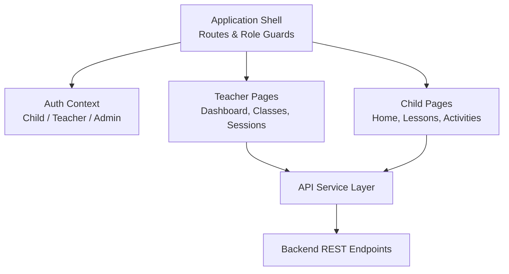

**Diagram sources**
- [App.tsx:17-38](file://client/src/App.tsx#L17-L38)
- [App.tsx:40-130](file://client/src/App.tsx#L40-L130)
- [AuthContext.tsx:30-61](file://client/src/context/AuthContext.tsx#L30-L61)
- [api.ts:1-61](file://client/src/services/api.ts#L1-L61)

**Section sources**
- [App.tsx:17-38](file://client/src/App.tsx#L17-L38)
- [App.tsx:40-130](file://client/src/App.tsx#L40-L130)
- [AuthContext.tsx:30-61](file://client/src/context/AuthContext.tsx#L30-L61)
- [api.ts:1-61](file://client/src/services/api.ts#L1-L61)

## Core Components
- Dual-role authentication:
  - Child login via PIN or identifier/password.
  - Teacher login via email/password.
  - Admin login via email/password.
  - Session verification on app start using stored token.
- Protected routes:
  - Child routes require role CHILD.
  - Teacher routes require role TEACHER.
- API service:
  - Centralized fetch wrapper with Authorization header injection.
  - Domain-scoped clients: auth, teacher, classroom session, parent notifications, etc.
- Types:
  - Shared TypeScript interfaces for User, Lesson, Activity, ClassroomSession, and related entities.

Key responsibilities:
- AuthContext persists tokens and user profiles across refreshes and initializes vocabulary mastery sync for children.
- App.tsx enforces route-level access control and organizes teacher and child UI trees.
- api.ts defines all HTTP operations used by dashboards and learning features.
- types/index.ts provides strict contracts for session scoring, results, and notifications.

**Section sources**
- [AuthContext.tsx:6-26](file://client/src/context/AuthContext.tsx#L6-L26)
- [AuthContext.tsx:30-61](file://client/src/context/AuthContext.tsx#L30-L61)
- [AuthContext.tsx:63-121](file://client/src/context/AuthContext.tsx#L63-L121)
- [AuthContext.tsx:130-134](file://client/src/context/AuthContext.tsx#L130-L134)
- [App.tsx:17-38](file://client/src/App.tsx#L17-L38)
- [App.tsx:40-130](file://client/src/App.tsx#L40-L130)
- [api.ts:1-61](file://client/src/services/api.ts#L1-L61)
- [api.ts:63-94](file://client/src/services/api.ts#L63-L94)
- [api.ts:192-296](file://client/src/services/api.ts#L192-L296)
- [index.ts:1-15](file://client/src/types/index.ts#L1-L15)
- [index.ts:122-177](file://client/src/types/index.ts#L122-L177)

## Architecture Overview
The teacher dashboard integrates with the main application through shared authentication and routing. The flow from authentication to live session management is as follows:

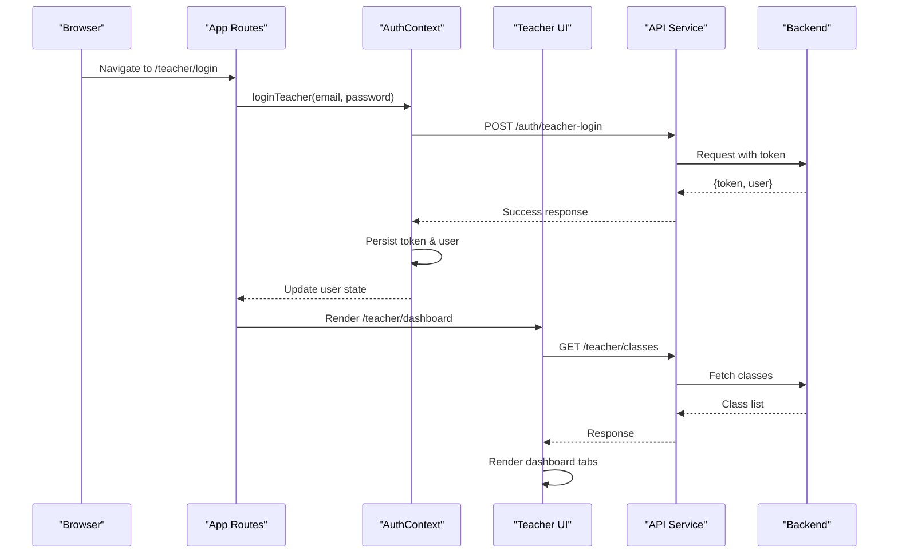

**Diagram sources**
- [App.tsx:96-123](file://client/src/App.tsx#L96-L123)
- [AuthContext.tsx:114-121](file://client/src/context/AuthContext.tsx#L114-L121)
- [api.ts:85-89](file://client/src/services/api.ts#L85-L89)
- [api.ts:192-196](file://client/src/services/api.ts#L192-L196)

## Detailed Component Analysis

### Dual-Role Authentication System
The application supports three roles: CHILD, TEACHER, ADMIN. Authentication is centralized in the context, which:
- Verifies an existing session on startup.
- Stores tokens and user profiles in localStorage.
- Provides login methods for each role.
- Triggers vocabulary mastery synchronization for child users.

Route guards ensure only authorized roles can access their respective sections.

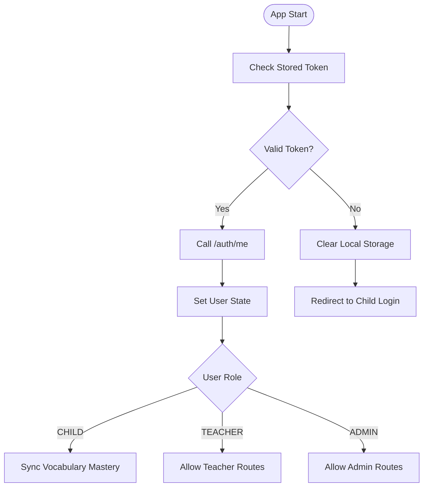

**Diagram sources**
- [AuthContext.tsx:30-61](file://client/src/context/AuthContext.tsx#L30-L61)
- [AuthContext.tsx:63-121](file://client/src/context/AuthContext.tsx#L63-L121)
- [App.tsx:17-38](file://client/src/App.tsx#L17-L38)

**Section sources**
- [AuthContext.tsx:30-61](file://client/src/context/AuthContext.tsx#L30-L61)
- [AuthContext.tsx:63-121](file://client/src/context/AuthContext.tsx#L63-L121)
- [App.tsx:17-38](file://client/src/App.tsx#L17-L38)

### Teacher Workspace Layout
The teacher workspace provides:
- A sidebar navigation for dashboard, classes, sessions, content, assignments, and students.
- Metric cards summarizing assigned classes, total children, active assignments, and attention needs.
- Recent assignments and recent learning sessions lists.
- Consistent header and footer patterns.

It separates administrative tasks (classes, assignments, students) from live session management (sessions list, setup, live page, summary).

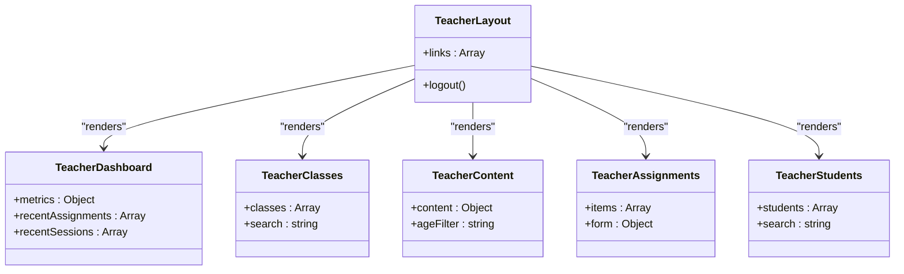

**Diagram sources**
- [TeacherWorkspace.tsx:13-17](file://client/src/dashboards/teacher/TeacherWorkspace.tsx#L13-L17)
- [TeacherWorkspace.tsx:19-39](file://client/src/dashboards/teacher/TeacherWorkspace.tsx#L19-L39)

**Section sources**
- [TeacherWorkspace.tsx:13-17](file://client/src/dashboards/teacher/TeacherWorkspace.tsx#L13-L17)
- [TeacherWorkspace.tsx:19-39](file://client/src/dashboards/teacher/TeacherWorkspace.tsx#L19-L39)

### Classroom Management Interface
The classroom management interface includes:
- Class selection and detail view with student roster.
- Adding/removing students from a class.
- Viewing recent assignments per class.
- Quick links to start a new session.

Data flows:
- Load class details and eligible students.
- Add selected students to the class.
- Remove students with confirmation.

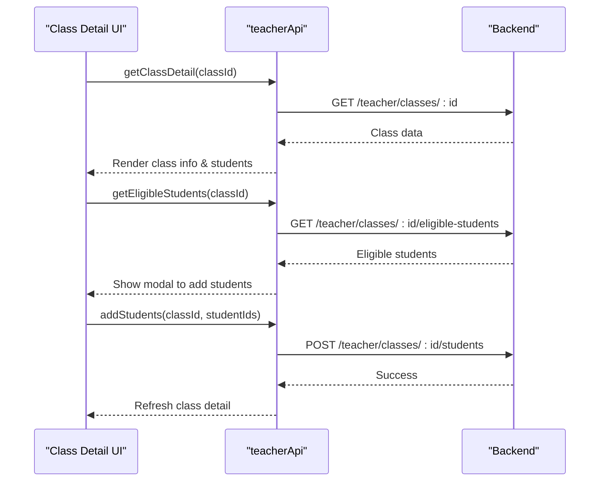

**Diagram sources**
- [TeacherWorkspace.tsx:25-26](file://client/src/dashboards/teacher/TeacherWorkspace.tsx#L25-L26)
- [api.ts:196-200](file://client/src/services/api.ts#L196-L200)

**Section sources**
- [TeacherWorkspace.tsx:25-26](file://client/src/dashboards/teacher/TeacherWorkspace.tsx#L25-L26)
- [api.ts:196-200](file://client/src/services/api.ts#L196-L200)

### Session Scheduling and Setup
The session setup wizard guides teachers through:
- Choosing a lesson filtered by age group.
- Selecting activities associated with the lesson.
- Setting planned duration and title.
- Creating and immediately starting a session.

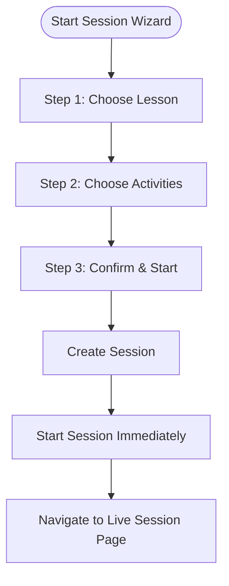

**Diagram sources**
- [ClassroomSessionSetup.tsx:13-27](file://client/src/dashboards/teacher/ClassroomSessionSetup.tsx#L13-L27)
- [ClassroomSessionSetup.tsx:63-83](file://client/src/dashboards/teacher/ClassroomSessionSetup.tsx#L63-L83)
- [api.ts:242-259](file://client/src/services/api.ts#L242-L259)

**Section sources**
- [ClassroomSessionSetup.tsx:13-27](file://client/src/dashboards/teacher/ClassroomSessionSetup.tsx#L13-L27)
- [ClassroomSessionSetup.tsx:63-83](file://client/src/dashboards/teacher/ClassroomSessionSetup.tsx#L63-L83)
- [api.ts:242-259](file://client/src/services/api.ts#L242-L259)

### Real-Time Student Monitoring and Interactive Controls
The live session page provides:
- Three views: presentation (vocabulary flashcards), games (interactive mini-games), grid (student management).
- Bulk scoring and multi-select awarding.
- Random student picker for participation prompts.
- Elapsed time tracking and soft warnings based on planned duration.
- Question result submission and per-student scoring updates.

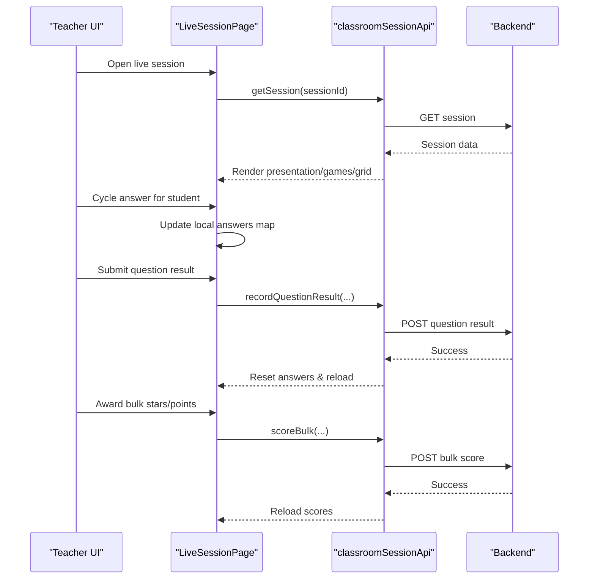

**Diagram sources**
- [LiveSessionPage.tsx:59-90](file://client/src/dashboards/teacher/LiveSessionPage.tsx#L59-L90)
- [LiveSessionPage.tsx:109-126](file://client/src/dashboards/teacher/LiveSessionPage.tsx#L109-L126)
- [LiveSessionPage.tsx:165-188](file://client/src/dashboards/teacher/LiveSessionPage.tsx#L165-L188)
- [LiveSessionPage.tsx:201-218](file://client/src/dashboards/teacher/LiveSessionPage.tsx#L201-L218)
- [api.ts:257-295](file://client/src/services/api.ts#L257-L295)

**Section sources**
- [LiveSessionPage.tsx:59-90](file://client/src/dashboards/teacher/LiveSessionPage.tsx#L59-L90)
- [LiveSessionPage.tsx:109-126](file://client/src/dashboards/teacher/LiveSessionPage.tsx#L109-L126)
- [LiveSessionPage.tsx:165-188](file://client/src/dashboards/teacher/LiveSessionPage.tsx#L165-L188)
- [LiveSessionPage.tsx:201-218](file://client/src/dashboards/teacher/LiveSessionPage.tsx#L201-L218)
- [api.ts:257-295](file://client/src/services/api.ts#L257-L295)

### Data Visualization Components
- Session summary displays metrics: participation count, average accuracy, total stars, duration.
- Student results table shows correct/wrong counts, accuracy, stars, points, and status badges.
- Top performers and students needing practice are highlighted.
- Parent report modal allows adding per-student notes before sending reports.

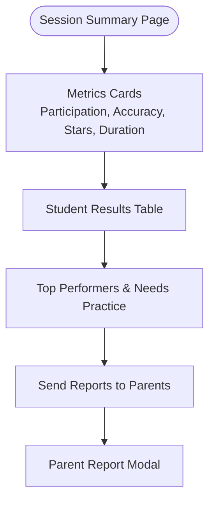

**Diagram sources**
- [SessionSummaryPage.tsx:46-77](file://client/src/dashboards/teacher/SessionSummaryPage.tsx#L46-L77)
- [SessionSummaryPage.tsx:102-129](file://client/src/dashboards/teacher/SessionSummaryPage.tsx#L102-L129)
- [SessionSummaryPage.tsx:131-183](file://client/src/dashboards/teacher/SessionSummaryPage.tsx#L131-L183)
- [SessionSummaryPage.tsx:185-239](file://client/src/dashboards/teacher/SessionSummaryPage.tsx#L185-L239)
- [SessionSummaryPage.tsx:242-266](file://client/src/dashboards/teacher/SessionSummaryPage.tsx#L242-L266)
- [SessionSummaryPage.tsx:315-455](file://client/src/dashboards/teacher/SessionSummaryPage.tsx#L315-L455)

**Section sources**
- [SessionSummaryPage.tsx:46-77](file://client/src/dashboards/teacher/SessionSummaryPage.tsx#L46-L77)
- [SessionSummaryPage.tsx:102-129](file://client/src/dashboards/teacher/SessionSummaryPage.tsx#L102-L129)
- [SessionSummaryPage.tsx:131-183](file://client/src/dashboards/teacher/SessionSummaryPage.tsx#L131-L183)
- [SessionSummaryPage.tsx:185-239](file://client/src/dashboards/teacher/SessionSummaryPage.tsx#L185-L239)
- [SessionSummaryPage.tsx:242-266](file://client/src/dashboards/teacher/SessionSummaryPage.tsx#L242-L266)
- [SessionSummaryPage.tsx:315-455](file://client/src/dashboards/teacher/SessionSummaryPage.tsx#L315-L455)

### Transition Between Child Learning Mode and Teacher Administration Mode
- From teacher dashboard, there is a link to switch to the child portal.
- From teacher login, there is a link back to the child login page.
- Route guards enforce role-based access, ensuring smooth transitions without unauthorized access.

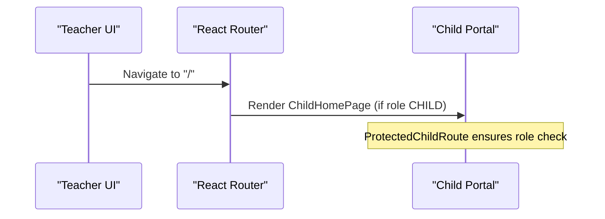

**Diagram sources**
- [TeacherDashboardPage.tsx:337-342](file://client/src/dashboards/teacher/TeacherDashboardPage.tsx#L337-L342)
- [TeacherLoginPage.tsx:37-45](file://client/src/dashboards/teacher/TeacherLoginPage.tsx#L37-L45)
- [App.tsx:46-54](file://client/src/App.tsx#L46-L54)

**Section sources**
- [TeacherDashboardPage.tsx:337-342](file://client/src/dashboards/teacher/TeacherDashboardPage.tsx#L337-L342)
- [TeacherLoginPage.tsx:37-45](file://client/src/dashboards/teacher/TeacherLoginPage.tsx#L37-L45)
- [App.tsx:46-54](file://client/src/App.tsx#L46-L54)

### Responsive Design Considerations
- Mobile-first layouts with Tailwind utility classes.
- Collapsible navigation and tab bars for small screens.
- Grids adapt from single-column to multi-column depending on screen size.
- Large typography and high-contrast colors for classroom projection and readability.

Examples:
- Live session page uses hidden md:flex for desktop tabs and a mobile-only tab bar.
- Dashboard cards and grids use sm:grid-cols-* and lg:grid-cols-* for scaling.

**Section sources**
- [LiveSessionPage.tsx:341-381](file://client/src/dashboards/teacher/LiveSessionPage.tsx#L341-L381)
- [LiveSessionPage.tsx:413-433](file://client/src/dashboards/teacher/LiveSessionPage.tsx#L413-L433)
- [TeacherDashboardPage.tsx:556-567](file://client/src/dashboards/teacher/TeacherDashboardPage.tsx#L556-L567)

### Separation of Concerns: Educational Content vs Administrative Functions
- Educational content:
  - Curriculum browsing, lesson selection, vocabulary flashcards, interactive games.
  - Managed by TeacherDashboardPage and LiveSessionPage.
- Administrative functions:
  - Class management, student rosters, assignments, notes, session scheduling.
  - Managed by TeacherWorkspace and ClassroomSessionSetup.

This separation keeps teaching tools focused on pedagogy while administrative tools handle logistics and reporting.

**Section sources**
- [TeacherDashboardPage.tsx:429-677](file://client/src/dashboards/teacher/TeacherDashboardPage.tsx#L429-L677)
- [LiveSessionPage.tsx:447-657](file://client/src/dashboards/teacher/LiveSessionPage.tsx#L447-L657)
- [TeacherWorkspace.tsx:13-17](file://client/src/dashboards/teacher/TeacherWorkspace.tsx#L13-L17)
- [ClassroomSessionSetup.tsx:143-190](file://client/src/dashboards/teacher/ClassroomSessionSetup.tsx#L143-L190)

### State Management Patterns for Concurrent Roles and Session Contexts
- Global role state:
  - AuthContext holds current user and loading state.
  - Methods update localStorage and trigger side effects like vocabulary mastery sync.
- Local component state:
  - Each dashboard component manages its own UI state (tabs, forms, selections).
  - Live session page maintains local answer maps, multi-select sets, and timers.
- API-driven state:
  - Components call API services to fetch and mutate data.
  - Errors are handled locally with alerts or console logs.

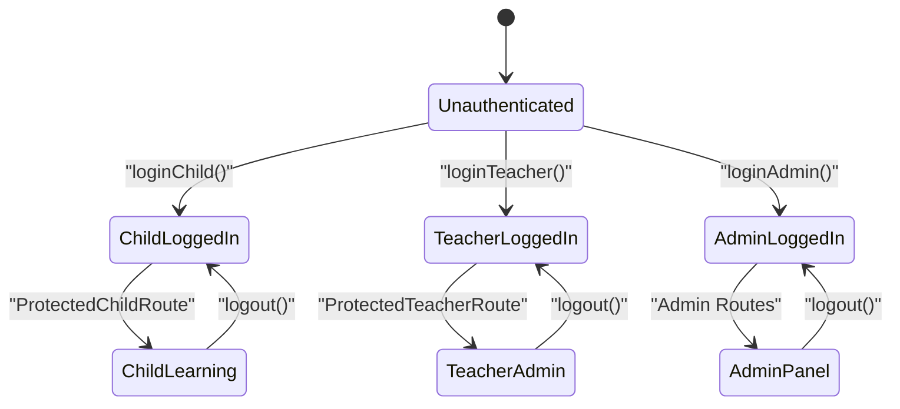

**Diagram sources**
- [AuthContext.tsx:63-121](file://client/src/context/AuthContext.tsx#L63-L121)
- [App.tsx:17-38](file://client/src/App.tsx#L17-L38)

**Section sources**
- [AuthContext.tsx:63-121](file://client/src/context/AuthContext.tsx#L63-L121)
- [App.tsx:17-38](file://client/src/App.tsx#L17-L38)

## Dependency Analysis
The teacher dashboard depends on:
- AuthContext for role and session state.
- API service for data fetching and mutations.
- Types for consistent data contracts.
- React Router for navigation and route protection.

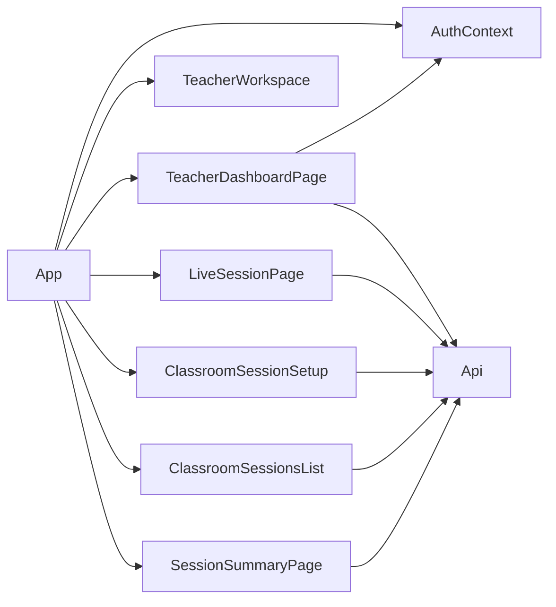

**Diagram sources**
- [TeacherDashboardPage.tsx:24-26](file://client/src/dashboards/teacher/TeacherDashboardPage.tsx#L24-L26)
- [LiveSessionPage.tsx:26-28](file://client/src/dashboards/teacher/LiveSessionPage.tsx#L26-L28)
- [ClassroomSessionSetup.tsx:4-5](file://client/src/dashboards/teacher/ClassroomSessionSetup.tsx#L4-L5)
- [ClassroomSessionsList.tsx:4-5](file://client/src/dashboards/teacher/ClassroomSessionsList.tsx#L4-L5)
- [SessionSummaryPage.tsx:17-18](file://client/src/dashboards/teacher/SessionSummaryPage.tsx#L17-L18)
- [App.tsx:9-14](file://client/src/App.tsx#L9-L14)

**Section sources**
- [TeacherDashboardPage.tsx:24-26](file://client/src/dashboards/teacher/TeacherDashboardPage.tsx#L24-L26)
- [LiveSessionPage.tsx:26-28](file://client/src/dashboards/teacher/LiveSessionPage.tsx#L26-L28)
- [ClassroomSessionSetup.tsx:4-5](file://client/src/dashboards/teacher/ClassroomSessionSetup.tsx#L4-L5)
- [ClassroomSessionsList.tsx:4-5](file://client/src/dashboards/teacher/ClassroomSessionsList.tsx#L4-L5)
- [SessionSummaryPage.tsx:17-18](file://client/src/dashboards/teacher/SessionSummaryPage.tsx#L17-L18)
- [App.tsx:9-14](file://client/src/App.tsx#L9-L14)

## Performance Considerations
- Minimize re-renders by keeping local state scoped to components.
- Use memoization where appropriate (e.g., computed lists in live session).
- Debounce frequent API calls if needed (e.g., search inputs).
- Avoid heavy synchronous operations during rendering; offload to effects or event handlers.
- Prefer server-side filtering and pagination for large datasets (classes, students, assignments).

[No sources needed since this section provides general guidance]

## Troubleshooting Guide
Common issues and resolutions:
- Authentication failures:
  - Ensure correct credentials for teacher login.
  - Verify token persistence and session verification logic.
- API errors:
  - Check network requests and error messages thrown by the API service.
  - Validate payload structures for create/update operations.
- Live session problems:
  - Confirm session ID and status before opening live page.
  - Handle fallback scoring if bulk scoring fails.
- Navigation issues:
  - Ensure route guards allow intended roles.
  - Verify links to child portal and teacher login are correctly configured.

**Section sources**
- [TeacherLoginPage.tsx:17-31](file://client/src/dashboards/teacher/TeacherLoginPage.tsx#L17-L31)
- [api.ts:11-61](file://client/src/services/api.ts#L11-L61)
- [LiveSessionPage.tsx:201-218](file://client/src/dashboards/teacher/LiveSessionPage.tsx#L201-L218)
- [App.tsx:17-38](file://client/src/App.tsx#L17-L38)

## Conclusion
The teacher dashboard integrates seamlessly with the main application, providing robust dual-role authentication, comprehensive classroom management, structured session scheduling, and powerful real-time student monitoring. Its architecture emphasizes clear separation between educational content and administrative functions, responsive design for varied screen sizes, and reliable state management for concurrent roles and sessions. Teachers can confidently manage classes, assign content, run engaging live sessions, and generate actionable reports for parents.

[No sources needed since this section summarizes without analyzing specific files]