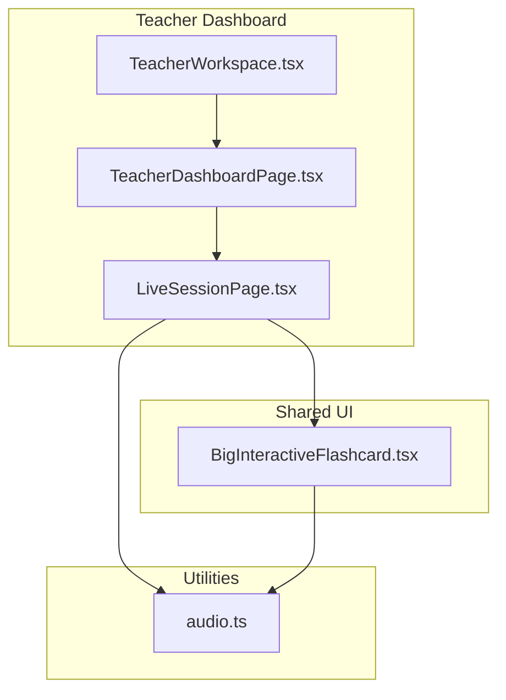
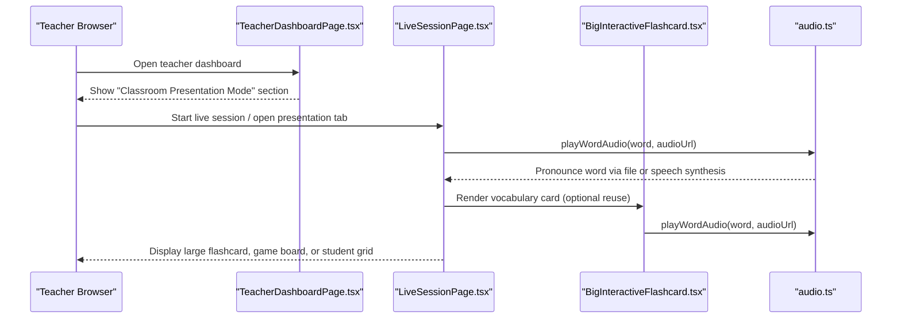
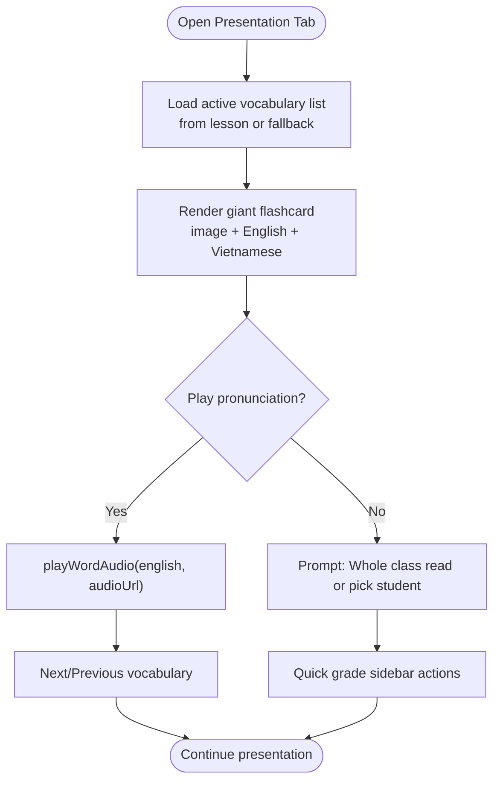
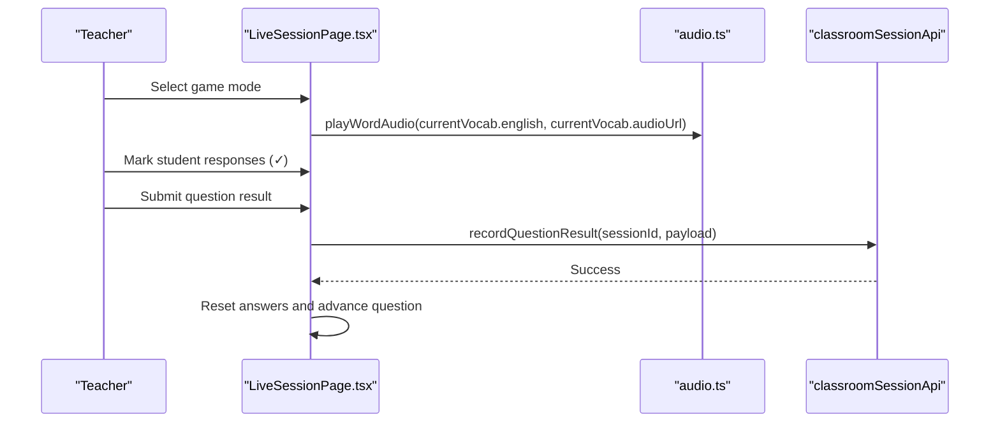
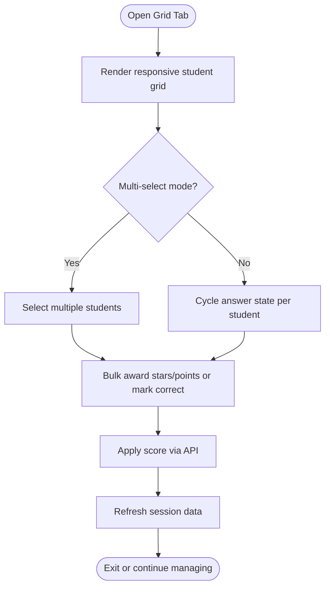
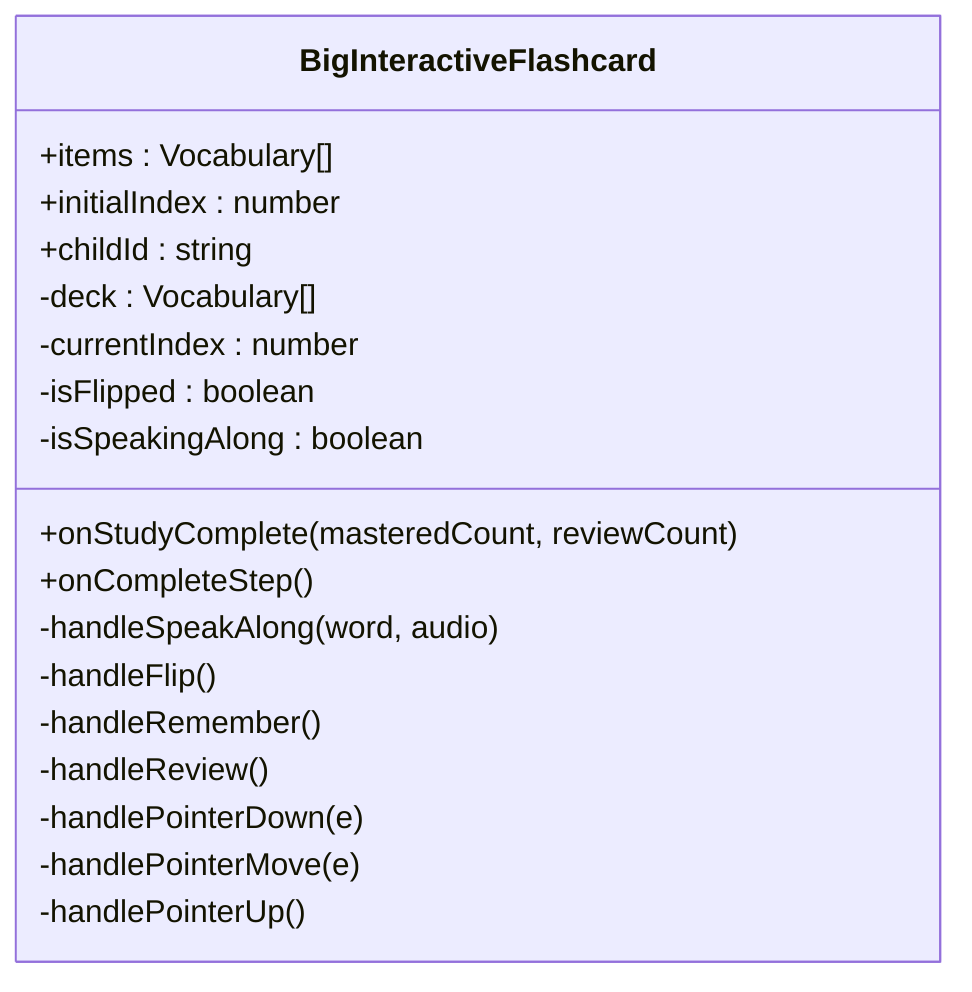
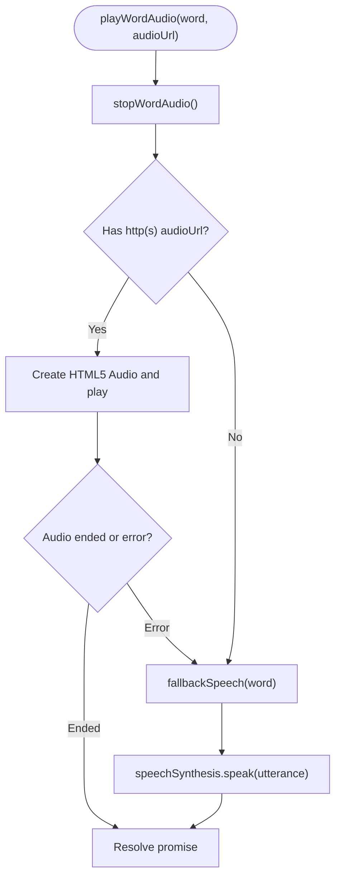
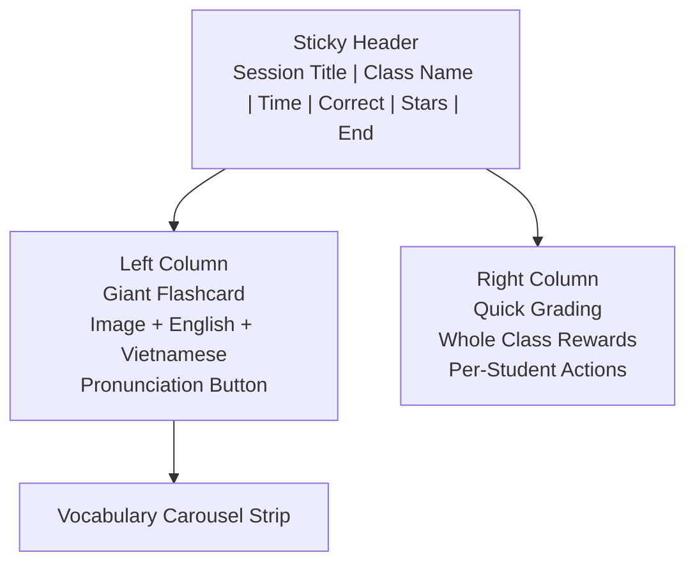
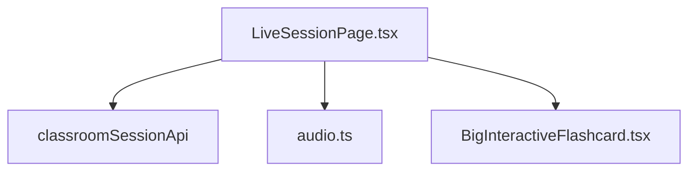
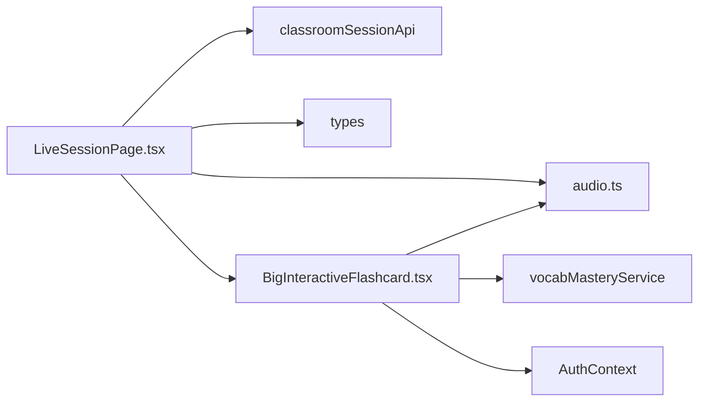

# Teaching Presentation Mode

<cite>
**Referenced Files in This Document**
- [LiveSessionPage.tsx](file://client/src/dashboards/teacher/LiveSessionPage.tsx)
- [BigInteractiveFlashcard.tsx](file://client/src/components/child/BigInteractiveFlashcard.tsx)
- [audio.ts](file://client/src/utils/audio.ts)
- [TeacherDashboardPage.tsx](file://client/src/dashboards/teacher/TeacherDashboardPage.tsx)
- [TeacherWorkspace.tsx](file://client/src/dashboards/teacher/TeacherWorkspace.tsx)
</cite>

## Table of Contents
1. [Introduction](#introduction)
2. [Project Structure](#project-structure)
3. [Core Components](#core-components)
4. [Architecture Overview](#architecture-overview)
5. [Detailed Component Analysis](#detailed-component-analysis)
6. [Dependency Analysis](#dependency-analysis)
7. [Performance Considerations](#performance-considerations)
8. [Troubleshooting Guide](#troubleshooting-guide)
9. [Conclusion](#conclusion)

## Introduction
This document explains the teaching presentation mode designed for classroom projection. It covers:
- Lesson content display through a large vocabulary flashcard system
- Vocabulary flashcard presentation with pronunciation audio
- Interactive game launching and live classroom question flow
- Audio integration for pronunciation practice
- Visual layout optimization for large screens
- Seamless transitions between presentation, games, and student management views
- Full-screen presentation features, navigation controls for teachers, and integration with main activity engines for live classroom interaction

The implementation is centered around a teacher-facing live session interface that combines vocabulary teaching, interactive games, and real-time student scoring. A child-facing interactive flashcard component provides reusable vocabulary study behavior that can be reused or referenced by lesson flows.

## Project Structure
The teaching presentation mode lives primarily under the teacher dashboard and uses shared child components and utilities:
- Teacher live session page: main orchestration of presentation, games, and grading
- Child flashcard component: reusable vocabulary card with flip, swipe, and audio behaviors
- Audio utility: sound effects engine and word pronunciation helpers
- Teacher dashboard entry point: labels and context for classroom presentation mode
- Teacher workspace: general teacher navigation and routing context

**Diagram sources**
- [TeacherWorkspace.tsx:13-16](file://client/src/dashboards/teacher/TeacherWorkspace.tsx#L13-L16)
- [TeacherDashboardPage.tsx:423-447](file://client/src/dashboards/teacher/TeacherDashboardPage.tsx#L423-L447)
- [LiveSessionPage.tsx:1-28](file://client/src/dashboards/teacher/LiveSessionPage.tsx#L1-L28)
- [BigInteractiveFlashcard.tsx:1-14](file://client/src/components/child/BigInteractiveFlashcard.tsx#L1-L14)
- [audio.ts:1-22](file://client/src/utils/audio.ts#L1-L22)

**Section sources**
- [TeacherWorkspace.tsx:13-16](file://client/src/dashboards/teacher/TeacherWorkspace.tsx#L13-L16)
- [TeacherDashboardPage.tsx:423-447](file://client/src/dashboards/teacher/TeacherDashboardPage.tsx#L423-L447)
- [LiveSessionPage.tsx:1-28](file://client/src/dashboards/teacher/LiveSessionPage.tsx#L1-L28)
- [BigInteractiveFlashcard.tsx:1-14](file://client/src/components/child/BigInteractiveFlashcard.tsx#L1-L14)
- [audio.ts:1-22](file://client/src/utils/audio.ts#L1-L22)

## Core Components
- LiveSessionPage: Main teacher control panel for live classroom sessions. It manages three primary tabs:
  - Presentation tab: large vocabulary flashcard display with pronunciation and quick student prompts
  - Games tab: interactive classroom mini-games using the same vocabulary pool
  - Grid tab: full-class student grid with bulk grading, multi-select mode, random student spotlight, and per-student scoring
- BigInteractiveFlashcard: Reusable vocabulary flashcard used by child learning flows; supports flip, swipe, speak-along, mastery tracking, and spaced repetition re-queueing
- audio.ts: Sound effects engine and word pronunciation helper with fallback to speech synthesis

Key responsibilities:
- Load and render session data
- Manage active vocabulary list from lesson or fallback preschool dataset
- Provide pronunciation playback for words
- Track and submit question results
- Score students individually or in bulk
- Launch and navigate interactive games
- Optimize visual layout for large projection screens

**Section sources**
- [LiveSessionPage.tsx:59-161](file://client/src/dashboards/teacher/LiveSessionPage.tsx#L59-L161)
- [LiveSessionPage.tsx:449-656](file://client/src/dashboards/teacher/LiveSessionPage.tsx#L449-L656)
- [LiveSessionPage.tsx:662-883](file://client/src/dashboards/teacher/LiveSessionPage.tsx#L662-L883)
- [LiveSessionPage.tsx:890-1077](file://client/src/dashboards/teacher/LiveSessionPage.tsx#L890-L1077)
- [BigInteractiveFlashcard.tsx:24-30](file://client/src/components/child/BigInteractiveFlashcard.tsx#L24-L30)
- [audio.ts:182-318](file://client/src/utils/audio.ts#L182-L318)

## Architecture Overview
The teaching presentation mode follows a clear separation of concerns:
- The teacher dashboard introduces the presentation mode concept and routes into live session pages
- The live session page orchestrates vocabulary presentation, interactive games, and student management
- Shared child components provide reusable vocabulary interactions
- Audio utilities centralize sound effects and pronunciation logic

**Diagram sources**
- [TeacherDashboardPage.tsx:423-447](file://client/src/dashboards/teacher/TeacherDashboardPage.tsx#L423-L447)
- [LiveSessionPage.tsx:449-656](file://client/src/dashboards/teacher/LiveSessionPage.tsx#L449-L656)
- [BigInteractiveFlashcard.tsx:162-170](file://client/src/components/child/BigInteractiveFlashcard.tsx#L162-L170)
- [audio.ts:217-284](file://client/src/utils/audio.ts#L217-L284)

## Detailed Component Analysis

### LiveSessionPage: Classroom Presentation, Games, and Grading
LiveSessionPage is the core teacher interface for live classroom projection. It provides:
- Three view tabs: presentation, games, and grid
- Large vocabulary flashcard display optimized for projection
- Interactive game modes built on the same vocabulary set
- Bulk and individual student scoring with feedback
- Random student spotlight modal for pronunciation prompts
- Question result submission to track class progress

#### Presentation Tab
- Displays a giant flashcard with image, English word, Vietnamese meaning, and optional pronunciation hint
- Provides pronunciation playback via audio utility
- Offers “whole class read aloud” and “pick one student to read” prompts
- Includes a vocabulary carousel strip for quick navigation
- Quick grading sidebar for whole-class rewards and per-student actions

**Diagram sources**
- [LiveSessionPage.tsx:147-163](file://client/src/dashboards/teacher/LiveSessionPage.tsx#L147-L163)
- [LiveSessionPage.tsx:449-656](file://client/src/dashboards/teacher/LiveSessionPage.tsx#L449-L656)
- [audio.ts:217-284](file://client/src/utils/audio.ts#L217-L284)

#### Games Tab
- Supports multiple mini-game modes: listen-and-choose, true/false, animal sounds
- Uses the same vocabulary pool to keep lessons consistent
- Allows marking all correct answers at once and resetting responses
- Submits question results to record class performance
- Advances to next question while syncing vocabulary index

**Diagram sources**
- [LiveSessionPage.tsx:662-883](file://client/src/dashboards/teacher/LiveSessionPage.tsx#L662-L883)
- [audio.ts:217-284](file://client/src/utils/audio.ts#L217-L284)

#### Grid Tab: Student Management and Bulk Grading
- Responsive grid of student cards showing name, avatar, stars, points, and answer state
- Multi-select mode for bulk actions
- Master buttons: award all correct, award whole class, mark all correct, reset question
- Random student spotlight modal with reward options
- Individual scoring modal for detailed adjustments

**Diagram sources**
- [LiveSessionPage.tsx:890-1077](file://client/src/dashboards/teacher/LiveSessionPage.tsx#L890-L1077)
- [LiveSessionPage.tsx:1117-1236](file://client/src/dashboards/teacher/LiveSessionPage.tsx#L1117-L1236)
- [LiveSessionPage.tsx:1238-1359](file://client/src/dashboards/teacher/LiveSessionPage.tsx#L1238-L1359)
- [LiveSessionPage.tsx:1361-1438](file://client/src/dashboards/teacher/LiveSessionPage.tsx#L1361-L1438)

**Section sources**
- [LiveSessionPage.tsx:59-161](file://client/src/dashboards/teacher/LiveSessionPage.tsx#L59-L161)
- [LiveSessionPage.tsx:449-656](file://client/src/dashboards/teacher/LiveSessionPage.tsx#L449-L656)
- [LiveSessionPage.tsx:662-883](file://client/src/dashboards/teacher/LiveSessionPage.tsx#L662-L883)
- [LiveSessionPage.tsx:890-1077](file://client/src/dashboards/teacher/LiveSessionPage.tsx#L890-L1077)
- [LiveSessionPage.tsx:1080-1113](file://client/src/dashboards/teacher/LiveSessionPage.tsx#L1080-L1113)

### BigInteractiveFlashcard: Reusable Vocabulary Study Flow
BigInteractiveFlashcard provides a rich vocabulary study experience:
- Flip card to reveal Vietnamese meaning
- Swipe right to mark mastered, left to mark review and re-queue
- Speak-along pronunciation with audio feedback
- Mastery and review tracking via vocabulary mastery service
- Completion screen with stats and option to proceed to practice

**Diagram sources**
- [BigInteractiveFlashcard.tsx:16-30](file://client/src/components/child/BigInteractiveFlashcard.tsx#L16-L30)
- [BigInteractiveFlashcard.tsx:50-61](file://client/src/components/child/BigInteractiveFlashcard.tsx#L50-L61)
- [BigInteractiveFlashcard.tsx:164-219](file://client/src/components/child/BigInteractiveFlashcard.tsx#L164-L219)
- [BigInteractiveFlashcard.tsx:221-257](file://client/src/components/child/BigInteractiveFlashcard.tsx#L221-L257)

**Section sources**
- [BigInteractiveFlashcard.tsx:24-30](file://client/src/components/child/BigInteractiveFlashcard.tsx#L24-L30)
- [BigInteractiveFlashcard.tsx:50-61](file://client/src/components/child/BigInteractiveFlashcard.tsx#L50-L61)
- [BigInteractiveFlashcard.tsx:162-219](file://client/src/components/child/BigInteractiveFlashcard.tsx#L162-L219)
- [BigInteractiveFlashcard.tsx:221-257](file://client/src/components/child/BigInteractiveFlashcard.tsx#L221-L257)
- [BigInteractiveFlashcard.tsx:292-503](file://client/src/components/child/BigInteractiveFlashcard.tsx#L292-L503)

### Audio Integration: Pronunciation Practice and Sound Effects
The audio utility provides:
- A sound effects engine for playful feedback (pop, correct, gentle wrong, star fanfare, badge chime)
- Word pronunciation helper with HTML5 audio fallback to speech synthesis
- Safety mechanisms to stop overlapping audio and handle browser autoplay restrictions
- Slow pronunciation mode for early learners

**Diagram sources**
- [audio.ts:182-318](file://client/src/utils/audio.ts#L182-L318)

**Section sources**
- [audio.ts:1-22](file://client/src/utils/audio.ts#L1-22)
- [audio.ts:40-180](file://client/src/utils/audio.ts#L40-L180)
- [audio.ts:182-318](file://client/src/utils/audio.ts#L182-L318)
- [audio.ts:320-358](file://client/src/utils/audio.ts#L320-L358)

### Visual Layout Optimization for Large Screens
LiveSessionPage uses responsive grids and large typography to optimize for classroom projection:
- Left column for giant flashcard content, right column for quick grading
- Large images and bold text for visibility on projectors
- Sticky header with session status, elapsed time, total correct, total stars, and end session button
- Mobile-friendly tab switcher for smaller screens

**Diagram sources**
- [LiveSessionPage.tsx:321-411](file://client/src/dashboards/teacher/LiveSessionPage.tsx#L321-L411)
- [LiveSessionPage.tsx:449-656](file://client/src/dashboards/teacher/LiveSessionPage.tsx#L449-L656)

**Section sources**
- [LiveSessionPage.tsx:321-411](file://client/src/dashboards/teacher/LiveSessionPage.tsx#L321-L411)
- [LiveSessionPage.tsx:449-656](file://client/src/dashboards/teacher/LiveSessionPage.tsx#L449-L656)

### Seamless Transitions Between Content Types
LiveSessionPage manages smooth transitions between:
- Presentation tab: vocabulary flashcards
- Games tab: interactive mini-games
- Grid tab: student management and bulk grading

State variables include:
- activeTab: controls which view is rendered
- currentVocabIndex: tracks current vocabulary item
- gameQuestionIdx: tracks current game question
- answers: maps student IDs to answer states
- selectedStudentIds: tracks multi-select mode selections

Transitions are triggered by user interactions such as clicking tabs, advancing questions, or toggling multi-select mode.

**Section sources**
- [LiveSessionPage.tsx:74-86](file://client/src/dashboards/teacher/LiveSessionPage.tsx#L74-L86)
- [LiveSessionPage.tsx:341-381](file://client/src/dashboards/teacher/LiveSessionPage.tsx#L341-L381)
- [LiveSessionPage.tsx:662-883](file://client/src/dashboards/teacher/LiveSessionPage.tsx#L662-L883)
- [LiveSessionPage.tsx:890-1077](file://client/src/dashboards/teacher/LiveSessionPage.tsx#L890-L1077)

### Full-Screen Presentation Features
While explicit full-screen API calls are not present in the analyzed files, the interface is designed for projection:
- Dark theme with high contrast colors
- Large typography and oversized interactive elements
- Sticky header with essential controls always visible
- Clear visual hierarchy for flashcards and game boards

Teachers can use browser full-screen mode alongside this interface to maximize projection clarity.

[No sources needed since this section provides general guidance based on observed UI patterns]

### Navigation Controls for Teachers
Navigation controls include:
- Tab switcher for presentation, games, and grid views
- Previous/Next vocabulary navigation
- Game question advancement
- Bulk action toolbar in grid mode
- Random student spotlight modal with reward options
- End session button to finalize and navigate to summary

**Section sources**
- [LiveSessionPage.tsx:341-381](file://client/src/dashboards/teacher/LiveSessionPage.tsx#L341-L381)
- [LiveSessionPage.tsx:459-480](file://client/src/dashboards/teacher/LiveSessionPage.tsx#L459-L480)
- [LiveSessionPage.tsx:870-881](file://client/src/dashboards/teacher/LiveSessionPage.tsx#L870-L881)
- [LiveSessionPage.tsx:911-956](file://client/src/dashboards/teacher/LiveSessionPage.tsx#L911-L956)
- [LiveSessionPage.tsx:1080-1113](file://client/src/dashboards/teacher/LiveSessionPage.tsx#L1080-L1113)

### Integration with Main Activity Engines
LiveSessionPage integrates with:
- Classroom session API for loading session data, recording question results, scoring students, and ending sessions
- Audio utility for pronunciation and sound effects
- Optional reuse of BigInteractiveFlashcard for vocabulary study flows

**Diagram sources**
- [LiveSessionPage.tsx:26-28](file://client/src/dashboards/teacher/LiveSessionPage.tsx#L26-L28)
- [LiveSessionPage.tsx:109-126](file://client/src/dashboards/teacher/LiveSessionPage.tsx#L109-L126)
- [LiveSessionPage.tsx:166-188](file://client/src/dashboards/teacher/LiveSessionPage.tsx#L166-L188)
- [LiveSessionPage.tsx:190-218](file://client/src/dashboards/teacher/LiveSessionPage.tsx#L190-L218)

**Section sources**
- [LiveSessionPage.tsx:26-28](file://client/src/dashboards/teacher/LiveSessionPage.tsx#L26-L28)
- [LiveSessionPage.tsx:109-126](file://client/src/dashboards/teacher/LiveSessionPage.tsx#L109-L126)
- [LiveSessionPage.tsx:166-188](file://client/src/dashboards/teacher/LiveSessionPage.tsx#L166-L188)
- [LiveSessionPage.tsx:190-218](file://client/src/dashboards/teacher/LiveSessionPage.tsx#L190-L218)

## Dependency Analysis
Dependencies among key components:
- LiveSessionPage depends on:
  - classroomSessionApi for session data and scoring
  - audio.ts for sound effects and pronunciation
  - types for ClassroomSession, StudentSessionScore, User
  - BigInteractiveFlashcard optionally for vocabulary study reuse
- BigInteractiveFlashcard depends on:
  - audio.ts for pronunciation
  - vocabMasteryService for mastery tracking
  - AuthContext for user identification
- audio.ts is independent and provides shared audio functionality

**Diagram sources**
- [LiveSessionPage.tsx:1-28](file://client/src/dashboards/teacher/LiveSessionPage.tsx#L1-L28)
- [BigInteractiveFlashcard.tsx:1-14](file://client/src/components/child/BigInteractiveFlashcard.tsx#L1-L14)
- [audio.ts:1-22](file://client/src/utils/audio.ts#L1-L22)

**Section sources**
- [LiveSessionPage.tsx:1-28](file://client/src/dashboards/teacher/LiveSessionPage.tsx#L1-L28)
- [BigInteractiveFlashcard.tsx:1-14](file://client/src/components/child/BigInteractiveFlashcard.tsx#L1-L14)
- [audio.ts:1-22](file://client/src/utils/audio.ts#L1-L22)

## Performance Considerations
- Audio playback safety: The audio utility stops any previously playing audio before starting new pronunciation, preventing overlap and resource contention
- Speech synthesis fallback: If remote audio fails or is blocked, speech synthesis ensures pronunciation still works
- Bulk operations: Bulk scoring attempts an efficient API call first, then falls back to per-student scoring if needed
- Responsive layouts: Grid and card layouts adapt to screen sizes, reducing unnecessary reflows on large displays
- State minimization: Local state changes are scoped to specific views, minimizing global re-renders

[No sources needed since this section provides general guidance]

## Troubleshooting Guide
Common issues and resolutions:
- No audio plays:
  - Ensure user gesture has unlocked audio context
  - Check network connectivity for remote audio URLs
  - Verify browser supports speech synthesis as fallback
- Overlapping audio:
  - The utility automatically stops previous audio; ensure no custom loops are overriding behavior
- Bulk scoring failures:
  - Bulk API may fail; the component falls back to per-student scoring
- Large class grid lag:
  - Use multi-select mode sparingly and avoid excessive DOM updates
- Projection readability:
  - Increase font sizes and contrast in CSS if needed; the current design already uses large text and high contrast

**Section sources**
- [audio.ts:182-318](file://client/src/utils/audio.ts#L182-L318)
- [LiveSessionPage.tsx:201-218](file://client/src/dashboards/teacher/LiveSessionPage.tsx#L201-L218)
- [LiveSessionPage.tsx:1007-1077](file://client/src/dashboards/teacher/LiveSessionPage.tsx#L1007-L1077)

## Conclusion
The teaching presentation mode provides a robust, projection-ready interface for classroom instruction. It combines:
- A large vocabulary flashcard system with pronunciation support
- Interactive game modes aligned with lesson vocabulary
- Real-time student management and bulk grading capabilities
- Seamless transitions between presentation, games, and grid views
- Audio integration for pronunciation practice and engaging feedback

Teachers can confidently lead live sessions, engage students with interactive games, and track participation and performance efficiently. The architecture separates concerns clearly, making it maintainable and extensible for future enhancements such as additional game types, richer analytics, and deeper integrations with curriculum engines.

[No sources needed since this section summarizes without analyzing specific files]