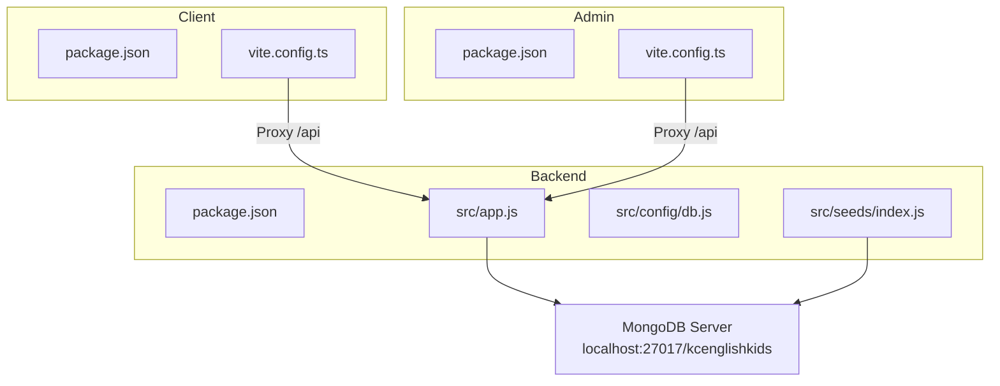
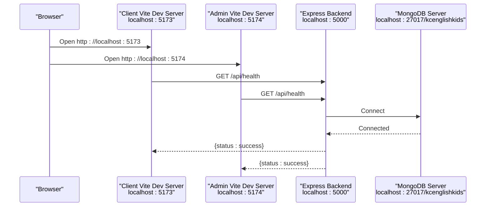
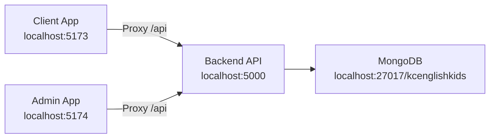

# Getting Started Guide

<cite>
**Referenced Files in This Document**
- [README.md](file://README.md)
- [KCEnglishKids_BE/package.json](file://KCEnglishKids_BE/package.json)
- [client/package.json](file://client/package.json)
- [admin/package.json](file://admin/package.json)
- [KCEnglishKids_BE/src/config/db.js](file://KCEnglishKids_BE/src/config/db.js)
- [KCEnglishKids_BE/src/app.js](file://KCEnglishKids_BE/src/app.js)
- [KCEnglishKids_BE/src/seeds/index.js](file://KCEnglishKids_BE/src/seeds/index.js)
- [client/vite.config.ts](file://client/vite.config.ts)
- [admin/vite.config.ts](file://admin/vite.config.ts)
</cite>

## Table of Contents
1. [Introduction](#introduction)
2. [Project Structure](#project-structure)
3. [Core Components](#core-components)
4. [Architecture Overview](#architecture-overview)
5. [Detailed Component Analysis](#detailed-component-analysis)
6. [Dependency Analysis](#dependency-analysis)
7. [Performance Considerations](#performance-considerations)
8. [Troubleshooting Guide](#troubleshooting-guide)
9. [Conclusion](#conclusion)
10. [Appendices](#appendices)

## Introduction
KCEnglishKids is an interactive English learning platform for children aged 3–6. It connects a structured curriculum foundation with an engaging application experience, including child-friendly activities, progress tracking, and teacher/admin dashboards. The system consists of:
- A Node.js + Express backend API connected to MongoDB
- A React + TypeScript client for children and teachers
- A React + TypeScript admin portal for curriculum and content management

This guide helps you set up the environment, install dependencies, initialize seed data, run all components, verify connectivity, and troubleshoot common issues.

## Project Structure
The repository contains three main applications:
- Backend: `KCEnglishKids_BE` (Express, Mongoose, MongoDB)
- Client: `client` (React, Vite, Tailwind CSS)
- Admin Portal: `admin` (React, Vite, Tailwind CSS)

**Diagram sources**
- [KCEnglishKids_BE/src/app.js:1-53](file://KCEnglishKids_BE/src/app.js#L1-L53)
- [KCEnglishKids_BE/src/config/db.js:11-30](file://KCEnglishKids_BE/src/config/db.js#L11-L30)
- [KCEnglishKids_BE/src/seeds/index.js:125-150](file://KCEnglishKids_BE/src/seeds/index.js#L125-L150)
- [client/vite.config.ts:11-19](file://client/vite.config.ts#L11-L19)
- [admin/vite.config.ts:11-19](file://admin/vite.config.ts#L11-L19)

**Section sources**
- [README.md:95-138](file://README.md#L95-L138)

## Core Components
- Backend REST API
  - Express app with CORS, JSON parsing, health check, and route mounting
  - MongoDB connection via Mongoose with fallback URIs
  - Seed script that populates curriculum, topics, lessons, vocabulary, activities, demo users, and sample classroom data
- Client (Children & Teachers)
  - Vite dev server on port 5173
  - Proxies `/api` requests to backend at localhost:5000
- Admin Portal
  - Vite dev server on port 5174
  - Proxies `/api` requests to backend at localhost:5000

Key responsibilities:
- Backend exposes endpoints under `/api/*`, handles authentication, curriculum, lessons, activities, learning sessions, progress, admin, and teacher features.
- Client and Admin frontends consume these APIs through the configured proxy.

**Section sources**
- [KCEnglishKids_BE/src/app.js:18-51](file://KCEnglishKids_BE/src/app.js#L18-L51)
- [KCEnglishKids_BE/src/config/db.js:11-30](file://KCEnglishKids_BE/src/config/db.js#L11-L30)
- [KCEnglishKids_BE/src/seeds/index.js:125-150](file://KCEnglishKids_BE/src/seeds/index.js#L125-L150)
- [client/vite.config.ts:11-19](file://client/vite.config.ts#L11-L19)
- [admin/vite.config.ts:11-19](file://admin/vite.config.ts#L11-L19)

## Architecture Overview
High-level runtime flow:
- Frontend apps run locally using Vite dev servers
- Both frontends proxy API calls to the backend
- Backend connects to MongoDB and serves API endpoints
- Seed script initializes rich curriculum and demo accounts

**Diagram sources**
- [client/vite.config.ts:11-19](file://client/vite.config.ts#L11-L19)
- [admin/vite.config.ts:11-19](file://admin/vite.config.ts#L11-L19)
- [KCEnglishKids_BE/src/app.js:25-32](file://KCEnglishKids_BE/src/app.js#L25-L32)
- [KCEnglishKids_BE/src/config/db.js:11-30](file://KCEnglishKids_BE/src/config/db.js#L11-L30)

## Detailed Component Analysis

### Environment Requirements
- Node.js 18+
- MongoDB server running locally at `mongodb://localhost:27017/kcenglishkids`

These requirements are explicitly stated in the project documentation.

**Section sources**
- [README.md:53-56](file://README.md#L53-L56)

### Installation Steps

#### Backend (KCEnglishKids_BE)
1. Navigate to the backend directory.
2. Install dependencies.
3. Initialize seed data.
4. Start the backend server.

Commands:
- `cd KCEnglishKids_BE`
- `npm install`
- `npm run seed`
- `npm start`

Notes:
- The backend listens on port 5000 by default.
- The seed script clears collections and inserts curriculum, topics, lessons, vocabulary, activities, demo users, and sample classroom data.

**Section sources**
- [README.md:57-65](file://README.md#L57-L65)
- [KCEnglishKids_BE/package.json:6-11](file://KCEnglishKids_BE/package.json#L6-L11)
- [KCEnglishKids_BE/src/seeds/index.js:125-150](file://KCEnglishKids_BE/src/seeds/index.js#L125-L150)

#### Client (Children & Teachers)
1. Navigate to the client directory.
2. Install dependencies.
3. Start the development server.

Commands:
- `cd client`
- `npm install`
- `npm run dev`

Notes:
- The client runs on port 5173.
- API requests are proxied to the backend at localhost:5000.

**Section sources**
- [README.md:67-72](file://README.md#L67-L72)
- [client/package.json:6-11](file://client/package.json#L6-L11)
- [client/vite.config.ts:11-19](file://client/vite.config.ts#L11-L19)

#### Admin Portal
1. Navigate to the admin directory.
2. Install dependencies.
3. Start the development server.

Commands:
- `cd admin`
- `npm install`
- `npm run dev`

Notes:
- The admin portal runs on port 5174.
- API requests are proxied to the backend at localhost:5000.

**Section sources**
- [README.md:74-79](file://README.md#L74-L79)
- [admin/package.json:6-10](file://admin/package.json#L6-L10)
- [admin/vite.config.ts:11-19](file://admin/vite.config.ts#L11-L19)

### Database Setup and Configuration
- The backend uses Mongoose to connect to MongoDB.
- Connection candidates include:
  - `process.env.MONGODB_URI`
  - `mongodb://127.0.0.1:27017/kcenglishkids`
  - `mongodb://localhost:27017/kcenglishkids`
- If none succeed, the process exits with an error.

Recommendations:
- Ensure MongoDB is running and accessible at `localhost:27017`.
- Optionally configure `MONGODB_URI` in a `.env` file if using a different host or Atlas cluster.

**Section sources**
- [KCEnglishKids_BE/src/config/db.js:11-30](file://KCEnglishKids_BE/src/config/db.js#L11-L30)

### Seed Data Initialization
The seed script performs:
- Clearing existing collections
- Seeding age groups, books, units, topics, vocabulary, language content, lessons, activities
- Creating demo users (ADMIN, TEACHER, CHILD) and a demo classroom
- Linking sample progress and vocabulary mastery records
- Printing a verification report

Run it before starting the backend to ensure demo data exists.

**Section sources**
- [KCEnglishKids_BE/src/seeds/index.js:125-150](file://KCEnglishKids_BE/src/seeds/index.js#L125-L150)
- [KCEnglishKids_BE/src/seeds/index.js:456-590](file://KCEnglishKids_BE/src/seeds/index.js#L456-L590)
- [KCEnglishKids_BE/src/seeds/index.js:696-745](file://KCEnglishKids_BE/src/seeds/index.js#L696-L745)

### First Run Procedures
1. Start MongoDB locally.
2. Run the backend seed script once to populate data.
3. Start the backend server.
4. Start the client dev server.
5. Start the admin dev server.
6. Verify the backend health endpoint.

Verification URLs:
- Backend: `http://localhost:5000/api/health`
- Client: `http://localhost:5173`
- Admin: `http://localhost:5174`

**Section sources**
- [README.md:57-79](file://README.md#L57-L79)
- [KCEnglishKids_BE/src/app.js:25-32](file://KCEnglishKids_BE/src/app.js#L25-L32)

### Demo Account Credentials
Use these demo accounts after seeding:

| Role | Email | Password | PIN | Notes |
|------|-------|----------|-----|-------|
| CHILD | `leo@kcenglishkids.com` | `123456` | `1234` | Age group 3–4 |
| CHILD | `mia@kcenglishkids.com` | `123456` | `5678` | Age group 3–4 |
| CHILD | `toby@kcenglishkids.com` | `123456` | `1111` | Age group 4–5 |
| ADMIN | `admin@kcenglishkids.com` | `Admin@123` | N/A | Admin portal login |
| TEACHER | `teacher@kcenglishkids.com` | `Teacher@123` | N/A | Teacher portal login |

Notes:
- Children log in using avatar selection plus a 4-digit PIN.
- Admin and Teacher use email/password login flows.

**Section sources**
- [README.md:83-92](file://README.md#L83-L92)
- [KCEnglishKids_BE/src/seeds/index.js:456-590](file://KCEnglishKids_BE/src/seeds/index.js#L456-L590)

## Dependency Analysis
Runtime dependencies:
- Backend depends on Express, Mongoose, MongoDB, JWT, bcryptjs, cors, dotenv
- Client depends on React, Vite, Tailwind CSS, Howler, Canvas Confetti, Lucide Icons
- Admin depends on React, Vite, Tailwind CSS, Lucide Icons

Frontend-to-backend integration:
- Both frontends proxy `/api` to `http://localhost:5000`
- Backend mounts routes under `/api/auth`, `/api/topics`, `/api/lessons`, `/api/activities`, `/api/vocabulary`, `/api/learning`, `/api/children`, `/api/admin`, `/api/teacher`, and `/api/teacher/classroom-sessions`

**Diagram sources**
- [client/vite.config.ts:11-19](file://client/vite.config.ts#L11-L19)
- [admin/vite.config.ts:11-19](file://admin/vite.config.ts#L11-L19)
- [KCEnglishKids_BE/src/app.js:34-45](file://KCEnglishKids_BE/src/app.js#L34-L45)
- [KCEnglishKids_BE/src/config/db.js:11-30](file://KCEnglishKids_BE/src/config/db.js#L11-L30)

**Section sources**
- [KCEnglishKids_BE/package.json:17-27](file://KCEnglishKids_BE/package.json#L17-L27)
- [client/package.json:12-34](file://client/package.json#L12-L34)
- [admin/package.json:11-28](file://admin/package.json#L11-L28)
- [KCEnglishKids_BE/src/app.js:34-45](file://KCEnglishKids_BE/src/app.js#L34-L45)

## Performance Considerations
- Use the backend health endpoint to quickly verify service availability during development.
- Keep MongoDB local for fastest iteration; switch to Atlas only when necessary and configure `MONGODB_URI`.
- Avoid running multiple instances of the same services on conflicting ports.
- For large datasets, consider running the seed script once per environment rather than repeatedly.

[No sources needed since this section provides general guidance]

## Troubleshooting Guide

Common setup issues and resolutions:

- MongoDB connection problems
  - Symptom: Backend fails to connect to MongoDB and exits.
  - Checks:
    - Ensure MongoDB is running locally at `localhost:27017`.
    - Confirm database name is `kcenglishkids`.
    - If using Atlas, set `MONGODB_URI` in a `.env` file.
  - Relevant logic: The backend tries multiple URI candidates and logs warnings for each failure.

- Port conflicts
  - Symptom: Cannot start client or admin due to port already in use.
  - Resolution:
    - Client uses port 5173; Admin uses port 5174.
    - Stop any other processes using these ports or change the Vite server port configuration.

- Dependency installation errors
  - Symptom: `npm install` fails.
  - Resolution:
    - Ensure Node.js version is 18+.
    - Clear npm cache and reinstall dependencies.
    - Check for OS-specific build tools required by native modules.

- API not reachable from frontend
  - Symptom: Frontend cannot reach backend endpoints.
  - Resolution:
    - Verify backend is running on `localhost:5000`.
    - Confirm Vite proxy settings forward `/api` to `http://localhost:5000`.

- Seed data missing or inconsistent
  - Symptom: Demo accounts or curriculum data not found.
  - Resolution:
    - Re-run `npm run seed` in the backend directory.
    - Review the final verification report printed by the seed script.

**Section sources**
- [KCEnglishKids_BE/src/config/db.js:11-30](file://KCEnglishKids_BE/src/config/db.js#L11-L30)
- [client/vite.config.ts:11-19](file://client/vite.config.ts#L11-L19)
- [admin/vite.config.ts:11-19](file://admin/vite.config.ts#L11-L19)
- [KCEnglishKids_BE/src/seeds/index.js:696-745](file://KCEnglishKids_BE/src/seeds/index.js#L696-L745)

## Conclusion
You now have everything needed to set up, run, and verify KCEnglishKids locally. Start MongoDB, seed the backend, then launch the backend, client, and admin portals. Use the provided demo credentials to explore child, teacher, and admin workflows. Refer to the troubleshooting section if you encounter common setup issues.

[No sources needed since this section summarizes without analyzing specific files]

## Appendices

### Verification Checklist
- Backend health endpoint returns success at `http://localhost:5000/api/health`
- Client loads at `http://localhost:5173`
- Admin portal loads at `http://localhost:5174`
- Demo accounts can log in successfully
- Curriculum, lessons, and activities are available in the UI

**Section sources**
- [README.md:57-79](file://README.md#L57-L79)
- [KCEnglishKids_BE/src/app.js:25-32](file://KCEnglishKids_BE/src/app.js#L25-L32)