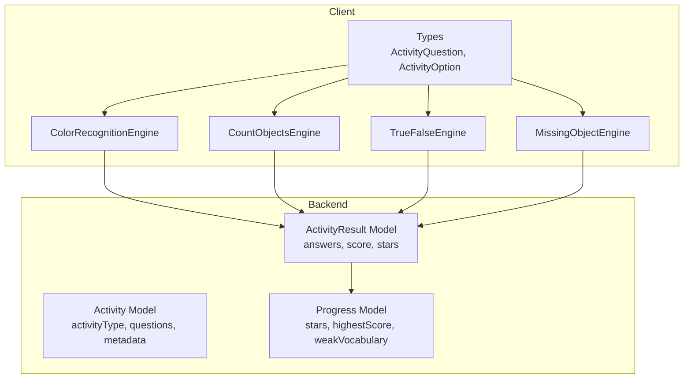
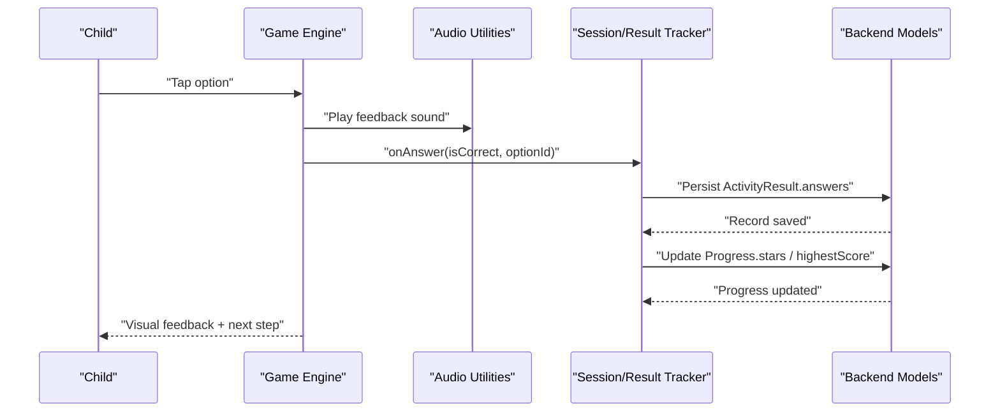
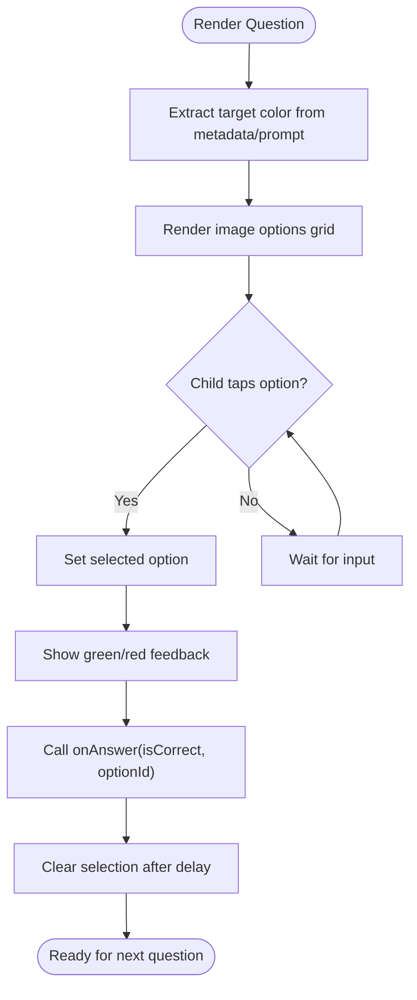
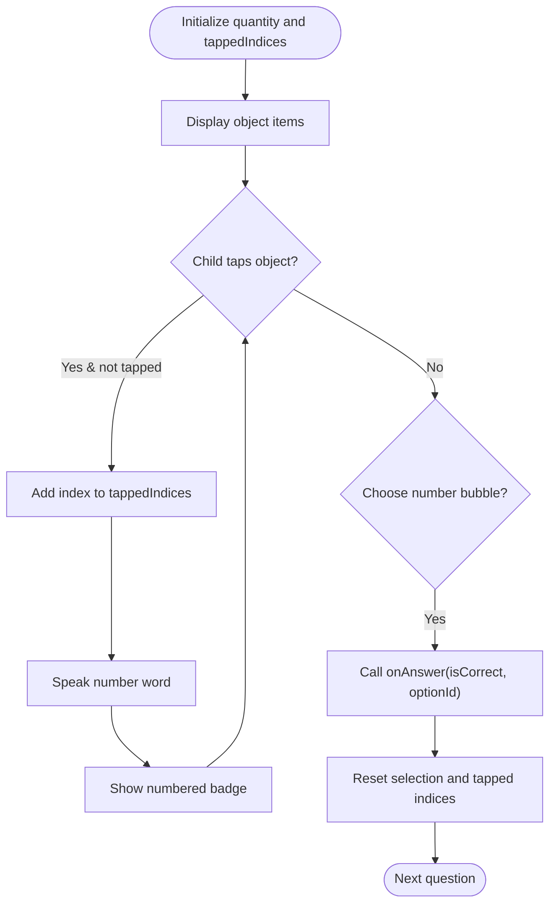
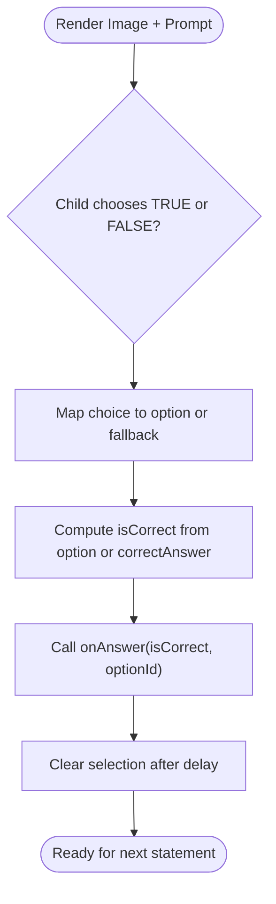
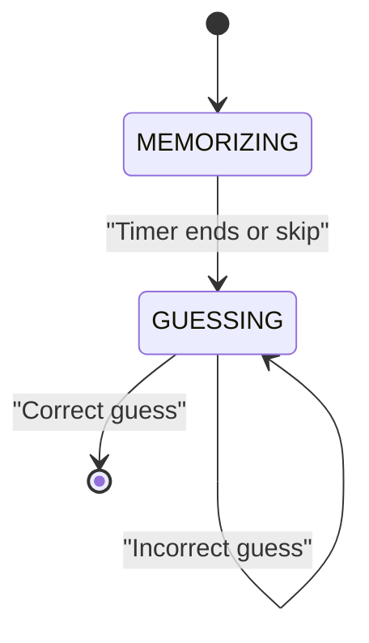
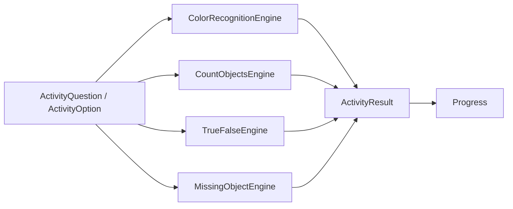

# Cognitive Development Games

<cite>
**Referenced Files in This Document**
- [README.md](file://README.md)
- [architecture.md](file://docs/architecture.md)
- [index.ts](file://client/src/types/index.ts)
- [ColorRecognitionEngine.tsx](file://client/src/components/child/games/ColorRecognitionEngine.tsx)
- [CountObjectsEngine.tsx](file://client/src/components/child/games/CountObjectsEngine.tsx)
- [TrueFalseEngine.tsx](file://client/src/components/child/games/TrueFalseEngine.tsx)
- [MissingObjectEngine.tsx](file://client/src/components/child/games/MissingObjectEngine.tsx)
- [Activity.js](file://KCEnglishKids_BE/src/models/Activity.js)
- [ActivityResult.js](file://KCEnglishKids_BE/src/models/ActivityResult.js)
- [Progress.js](file://KCEnglishKids_BE/src/models/Progress.js)
</cite>

## Table of Contents
1. [Introduction](#introduction)
2. [Project Structure](#project-structure)
3. [Core Components](#core-components)
4. [Architecture Overview](#architecture-overview)
5. [Detailed Component Analysis](#detailed-component-analysis)
6. [Dependency Analysis](#dependency-analysis)
7. [Performance Considerations](#performance-considerations)
8. [Troubleshooting Guide](#troubleshooting-guide)
9. [Conclusion](#conclusion)
10. [Appendices](#appendices)

## Introduction
This document explains the cognitive development-focused game engines in KCEnglishKids, with emphasis on four child-friendly activities: Color Recognition, Count Objects, True/False, and Missing Object. These games are designed for ages 3–6 and integrate visual feedback, audio prompts, interactive selection, and structured assessment data to support early learning outcomes such as color identification, number recognition, logical reasoning, and observational pattern recognition.

The platform follows a two-layer architecture: a curriculum foundation that defines books, units, topics, lessons, and vocabulary, and an application learning experience that delivers interactive activities, sessions, results, and progress tracking. The game engines consume activity question models and emit answer events that can be recorded into activity results and progress records.

**Section sources**
- [README.md:1-28](file://README.md#L1-L28)
- [architecture.md:1-29](file://docs/architecture.md#L1-L29)

## Project Structure
The relevant code for these cognitive games is located under the client-side React components for children’s games, while the backend models define the Activity schema, ActivityResult schema, and Progress schema used to persist learning outcomes.

**Diagram sources**
- [index.ts:41-78](file://client/src/types/index.ts#L41-L78)
- [Activity.js:66-158](file://KCEnglishKids_BE/src/models/Activity.js#L66-L158)
- [ActivityResult.js:3-71](file://KCEnglishKids_BE/src/models/ActivityResult.js#L3-L71)
- [Progress.js:3-57](file://KCEnglishKids_BE/src/models/Progress.js#L3-L57)

**Section sources**
- [index.ts:41-78](file://client/src/types/index.ts#L41-L78)
- [Activity.js:66-158](file://KCEnglishKids_BE/src/models/Activity.js#L66-L158)
- [ActivityResult.js:3-71](file://KCEnglishKids_BE/src/models/ActivityResult.js#L3-L71)
- [Progress.js:3-57](file://KCEnglishKids_BE/src/models/Progress.js#L3-L57)

## Core Components
The four core game engines share common patterns:
- They receive an ActivityQuestion containing prompt text/audio/image, options, correctAnswer, and optional metadata.
- They provide child-friendly UI with large touch targets, clear visual feedback (green for correct, red for incorrect), and audio cues.
- They call an onAnswer callback with isCorrect and optionId, enabling upstream session or result tracking.

Key shared types:
- ActivityOption includes id, text, vietnameseText, imageUrl, audioUrl, and isCorrect.
- ActivityQuestion includes promptText, promptAudioUrl, promptImageUrl, correctAnswer, options, explanation, and metadata.

These types ensure consistent data flow from curriculum content to interactive gameplay and assessment.

**Section sources**
- [index.ts:41-78](file://client/src/types/index.ts#L41-L78)

## Architecture Overview
At runtime, each game engine renders a question, accepts child interaction, validates responses, and emits structured answer events. Backend models capture these events into ActivityResult and update Progress over time.

**Diagram sources**
- [ActivityResult.js:58-70](file://KCEnglishKids_BE/src/models/ActivityResult.js#L58-L70)
- [Progress.js:27-56](file://KCEnglishKids_BE/src/models/Progress.js#L27-L56)

## Detailed Component Analysis

### Color Recognition Game
Purpose: Teach color identification through interactive selection and immediate visual feedback.

Mechanics:
- Displays a target color pill derived from the question’s metadata or prompt text.
- Presents multiple image-based options; selecting one triggers immediate feedback.
- Uses a color map to style the UI consistently with the target color.
- Plays audio instructions and word pronunciation when available.

Cognitive focus:
- Visual discrimination of colors.
- Associating English color names with images.
- Reinforcement through positive feedback.

Difficulty scaling:
- Option count adapts based on the number of options provided by the question.
- Visual complexity increases with more choices.

Educational methodology integration:
- Dual coding: pairing visual stimuli (images) with auditory labels (color names).
- Immediate reinforcement supports early learners’ attention and motivation.

Assessment metrics:
- Correctness per option via ActivityOption.isCorrect.
- Response captured through onAnswer(option.isCorrect, option.id).

**Diagram sources**
- [ColorRecognitionEngine.tsx:33-37](file://client/src/components/child/games/ColorRecognitionEngine.tsx#L33-L37)
- [ColorRecognitionEngine.tsx:44-52](file://client/src/components/child/games/ColorRecognitionEngine.tsx#L44-L52)
- [ColorRecognitionEngine.tsx:88-135](file://client/src/components/child/games/ColorRecognitionEngine.tsx#L88-L135)

**Section sources**
- [ColorRecognitionEngine.tsx:1-140](file://client/src/components/child/games/ColorRecognitionEngine.tsx#L1-L140)
- [index.ts:41-78](file://client/src/types/index.ts#L41-L78)

### Count Objects Game
Purpose: Develop number recognition and counting skills through object manipulation and numerical feedback.

Mechanics:
- Renders a set of objects determined by question.metadata.quantity (capped at 10).
- Children tap objects sequentially; each tap plays the corresponding English number word.
- A numeric badge appears on tapped items to reinforce one-to-one correspondence.
- After counting, children choose a number bubble representing the total quantity.

Validation and feedback:
- Prevents double-tapping the same object.
- Provides immediate visual feedback on the chosen number bubble.
- Resets state after feedback to prepare for the next question.

Cognitive focus:
- One-to-one counting.
- Quantity estimation and verification.
- Number-word association.

Educational methodology integration:
- Active manipulation promotes procedural memory for counting sequences.
- Auditory reinforcement strengthens phonological awareness of number words.

Assessment metrics:
- Correctness determined by ActivityOption.isCorrect.
- Response captured via onAnswer(option.isCorrect, option.id).

**Diagram sources**
- [CountObjectsEngine.tsx:17-19](file://client/src/components/child/games/CountObjectsEngine.tsx#L17-L19)
- [CountObjectsEngine.tsx:27-36](file://client/src/components/child/games/CountObjectsEngine.tsx#L27-L36)
- [CountObjectsEngine.tsx:38-47](file://client/src/components/child/games/CountObjectsEngine.tsx#L38-L47)
- [CountObjectsEngine.tsx:52-54](file://client/src/components/child/games/CountObjectsEngine.tsx#L52-L54)

**Section sources**
- [CountObjectsEngine.tsx:1-144](file://client/src/components/child/games/CountObjectsEngine.tsx#L1-L144)
- [index.ts:41-78](file://client/src/types/index.ts#L41-L78)

### True/False Game
Purpose: Build logical reasoning and decision-making by evaluating statements against visual or textual context.

Mechanics:
- Displays an image and prompt text/audio.
- Offers two large buttons: TRUE/YES and FALSE/NO.
- Maps button choice to the corresponding option or fallback option.
- Computes correctness using option metadata or direct comparison with correctAnswer.

Evaluation logic:
- Finds the option whose text indicates true/false or falls back to positional defaults.
- Compares the child’s choice with the stored correctAnswer if needed.

Cognitive focus:
- Statement evaluation.
- Binary decision making.
- Linking language comprehension with visual evidence.

Educational methodology integration:
- Simple binary choices reduce cognitive load for young learners.
- Immediate feedback reinforces correct reasoning pathways.

Assessment metrics:
- Correctness computed from option metadata or correctAnswer.
- Response captured via onAnswer(!!isCorrect, optionId).

**Diagram sources**
- [TrueFalseEngine.tsx:23-35](file://client/src/components/child/games/TrueFalseEngine.tsx#L23-L35)
- [TrueFalseEngine.tsx:42-70](file://client/src/components/child/games/TrueFalseEngine.tsx#L42-L70)

**Section sources**
- [TrueFalseEngine.tsx:1-106](file://client/src/components/child/games/TrueFalseEngine.tsx#L1-L106)
- [index.ts:41-78](file://client/src/types/index.ts#L41-L78)

### Missing Object Game
Purpose: Develop observational skills and pattern recognition by memorizing a set of items and identifying the missing one.

Mechanics:
- Phase 1 (Memorization): Shows all initial items with a short timer.
- Phase 2 (Guessing): Hides one item and presents visible items plus a mystery placeholder.
- Phase 3 (Selection): Child selects the missing object from options.

State management:
- Tracks stage transitions: MEMORIZING → GUESSING.
- Countdown timer auto-transitions to guessing phase; child can skip early.
- Disables further guesses after a correct selection.

Cognitive focus:
- Working memory retention.
- Pattern recognition and elimination.
- Attention to detail.

Educational methodology integration:
- Timed observation encourages focused attention.
- Mystery placeholder maintains engagement and curiosity.

Assessment metrics:
- Correctness determined by ActivityOption.isCorrect.
- Response captured via onAnswer(option.isCorrect, option.id).

**Diagram sources**
- [MissingObjectEngine.tsx:19-21](file://client/src/components/child/games/MissingObjectEngine.tsx#L19-L21)
- [MissingObjectEngine.tsx:32-50](file://client/src/components/child/games/MissingObjectEngine.tsx#L32-L50)
- [MissingObjectEngine.tsx:58-68](file://client/src/components/child/games/MissingObjectEngine.tsx#L58-L68)

**Section sources**
- [MissingObjectEngine.tsx:1-229](file://client/src/components/child/games/MissingObjectEngine.tsx#L1-L229)
- [index.ts:41-78](file://client/src/types/index.ts#L41-L78)

## Dependency Analysis
The game engines depend on:
- Shared types for questions and options.
- Audio utilities for instruction playback and feedback sounds.
- Backend models for persistence and progress aggregation.

**Diagram sources**
- [index.ts:41-78](file://client/src/types/index.ts#L41-L78)
- [ActivityResult.js:3-71](file://KCEnglishKids_BE/src/models/ActivityResult.js#L3-L71)
- [Progress.js:3-57](file://KCEnglishKids_BE/src/models/Progress.js#L3-L57)

**Section sources**
- [index.ts:41-78](file://client/src/types/index.ts#L41-L78)
- [ActivityResult.js:3-71](file://KCEnglishKids_BE/src/models/ActivityResult.js#L3-L71)
- [Progress.js:3-57](file://KCEnglishKids_BE/src/models/Progress.js#L3-L57)

## Performance Considerations
- Rendering efficiency: Each engine uses simple arrays and minimal state updates to keep interactions responsive for young users.
- Audio playback: Audio utilities should be reused across games to avoid redundant initialization.
- Image assets: Ensure images are optimized for mobile devices to prevent layout shifts and improve touch responsiveness.
- State resets: All engines reset selection states after feedback to avoid stale UI states.

[No sources needed since this section provides general guidance]

## Troubleshooting Guide
Common issues and resolutions:
- Audio not playing: Verify promptAudioUrl or audioUrl availability; ensure audio utilities are initialized.
- Incorrect feedback: Check ActivityOption.isCorrect mapping and correctAnswer consistency in the question payload.
- Timer behavior in Missing Object: Confirm interval cleanup and stage transitions; ensure skip functionality works as expected.
- Data persistence: Validate that onAnswer calls propagate optionId and isCorrect correctly to upstream trackers and backend models.

**Section sources**
- [ColorRecognitionEngine.tsx:39-42](file://client/src/components/child/games/ColorRecognitionEngine.tsx#L39-L42)
- [CountObjectsEngine.tsx:23-25](file://client/src/components/child/games/CountObjectsEngine.tsx#L23-L25)
- [TrueFalseEngine.tsx:19-21](file://client/src/components/child/games/TrueFalseEngine.tsx#L19-L21)
- [MissingObjectEngine.tsx:32-50](file://client/src/components/child/games/MissingObjectEngine.tsx#L32-L50)

## Conclusion
The four cognitive development games in KCEnglishKids provide age-appropriate, visually engaging, and audibly supported learning experiences. They align with early childhood educational principles by combining interactive manipulation, immediate feedback, and structured assessment. Through consistent data models and clear component responsibilities, these engines support developmental milestones such as color recognition, counting proficiency, logical reasoning, and observational pattern recognition.

[No sources needed since this section summarizes without analyzing specific files]

## Appendices

### Educational Methodology Integration
- Dual coding: Pairing visuals with audio labels enhances retention for young learners.
- Scaffolding: Progressive difficulty via option counts, timed phases, and interactive steps.
- Reinforcement: Positive feedback loops encourage continued engagement and practice.

[No sources needed since this section provides general guidance]

### Age-Appropriate Difficulty Scaling
- Color Recognition: Increase option count and visual similarity to raise difficulty.
- Count Objects: Adjust quantity range and introduce distractor bubbles.
- True/False: Use longer prompts and more nuanced statements.
- Missing Object: Reduce observation time and increase item sets.

[No sources needed since this section provides general guidance]

### Cognitive Assessment Metrics and Milestone Tracking
- Per-question accuracy and response times recorded in ActivityResult.answers.
- Aggregated stars and highest scores tracked in Progress.
- Weak vocabulary identified via mistake counts to guide targeted practice.

**Section sources**
- [ActivityResult.js:58-70](file://KCEnglishKids_BE/src/models/ActivityResult.js#L58-L70)
- [Progress.js:27-56](file://KCEnglishKids_BE/src/models/Progress.js#L27-L56)