# Game Engine Architecture & Infrastructure

<cite>
**Referenced Files in This Document**
- [README.md](file://README.md)
- [App.tsx](file://client/src/App.tsx)
- [ActivityPlayPage.tsx](file://client/src/pages/child/ActivityPlayPage.tsx)
- [audio.ts](file://client/src/utils/audio.ts)
- [AnimalSoundEngine.tsx](file://client/src/components/child/games/AnimalSoundEngine.tsx)
- [BubblePopEngine.tsx](file://client/src/components/child/games/BubblePopEngine.tsx)
- [ColorRecognitionEngine.tsx](file://client/src/components/child/games/ColorRecognitionEngine.tsx)
- [CountObjectsEngine.tsx](file://client/src/components/child/games/CountObjectsEngine.tsx)
- [FeedAnimalEngine.tsx](file://client/src/components/child/games/FeedAnimalEngine.tsx)
- [ImageWordMatchEngine.tsx](file://client/src/components/child/games/ImageWordMatchEngine.tsx)
- [ListenChooseEngine.tsx](file://client/src/components/child/games/ListenChooseEngine.tsx)
- [MemoryCardEngine.tsx](file://client/src/components/child/games/MemoryCardEngine.tsx)
- [MissingObjectEngine.tsx](file://client/src/components/child/games/MissingObjectEngine.tsx)
- [StarCatcherEngine.tsx](file://client/src/components/child/games/StarCatcherEngine.tsx)
</cite>

## Table of Contents
1. Introduction
2. Project Structure
3. Core Components
4. Architecture Overview
5. Detailed Component Analysis
6. Dependency Analysis
7. Performance Considerations
8. Troubleshooting Guide
9. Conclusion

## Introduction
This document explains the game engine architecture and shared infrastructure for KCEnglishKids, focusing on common interaction patterns, state management strategies, component composition, audio integration with Howler.js and Web Audio API, scoring and progress tracking, reward systems (stars and badges), and guidelines for creating new games. It is designed to be accessible to both technical and non-technical readers while providing code-level traceability.

## Project Structure
KCEnglishKids uses a two-layer architecture:
- Curriculum Foundation: structured curriculum content (Books, Units, Topics, Lessons, Vocabulary).
- Application Learning Experience: age group mapping, activities, learning sessions, activity results, progress, stars, and rewards.

The frontend client routes child-facing pages and protects them by role. The Activity Play page orchestrates individual game engines and integrates audio, feedback, and result submission.

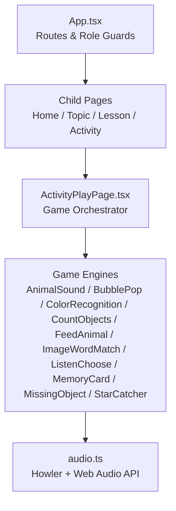

**Diagram sources**
- [App.tsx:17-38](file://client/src/App.tsx#L17-L38)
- [App.tsx:40-131](file://client/src/App.tsx#L40-L131)

**Section sources**
- [README.md:7-27](file://README.md#L7-L27)
- [README.md:31-47](file://README.md#L31-L47)
- [App.tsx:17-38](file://client/src/App.tsx#L17-L38)
- [App.tsx:40-131](file://client/src/App.tsx#L40-L131)

## Core Components
- Common Game Interface Pattern:
  - Each game engine receives a question object and exposes an onAnswer callback that reports correctness and option identity.
  - Engines manage local UI state (selections, animations) and delegate scoring to the parent via onAnswer.
- Shared Audio Utilities:
  - playWordAudio handles text-to-speech pronunciation and prompt audio playback.
  - sfx provides sound effects like pop, correct, gentle wrong, etc.
- Progression and Rewards:
  - Activities accumulate stars and can unlock badges; these are tracked through backend APIs integrated by the activity orchestrator.

Key responsibilities:
- AnimalSoundEngine: plays animal sounds and prompts; selects image options.
- BubblePopEngine: bubble-themed selection with pop feedback.
- ColorRecognitionEngine: color-targeted recognition with dynamic theme.
- CountObjectsEngine: interactive counting with number pronunciation.
- FeedAnimalEngine: feeding mini-game with animated character states.
- ImageWordMatchEngine: match image to word.
- ListenChooseEngine: listen-and-choose visual selection.
- MemoryCardEngine: memory matching pairs with card flip logic.
- MissingObjectEngine: memorize then guess missing item with timer.
- StarCatcherEngine: HTML5 canvas star-catching game with particle effects.

**Section sources**
- [AnimalSoundEngine.tsx:1-159](file://client/src/components/child/games/AnimalSoundEngine.tsx#L1-L159)
- [BubblePopEngine.tsx:1-133](file://client/src/components/child/games/BubblePopEngine.tsx#L1-L133)
- [ColorRecognitionEngine.tsx:1-140](file://client/src/components/child/games/ColorRecognitionEngine.tsx#L1-L140)
- [CountObjectsEngine.tsx:1-144](file://client/src/components/child/games/CountObjectsEngine.tsx#L1-L144)
- [FeedAnimalEngine.tsx:1-165](file://client/src/components/child/games/FeedAnimalEngine.tsx#L1-L165)
- [ImageWordMatchEngine.tsx:1-108](file://client/src/components/child/games/ImageWordMatchEngine.tsx#L1-L108)
- [ListenChooseEngine.tsx:1-109](file://client/src/components/child/games/ListenChooseEngine.tsx#L1-L109)
- [MemoryCardEngine.tsx:1-187](file://client/src/components/child/games/MemoryCardEngine.tsx#L1-L187)
- [MissingObjectEngine.tsx:1-229](file://client/src/components/child/games/MissingObjectEngine.tsx#L1-L229)
- [StarCatcherEngine.tsx:1-406](file://client/src/components/child/games/StarCatcherEngine.tsx#L1-L406)

## Architecture Overview
The application routes protect child pages and route to the Activity Play page where game engines are rendered. Audio utilities provide consistent TTS and SFX across all games.

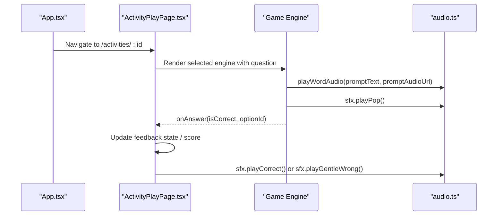

**Diagram sources**
- [App.tsx:40-131](file://client/src/App.tsx#L40-L131)
- [AnimalSoundEngine.tsx:38-69](file://client/src/components/child/games/AnimalSoundEngine.tsx#L38-L69)
- [BubblePopEngine.tsx:27-47](file://client/src/components/child/games/BubblePopEngine.tsx#L27-L47)
- [ColorRecognitionEngine.tsx:39-52](file://client/src/components/child/games/ColorRecognitionEngine.tsx#L39-L52)
- [CountObjectsEngine.tsx:23-47](file://client/src/components/child/games/CountObjectsEngine.tsx#L23-L47)
- [FeedAnimalEngine.tsx:32-55](file://client/src/components/child/games/FeedAnimalEngine.tsx#L32-L55)
- [ImageWordMatchEngine.tsx:19-31](file://client/src/components/child/games/ImageWordMatchEngine.tsx#L19-L31)
- [ListenChooseEngine.tsx:29-38](file://client/src/components/child/games/ListenChooseEngine.tsx#L29-L38)
- [MemoryCardEngine.tsx:68-119](file://client/src/components/child/games/MemoryCardEngine.tsx#L68-L119)
- [MissingObjectEngine.tsx:32-68](file://client/src/components/child/games/MissingObjectEngine.tsx#L32-L68)
- [StarCatcherEngine.tsx:162-176](file://client/src/components/child/games/StarCatcherEngine.tsx#L162-L176)

## Detailed Component Analysis

### Common Game Interface Patterns
All single-question engines follow a consistent pattern:
- Props:
  - question: contains promptText, options, metadata, and optional promptAudioUrl.
  - onAnswer: callback returning { isCorrect, optionId }.
  - disabled: prevents further interactions during transitions.
- State:
  - Local UI state tracks selections, animation flags, and temporary feedback.
- Interaction:
  - Trigger audio via playWordAudio and sfx.
  - Validate answer and call onAnswer with correctness and option identity.
  - Provide immediate visual feedback (correct/wrong styles, animations).

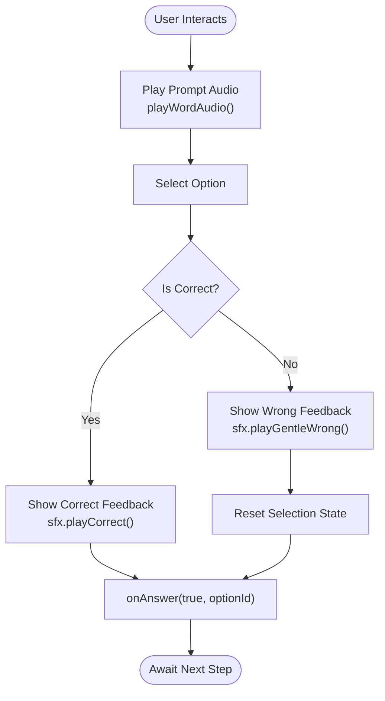

**Diagram sources**
- [AnimalSoundEngine.tsx:54-69](file://client/src/components/child/games/AnimalSoundEngine.tsx#L54-L69)
- [BubblePopEngine.tsx:31-47](file://client/src/components/child/games/BubblePopEngine.tsx#L31-L47)
- [ColorRecognitionEngine.tsx:44-52](file://client/src/components/child/games/ColorRecognitionEngine.tsx#L44-L52)
- [CountObjectsEngine.tsx:38-47](file://client/src/components/child/games/CountObjectsEngine.tsx#L38-L47)
- [FeedAnimalEngine.tsx:36-55](file://client/src/components/child/games/FeedAnimalEngine.tsx#L36-L55)
- [ImageWordMatchEngine.tsx:23-31](file://client/src/components/child/games/ImageWordMatchEngine.tsx#L23-L31)
- [ListenChooseEngine.tsx:52-101](file://client/src/components/child/games/ListenChooseEngine.tsx#L52-L101)
- [MissingObjectEngine.tsx:58-68](file://client/src/components/child/games/MissingObjectEngine.tsx#L58-L68)

**Section sources**
- [AnimalSoundEngine.tsx:1-159](file://client/src/components/child/games/AnimalSoundEngine.tsx#L1-L159)
- [BubblePopEngine.tsx:1-133](file://client/src/components/child/games/BubblePopEngine.tsx#L1-L133)
- [ColorRecognitionEngine.tsx:1-140](file://client/src/components/child/games/ColorRecognitionEngine.tsx#L1-L140)
- [CountObjectsEngine.tsx:1-144](file://client/src/components/child/games/CountObjectsEngine.tsx#L1-L144)
- [FeedAnimalEngine.tsx:1-165](file://client/src/components/child/games/FeedAnimalEngine.tsx#L1-L165)
- [ImageWordMatchEngine.tsx:1-108](file://client/src/components/child/games/ImageWordMatchEngine.tsx#L1-L108)
- [ListenChooseEngine.tsx:1-109](file://client/src/components/child/games/ListenChooseEngine.tsx#L1-L109)
- [MissingObjectEngine.tsx:1-229](file://client/src/components/child/games/MissingObjectEngine.tsx#L1-L229)

### Audio System Integration (Howler.js + Web Audio API)
- Text-to-Speech Pronunciation:
  - playWordAudio centralizes TTS and prompt audio URL handling.
  - Engines invoke it to pronounce target words or instructions.
- Sound Effects:
  - sfx encapsulates short sound effects (pop, correct, gentle wrong).
- Consistency:
  - All engines use the same audio entry points, ensuring uniform UX and easier testing.

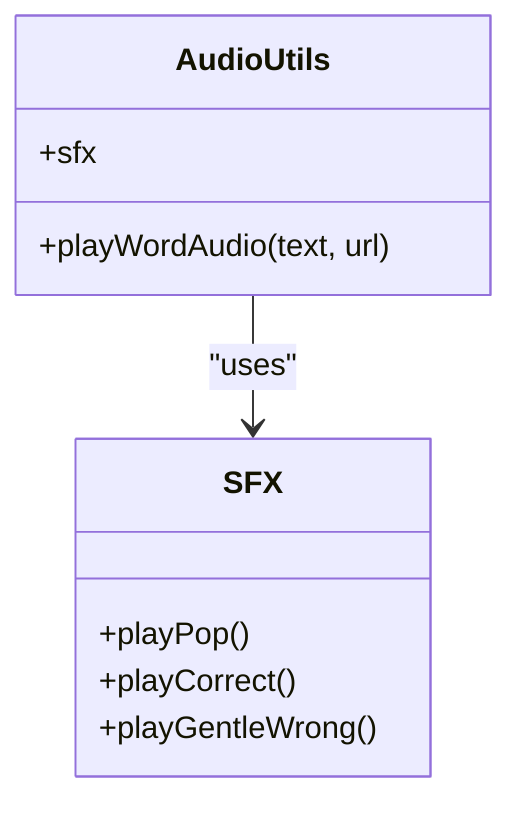

**Diagram sources**
- [AnimalSoundEngine.tsx:4](file://client/src/components/child/games/AnimalSoundEngine.tsx#L4)
- [BubblePopEngine.tsx:4](file://client/src/components/child/games/BubblePopEngine.tsx#L4)
- [ColorRecognitionEngine.tsx:4](file://client/src/components/child/games/ColorRecognitionEngine.tsx#L4)
- [CountObjectsEngine.tsx:4](file://client/src/components/child/games/CountObjectsEngine.tsx#L4)
- [FeedAnimalEngine.tsx:4](file://client/src/components/child/games/FeedAnimalEngine.tsx#L4)
- [ImageWordMatchEngine.tsx:4](file://client/src/components/child/games/ImageWordMatchEngine.tsx#L4)
- [MemoryCardEngine.tsx:4](file://client/src/components/child/games/MemoryCardEngine.tsx#L4)
- [MissingObjectEngine.tsx:4](file://client/src/components/child/games/MissingObjectEngine.tsx#L4)
- [StarCatcherEngine.tsx:4](file://client/src/components/child/games/StarCatcherEngine.tsx#L4)

**Section sources**
- [README.md:31-38](file://README.md#L31-L38)
- [AnimalSoundEngine.tsx:38-44](file://client/src/components/child/games/AnimalSoundEngine.tsx#L38-L44)
- [BubblePopEngine.tsx:27-29](file://client/src/components/child/games/BubblePopEngine.tsx#L27-L29)
- [ColorRecognitionEngine.tsx:39-42](file://client/src/components/child/games/ColorRecognitionEngine.tsx#L39-L42)
- [CountObjectsEngine.tsx:23-25](file://client/src/components/child/games/CountObjectsEngine.tsx#L23-L25)
- [FeedAnimalEngine.tsx:32-34](file://client/src/components/child/games/FeedAnimalEngine.tsx#L32-L34)
- [ImageWordMatchEngine.tsx:19-21](file://client/src/components/child/games/ImageWordMatchEngine.tsx#L19-L21)
- [MemoryCardEngine.tsx:68-76](file://client/src/components/child/games/MemoryCardEngine.tsx#L68-L76)
- [MissingObjectEngine.tsx:41-43](file://client/src/components/child/games/MissingObjectEngine.tsx#L41-L43)
- [StarCatcherEngine.tsx:162-176](file://client/src/components/child/games/StarCatcherEngine.tsx#L162-L176)

### Scoring Algorithms and Progress Tracking
- Scoring:
  - Each engine returns isCorrect and optionId via onAnswer.
  - The Activity Play page aggregates scores per activity and determines completion.
- Progress Tracking:
  - Backend APIs record activity results, update progress, and award stars/badges.
  - The orchestrator coordinates session persistence and reward updates.

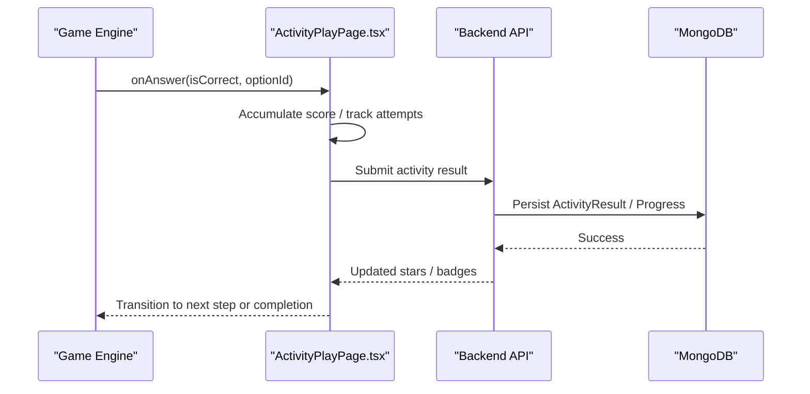

**Diagram sources**
- [README.md:102-109](file://README.md#L102-L109)
- [README.md:114-129](file://README.md#L114-L129)

**Section sources**
- [README.md:102-109](file://README.md#L102-L109)
- [README.md:114-129](file://README.md#L114-L129)

### Reward Systems: Stars and Badges
- Stars:
  - Awarded upon successful activity completion or milestone achievements.
- Badges:
  - Unlocked based on cumulative performance or thematic mastery.
- UI:
  - Dedicated modals and showcases present earned rewards to children.

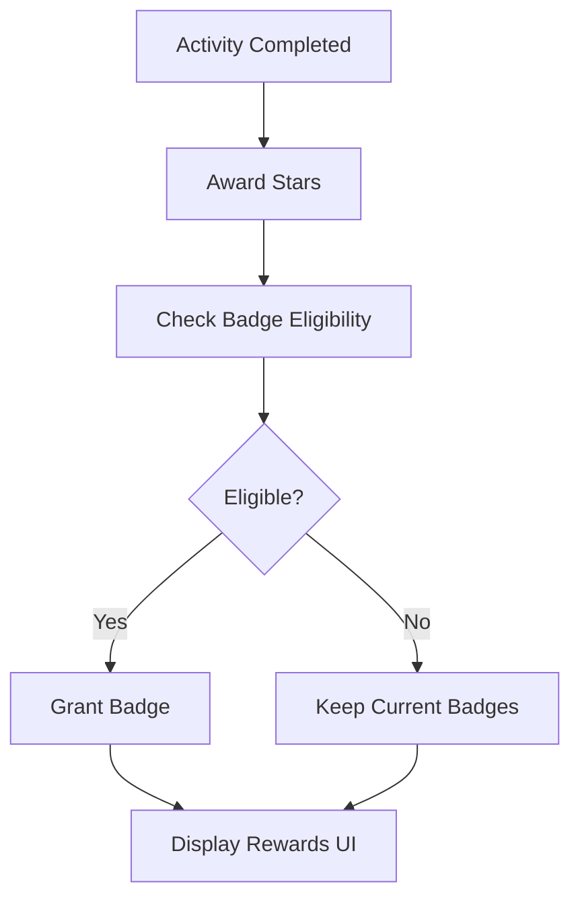

[No sources needed since this diagram shows conceptual workflow, not actual code structure]

### Component Composition and State Management Strategies
- Single Responsibility:
  - Each engine focuses on one interaction model and delegates scoring to the parent.
- Local State:
  - Engines maintain transient UI state (selected option, animation flags).
- Parent Orchestration:
  - ActivityPlayPage manages global flow, feedback states, and transitions between questions.

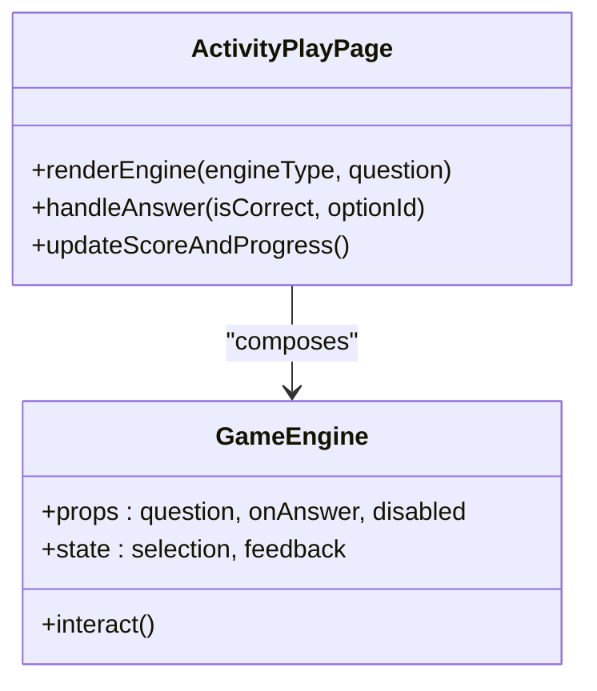

**Diagram sources**
- [AnimalSoundEngine.tsx:6-15](file://client/src/components/child/games/AnimalSoundEngine.tsx#L6-L15)
- [BubblePopEngine.tsx:6-16](file://client/src/components/child/games/BubblePopEngine.tsx#L6-L16)
- [ColorRecognitionEngine.tsx:6-10](file://client/src/components/child/games/ColorRecognitionEngine.tsx#L6-L10)
- [CountObjectsEngine.tsx:6-10](file://client/src/components/child/games/CountObjectsEngine.tsx#L6-L10)
- [FeedAnimalEngine.tsx:6-10](file://client/src/components/child/games/FeedAnimalEngine.tsx#L6-L10)
- [ImageWordMatchEngine.tsx:6-10](file://client/src/components/child/games/ImageWordMatchEngine.tsx#L6-L10)
- [ListenChooseEngine.tsx:5-11](file://client/src/components/child/games/ListenChooseEngine.tsx#L5-L11)
- [MemoryCardEngine.tsx:16-24](file://client/src/components/child/games/MemoryCardEngine.tsx#L16-L24)
- [MissingObjectEngine.tsx:6-10](file://client/src/components/child/games/MissingObjectEngine.tsx#L6-L10)
- [StarCatcherEngine.tsx:6-12](file://client/src/components/child/games/StarCatcherEngine.tsx#L6-L12)

**Section sources**
- [AnimalSoundEngine.tsx:1-159](file://client/src/components/child/games/AnimalSoundEngine.tsx#L1-L159)
- [BubblePopEngine.tsx:1-133](file://client/src/components/child/games/BubblePopEngine.tsx#L1-L133)
- [ColorRecognitionEngine.tsx:1-140](file://client/src/components/child/games/ColorRecognitionEngine.tsx#L1-L140)
- [CountObjectsEngine.tsx:1-144](file://client/src/components/child/games/CountObjectsEngine.tsx#L1-L144)
- [FeedAnimalEngine.tsx:1-165](file://client/src/components/child/games/FeedAnimalEngine.tsx#L1-L165)
- [ImageWordMatchEngine.tsx:1-108](file://client/src/components/child/games/ImageWordMatchEngine.tsx#L1-L108)
- [ListenChooseEngine.tsx:1-109](file://client/src/components/child/games/ListenChooseEngine.tsx#L1-L109)
- [MemoryCardEngine.tsx:1-187](file://client/src/components/child/games/MemoryCardEngine.tsx#L1-L187)
- [MissingObjectEngine.tsx:1-229](file://client/src/components/child/games/MissingObjectEngine.tsx#L1-L229)
- [StarCatcherEngine.tsx:1-406](file://client/src/components/child/games/StarCatcherEngine.tsx#L1-L406)

### Specialized Engines

#### Memory Card Engine
- Initializes pairs from activity questions based on age progression.
- Flips cards, plays pronunciation, checks matches, and completes when all pairs are matched.

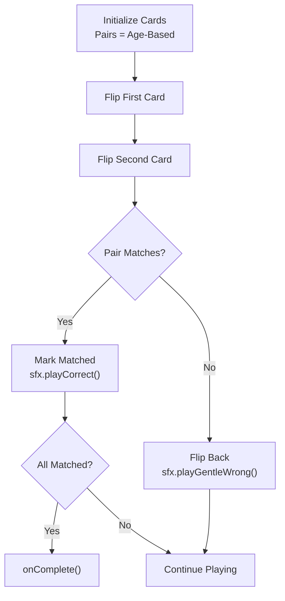

**Diagram sources**
- [MemoryCardEngine.tsx:29-66](file://client/src/components/child/games/MemoryCardEngine.tsx#L29-L66)
- [MemoryCardEngine.tsx:68-119](file://client/src/components/child/games/MemoryCardEngine.tsx#L68-L119)

**Section sources**
- [MemoryCardEngine.tsx:1-187](file://client/src/components/child/games/MemoryCardEngine.tsx#L1-L187)

#### Missing Object Engine
- Two-phase flow: memorization with countdown, then guessing phase.
- Uses sfx for transitions and plays pronunciation for options.

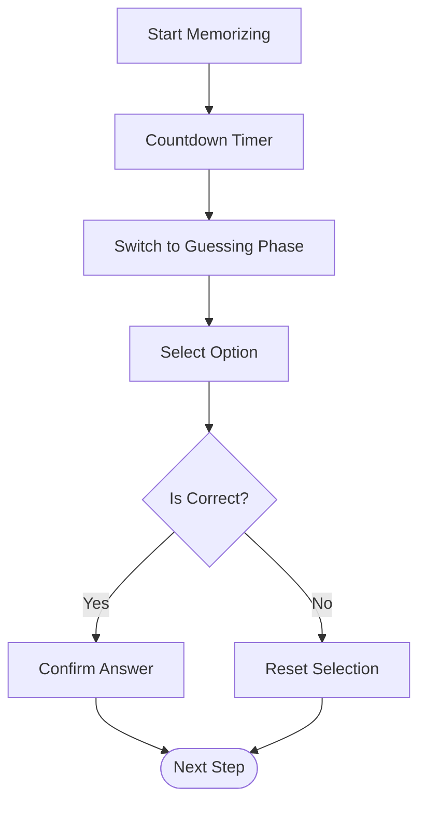

**Diagram sources**
- [MissingObjectEngine.tsx:32-68](file://client/src/components/child/games/MissingObjectEngine.tsx#L32-L68)

**Section sources**
- [MissingObjectEngine.tsx:1-229](file://client/src/components/child/games/MissingObjectEngine.tsx#L1-L229)

#### Star Catcher Engine
- Canvas-based falling star game with particle effects.
- Basket movement via pointer events; direct option buttons for accessibility.
- Triggers sfx on catch outcomes and displays win overlay.

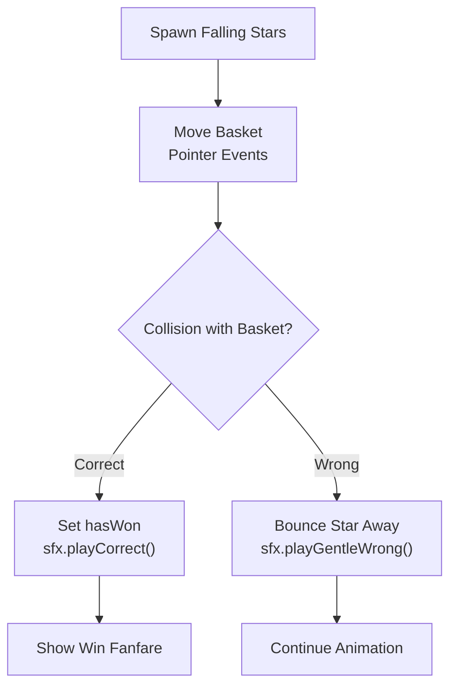

**Diagram sources**
- [StarCatcherEngine.tsx:56-80](file://client/src/components/child/games/StarCatcherEngine.tsx#L56-L80)
- [StarCatcherEngine.tsx:146-176](file://client/src/components/child/games/StarCatcherEngine.tsx#L146-L176)
- [StarCatcherEngine.tsx:296-320](file://client/src/components/child/games/StarCatcherEngine.tsx#L296-L320)

**Section sources**
- [StarCatcherEngine.tsx:1-406](file://client/src/components/child/games/StarCatcherEngine.tsx#L1-L406)

## Dependency Analysis
- Routing and Protection:
  - App.tsx defines protected routes for child and teacher roles.
- Game Engines:
  - Depend on audio.ts for TTS and SFX.
  - Use lucide-react icons and Tailwind CSS classes for UI.
- Types:
  - ActivityQuestion and ActivityOption types define the contract between engines and the orchestrator.

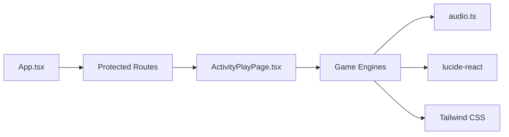

**Diagram sources**
- [App.tsx:17-38](file://client/src/App.tsx#L17-L38)
- [AnimalSoundEngine.tsx:1-4](file://client/src/components/child/games/AnimalSoundEngine.tsx#L1-L4)
- [BubblePopEngine.tsx:1-4](file://client/src/components/child/games/BubblePopEngine.tsx#L1-L4)
- [ColorRecognitionEngine.tsx:1-4](file://client/src/components/child/games/ColorRecognitionEngine.tsx#L1-L4)
- [CountObjectsEngine.tsx:1-4](file://client/src/components/child/games/CountObjectsEngine.tsx#L1-L4)
- [FeedAnimalEngine.tsx:1-4](file://client/src/components/child/games/FeedAnimalEngine.tsx#L1-L4)
- [ImageWordMatchEngine.tsx:1-4](file://client/src/components/child/games/ImageWordMatchEngine.tsx#L1-L4)
- [ListenChooseEngine.tsx:1-4](file://client/src/components/child/games/ListenChooseEngine.tsx#L1-L4)
- [MemoryCardEngine.tsx:1-4](file://client/src/components/child/games/MemoryCardEngine.tsx#L1-L4)
- [MissingObjectEngine.tsx:1-4](file://client/src/components/child/games/MissingObjectEngine.tsx#L1-L4)
- [StarCatcherEngine.tsx:1-4](file://client/src/components/child/games/StarCatcherEngine.tsx#L1-L4)

**Section sources**
- [App.tsx:17-38](file://client/src/App.tsx#L17-L38)
- [AnimalSoundEngine.tsx:1-159](file://client/src/components/child/games/AnimalSoundEngine.tsx#L1-L159)
- [BubblePopEngine.tsx:1-133](file://client/src/components/child/games/BubblePopEngine.tsx#L1-L133)
- [ColorRecognitionEngine.tsx:1-140](file://client/src/components/child/games/ColorRecognitionEngine.tsx#L1-L140)
- [CountObjectsEngine.tsx:1-144](file://client/src/components/child/games/CountObjectsEngine.tsx#L1-L144)
- [FeedAnimalEngine.tsx:1-165](file://client/src/components/child/games/FeedAnimalEngine.tsx#L1-L165)
- [ImageWordMatchEngine.tsx:1-108](file://client/src/components/child/games/ImageWordMatchEngine.tsx#L1-L108)
- [ListenChooseEngine.tsx:1-109](file://client/src/components/child/games/ListenChooseEngine.tsx#L1-L109)
- [MemoryCardEngine.tsx:1-187](file://client/src/components/child/games/MemoryCardEngine.tsx#L1-L187)
- [MissingObjectEngine.tsx:1-229](file://client/src/components/child/games/MissingObjectEngine.tsx#L1-L229)
- [StarCatcherEngine.tsx:1-406](file://client/src/components/child/games/StarCatcherEngine.tsx#L1-L406)

## Performance Considerations
- Touch Interactions:
  - Large touch targets, active scale-down feedback, and minimal layout shifts improve responsiveness.
  - Canvas-based games use requestAnimationFrame and pointer events for smooth motion.
- Mobile Compatibility:
  - Responsive grids adapt to device width; images use object-contain to avoid overflow.
  - Animations leverage CSS transforms and opacity for GPU acceleration.
- Memory Management:
  - Avoid heavy DOM operations inside loops; prefer React state updates and memoization where applicable.
  - Clean up timers and animation frames in effect cleanup functions.
- Audio:
  - Reuse audio instances via Howler; avoid repeated initialization.
  - Limit concurrent TTS requests; queue or debounce if necessary.

[No sources needed since this section provides general guidance]

## Troubleshooting Guide
- Audio Not Playing:
  - Ensure playWordAudio is called with valid text or URL.
  - Verify browser autoplay policies; user gestures required for initial audio.
- Incorrect Feedback:
  - Confirm onAnswer is invoked with correct boolean and optionId.
  - Check that feedback state is reset after transitions.
- Canvas Issues (StarCatcher):
  - Validate pointer event handlers and coordinate scaling.
  - Ensure requestAnimationFrame is canceled on unmount.
- Progress Not Saving:
  - Verify API calls are made after activity completion.
  - Check network connectivity and backend endpoints.

**Section sources**
- [AnimalSoundEngine.tsx:38-44](file://client/src/components/child/games/AnimalSoundEngine.tsx#L38-L44)
- [BubblePopEngine.tsx:27-29](file://client/src/components/child/games/BubblePopEngine.tsx#L27-L29)
- [ColorRecognitionEngine.tsx:39-42](file://client/src/components/child/games/ColorRecognitionEngine.tsx#L39-L42)
- [CountObjectsEngine.tsx:23-25](file://client/src/components/child/games/CountObjectsEngine.tsx#L23-L25)
- [FeedAnimalEngine.tsx:32-34](file://client/src/components/child/games/FeedAnimalEngine.tsx#L32-L34)
- [ImageWordMatchEngine.tsx:19-21](file://client/src/components/child/games/ImageWordMatchEngine.tsx#L19-L21)
- [MemoryCardEngine.tsx:68-76](file://client/src/components/child/games/MemoryCardEngine.tsx#L68-L76)
- [MissingObjectEngine.tsx:41-43](file://client/src/components/child/games/MissingObjectEngine.tsx#L41-L43)
- [StarCatcherEngine.tsx:290-294](file://client/src/components/child/games/StarCatcherEngine.tsx#L290-L294)

## Conclusion
KCEnglishKids’ game engine architecture emphasizes consistent interfaces, robust audio integration, and clear separation of concerns between game engines and orchestration. By following the documented patterns, developers can create engaging, accessible activities for young learners while maintaining performance and reliability across devices.

[No sources needed since this section summarizes without analyzing specific files]