# Interactive Game Engines

<cite>
**Referenced Files in This Document**
- [README.md](file://README.md)
- [App.tsx](file://client/src/App.tsx)
- [ActivityPlayPage.tsx](file://client/src/pages/child/ActivityPlayPage.tsx)
- [ChildArcadeSection.tsx](file://client/src/components/child/ChildArcadeSection.tsx)
- [audio.ts](file://client/src/utils/audio.ts)
- [ResultModal.tsx](file://client/src/components/child/ResultModal.tsx)
- [BubblePopEngine.tsx](file://client/src/components/child/games/BubblePopEngine.tsx)
- [ListenChooseEngine.tsx](file://client/src/components/child/games/ListenChooseEngine.tsx)
- [MemoryCardEngine.tsx](file://client/src/components/child/games/MemoryCardEngine.tsx)
- [StarCatcherEngine.tsx](file://client/src/components/child/games/StarCatcherEngine.tsx)
- [index.ts](file://client/src/types/index.ts)
- [api.ts](file://client/src/services/api.ts)
</cite>

## Table of Contents
1. [Introduction](#introduction)
2. [Project Structure](#project-structure)
3. [Core Components](#core-components)
4. [Architecture Overview](#architecture-overview)
5. [Detailed Component Analysis](#detailed-component-analysis)
6. [Dependency Analysis](#dependency-analysis)
7. [Performance Considerations](#performance-considerations)
8. [Troubleshooting Guide](#troubleshooting-guide)
9. [Conclusion](#conclusion)
10. [Appendices](#appendices)

## Introduction
This document explains the interactive game engines powering KCEnglishKids for preschool learners (ages 3–6). It covers:
- The common game interface and routing that dispatches to multiple activity types
- State management patterns for question flow, feedback, scoring, and completion
- Progress tracking integration with the backend via REST APIs
- Audio feedback using Web Audio API synthesis and Speech Synthesis fallback
- Visual reward system including confetti, stickers, and star accumulation
- Implementation guidelines for creating new games and extending existing ones
- Performance optimization for touch interactions on mobile devices

The platform follows a two-layer architecture: a Curriculum Foundation and an Application Learning Experience. Games are part of the application layer and connect to curriculum content through activities and lessons.

**Section sources**
- [README.md:7-27](file://README.md#L7-L27)

## Project Structure
At a high level:
- Routing is defined in the app shell and protects child routes
- ActivityPlayPage orchestrates curriculum-based activities and renders specific game engines
- ChildArcadeSection provides a mini-game arcade with modular engines and round-based play
- Audio utilities provide synthesized sound effects and pronunciation
- ResultModal handles celebration visuals and rewards
- Types define shared data models for activities, questions, options, and progress

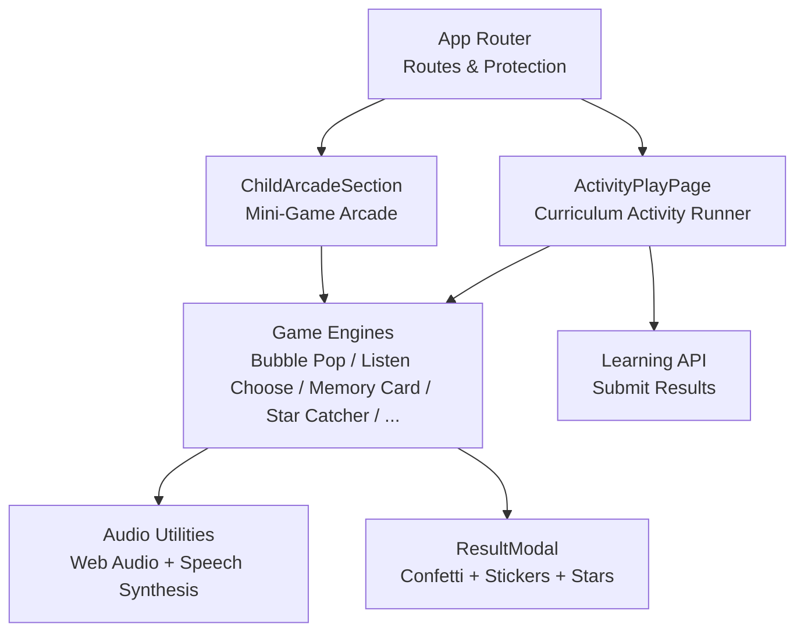

**Diagram sources**
- [App.tsx:40-130](file://client/src/App.tsx#L40-L130)
- [ActivityPlayPage.tsx:23-386](file://client/src/pages/child/ActivityPlayPage.tsx#L23-L386)
- [ChildArcadeSection.tsx:71-941](file://client/src/components/child/ChildArcadeSection.tsx#L71-L941)
- [audio.ts:1-360](file://client/src/utils/audio.ts#L1-L360)
- [ResultModal.tsx:1-226](file://client/src/components/child/ResultModal.tsx#L1-L226)
- [api.ts:142-158](file://client/src/services/api.ts#L142-L158)

**Section sources**
- [App.tsx:40-130](file://client/src/App.tsx#L40-L130)
- [ActivityPlayPage.tsx:23-386](file://client/src/pages/child/ActivityPlayPage.tsx#L23-L386)
- [ChildArcadeSection.tsx:71-941](file://client/src/components/child/ChildArcadeSection.tsx#L71-L941)

## Core Components
- ActivityPlayPage: Loads curriculum activities, manages per-question state, audio prompts, feedback, and submission of results
- ChildArcadeSection: Provides a curated set of mini-games with age-based unlocking, round progression, and local scoring
- Game Engines: Individual React components implementing distinct interaction patterns (e.g., bubble pop, listen-and-choose, memory cards, HTML5 canvas star catcher)
- Audio Utilities: Centralized sound effects engine and pronunciation helpers
- ResultModal: Celebration overlay with confetti, sticker awards, and star display
- Types: Shared TypeScript interfaces for activities, questions, options, and progress

Key responsibilities:
- Common interface: All engines accept a question or activity and emit answers via callbacks
- State management: Parent components track current question index, selected option, feedback state, recorded answers, and completion
- Scoring: Correct answers increment counters; final scores map to stars based on thresholds
- Progress tracking: Completed activities submit structured answer records to the backend

**Section sources**
- [ActivityPlayPage.tsx:23-386](file://client/src/pages/child/ActivityPlayPage.tsx#L23-L386)
- [ChildArcadeSection.tsx:71-941](file://client/src/components/child/ChildArcadeSection.tsx#L71-L941)
- [audio.ts:1-360](file://client/src/utils/audio.ts#L1-L360)
- [ResultModal.tsx:1-226](file://client/src/components/child/ResultModal.tsx#L1-L226)
- [index.ts:41-78](file://client/src/types/index.ts#L41-L78)

## Architecture Overview
The game engine architecture separates orchestration from rendering:
- Orchestration layers:
  - ActivityPlayPage coordinates curriculum-driven activities
  - ChildArcadeSection coordinates modular mini-games
- Rendering layers:
  - Game Engine components render specific interaction patterns
- Support layers:
  - Audio utilities for sound effects and pronunciation
  - Result modal for celebrations and rewards
  - API services for progress persistence

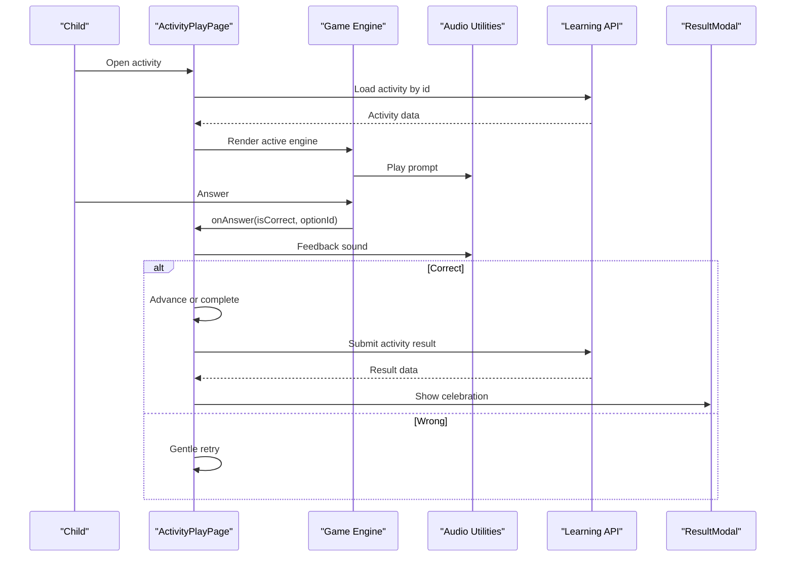

**Diagram sources**
- [ActivityPlayPage.tsx:40-192](file://client/src/pages/child/ActivityPlayPage.tsx#L40-L192)
- [audio.ts:217-318](file://client/src/utils/audio.ts#L217-L318)
- [api.ts:142-158](file://client/src/services/api.ts#L142-L158)
- [ResultModal.tsx:38-57](file://client/src/components/child/ResultModal.tsx#L38-L57)

## Detailed Component Analysis

### ActivityPlayPage: Curriculum Activity Orchestrator
Responsibilities:
- Fetch activity by ID and initialize session timing
- Auto-play prompt audio when question changes
- Manage feedback states and selection
- Record answers with response time and vocabulary context
- Submit completed activity results and show celebration modal

State model:
- activity: loaded curriculum activity
- currentIdx: current question index
- selectedOptionId: last selected option id
- feedbackState: idle | correct | wrong
- recordedAnswers: array of answer records
- loading, isFinished, resultData

Flow highlights:
- On mount, load activity and reset state
- On question change, stop previous audio, clear selection, auto-play prompt
- On answer:
  - Correct: mark feedback correct, play success sound, record answer, advance or complete
  - Wrong: mark feedback wrong, play gentle wrong sound, reset selection, replay prompt
- Completion: calculate duration, submit results, show ResultModal

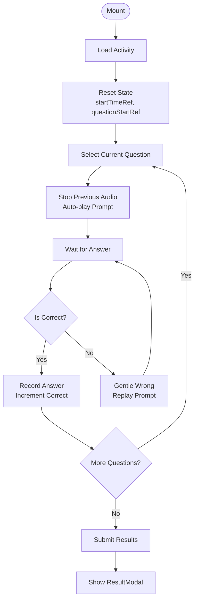

**Diagram sources**
- [ActivityPlayPage.tsx:40-192](file://client/src/pages/child/ActivityPlayPage.tsx#L40-L192)

**Section sources**
- [ActivityPlayPage.tsx:23-386](file://client/src/pages/child/ActivityPlayPage.tsx#L23-L386)

### ChildArcadeSection: Modular Mini-Game Arcade
Responsibilities:
- Provide a menu of 12 mini-games grouped by age levels
- Unlock games based on user age group
- Run rounds with progressive difficulty
- Compute local score and stars, then show result modal

Key behaviors:
- Age gating: games tagged with age groups; only unlocked games are playable
- Round setup: generates questions dynamically per game type (color recognition, counting, true/false, missing object, image-word match, animal sounds, etc.)
- Answer handling: tracks correct count, plays feedback sounds, advances rounds, and computes final stars
- Vocabulary pool: uses learned/mastered/review words or safe defaults

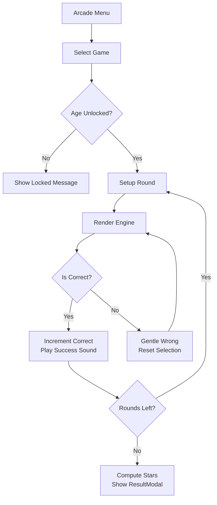

**Diagram sources**
- [ChildArcadeSection.tsx:91-114](file://client/src/components/child/ChildArcadeSection.tsx#L91-L114)
- [ChildArcadeSection.tsx:204-395](file://client/src/components/child/ChildArcadeSection.tsx#L204-L395)
- [ChildArcadeSection.tsx:397-463](file://client/src/components/child/ChildArcadeSection.tsx#L397-L463)
- [ChildArcadeSection.tsx:466-604](file://client/src/components/child/ChildArcadeSection.tsx#L466-L604)

**Section sources**
- [ChildArcadeSection.tsx:71-941](file://client/src/components/child/ChildArcadeSection.tsx#L71-L941)

### Game Engines: Interaction Patterns

#### BubblePopEngine
- Presents floating bubbles with images and words
- On tap, pops the bubble and reports correctness
- Uses audio prompt and sound effects

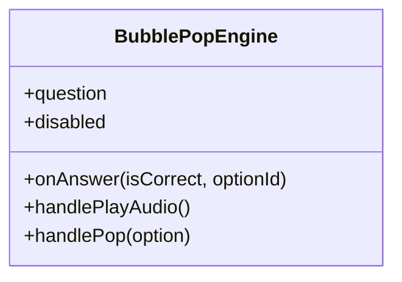

**Diagram sources**
- [BubblePopEngine.tsx:6-48](file://client/src/components/child/games/BubblePopEngine.tsx#L6-L48)

**Section sources**
- [BubblePopEngine.tsx:1-133](file://client/src/components/child/games/BubblePopEngine.tsx#L1-L133)

#### ListenChooseEngine
- Large audio button to hear the prompt
- Grid of visual choice cards with progressive difficulty (2–4 options)
- Highlights selected card with correct/wrong styles

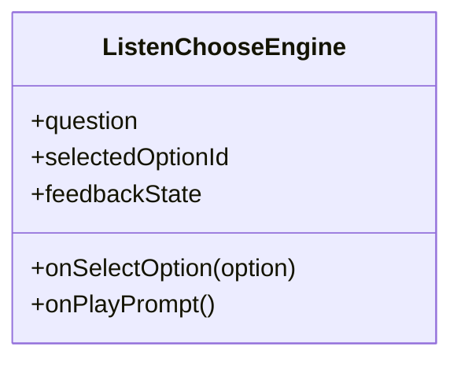

**Diagram sources**
- [ListenChooseEngine.tsx:5-19](file://client/src/components/child/games/ListenChooseEngine.tsx#L5-L19)

**Section sources**
- [ListenChooseEngine.tsx:1-109](file://client/src/components/child/games/ListenChooseEngine.tsx#L1-L109)

#### MemoryCardEngine
- Flips pairs of cards (image vs word)
- Matches pairs and marks them matched
- Plays pronunciation on flip and feedback sounds on match/mismatch

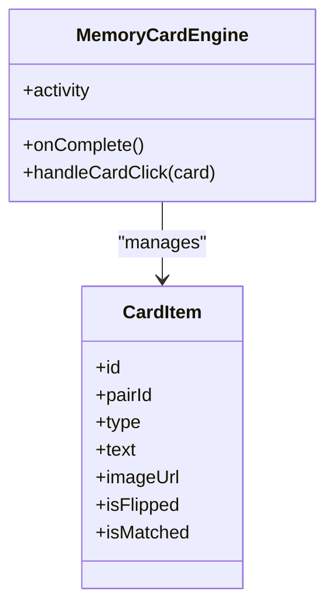

**Diagram sources**
- [MemoryCardEngine.tsx:6-14](file://client/src/components/child/games/MemoryCardEngine.tsx#L6-L14)
- [MemoryCardEngine.tsx:21-120](file://client/src/components/child/games/MemoryCardEngine.tsx#L21-L120)

**Section sources**
- [MemoryCardEngine.tsx:1-187](file://client/src/components/child/games/MemoryCardEngine.tsx#L1-L187)

#### StarCatcherEngine
- Canvas-based falling stars animation
- Touch/mouse control to move basket and catch stars
- Direct option buttons as alternative input
- Celebrates correct catch with particles and sound

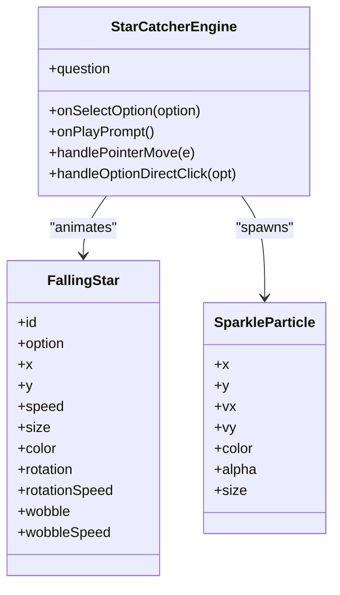

**Diagram sources**
- [StarCatcherEngine.tsx:14-36](file://client/src/components/child/games/StarCatcherEngine.tsx#L14-L36)
- [StarCatcherEngine.tsx:40-80](file://client/src/components/child/games/StarCatcherEngine.tsx#L40-L80)
- [StarCatcherEngine.tsx:87-294](file://client/src/components/child/games/StarCatcherEngine.tsx#L87-L294)
- [StarCatcherEngine.tsx:296-320](file://client/src/components/child/games/StarCatcherEngine.tsx#L296-L320)

**Section sources**
- [StarCatcherEngine.tsx:1-406](file://client/src/components/child/games/StarCatcherEngine.tsx#L1-L406)

### Audio System: Howler.js and Web Audio API Synthesis
Implementation notes:
- SoundEffectsEngine uses Web Audio API oscillators for UI sounds (pop, correct, gentle wrong, fanfare, badge chime)
- Pronunciation uses HTML5 Audio with SpeechSynthesis fallback
- Safety timers prevent hanging audio and cancel overlapping speech
- Autoplay policy handled by resuming AudioContext on user gestures

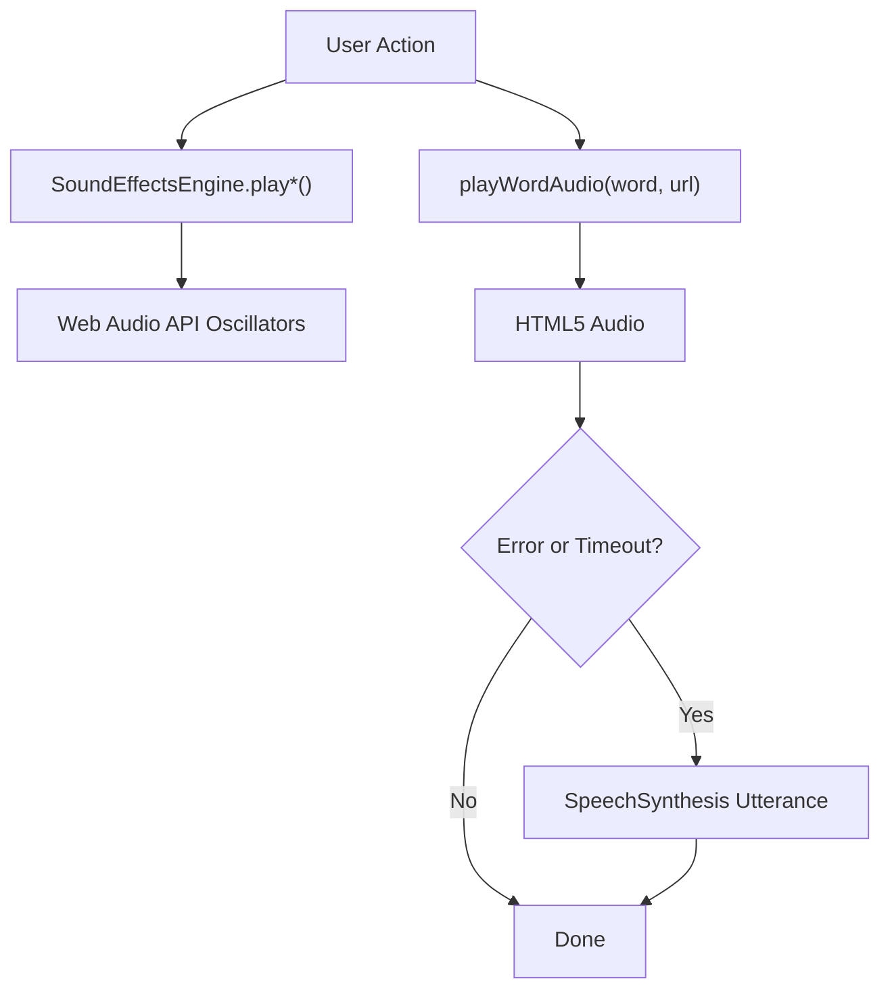

**Diagram sources**
- [audio.ts:1-180](file://client/src/utils/audio.ts#L1-L180)
- [audio.ts:184-318](file://client/src/utils/audio.ts#L184-L318)
- [audio.ts:320-358](file://client/src/utils/audio.ts#L320-L358)

**Section sources**
- [audio.ts:1-360](file://client/src/utils/audio.ts#L1-L360)

### Visual Reward System: Confetti, Badges, and Stars
- ResultModal triggers confetti and plays star fanfare when stars > 0
- Awards random stickers when stars >= 2
- Displays animated stars and encouragement messages
- Integrates mascot mascot animations and sound effects

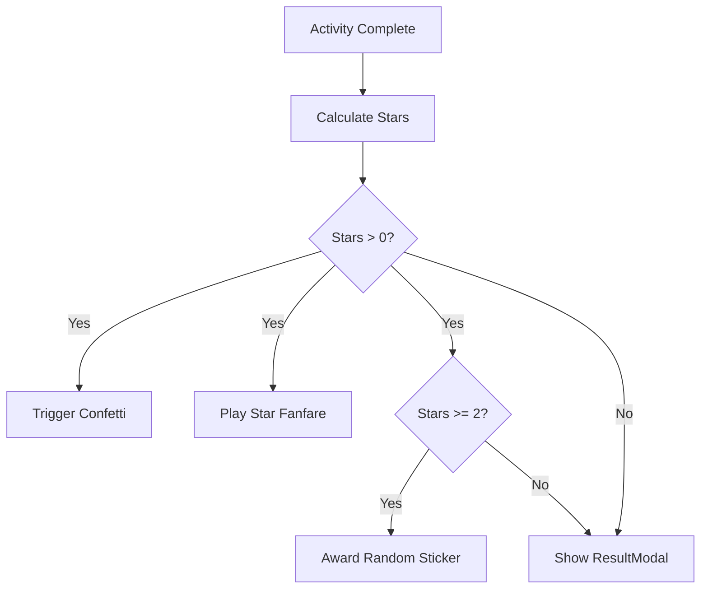

**Diagram sources**
- [ResultModal.tsx:38-57](file://client/src/components/child/ResultModal.tsx#L38-L57)
- [ResultModal.tsx:59-88](file://client/src/components/child/ResultModal.tsx#L59-L88)
- [ResultModal.tsx:159-177](file://client/src/components/child/ResultModal.tsx#L159-L177)

**Section sources**
- [ResultModal.tsx:1-226](file://client/src/components/child/ResultModal.tsx#L1-L226)

## Dependency Analysis
Component relationships:
- App.tsx defines protected routes for child pages, including ActivityPlayPage
- ActivityPlayPage imports all game engines and audio utilities, and calls learning API
- ChildArcadeSection imports game engines and audio utilities, and shows ResultModal
- Game Engines depend on audio utilities for feedback and pronunciation
- ResultModal depends on confetti and audio utilities

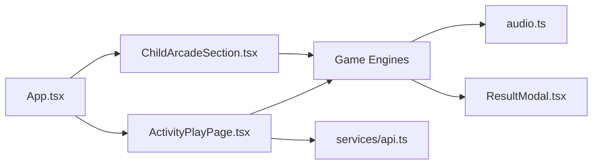

**Diagram sources**
- [App.tsx:40-130](file://client/src/App.tsx#L40-L130)
- [ActivityPlayPage.tsx:1-22](file://client/src/pages/child/ActivityPlayPage.tsx#L1-L22)
- [ChildArcadeSection.tsx:15-27](file://client/src/components/child/ChildArcadeSection.tsx#L15-L27)
- [api.ts:142-158](file://client/src/services/api.ts#L142-L158)

**Section sources**
- [App.tsx:40-130](file://client/src/App.tsx#L40-L130)
- [ActivityPlayPage.tsx:1-22](file://client/src/pages/child/ActivityPlayPage.tsx#L1-L22)
- [ChildArcadeSection.tsx:15-27](file://client/src/components/child/ChildArcadeSection.tsx#L15-L27)
- [api.ts:142-158](file://client/src/services/api.ts#L142-L158)

## Performance Considerations
- Audio context lifecycle:
  - Resume AudioContext on first user gesture to comply with autoplay policies
  - Cancel overlapping speech synthesis to avoid queue buildup
- Animation performance:
  - Use requestAnimationFrame for canvas-based games like StarCatcherEngine
  - Avoid heavy DOM updates during animation frames
- Touch interactions:
  - Use pointer events for unified mouse/touch handling
  - Debounce or throttle rapid taps if needed
- Image and media:
  - Prefer lazy loading and responsive images
  - Ensure audio URLs are cached or use CDN for low latency
- State updates:
  - Batch state changes where possible to reduce re-renders
  - Keep feedback states short-lived to maintain responsiveness

[No sources needed since this section provides general guidance]

## Troubleshooting Guide
Common issues and resolutions:
- No sound on first interaction:
  - Ensure user has interacted with the page to unlock AudioContext
  - Check browser autoplay policies and permissions
- Pronunciation not playing:
  - Verify remote audio URL availability and CORS
  - Confirm SpeechSynthesis fallback is enabled
- Canvas game unresponsive:
  - Ensure pointer events are attached correctly
  - Validate canvas dimensions and scaling calculations
- Incorrect feedback loops:
  - Verify feedback state transitions and timeouts
  - Ensure audio cleanup prevents overlapping playback

**Section sources**
- [audio.ts:1-38](file://client/src/utils/audio.ts#L1-L38)
- [audio.ts:184-212](file://client/src/utils/audio.ts#L184-L212)
- [audio.ts:217-318](file://client/src/utils/audio.ts#L217-L318)
- [StarCatcherEngine.tsx:296-320](file://client/src/components/child/games/StarCatcherEngine.tsx#L296-L320)

## Conclusion
KCEnglishKids’ interactive game engines provide a consistent, child-friendly experience across multiple activity types. The architecture cleanly separates orchestration from rendering, leverages Web Audio API and SpeechSynthesis for robust audio feedback, and integrates with the curriculum framework for meaningful learning outcomes. The reward system reinforces engagement through confetti, stickers, and stars. Following the implementation guidelines below will help extend the platform with new games while maintaining performance and accessibility.

[No sources needed since this section summarizes without analyzing specific files]

## Appendices

### Implementation Guidelines for New Game Types
- Define a new engine component under client/src/components/child/games
- Accept props:
  - question: ActivityQuestion
  - onAnswer: (isCorrect: boolean, optionId: string) => void
  - disabled?: boolean
- Integrate audio:
  - Use playWordAudio for prompts
  - Use sfx.playCorrect/sfx.playGentleWrong for feedback
- Connect to parent:
  - For ActivityPlayPage: add conditional rendering based on activity.activityType
  - For ChildArcadeSection: add game definition in ALL_GAMES and handle round setup
- Test:
  - Verify feedback states, audio behavior, and touch interactions
  - Ensure no overlapping audio and proper cleanup on unmount

**Section sources**
- [ActivityPlayPage.tsx:270-349](file://client/src/pages/child/ActivityPlayPage.tsx#L270-L349)
- [ChildArcadeSection.tsx:466-604](file://client/src/components/child/ChildArcadeSection.tsx#L466-L604)
- [audio.ts:217-318](file://client/src/utils/audio.ts#L217-L318)

### Extending Existing Games
- Add new question metadata fields to ActivityQuestion if needed
- Update engine logic to interpret metadata for richer interactions
- Maintain backward compatibility by defaulting unknown fields

**Section sources**
- [index.ts:50-60](file://client/src/types/index.ts#L50-L60)
- [MemoryCardEngine.tsx:29-66](file://client/src/components/child/games/MemoryCardEngine.tsx#L29-L66)

### Integrating with the Curriculum Framework
- Activities are fetched via activitiesApi.getActivityById
- Lessons and topics drive activity selection and progression
- Progress is submitted via learningApi.submitActivityResult

**Section sources**
- [api.ts:137-158](file://client/src/services/api.ts#L137-L158)
- [ActivityPlayPage.tsx:40-76](file://client/src/pages/child/ActivityPlayPage.tsx#L40-L76)
- [ActivityPlayPage.tsx:171-192](file://client/src/pages/child/ActivityPlayPage.tsx#L171-L192)