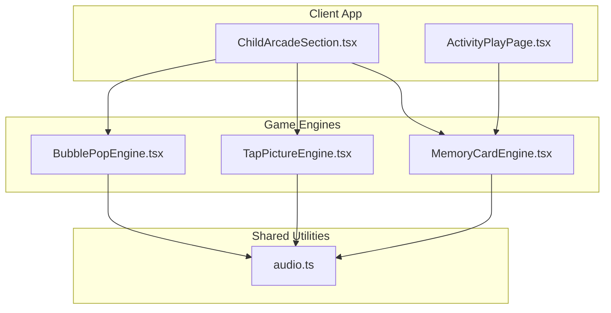
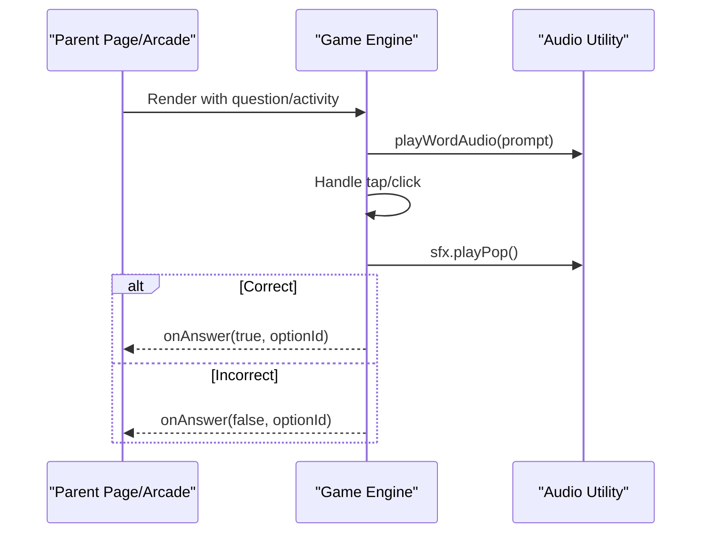
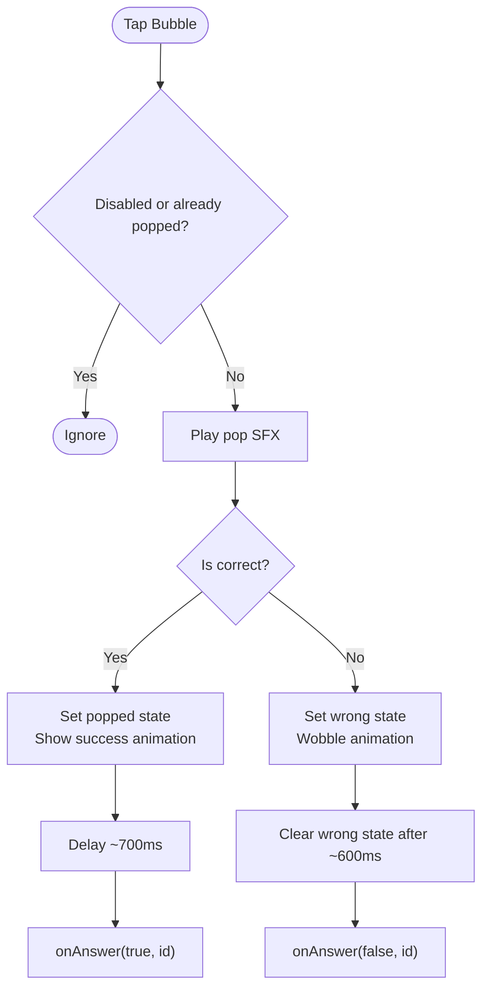
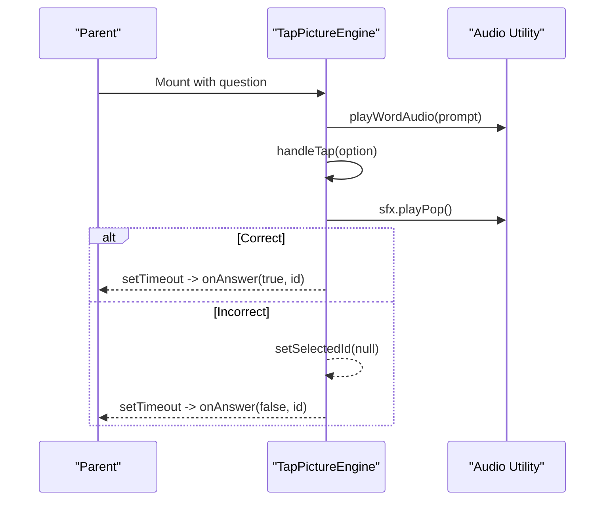
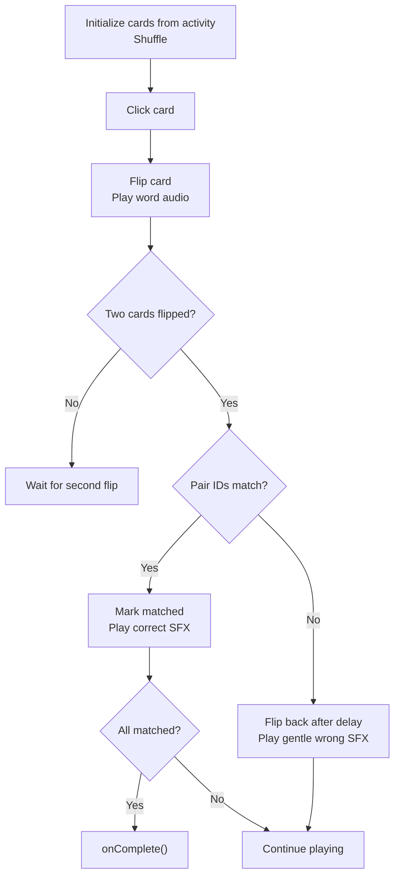
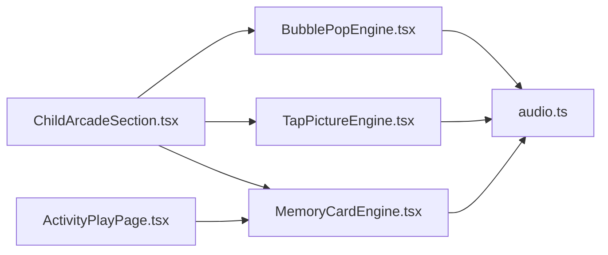

# Interactive Mechanics Games

<cite>
**Referenced Files in This Document**
- [BubblePopEngine.tsx](file://client/src/components/child/games/BubblePopEngine.tsx)
- [TapPictureEngine.tsx](file://client/src/components/child/games/TapPictureEngine.tsx)
- [MemoryCardEngine.tsx](file://client/src/components/child/games/MemoryCardEngine.tsx)
- [audio.ts](file://client/src/utils/audio.ts)
- [ChildArcadeSection.tsx](file://client/src/components/child/ChildArcadeSection.tsx)
- [ActivityPlayPage.tsx](file://client/src/pages/child/ActivityPlayPage.tsx)
</cite>

## Table of Contents
1. [Introduction](#introduction)
2. [Project Structure](#project-structure)
3. [Core Components](#core-components)
4. [Architecture Overview](#architecture-overview)
5. [Detailed Component Analysis](#detailed-component-analysis)
6. [Dependency Analysis](#dependency-analysis)
7. [Performance Considerations](#performance-considerations)
8. [Troubleshooting Guide](#troubleshooting-guide)
9. [Conclusion](#conclusion)

## Introduction
This document explains the interactive mechanics-based game engines used for early childhood English learning in KCEnglishKids. It focuses on three core games:
- Bubble Pop: touch/click interactions, bubble visuals, pop animations, and correctness feedback.
- Tap Picture: image selection and recognition with large, toddler-friendly UI and audio prompts.
- Memory Card: card flip animations, pair matching logic, completion detection, and progression handling.

The documentation covers technical implementation details including gesture handling, animation performance, responsive design, and accessibility considerations tailored for motor skill development.

## Project Structure
The game engines are React components under the child-facing client application. They receive structured question/activity data from parent pages or arcade sections and report results back via callbacks. Audio and sound effects are centralized to ensure consistent UX across games.

**Diagram sources**
- [ChildArcadeSection.tsx:814-862](file://client/src/components/child/ChildArcadeSection.tsx#L814-L862)
- [ActivityPlayPage.tsx:270-302](file://client/src/pages/child/ActivityPlayPage.tsx#L270-L302)
- [BubblePopEngine.tsx:1-133](file://client/src/components/child/games/BubblePopEngine.tsx#L1-L133)
- [TapPictureEngine.tsx:1-132](file://client/src/components/child/games/TapPictureEngine.tsx#L1-L132)
- [MemoryCardEngine.tsx:1-187](file://client/src/components/child/games/MemoryCardEngine.tsx#L1-L187)
- [audio.ts:1-360](file://client/src/utils/audio.ts#L1-L360)

**Section sources**
- [ChildArcadeSection.tsx:787-862](file://client/src/components/child/ChildArcadeSection.tsx#L787-L862)
- [ActivityPlayPage.tsx:270-302](file://client/src/pages/child/ActivityPlayPage.tsx#L270-L302)

## Core Components
- BubblePopEngine: Presents floating bubbles with images and words. The child taps a bubble to “pop” it. Correct pops show a success animation; incorrect ones wobble briefly. Audio prompts reinforce vocabulary.
- TapPictureEngine: Shows large picture cards with optional word labels. Auto-plays audio prompt on mount. Tapping selects an option with immediate visual feedback and delayed result callback.
- MemoryCardEngine: Builds pairs of image and word cards based on activity questions. Supports flipping, matching, mismatch handling, and completion detection.

All engines use shared audio utilities for pronunciation and sound effects.

**Section sources**
- [BubblePopEngine.tsx:12-48](file://client/src/components/child/games/BubblePopEngine.tsx#L12-L48)
- [TapPictureEngine.tsx:12-48](file://client/src/components/child/games/TapPictureEngine.tsx#L12-L48)
- [MemoryCardEngine.tsx:21-66](file://client/src/components/child/games/MemoryCardEngine.tsx#L21-L66)
- [audio.ts:182-360](file://client/src/utils/audio.ts#L182-L360)

## Architecture Overview
The engines follow a simple event-driven pattern:
- Parent orchestrates which engine to render.
- Engine renders interactive UI and plays audio/sfx.
- On interaction, engine calls a callback with correctness and selected option ID.
- Parent updates progress, score, and navigates to next state.

**Diagram sources**
- [BubblePopEngine.tsx:31-48](file://client/src/components/child/games/BubblePopEngine.tsx#L31-L48)
- [TapPictureEngine.tsx:32-48](file://client/src/components/child/games/TapPictureEngine.tsx#L32-L48)
- [audio.ts:217-284](file://client/src/utils/audio.ts#L217-L284)

## Detailed Component Analysis

### Bubble Pop Engine
Mechanics:
- Displays multiple bubbles with gradient backgrounds, reflections, and floating animations.
- Each bubble shows an image (optional) and a word label.
- Tapping a bubble triggers:
  - Sound effect pop.
  - If correct: set popped state, show success animation, then call onAnswer(true, id).
  - If incorrect: set wrong state, wobble animation, clear after delay, then call onAnswer(false, id).

Interaction model:
- Uses onClick handlers on buttons styled as bubbles.
- Disabled during feedback states to prevent double-taps.

Accessibility and responsiveness:
- Large target sizes and high contrast colors support small fingers.
- Responsive grid scales across screen sizes.
- aria attributes can be added to improve screen reader support.

**Diagram sources**
- [BubblePopEngine.tsx:31-48](file://client/src/components/child/games/BubblePopEngine.tsx#L31-L48)

**Section sources**
- [BubblePopEngine.tsx:12-48](file://client/src/components/child/games/BubblePopEngine.tsx#L12-L48)
- [BubblePopEngine.tsx:50-133](file://client/src/components/child/games/BubblePopEngine.tsx#L50-L133)

### Tap Picture Engine
Mechanics:
- Auto-plays audio prompt shortly after mount to guide toddlers.
- Limits options to 2–3 cards for age-appropriate difficulty.
- Tapping a card:
  - Plays pop SFX.
  - Selects the card visually.
  - If correct: delays and reports true.
  - If incorrect: clears selection after short delay and reports false.

Visual feedback:
- Selected correct card gets a green ring and bounce animation.
- Incorrect selection wobbles and is cleared.

Responsiveness:
- Grid adapts to 2 or 3 columns depending on number of options.
- Large images and text improve readability on all devices.

**Diagram sources**
- [TapPictureEngine.tsx:19-48](file://client/src/components/child/games/TapPictureEngine.tsx#L19-L48)
- [audio.ts:217-284](file://client/src/utils/audio.ts#L217-L284)

**Section sources**
- [TapPictureEngine.tsx:12-51](file://client/src/components/child/games/TapPictureEngine.tsx#L12-L51)
- [TapPictureEngine.tsx:53-132](file://client/src/components/child/games/TapPictureEngine.tsx#L53-L132)

### Memory Card Engine
Mechanics:
- Initializes cards from activity questions:
  - Determines max pairs by age group code.
  - Creates two cards per pair: one image card and one word card.
  - Shuffles cards randomly.
- Interaction flow:
  - Clicking a card flips it and plays its word audio.
  - When two cards are flipped:
    - If pair IDs match: mark matched, play correct SFX, check completion.
    - If not: flip both back after delay, play gentle wrong SFX.

Progression:
- Completion triggers onComplete callback after a short delay.

State management:
- Tracks flippedIds and isProcessing to prevent rapid re-flips.
- Cards track isFlipped and isMatched for rendering.

**Diagram sources**
- [MemoryCardEngine.tsx:29-66](file://client/src/components/child/games/MemoryCardEngine.tsx#L29-L66)
- [MemoryCardEngine.tsx:68-120](file://client/src/components/child/games/MemoryCardEngine.tsx#L68-L120)

**Section sources**
- [MemoryCardEngine.tsx:21-66](file://client/src/components/child/games/MemoryCardEngine.tsx#L21-L66)
- [MemoryCardEngine.tsx:68-120](file://client/src/components/child/games/MemoryCardEngine.tsx#L68-L120)
- [MemoryCardEngine.tsx:122-187](file://client/src/components/child/games/MemoryCardEngine.tsx#L122-L187)

## Dependency Analysis
Engines depend on:
- Shared audio utility for pronunciation and sound effects.
- Parent components for routing and state management.

**Diagram sources**
- [BubblePopEngine.tsx:1-5](file://client/src/components/child/games/BubblePopEngine.tsx#L1-L5)
- [TapPictureEngine.tsx:1-5](file://client/src/components/child/games/TapPictureEngine.tsx#L1-L5)
- [MemoryCardEngine.tsx:1-5](file://client/src/components/child/games/MemoryCardEngine.tsx#L1-L5)
- [audio.ts:182-360](file://client/src/utils/audio.ts#L182-L360)
- [ChildArcadeSection.tsx:814-862](file://client/src/components/child/ChildArcadeSection.tsx#L814-L862)
- [ActivityPlayPage.tsx:270-302](file://client/src/pages/child/ActivityPlayPage.tsx#L270-L302)

**Section sources**
- [ChildArcadeSection.tsx:814-862](file://client/src/components/child/ChildArcadeSection.tsx#L814-L862)
- [ActivityPlayPage.tsx:270-302](file://client/src/pages/child/ActivityPlayPage.tsx#L270-L302)

## Performance Considerations
- Animation strategy:
  - CSS transitions and Tailwind utility classes provide lightweight animations (scale, ring, pulse, bounce).
  - Avoid heavy layout thrashing by using transform and opacity where possible.
- Audio optimization:
  - Centralized SoundEffectsEngine uses oscillators for short, low-cost sounds.
  - HTML5 audio with speech synthesis fallback ensures robustness without blocking UI.
- Rendering efficiency:
  - Engines keep minimal local state and avoid unnecessary re-renders by gating interactions during feedback.
  - Grid layouts adapt to device size without complex recalculations.

[No sources needed since this section provides general guidance]

## Troubleshooting Guide
Common issues and resolutions:
- No sound on first interaction:
  - Browsers require user gesture to unlock AudioContext. The utility listens for click/touch/pointer events to resume context automatically.
- Word audio does not play:
  - If remote audio fails or times out, the utility falls back to speech synthesis. Ensure network connectivity or verify fallback behavior.
- Animations feel laggy:
  - Prefer transform-based animations and avoid expensive filters on large images. Keep image sizes reasonable and use object-fit.
- Touch targets too small:
  - Increase button/card sizes and spacing for toddlers’ motor skills. Use large fonts and high-contrast borders.

**Section sources**
- [audio.ts:1-38](file://client/src/utils/audio.ts#L1-L38)
- [audio.ts:217-284](file://client/src/utils/audio.ts#L217-L284)

## Conclusion
KCEnglishKids implements child-friendly game engines that combine intuitive touch interactions, accessible visuals, and reliable audio feedback. Bubble Pop, Tap Picture, and Memory Card demonstrate scalable patterns for early education apps: simple state machines, responsive layouts, and shared audio utilities. These patterns support motor skill development and inclusive design while maintaining performance and usability across devices.

[No sources needed since this section summarizes without analyzing specific files]