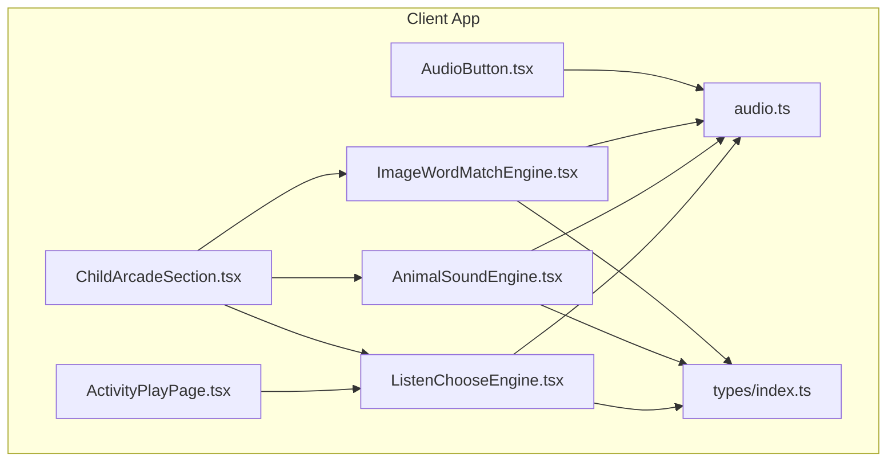
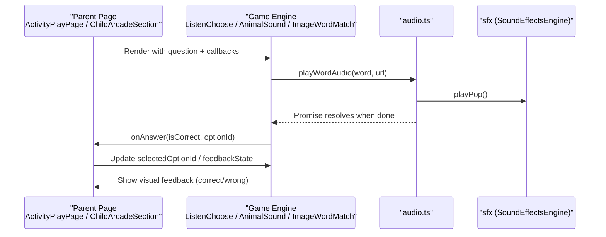
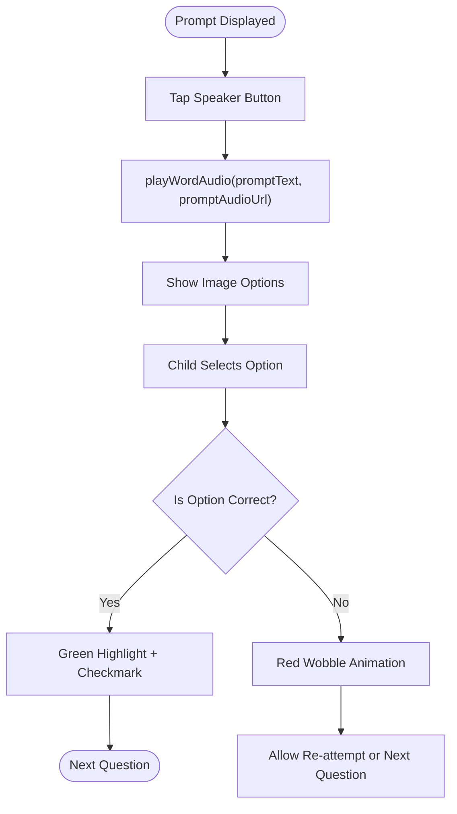
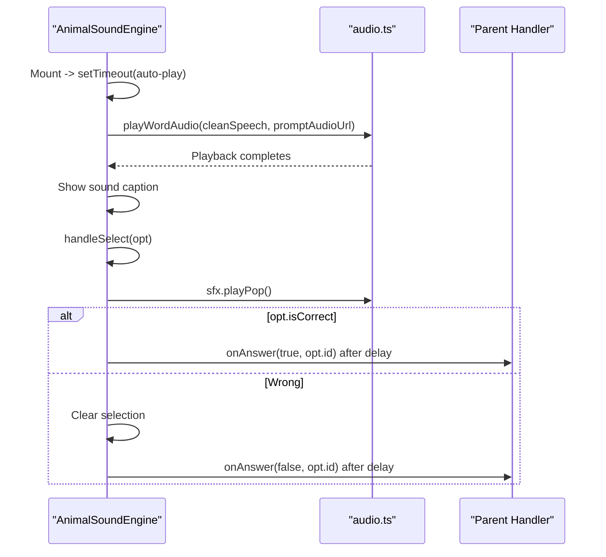
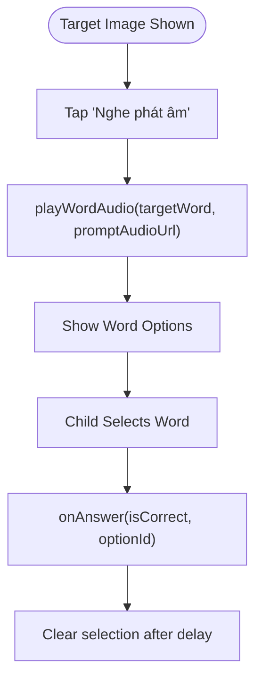
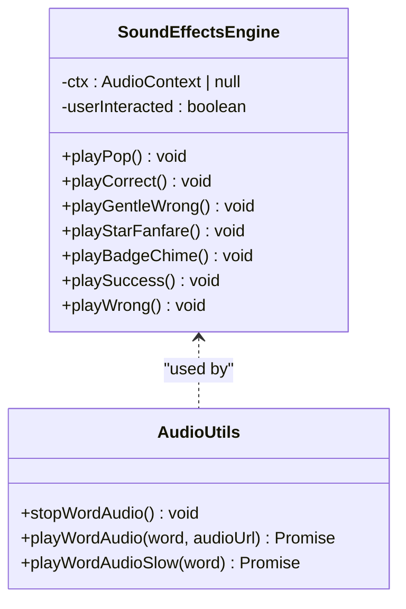
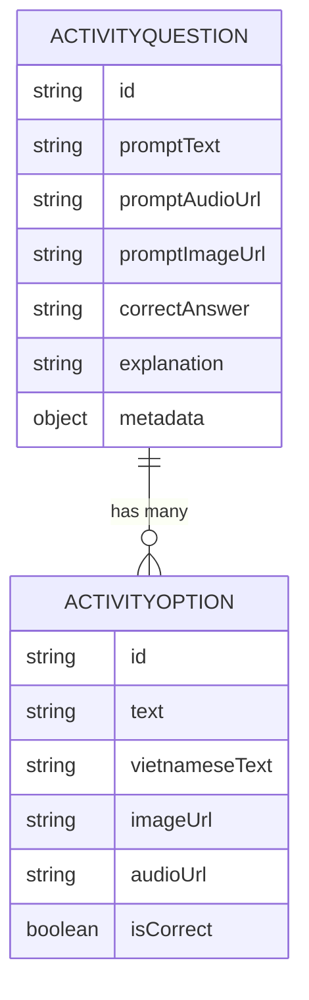
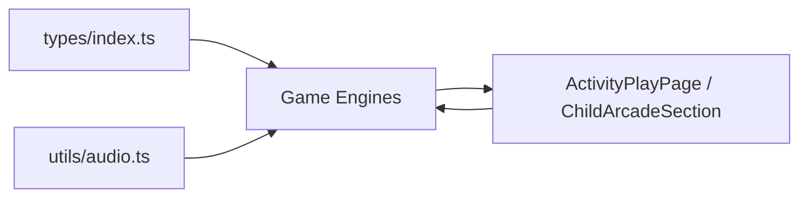

# Listening & Comprehension Games

<cite>
**Referenced Files in This Document**
- [ListenChooseEngine.tsx](file://client/src/components/child/games/ListenChooseEngine.tsx)
- [AnimalSoundEngine.tsx](file://client/src/components/child/games/AnimalSoundEngine.tsx)
- [ImageWordMatchEngine.tsx](file://client/src/components/child/games/ImageWordMatchEngine.tsx)
- [audio.ts](file://client/src/utils/audio.ts)
- [AudioButton.tsx](file://client/src/components/child/AudioButton.tsx)
- [index.ts](file://client/src/types/index.ts)
- [ActivityPlayPage.tsx](file://client/src/pages/child/ActivityPlayPage.tsx)
- [ChildArcadeSection.tsx](file://client/src/components/child/ChildArcadeSection.tsx)
</cite>

## Table of Contents
1. [Introduction](#introduction)
2. [Project Structure](#project-structure)
3. [Core Components](#core-components)
4. [Architecture Overview](#architecture-overview)
5. [Detailed Component Analysis](#detailed-component-analysis)
6. [Dependency Analysis](#dependency-analysis)
7. [Performance Considerations](#performance-considerations)
8. [Troubleshooting Guide](#troubleshooting-guide)
9. [Conclusion](#conclusion)

## Introduction
This document explains the listening and comprehension game engines in KCEnglishKids, focusing on three core experiences:
- Listen & Choose: children hear an audio prompt and select the correct image.
- Animal Sound Engine: children match animal sounds with the correct animal name.
- Image Word Match: children connect a visual stimulus to the correct vocabulary word.

It covers audio playback controls, answer validation, feedback systems, sound file management, audio recognition patterns, accessibility considerations, and progressive difficulty scaling.

## Project Structure
The listening and comprehension features are implemented as React components under the child games directory, with shared audio utilities and type definitions supporting data contracts across the application.

**Diagram sources**
- [ActivityPlayPage.tsx:331-352](file://client/src/pages/child/ActivityPlayPage.tsx#L331-L352)
- [ChildArcadeSection.tsx:860-887](file://client/src/components/child/ChildArcadeSection.tsx#L860-L887)
- [ListenChooseEngine.tsx:1-109](file://client/src/components/child/games/ListenChooseEngine.tsx#L1-L109)
- [AnimalSoundEngine.tsx:1-159](file://client/src/components/child/games/AnimalSoundEngine.tsx#L1-L159)
- [ImageWordMatchEngine.tsx:1-108](file://client/src/components/child/games/ImageWordMatchEngine.tsx#L1-L108)
- [AudioButton.tsx:1-74](file://client/src/components/child/AudioButton.tsx#L1-L74)
- [audio.ts:1-360](file://client/src/utils/audio.ts#L1-L360)
- [index.ts:41-60](file://client/src/types/index.ts#L41-L60)

**Section sources**
- [ListenChooseEngine.tsx:1-109](file://client/src/components/child/games/ListenChooseEngine.tsx#L1-L109)
- [AnimalSoundEngine.tsx:1-159](file://client/src/components/child/games/AnimalSoundEngine.tsx#L1-L159)
- [ImageWordMatchEngine.tsx:1-108](file://client/src/components/child/games/ImageWordMatchEngine.tsx#L1-L108)
- [audio.ts:1-360](file://client/src/utils/audio.ts#L1-L360)
- [AudioButton.tsx:1-74](file://client/src/components/child/AudioButton.tsx#L1-L74)
- [index.ts:41-60](file://client/src/types/index.ts#L41-L60)
- [ActivityPlayPage.tsx:331-352](file://client/src/pages/child/ActivityPlayPage.tsx#L331-L352)
- [ChildArcadeSection.tsx:860-887](file://client/src/components/child/ChildArcadeSection.tsx#L860-L887)

## Core Components
- ListenChooseEngine: Presents a large audio button for the prompt, displays image options, and applies visual feedback based on correctness. It supports progressive grid layouts depending on the number of choices.
- AnimalSoundEngine: Plays animal sound cues via text-to-speech or audio files, auto-plays on mount, and validates answers with timed feedback.
- ImageWordMatchEngine: Shows a target image and word pronunciation, then asks the child to pick the matching English word from options.
- Audio utilities: Provide centralized audio playback, speech synthesis fallback, safety timers, and sound effects.
- Types: Define ActivityQuestion and ActivityOption used by all game engines.

Key responsibilities:
- Audio playback control and synchronization
- Answer selection and validation
- Visual feedback (correct/wrong)
- Accessibility-friendly interactions (large buttons, clear labels)
- Progressive difficulty through option count and layout

**Section sources**
- [ListenChooseEngine.tsx:20-105](file://client/src/components/child/games/ListenChooseEngine.tsx#L20-L105)
- [AnimalSoundEngine.tsx:38-70](file://client/src/components/child/games/AnimalSoundEngine.tsx#L38-L70)
- [ImageWordMatchEngine.tsx:19-31](file://client/src/components/child/games/ImageWordMatchEngine.tsx#L19-L31)
- [audio.ts:217-284](file://client/src/utils/audio.ts#L217-L284)
- [index.ts:41-60](file://client/src/types/index.ts#L41-L60)

## Architecture Overview
The game engines are stateless presentational components that receive question data and callbacks from parent pages. They delegate audio playback to a shared utility module and use consistent feedback patterns.

**Diagram sources**
- [ActivityPlayPage.tsx:331-352](file://client/src/pages/child/ActivityPlayPage.tsx#L331-L352)
- [ChildArcadeSection.tsx:860-887](file://client/src/components/child/ChildArcadeSection.tsx#L860-L887)
- [ListenChooseEngine.tsx:29-38](file://client/src/components/child/games/ListenChooseEngine.tsx#L29-L38)
- [AnimalSoundEngine.tsx:38-52](file://client/src/components/child/games/AnimalSoundEngine.tsx#L38-L52)
- [ImageWordMatchEngine.tsx:19-21](file://client/src/components/child/games/ImageWordMatchEngine.tsx#L19-L21)
- [audio.ts:217-284](file://client/src/utils/audio.ts#L217-L284)

## Detailed Component Analysis

### Listen & Choose Engine
Mechanics:
- Children tap a large speaker button to hear the prompt.
- The component shows image cards with optional Vietnamese translations.
- After selecting an option, it disables further interaction until feedback is resolved.
- Correct selections show a green highlight and checkmark; wrong selections show red wobble.

Audio playback:
- Delegates to playWordAudio with the prompt text and optional audio URL.
- Uses sfx.playPop for tactile feedback when starting playback.

Progressive difficulty:
- Grid layout adapts to 2, 3, or 4 options for better usability by age group.

Accessibility:
- Large interactive targets and clear visual states support young users.
- aria-labels can be added to buttons for screen readers.

**Diagram sources**
- [ListenChooseEngine.tsx:29-38](file://client/src/components/child/games/ListenChooseEngine.tsx#L29-L38)
- [ListenChooseEngine.tsx:52-105](file://client/src/components/child/games/ListenChooseEngine.tsx#L52-L105)
- [audio.ts:217-284](file://client/src/utils/audio.ts#L217-L284)

**Section sources**
- [ListenChooseEngine.tsx:20-105](file://client/src/components/child/games/ListenChooseEngine.tsx#L20-L105)
- [audio.ts:217-284](file://client/src/utils/audio.ts#L217-L284)

### Animal Sound Engine
Mechanics:
- Auto-plays a sound cue shortly after mount using playWordAudio.
- Provides a manual replay button for the sound cue.
- Validates the selected animal against the correct answer and provides delayed feedback.

Sound file management and recognition patterns:
- Uses metadata.soundText if provided; otherwise falls back to a built-in map of common animal sounds.
- Cleans non-alphanumeric characters before TTS to ensure clean speech.
- If no audio URL is available, speech synthesis is used as a reliable fallback.

Timing controls:
- Initial auto-play delay ensures UI is ready before audio starts.
- Selection feedback uses short timeouts to allow visual confirmation before moving on.

**Diagram sources**
- [AnimalSoundEngine.tsx:38-70](file://client/src/components/child/games/AnimalSoundEngine.tsx#L38-L70)
- [AnimalSoundEngine.tsx:46-52](file://client/src/components/child/games/AnimalSoundEngine.tsx#L46-L52)
- [audio.ts:217-284](file://client/src/utils/audio.ts#L217-L284)

**Section sources**
- [AnimalSoundEngine.tsx:20-70](file://client/src/components/child/games/AnimalSoundEngine.tsx#L20-L70)
- [audio.ts:217-284](file://client/src/utils/audio.ts#L217-L284)

### Image Word Match Engine
Mechanics:
- Displays a target image and a pronunciation button.
- Presents vocabulary words as selectable options.
- On selection, immediately reports correctness and clears selection after a short delay.

Pronunciation features:
- Uses playWordAudio to pronounce the target word and optionally plays the associated audio file.

Drag-and-drop note:
- The current implementation uses click/tap selection rather than drag-and-drop. Drag-and-drop would require additional state and event handling beyond the current code.

**Diagram sources**
- [ImageWordMatchEngine.tsx:19-31](file://client/src/components/child/games/ImageWordMatchEngine.tsx#L19-L31)
- [ImageWordMatchEngine.tsx:33-35](file://client/src/components/child/games/ImageWordMatchEngine.tsx#L33-L35)
- [audio.ts:217-284](file://client/src/utils/audio.ts#L217-L284)

**Section sources**
- [ImageWordMatchEngine.tsx:19-35](file://client/src/components/child/games/ImageWordMatchEngine.tsx#L19-L35)
- [audio.ts:217-284](file://client/src/utils/audio.ts#L217-L284)

### Audio Utilities and Sound Effects
Responsibilities:
- Centralized audio playback with HTML5 Audio and SpeechSynthesis fallback.
- Safety timer prevents hanging audio and triggers fallback if needed.
- Sound effects engine generates playful tones for user interactions.

Key behaviors:
- stopWordAudio halts any ongoing audio or speech synthesis.
- playWordAudio attempts remote audio first, then falls back to TTS.
- playWordAudioSlow provides slower pronunciation for early learners.
- sfx methods provide pop, correct, gentle wrong, star fanfare, and badge chime.

**Diagram sources**
- [audio.ts:1-182](file://client/src/utils/audio.ts#L1-L182)
- [audio.ts:184-360](file://client/src/utils/audio.ts#L184-L360)

**Section sources**
- [audio.ts:1-360](file://client/src/utils/audio.ts#L1-L360)

### Data Contracts
All game engines consume ActivityQuestion and ActivityOption types, which define:
- Prompt text and optional media URLs
- Correct answer string
- Array of options with text, optional Vietnamese translation, image/audio URLs, and correctness flag
- Metadata for specialized games (e.g., soundText, imageUrl, word)

**Diagram sources**
- [index.ts:41-60](file://client/src/types/index.ts#L41-L60)

**Section sources**
- [index.ts:41-60](file://client/src/types/index.ts#L41-L60)

## Dependency Analysis
- Game engines depend on:
  - audio.ts for playback and sound effects
  - types/index.ts for data structures
- Parent pages orchestrate:
  - Rendering the appropriate engine
  - Managing selectedOptionId and feedbackState
  - Handling onAnswer callbacks to progress the activity

**Diagram sources**
- [index.ts:41-60](file://client/src/types/index.ts#L41-L60)
- [audio.ts:1-360](file://client/src/utils/audio.ts#L1-L360)
- [ActivityPlayPage.tsx:331-352](file://client/src/pages/child/ActivityPlayPage.tsx#L331-L352)
- [ChildArcadeSection.tsx:860-887](file://client/src/components/child/ChildArcadeSection.tsx#L860-L887)

**Section sources**
- [ActivityPlayPage.tsx:331-352](file://client/src/pages/child/ActivityPlayPage.tsx#L331-L352)
- [ChildArcadeSection.tsx:860-887](file://client/src/components/child/ChildArcadeSection.tsx#L860-L887)
- [index.ts:41-60](file://client/src/types/index.ts#L41-L60)
- [audio.ts:1-360](file://client/src/utils/audio.ts#L1-L360)

## Performance Considerations
- Audio playback:
  - Immediate cancellation of previous audio/speech prevents overlapping sounds.
  - Safety timeout avoids long stalls if remote audio fails to load.
- User experience:
  - Short delays around feedback allow animations to complete without blocking input.
  - Large touch targets reduce mis-taps on small screens.
- Memory and resources:
  - Avoid creating multiple Audio instances per prompt; reuse cleanup logic.
  - Prefer TTS fallback when network conditions are poor.

[No sources needed since this section provides general guidance]

## Troubleshooting Guide
Common issues and resolutions:
- No audio plays:
  - Ensure user interaction has occurred to unlock AudioContext.
  - Verify promptAudioUrl is a valid HTTP(S) link; otherwise TTS will be used.
- Audio hangs or does not stop:
  - stopWordAudio cancels both HTML5 audio and speech synthesis.
- Incorrect feedback timing:
  - Review setTimeout values in game engines and adjust to match animation durations.
- Accessibility concerns:
  - Add aria-labels to interactive elements for screen reader support.
  - Provide captions or transcripts for audio prompts where possible.

**Section sources**
- [audio.ts:184-212](file://client/src/utils/audio.ts#L184-L212)
- [audio.ts:217-284](file://client/src/utils/audio.ts#L217-L284)
- [AudioButton.tsx:56-68](file://client/src/components/child/AudioButton.tsx#L56-L68)

## Conclusion
KCEnglishKids implements robust listening and comprehension games through focused React components and a shared audio utility layer. The engines provide intuitive audio controls, clear feedback, and scalable difficulty via option counts and layouts. The audio system ensures reliable playback with fallbacks and sound effects, while the data model standardizes how questions and options are structured. Future enhancements could include drag-and-drop for Image Word Match, richer accessibility features, and more granular difficulty scaling based on performance metrics.