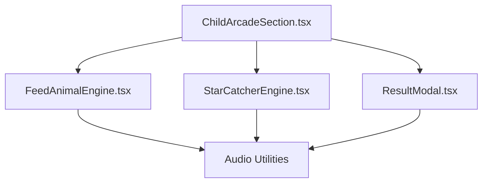
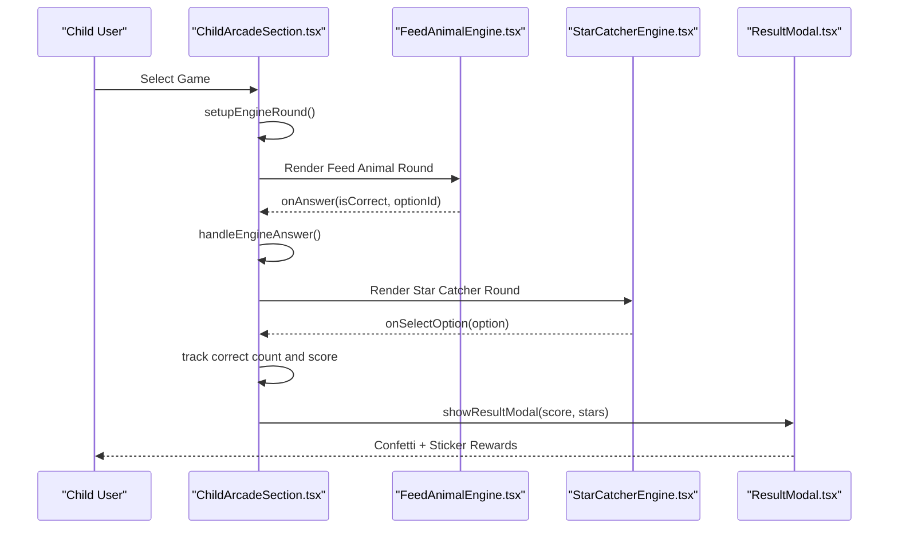
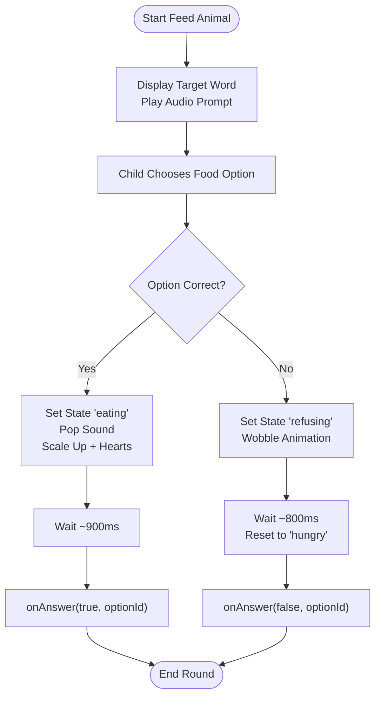
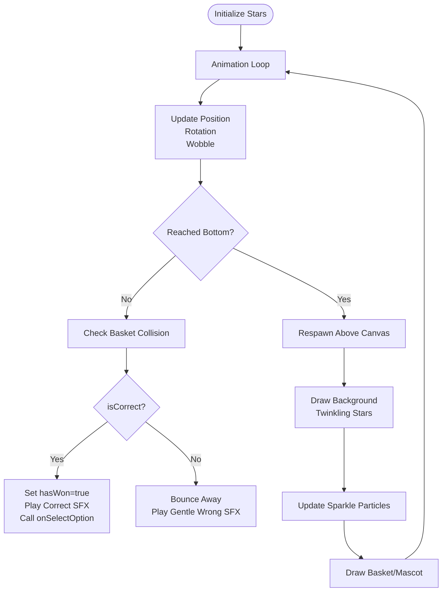
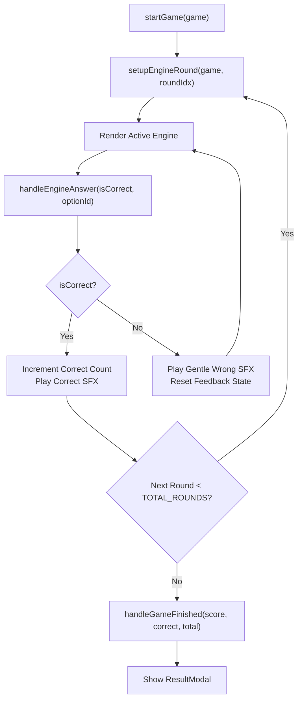
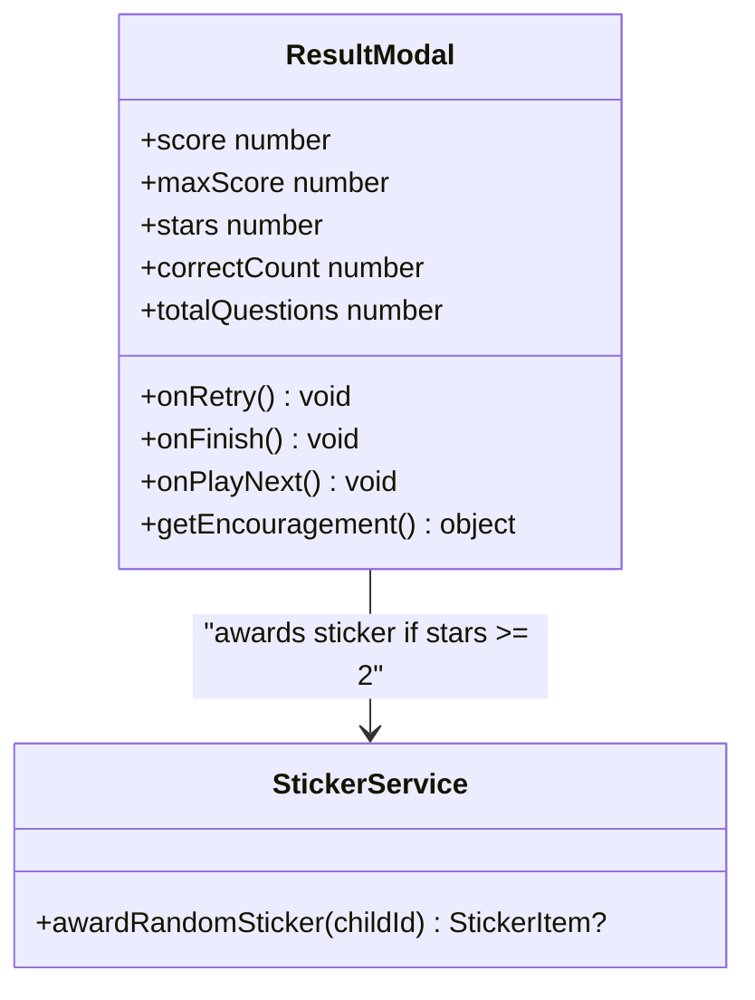
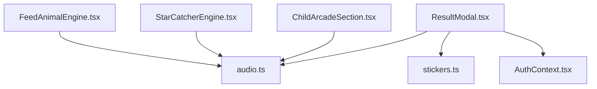

# Reward & Motivation Games

<cite>
**Referenced Files in This Document**
- [FeedAnimalEngine.tsx](file://client/src/components/child/games/FeedAnimalEngine.tsx)
- [StarCatcherEngine.tsx](file://client/src/components/child/games/StarCatcherEngine.tsx)
- [ChildArcadeSection.tsx](file://client/src/components/child/ChildArcadeSection.tsx)
- [ResultModal.tsx](file://client/src/components/child/ResultModal.tsx)
</cite>

## Table of Contents
1. [Introduction](#introduction)
2. [Project Structure](#project-structure)
3. [Core Components](#core-components)
4. [Architecture Overview](#architecture-overview)
5. [Detailed Component Analysis](#detailed-component-analysis)
6. [Dependency Analysis](#dependency-analysis)
7. [Performance Considerations](#performance-considerations)
8. [Troubleshooting Guide](#troubleshooting-guide)
9. [Conclusion](#conclusion)

## Introduction
This document explains the reward and motivation-focused game engines in KCEnglishKids, with a deep focus on two child-friendly learning games:

- Feed Animal: A caring behavior game where children feed animals by choosing correct vocabulary options. It combines cute animal reactions, positive reinforcement, and learning prompts to encourage engagement.
- Star Catcher: An interactive HTML5 canvas game where children move a basket to catch falling stars labeled with vocabulary words. Correct catches trigger celebration effects and progress toward rewards.

The documentation covers game mechanics, animation timing, feedback patterns, reward accumulation, motivational messaging, and progress visualization that supports continued learning.

## Project Structure
The reward and motivation features are implemented in the client-side React application under the child components directory. The key files for this documentation are:

- FeedAnimalEngine.tsx: Implements the feeding interaction, animal state transitions, and immediate positive feedback.
- StarCatcherEngine.tsx: Implements the falling star animation, basket movement, collision detection, and celebration effects.
- ChildArcadeSection.tsx: Orchestrates game rounds, tracks scores and stars, and routes answers to the result modal.
- ResultModal.tsx: Displays final results, confetti, mascot encouragement, and sticker rewards based on accumulated stars.

**Diagram sources**
- [ChildArcadeSection.tsx:15-27](file://client/src/components/child/ChildArcadeSection.tsx#L15-L27)
- [FeedAnimalEngine.tsx:1-5](file://client/src/components/child/games/FeedAnimalEngine.tsx#L1-L5)
- [StarCatcherEngine.tsx:1-5](file://client/src/components/child/games/StarCatcherEngine.tsx#L1-L5)
- [ResultModal.tsx:1-7](file://client/src/components/child/ResultModal.tsx#L1-L7)

**Section sources**
- [ChildArcadeSection.tsx:15-27](file://client/src/components/child/ChildArcadeSection.tsx#L15-L27)
- [FeedAnimalEngine.tsx:1-5](file://client/src/components/child/games/FeedAnimalEngine.tsx#L1-L5)
- [StarCatcherEngine.tsx:1-5](file://client/src/components/child/games/StarCatcherEngine.tsx#L1-L5)
- [ResultModal.tsx:1-7](file://client/src/components/child/ResultModal.tsx#L1-L7)

## Core Components
This section summarizes the core components involved in reward and motivation:

- FeedAnimalEngine.tsx
  - Manages animal states (hungry, eating, refusing).
  - Plays audio prompts and sound effects.
  - Provides immediate visual feedback through animations and text bubbles.
  - Calls parent callback to record correctness and continue rounds.

- StarCatcherEngine.tsx
  - Renders a canvas-based animation loop at smooth frame rates.
  - Spawns falling stars with randomized motion and rotation.
  - Detects collisions between stars and the moving basket.
  - Triggers celebration particles and sound effects on correct catches.
  - Supports direct option buttons as an accessibility alternative.

- ChildArcadeSection.tsx
  - Controls round progression across multiple mini-games.
  - Tracks engine-level correct counts and overall score.
  - Computes stars based on performance thresholds.
  - Shows the ResultModal with confetti and sticker rewards.

- ResultModal.tsx
  - Celebrates outcomes with mascot animations and encouraging messages.
  - Awards stickers when stars reach certain thresholds.
  - Provides retry and next activity navigation.

**Section sources**
- [FeedAnimalEngine.tsx:12-55](file://client/src/components/child/games/FeedAnimalEngine.tsx#L12-L55)
- [StarCatcherEngine.tsx:40-80](file://client/src/components/child/games/StarCatcherEngine.tsx#L40-L80)
- [ChildArcadeSection.tsx:188-201](file://client/src/components/child/ChildArcadeSection.tsx#L188-L201)
- [ResultModal.tsx:22-57](file://client/src/components/child/ResultModal.tsx#L22-L57)

## Architecture Overview
The reward and motivation architecture follows a clear flow from game selection to result celebration:

**Diagram sources**
- [ChildArcadeSection.tsx:203-395](file://client/src/components/child/ChildArcadeSection.tsx#L203-L395)
- [ChildArcadeSection.tsx:397-425](file://client/src/components/child/ChildArcadeSection.tsx#L397-L425)
- [FeedAnimalEngine.tsx:36-55](file://client/src/components/child/games/FeedAnimalEngine.tsx#L36-L55)
- [StarCatcherEngine.tsx:162-176](file://client/src/components/child/games/StarCatcherEngine.tsx#L162-L176)
- [ResultModal.tsx:38-57](file://client/src/components/child/ResultModal.tsx#L38-L57)

## Detailed Component Analysis

### Feed Animal Engine Mechanics
Feed Animal blends caring behaviors with vocabulary learning. Children choose food items corresponding to target words. The component uses deterministic animal selection based on prompt length, plays audio prompts, and animates animal reactions to reinforce positive behavior.

Key behaviors:
- Animal states: hungry, eating, refusing.
- Positive reinforcement: eating state scales up the character, adds heart bubbles, and shows happy speech.
- Negative feedback: refusing state wobbles and resets to hungry after a short delay.
- Timing: correct answers wait briefly before calling parent callback; incorrect answers reset quickly.

**Diagram sources**
- [FeedAnimalEngine.tsx:36-55](file://client/src/components/child/games/FeedAnimalEngine.tsx#L36-L55)
- [FeedAnimalEngine.tsx:68-94](file://client/src/components/child/games/FeedAnimalEngine.tsx#L68-L94)

Implementation highlights:
- Deterministic animal selection ensures consistent character per question.
- Visual cues (scale, ring color, bounce) communicate success or gentle correction.
- Speech bubbles provide contextual encouragement and guidance.

**Section sources**
- [FeedAnimalEngine.tsx:20-34](file://client/src/components/child/games/FeedAnimalEngine.tsx#L20-L34)
- [FeedAnimalEngine.tsx:36-55](file://client/src/components/child/games/FeedAnimalEngine.tsx#L36-L55)
- [FeedAnimalEngine.tsx:68-94](file://client/src/components/child/games/FeedAnimalEngine.tsx#L68-L94)

### Star Catcher Engine Mechanics
Star Catcher is a canvas-based falling object game designed to build motivation through catching stars labeled with vocabulary words. It includes smooth animation, particle effects, and accessible controls.

Core systems:
- Falling stars: Each option becomes a star with randomized speed, rotation, and wobble.
- Basket control: Pointer/mouse movement updates basket position; direct option buttons allow quick selection.
- Collision detection: Distance-based check between star center and basket triggers catch logic.
- Celebration: Correct catches spawn sparkle particles, play positive sounds, and set win state.

**Diagram sources**
- [StarCatcherEngine.tsx:56-80](file://client/src/components/child/games/StarCatcherEngine.tsx#L56-L80)
- [StarCatcherEngine.tsx:112-177](file://client/src/components/child/games/StarCatcherEngine.tsx#L112-L177)
- [StarCatcherEngine.tsx:222-283](file://client/src/components/child/games/StarCatcherEngine.tsx#L222-L283)

Accessibility and engagement:
- Direct option buttons below the canvas provide an alternative interaction path.
- Win overlay provides celebratory messaging and mascot encouragement.
- Particle system enhances perceived reward without impacting performance significantly.

**Section sources**
- [StarCatcherEngine.tsx:40-80](file://client/src/components/child/games/StarCatcherEngine.tsx#L40-L80)
- [StarCatcherEngine.tsx:112-177](file://client/src/components/child/games/StarCatcherEngine.tsx#L112-L177)
- [StarCatcherEngine.tsx:296-320](file://client/src/components/child/games/StarCatcherEngine.tsx#L296-L320)
- [StarCatcherEngine.tsx:368-381](file://client/src/components/child/games/StarCatcherEngine.tsx#L368-L381)

### Arcade Orchestration and Reward Accumulation
ChildArcadeSection coordinates rounds, tracks correct answers, computes stars, and displays the ResultModal. It also integrates audio feedback and manages game-specific question generation.

Reward distribution algorithm:
- Stars are computed from correct answer thresholds:
  - 4 or more correct out of 5 rounds → 3 stars
  - 2 or more correct out of 5 rounds → 2 stars
  - Otherwise → 1 star
- Score accumulates per game round (correctAnswers * 10).
- Final stats include score, maxScore, stars, correct count, and total questions.

Progress visualization:
- Arcade header shows accumulated stars.
- ResultModal displays animated stars, score breakdown, and mascot encouragement.
- Stickers may be awarded when stars reach threshold.

**Diagram sources**
- [ChildArcadeSection.tsx:427-463](file://client/src/components/child/ChildArcadeSection.tsx#L427-L463)
- [ChildArcadeSection.tsx:397-425](file://client/src/components/child/ChildArcadeSection.tsx#L397-L425)
- [ChildArcadeSection.tsx:188-201](file://client/src/components/child/ChildArcadeSection.tsx#L188-L201)

**Section sources**
- [ChildArcadeSection.tsx:188-201](file://client/src/components/child/ChildArcadeSection.tsx#L188-L201)
- [ChildArcadeSection.tsx:397-425](file://client/src/components/child/ChildArcadeSection.tsx#L397-L425)
- [ChildArcadeSection.tsx:427-463](file://client/src/components/child/ChildArcadeSection.tsx#L427-L463)

### Result Modal and Motivational Messaging
ResultModal consolidates end-of-session rewards and motivation:

- Confetti and fanfare sounds celebrate non-zero stars.
- Sticker rewards are awarded when stars reach threshold via stickerService.
- Encouragement messages vary by star count, providing tailored praise and motivation.
- Navigation options include retrying, finishing, or proceeding to the next activity.

**Diagram sources**
- [ResultModal.tsx:22-57](file://client/src/components/child/ResultModal.tsx#L22-L57)
- [ResultModal.tsx:59-88](file://client/src/components/child/ResultModal.tsx#L59-L88)
- [ResultModal.tsx:159-177](file://client/src/components/child/ResultModal.tsx#L159-L177)

**Section sources**
- [ResultModal.tsx:38-57](file://client/src/components/child/ResultModal.tsx#L38-L57)
- [ResultModal.tsx:59-88](file://client/src/components/child/ResultModal.tsx#L59-L88)
- [ResultModal.tsx:159-177](file://client/src/components/child/ResultModal.tsx#L159-L177)

## Dependency Analysis
The reward and motivation system depends on shared utilities and services:

- Audio utilities: Provide pop, correct, gentle wrong, and star fanfare sounds.
- Sticker service: Randomly awards stickers based on child ID and star thresholds.
- Auth context: Supplies current child user ID for personalized rewards.

**Diagram sources**
- [FeedAnimalEngine.tsx:1-5](file://client/src/components/child/games/FeedAnimalEngine.tsx#L1-L5)
- [StarCatcherEngine.tsx:1-5](file://client/src/components/child/games/StarCatcherEngine.tsx#L1-L5)
- [ChildArcadeSection.tsx:1-11](file://client/src/components/child/ChildArcadeSection.tsx#L1-L11)
- [ResultModal.tsx:1-7](file://client/src/components/child/ResultModal.tsx#L1-L7)

**Section sources**
- [FeedAnimalEngine.tsx:1-5](file://client/src/components/child/games/FeedAnimalEngine.tsx#L1-L5)
- [StarCatcherEngine.tsx:1-5](file://client/src/components/child/games/StarCatcherEngine.tsx#L1-L5)
- [ChildArcadeSection.tsx:1-11](file://client/src/components/child/ChildArcadeSection.tsx#L1-L11)
- [ResultModal.tsx:1-7](file://client/src/components/child/ResultModal.tsx#L1-L7)

## Performance Considerations
- Canvas rendering: StarCatcherEngine uses requestAnimationFrame with delta-time calculations to maintain smooth animation regardless of device performance.
- Particle management: Sparkle particles are updated and removed efficiently within the render loop to avoid memory leaks.
- State transitions: FeedAnimalEngine uses short timeouts for feedback animations to keep interactions responsive.
- Accessibility: Direct option buttons in StarCatcher reduce cognitive load and support users who prefer tapping over dragging.

[No sources needed since this section provides general guidance]

## Troubleshooting Guide
Common issues and resolutions:

- Animations not playing:
  - Ensure audio utilities are initialized and permissions allow sound playback.
  - Verify that sfx.playCorrect, sfx.playGentleWrong, and sfx.playStarFanfare are called appropriately.

- Incorrect star calculation:
  - Confirm that handleGameFinished receives correct answer counts and total questions.
  - Check thresholds in handleGameFinished for star computation.

- Canvas input not responding:
  - Verify pointer event handlers are attached to the canvas element.
  - Ensure basketX state updates correctly on pointer move events.

- Sticker rewards not appearing:
  - Confirm stickerService.awardRandomSticker returns a valid sticker when stars >= 2.
  - Check that childId is correctly resolved from auth context.

**Section sources**
- [ChildArcadeSection.tsx:397-425](file://client/src/components/child/ChildArcadeSection.tsx#L397-L425)
- [StarCatcherEngine.tsx:296-320](file://client/src/components/child/games/StarCatcherEngine.tsx#L296-L320)
- [ResultModal.tsx:38-57](file://client/src/components/child/ResultModal.tsx#L38-L57)

## Conclusion
KCEnglishKids implements thoughtful reward and motivation systems through Feed Animal and Star Catcher. These games combine caring behaviors, engaging animations, and positive reinforcement to sustain child engagement while supporting vocabulary learning. The arcade orchestrator tracks progress, computes stars, and presents celebratory results with stickers and encouraging messages. Together, these components create a cohesive learning experience that motivates continued participation and reinforces achievement.

[No sources needed since this section summarizes without analyzing specific files]