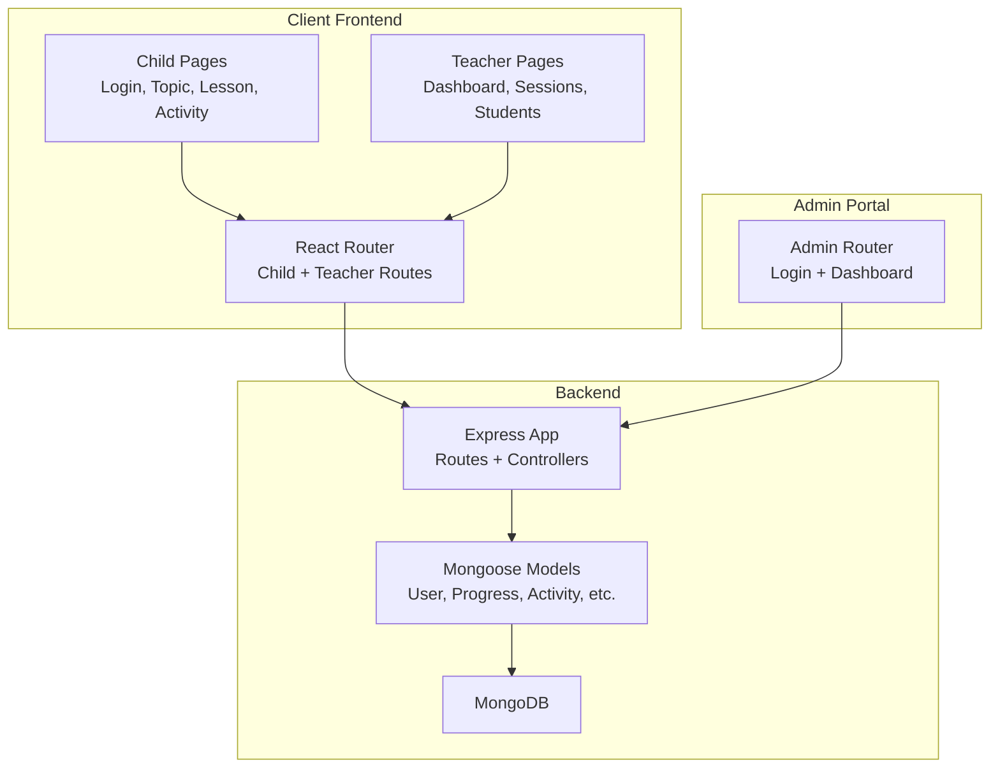
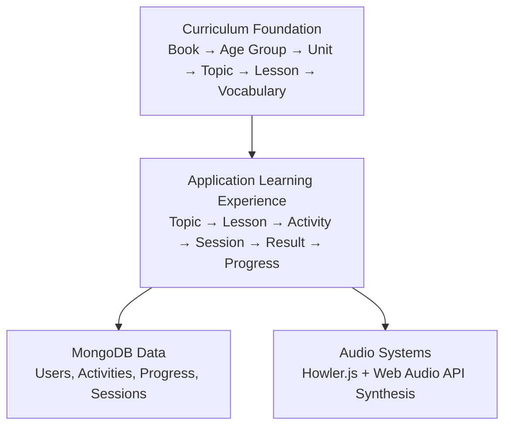
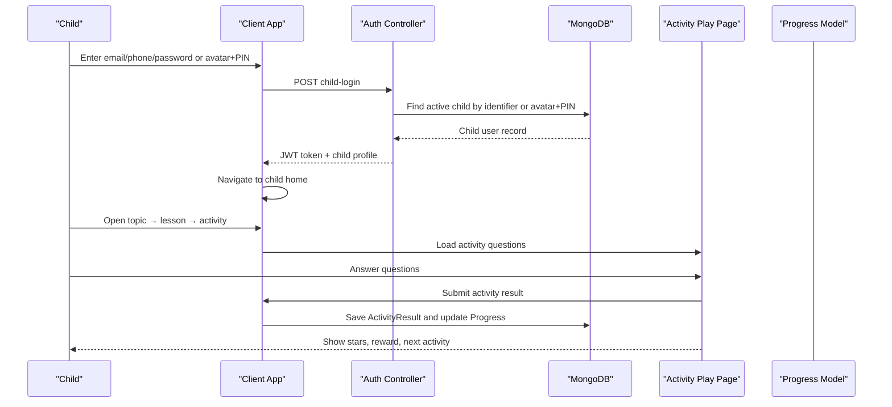
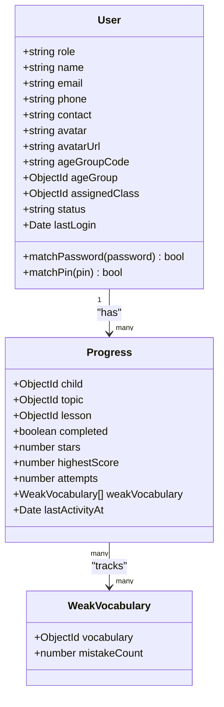
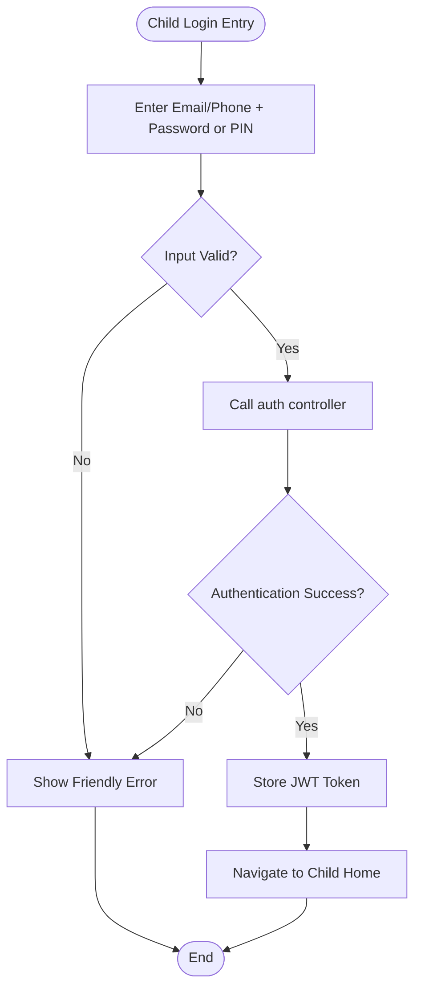
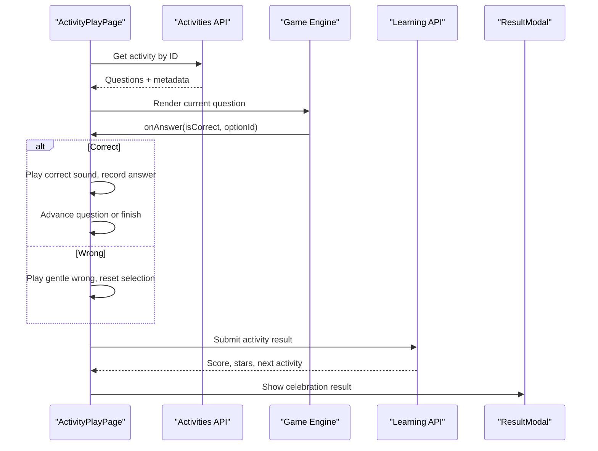
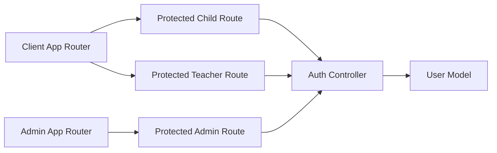

# Project Overview

<cite>
**Referenced Files in This Document**
- [README.md](file://README.md)
- [architecture.md](file://docs/architecture.md)
- [App.tsx](file://client/src/App.tsx)
- [admin App.tsx](file://admin/src/App.tsx)
- [User.js](file://KCEnglishKids_BE/src/models/User.js)
- [authController.js](file://KCEnglishKids_BE/src/controllers/authController.js)
- [StudentLoginPage.tsx](file://client/src/pages/child/StudentLoginPage.tsx)
- [PinPad.tsx](file://client/src/components/child/PinPad.tsx)
- [ActivityPlayPage.tsx](file://client/src/pages/child/ActivityPlayPage.tsx)
- [Progress.js](file://KCEnglishKids_BE/src/models/Progress.js)
</cite>

## Table of Contents
1. [Introduction](#introduction)
2. [Project Structure](#project-structure)
3. [Core Components](#core-components)
4. [Architecture Overview](#architecture-overview)
5. [Detailed Component Analysis](#detailed-component-analysis)
6. [Dependency Analysis](#dependency-analysis)
7. [Performance Considerations](#performance-considerations)
8. [Troubleshooting Guide](#troubleshooting-guide)
9. [Conclusion](#conclusion)

## Introduction
KCEnglishKids is an interactive English learning platform designed for children ages 3–6. It connects a standardized Curriculum Foundation with an engaging Application Learning Experience so that official curriculum content becomes playable, child-friendly activities. The system supports three main roles: CHILD, TEACHER, and ADMIN. Children log in using simple, age-appropriate methods such as avatar selection plus a four-digit PIN or email/phone plus password. Teachers manage classes and student progress, while administrators manage curriculum structure, topics, lessons, and KPIs.

The platform emphasizes visual interaction, large touch targets, playful mascots, audio feedback, and star-based rewards to keep young learners motivated.

**Section sources**
- [README.md:1-48](file://README.md#L1-L48)
- [architecture.md:1-29](file://docs/architecture.md#L1-L29)

## Project Structure
The repository is organized into three main application areas:

- Backend REST API under `KCEnglishKids_BE`
  - Express.js routes, controllers, services, Mongoose models, seeds, and scripts
  - MongoDB data structures for users, curriculum, sessions, activities, and progress
- Client frontend under `client`
  - React + TypeScript pages and components for children and teachers
  - Child login, topic navigation, lesson detail, activity play, teacher dashboard, and classroom session flows
- Admin portal under `admin`
  - React + TypeScript admin login and dashboard routing

**Diagram sources**
- [App.tsx:40-130](file://client/src/App.tsx#L40-L130)
- [admin App.tsx:22-40](file://admin/src/App.tsx#L22-L40)
- [README.md:95-138](file://README.md#L95-L138)

**Section sources**
- [README.md:95-138](file://README.md#L95-L138)

## Core Components
This section summarizes the core domain concepts used throughout the codebase:

- **Curriculum Book**: A structured book representing official curriculum material. There are three books covering Age Groups 3–4, 4–5, and 5–6, totaling 27 Units.
- **Age Group**: An age-scoped classification such as `3-4`, `4-5`, or `5-6`. Children are assigned an Age Group to ensure appropriate content difficulty.
- **Interactive Activities**: Configurable game-like experiences such as Listen & Choose, True/False, Count Objects, Memory Card, Color Recognition, Missing Object, Feed Animal, Bubble Pop, Tap Picture, Animal Sound, and Star Catcher.
- **Progress Tracking**: Per-child records tracking completion, stars, highest score, attempts, weak vocabulary, and last activity time.

These concepts connect the standardized curriculum to the child-facing learning experience.

**Section sources**
- [README.md:7-27](file://README.md#L7-L27)
- [architecture.md:3-19](file://docs/architecture.md#L3-L19)
- [Progress.js:3-62](file://KCEnglishKids_BE/src/models/Progress.js#L3-L62)

## Architecture Overview
KCEnglishKids uses a two-layer architecture:

1. **Curriculum Foundation**
   - Defines Books, Age Groups, Units, Topics, Lessons, Vocabulary, and official educational values.
   - Acts as the source of truth for what should be taught.

2. **Application Learning Experience**
   - Turns curriculum into App Topics, Lessons, Interactive Activities, Learning Sessions, Activity Results, and Progress.
   - Adds gamification elements like stars, badges, stickers, mascot encouragement, and audio feedback.

**Diagram sources**
- [README.md:7-27](file://README.md#L7-L27)
- [architecture.md:3-23](file://docs/architecture.md#L3-L23)

**Section sources**
- [README.md:7-27](file://README.md#L7-L27)
- [architecture.md:1-29](file://docs/architecture.md#L1-L29)

## Detailed Component Analysis

### User Roles and Workflows

#### CHILD Workflow
Children use a simplified login flow:
- Home login can accept email or phone plus password, or avatar plus a four-digit PIN.
- After successful authentication, the child navigates to the home page, selects a topic, opens a lesson, and plays Interactive Activities.
- During activities, the system provides audio prompts, visual feedback, and star rewards.
- Completed activities submit results and update Progress Tracking.

**Diagram sources**
- [authController.js:31-161](file://KCEnglishKids_BE/src/controllers/authController.js#L31-L161)
- [StudentLoginPage.tsx:51-63](file://client/src/pages/child/StudentLoginPage.tsx#L51-L63)
- [ActivityPlayPage.tsx:40-192](file://client/src/pages/child/ActivityPlayPage.tsx#L40-L192)
- [Progress.js:3-62](file://KCEnglishKids_BE/src/models/Progress.js#L3-L62)

#### TEACHER Workflow
Teachers authenticate with email and password, then access the teacher dashboard. They can:
- View class rosters and student lists
- Manage assignments and content
- Create and run classroom sessions
- Observe live session participation and view session summaries

The client router protects teacher routes and redirects unauthenticated users to the teacher login page.

**Section sources**
- [App.tsx:96-123](file://client/src/App.tsx#L96-L123)
- [authController.js:214-266](file://KCEnglishKids_BE/src/controllers/authController.js#L214-L266)

#### ADMIN Workflow
Administrators authenticate with email and password and access the admin dashboard. Administrators manage:
- Curriculum structure
- Topics and lessons
- KPIs and statistics

The admin app has its own protected route wrapper and redirects unauthorized users to the admin login.

**Section sources**
- [admin App.tsx:7-20](file://admin/src/App.tsx#L7-L20)
- [admin App.tsx:22-40](file://admin/src/App.tsx#L22-L40)
- [README.md:44-47](file://README.md#L44-L47)

### Authentication and Security
The backend supports multiple authentication modes:
- Child login by email/phone/contact plus password or PIN
- Classroom quick login by avatar plus four-digit PIN
- Admin login by email and password
- Teacher login by email and password
- Child PIN change endpoint
- Parent lookup endpoint to find children by registered parent phone

The User model stores hashed passwords and hashed PINs, and exposes helper methods to verify them.

**Diagram sources**
- [User.js:4-82](file://KCEnglishKids_BE/src/models/User.js#L4-L82)
- [User.js:84-106](file://KCEnglishKids_BE/src/models/User.js#L84-L106)
- [Progress.js:3-62](file://KCEnglishKids_BE/src/models/Progress.js#L3-L62)

**Section sources**
- [User.js:4-106](file://KCEnglishKids_BE/src/models/User.js#L4-L106)
- [authController.js:31-161](file://KCEnglishKids_BE/src/controllers/authController.js#L31-L161)
- [authController.js:163-266](file://KCEnglishKids_BE/src/controllers/authController.js#L163-L266)
- [authController.js:371-422](file://KCEnglishKids_BE/src/controllers/authController.js#L371-L422)
- [authController.js:424-474](file://KCEnglishKids_BE/src/controllers/authController.js#L424-L474)

### Child Login Flow
The child login page supports:
- Email or phone input
- Password or PIN input
- Quick demo accounts for different Age Groups
- Parent account lookup by phone number

When the form submits, it calls the authentication service, plays positive sound effects on success, and navigates to the child home page.

**Diagram sources**
- [StudentLoginPage.tsx:51-63](file://client/src/pages/child/StudentLoginPage.tsx#L51-L63)
- [authController.js:31-161](file://KCEnglishKids_BE/src/controllers/authController.js#L31-L161)

**Section sources**
- [StudentLoginPage.tsx:51-63](file://client/src/pages/child/StudentLoginPage.tsx#L51-L63)
- [StudentLoginPage.tsx:67-78](file://client/src/pages/child/StudentLoginPage.tsx#L67-L78)
- [StudentLoginPage.tsx:181-322](file://client/src/pages/child/StudentLoginPage.tsx#L181-L322)
- [StudentLoginPage.tsx:335-457](file://client/src/pages/child/StudentLoginPage.tsx#L335-L457)

### PIN Pad Interaction
The PIN Pad component provides a child-friendly four-digit keypad:
- Each digit press plays a pop sound
- Four bubble indicators show entered digits
- Backspace allows correction
- On error, gentle wrong sound plays and the PIN clears after a short delay

This component is suitable for classroom-style quick login where children select their avatar and enter a four-digit PIN.

**Section sources**
- [PinPad.tsx:11-41](file://client/src/components/child/PinPad.tsx#L11-L41)
- [PinPad.tsx:43-99](file://client/src/components/child/PinPad.tsx#L43-L99)

### Activity Play Flow
The Activity Play Page loads an activity, auto-plays audio prompts, tracks answers, and handles correct/wrong feedback:
- Correct answers play positive sounds, advance the question index, and record the answer
- Wrong answers play gentle feedback, clear selection, and replay the prompt
- When all questions are answered, the page submits results and shows a result modal with stars and optional next activity navigation

**Diagram sources**
- [ActivityPlayPage.tsx:40-100](file://client/src/pages/child/ActivityPlayPage.tsx#L40-L100)
- [ActivityPlayPage.tsx:108-192](file://client/src/pages/child/ActivityPlayPage.tsx#L108-L192)
- [ActivityPlayPage.tsx:232-382](file://client/src/pages/child/ActivityPlayPage.tsx#L232-L382)

**Section sources**
- [ActivityPlayPage.tsx:40-100](file://client/src/pages/child/ActivityPlayPage.tsx#L40-L100)
- [ActivityPlayPage.tsx:108-192](file://client/src/pages/child/ActivityPlayPage.tsx#L108-L192)
- [ActivityPlayPage.tsx:232-382](file://client/src/pages/child/ActivityPlayPage.tsx#L232-L382)

### Technology Stack Overview
- Frontend
  - React 19 + TypeScript + Vite 8
  - Tailwind CSS v4 for rounded, colorful, touch-friendly design
  - React Router DOM v7 for child, teacher, and admin routing
  - Howler.js + Web Audio API synthesis for pronunciation and sound effects
  - Canvas Confetti for star celebrations
  - Lucide Icons
- Backend
  - Node.js + Express.js REST API
  - Mongoose 9 + MongoDB
  - JWT + bcryptjs for secure authentication
- Specialized Audio Systems
  - Remote audio pronunciation streaming
  - Synthesized chimes for correct answers
  - Gentle wobble sounds for wrong attempts
  - Brass fanfare chords for star celebrations

**Section sources**
- [README.md:31-48](file://README.md#L31-L48)
- [architecture.md:20-23](file://docs/architecture.md#L20-L23)

## Dependency Analysis
The frontend routing defines separate protected routes for CHILD and TEACHER roles, while the admin portal has its own protected admin route. The backend centralizes authentication logic and returns JWT tokens scoped by role.

**Diagram sources**
- [App.tsx:17-38](file://client/src/App.tsx#L17-L38)
- [admin App.tsx:7-20](file://admin/src/App.tsx#L7-L20)
- [authController.js:4-10](file://KCEnglishKids_BE/src/controllers/authController.js#L4-L10)
- [User.js:4-11](file://KCEnglishKids_BE/src/models/User.js#L4-L11)

**Section sources**
- [App.tsx:17-38](file://client/src/App.tsx#L17-L38)
- [admin App.tsx:7-20](file://admin/src/App.tsx#L7-L20)
- [authController.js:4-10](file://KCEnglishKids_BE/src/controllers/authController.js#L4-L10)

## Performance Considerations
- Use lightweight SVG avatars and concise UI assets to keep the child interface responsive on tablets and small screens.
- Prefer synthesized audio for short feedback sounds to avoid network latency during gameplay.
- Cache activity metadata locally when possible to reduce repeated API calls during retries.
- Keep Progress updates efficient by batching or debouncing frequent state changes if needed.
- Avoid heavy animations on low-end devices; rely on subtle transitions and clear visual feedback.

[No sources needed since this section provides general guidance]

## Troubleshooting Guide
Common issues and resolutions:

- Child cannot log in with email/phone
  - Verify the identifier matches a registered email, phone, contact, or username.
  - Ensure the child account is ACTIVE.
  - Check whether the provided credential is a password or a PIN.

- Child cannot log in with avatar + PIN
  - Confirm the selected avatar matches the intended child.
  - Confirm the PIN is exactly four digits.
  - Verify the PIN is correctly stored and not expired or changed.

- Activity does not start or audio does not play
  - Check that the activity ID exists and the activity has questions.
  - Verify audio URLs are accessible or fallback speech synthesis is available.
  - Ensure the browser allows audio playback without user gesture restrictions.

- Progress not updating after activity completion
  - Confirm the activity submission request includes activityId, lessonId, childId, answers, and duration.
  - Verify the backend saves ActivityResult and updates Progress fields such as stars, highestScore, attempts, and lastActivityAt.

**Section sources**
- [authController.js:31-161](file://KCEnglishKids_BE/src/controllers/authController.js#L31-L161)
- [authController.js:163-266](file://KCEnglishKids_BE/src/controllers/authController.js#L163-L266)
- [ActivityPlayPage.tsx:171-192](file://client/src/pages/child/ActivityPlayPage.tsx#L171-L192)
- [Progress.js:23-62](file://KCEnglishKids_BE/src/models/Progress.js#L23-L62)

## Conclusion
KCEnglishKids bridges standardized curriculum and playful learning through a clear two-layer architecture. The Curriculum Foundation ensures educational alignment, while the Application Learning Experience delivers child-centered Interactive Activities, audio feedback, and Progress Tracking. With distinct workflows for CHILD, TEACHER, and ADMIN roles, the platform supports both home learning and classroom teaching. The technology stack combines modern frontend tools, a secure Express.js backend, and MongoDB storage, making it practical for early childhood English education.

[No sources needed since this section summarizes without analyzing specific files]