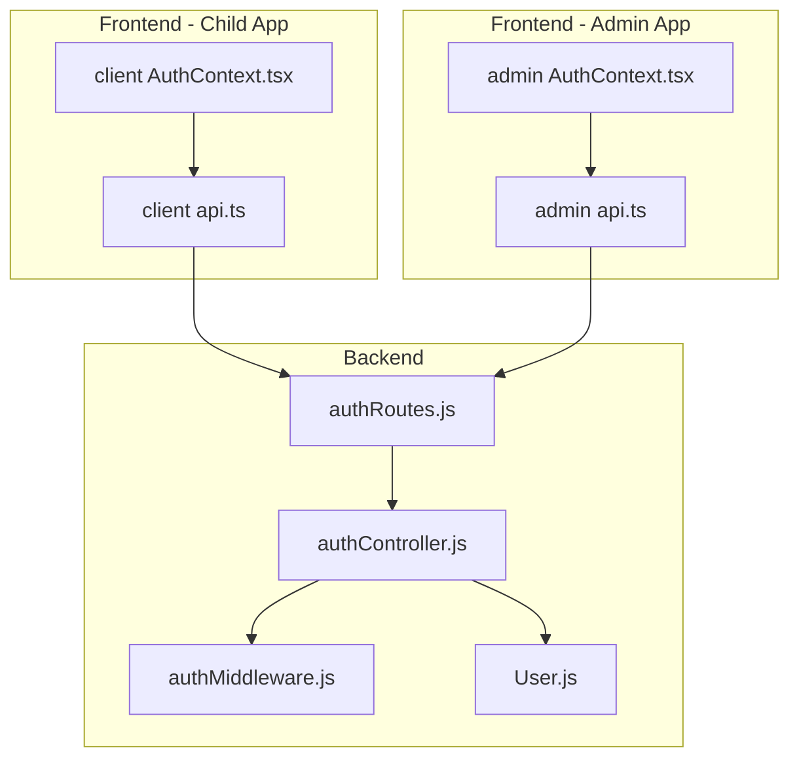
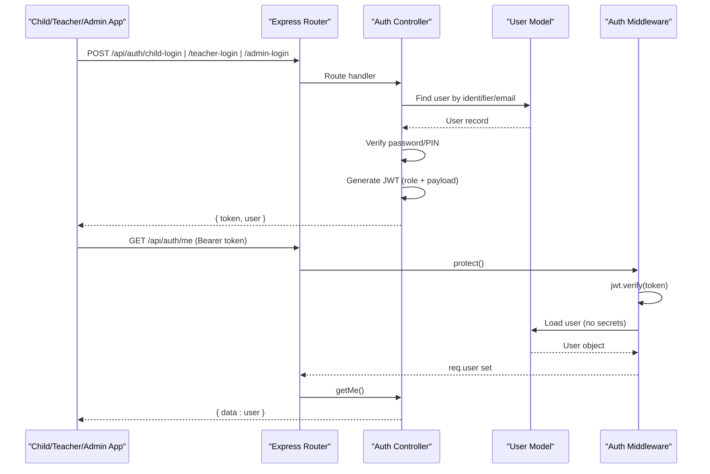
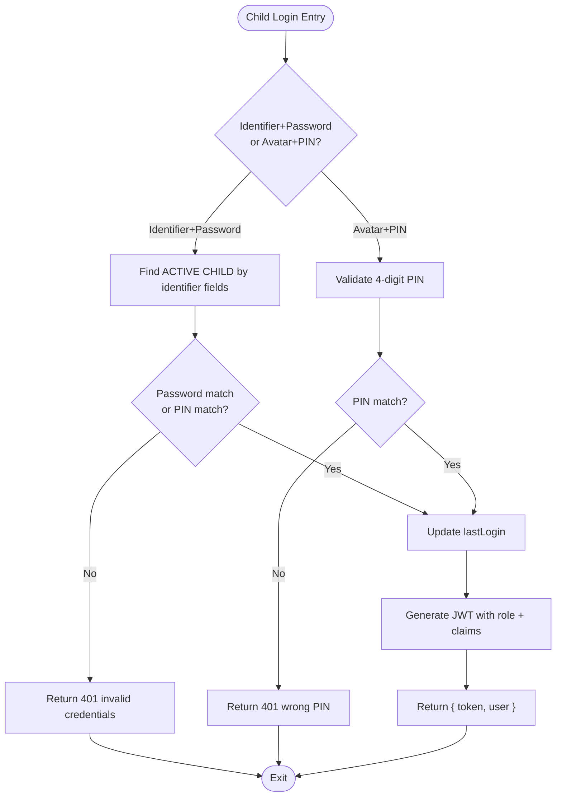
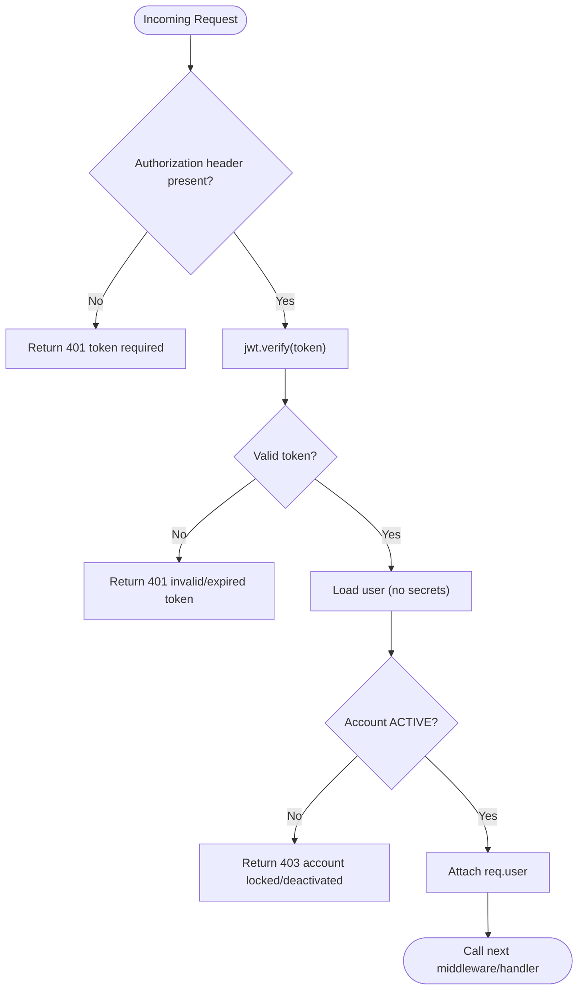
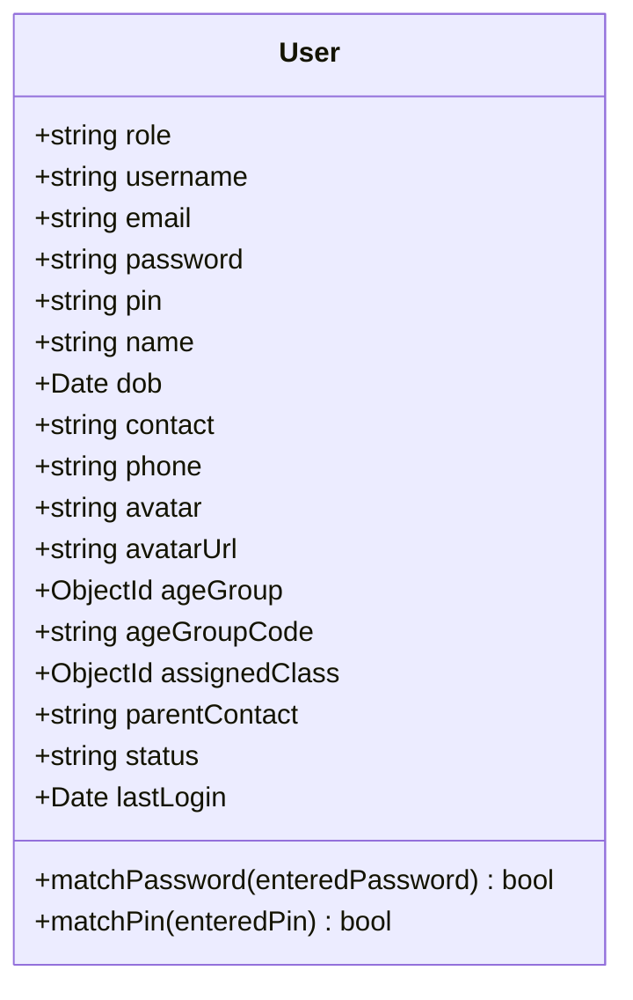
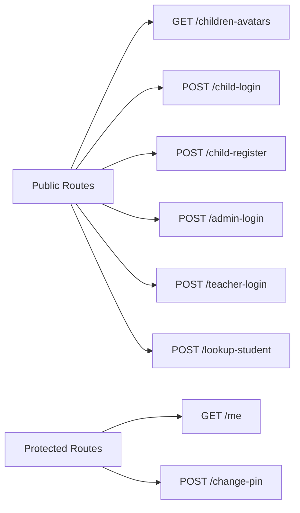
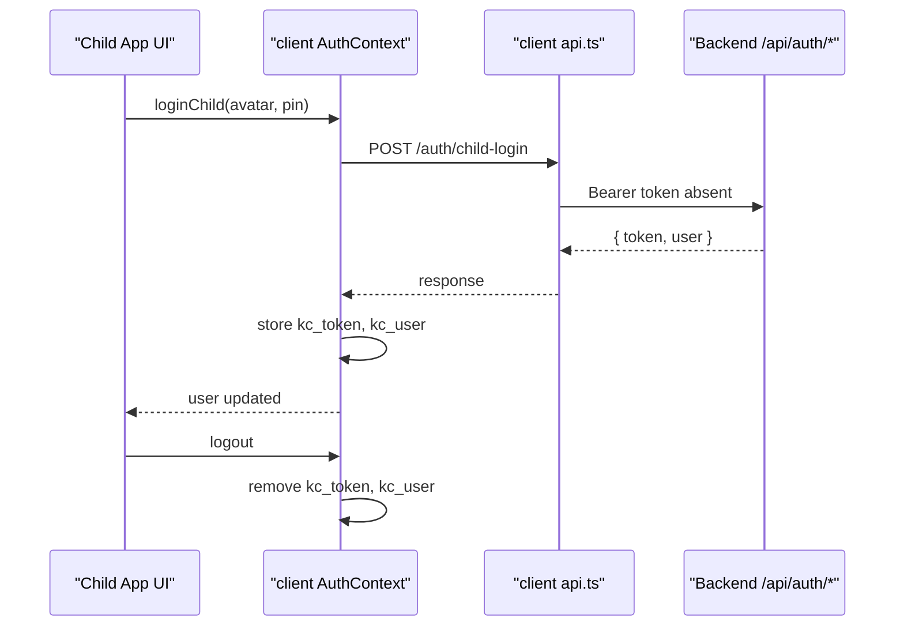
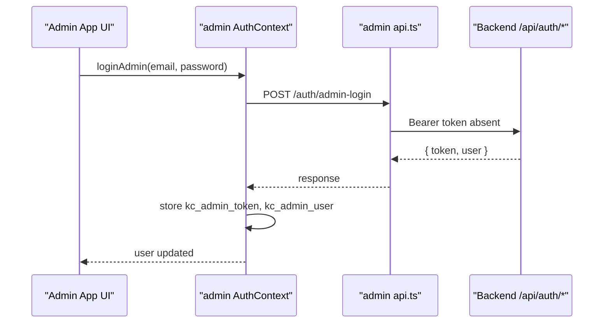
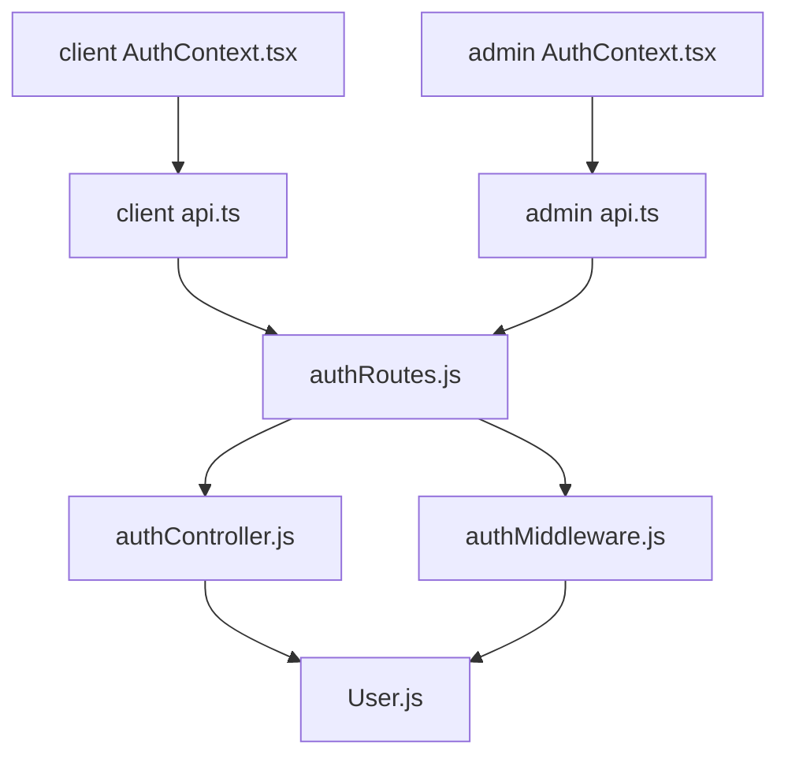

# Authentication & Authorization Architecture

<cite>
**Referenced Files in This Document**
- [authController.js](file://KCEnglishKids_BE/src/controllers/authController.js)
- [authMiddleware.js](file://KCEnglishKids_BE/src/middlewares/authMiddleware.js)
- [User.js](file://KCEnglishKids_BE/src/models/User.js)
- [authRoutes.js](file://KCEnglishKids_BE/src/routes/authRoutes.js)
- [AuthContext.tsx (client)](file://client/src/context/AuthContext.tsx)
- [api.ts (client)](file://client/src/services/api.ts)
- [AuthContext.tsx (admin)](file://admin/src/context/AuthContext.tsx)
- [api.ts (admin)](file://admin/src/services/api.ts)
</cite>

## Table of Contents
1. [Introduction](#introduction)
2. [Project Structure](#project-structure)
3. [Core Components](#core-components)
4. [Architecture Overview](#architecture-overview)
5. [Detailed Component Analysis](#detailed-component-analysis)
6. [Dependency Analysis](#dependency-analysis)
7. [Performance Considerations](#performance-considerations)
8. [Troubleshooting Guide](#troubleshooting-guide)
9. [Conclusion](#conclusion)

## Introduction
This document explains the authentication and authorization architecture for a multi-application learning platform with three user roles: CHILD, TEACHER, and ADMIN. The backend is a Node/Express service that issues JWTs and enforces role-based access control. Children aged 3–6 can authenticate using either:
- A 4-digit PIN selected via avatar (classroom quick login), or
- Email/phone plus password (home login).

Teachers and admins authenticate with email/password. All authenticated requests use Bearer tokens. Frontend applications (child app, teacher dashboard, admin portal) maintain session state via local storage and refresh sessions by calling a protected “me” endpoint.

## Project Structure
The authentication system spans backend controllers, middleware, models, routes, and frontend contexts/services.

**Diagram sources**
- [authRoutes.js:1-25](file://KCEnglishKids_BE/src/routes/authRoutes.js#L1-L25)
- [authController.js:1-488](file://KCEnglishKids_BE/src/controllers/authController.js#L1-L488)
- [authMiddleware.js:1-59](file://KCEnglishKids_BE/src/middlewares/authMiddleware.js#L1-L59)
- [User.js:1-109](file://KCEnglishKids_BE/src/models/User.js#L1-L109)
- [AuthContext.tsx (client):1-161](file://client/src/context/AuthContext.tsx#L1-L161)
- [api.ts (client):1-354](file://client/src/services/api.ts#L1-L354)
- [AuthContext.tsx (admin):1-82](file://admin/src/context/AuthContext.tsx#L1-L82)
- [api.ts (admin):1-90](file://admin/src/services/api.ts#L1-L90)

**Section sources**
- [authRoutes.js:1-25](file://KCEnglishKids_BE/src/routes/authRoutes.js#L1-L25)
- [authController.js:1-488](file://KCEnglishKids_BE/src/controllers/authController.js#L1-L488)
- [authMiddleware.js:1-59](file://KCEnglishKids_BE/src/middlewares/authMiddleware.js#L1-L59)
- [User.js:1-109](file://KCEnglishKids_BE/src/models/User.js#L1-L109)
- [AuthContext.tsx (client):1-161](file://client/src/context/AuthContext.tsx#L1-L161)
- [api.ts (client):1-354](file://client/src/services/api.ts#L1-L354)
- [AuthContext.tsx (admin):1-82](file://admin/src/context/AuthContext.tsx#L1-L82)
- [api.ts (admin):1-90](file://admin/src/services/api.ts#L1-L90)

## Core Components
- Role model and credentials storage: User model defines roles (ADMIN, TEACHER, CHILD, PARENT), hashed passwords, hashed 4-digit PINs, status, and lastLogin.
- Authentication controller: Provides endpoints for child login/register, teacher/admin login, profile retrieval, and PIN change.
- Middleware: Token validation, account status checks, and role-based authorization guards.
- Routes: Public auth endpoints and protected endpoints requiring valid tokens.
- Frontend contexts: Maintain token/user state, handle login flows, and persist sessions across app reloads.

Key responsibilities:
- Backend validates credentials, hashes secrets, issues JWTs, and enforces permissions.
- Frontend stores tokens securely in local storage, attaches Authorization headers, and refreshes sessions.

**Section sources**
- [User.js:1-109](file://KCEnglishKids_BE/src/models/User.js#L1-L109)
- [authController.js:1-488](file://KCEnglishKids_BE/src/controllers/authController.js#L1-L488)
- [authMiddleware.js:1-59](file://KCEnglishKids_BE/src/middlewares/authMiddleware.js#L1-L59)
- [authRoutes.js:1-25](file://KCEnglishKids_BE/src/routes/authRoutes.js#L1-L25)
- [AuthContext.tsx (client):1-161](file://client/src/context/AuthContext.tsx#L1-L161)
- [AuthContext.tsx (admin):1-82](file://admin/src/context/AuthContext.tsx#L1-L82)

## Architecture Overview
The system uses JWT-based authentication with role-based access control. Tokens are issued after successful authentication and validated on protected routes. Roles determine access to resources.

**Diagram sources**
- [authRoutes.js:15-22](file://KCEnglishKids_BE/src/routes/authRoutes.js#L15-L22)
- [authController.js:31-161](file://KCEnglishKids_BE/src/controllers/authController.js#L31-L161)
- [authController.js:166-266](file://KCEnglishKids_BE/src/controllers/authController.js#L166-L266)
- [authController.js:268-285](file://KCEnglishKids_BE/src/controllers/authController.js#L268-L285)
- [authMiddleware.js:4-31](file://KCEnglishKids_BE/src/middlewares/authMiddleware.js#L4-L31)
- [User.js:1-109](file://KCEnglishKids_BE/src/models/User.js#L1-L109)

## Detailed Component Analysis

### Authentication Controllers
Responsibilities:
- Child login supports two modes:
  - Home mode: identifier (email/phone/contact/username) + password; also accepts password or PIN fallback.
  - Classroom mode: avatar + 4-digit PIN.
- Teacher and Admin login validate email/password against role-restricted queries.
- Profile retrieval returns sanitized user data.
- PIN change enforces current PIN verification and new PIN format.

Security notes:
- Passwords and PINs are compared using bcrypt methods defined on the User model.
- Successful logins update lastLogin timestamps.
- Tokens include role and minimal claims.

**Diagram sources**
- [authController.js:31-161](file://KCEnglishKids_BE/src/controllers/authController.js#L31-L161)

**Section sources**
- [authController.js:31-161](file://KCEnglishKids_BE/src/controllers/authController.js#L31-L161)
- [authController.js:166-266](file://KCEnglishKids_BE/src/controllers/authController.js#L166-L266)
- [authController.js:371-422](file://KCEnglishKids_BE/src/controllers/authController.js#L371-L422)

### Middleware: Token Validation and Role Guards
- protect(): Extracts Bearer token, verifies signature, loads user without secrets, checks account status, and attaches user to request.
- authorize(...roles): Ensures the authenticated user has one of the required roles.
- optionalProtect(): Attempts to parse token but does not fail if missing/invalid; useful for mixed public/private endpoints.

**Diagram sources**
- [authMiddleware.js:4-31](file://KCEnglishKids_BE/src/middlewares/authMiddleware.js#L4-L31)

**Section sources**
- [authMiddleware.js:1-59](file://KCEnglishKids_BE/src/middlewares/authMiddleware.js#L1-L59)

### User Model: Credentials Storage and Hashing
- Stores hashed password and hashed 4-digit PIN.
- Pre-save hooks hash both password and pin when modified.
- Methods compare entered credentials against stored hashes.

**Diagram sources**
- [User.js:1-109](file://KCEnglishKids_BE/src/models/User.js#L1-L109)

**Section sources**
- [User.js:1-109](file://KCEnglishKids_BE/src/models/User.js#L1-L109)

### Routes and Access Control
Public endpoints:
- GET /api/auth/children-avatars
- POST /api/auth/child-login
- POST /api/auth/child-register
- POST /api/auth/admin-login
- POST /api/auth/teacher-login
- POST /api/auth/lookup-student

Protected endpoints:
- GET /api/auth/me
- POST /api/auth/change-pin

Role-based protection:
- The authorize(...) middleware can be applied to route groups to restrict access by role.

**Diagram sources**
- [authRoutes.js:15-22](file://KCEnglishKids_BE/src/routes/authRoutes.js#L15-L22)

**Section sources**
- [authRoutes.js:1-25](file://KCEnglishKids_BE/src/routes/authRoutes.js#L1-L25)

### Frontend Context Management

#### Child App (client)
- Maintains user and token in localStorage keys: kc_user, kc_token.
- On mount, verifies token by calling /api/auth/me; clears stale sessions on failure.
- Provides loginChild, loginStudentHome, registerChild, loginAdmin, loginTeacher, logout, setUser, setAgeGroup.
- Attaches Authorization header automatically via api.ts helper.

**Diagram sources**
- [AuthContext.tsx (client):30-134](file://client/src/context/AuthContext.tsx#L30-L134)
- [api.ts (client):3-9](file://client/src/services/api.ts#L3-L9)

**Section sources**
- [AuthContext.tsx (client):1-161](file://client/src/context/AuthContext.tsx#L1-L161)
- [api.ts (client):1-94](file://client/src/services/api.ts#L1-L94)

#### Admin App (admin)
- Uses separate storage keys: kc_admin_token, kc_admin_user.
- Verifies token on startup by calling /api/auth/me and ensuring role is ADMIN.
- Provides loginAdmin and logout.
- api.ts helper reads from kc_admin_token first, falling back to kc_token for compatibility.

**Diagram sources**
- [AuthContext.tsx (admin):15-60](file://admin/src/context/AuthContext.tsx#L15-L60)
- [api.ts (admin):3-8](file://admin/src/services/api.ts#L3-L8)

**Section sources**
- [AuthContext.tsx (admin):1-82](file://admin/src/context/AuthContext.tsx#L1-L82)
- [api.ts (admin):1-58](file://admin/src/services/api.ts#L1-L58)

## Dependency Analysis
- Controllers depend on User model for credential verification and persistence.
- Middleware depends on jsonwebtoken and User model for token verification and user loading.
- Routes wire controllers and middleware into Express handlers.
- Frontend services attach Authorization headers and manage tokens in local storage.

**Diagram sources**
- [authController.js:1-488](file://KCEnglishKids_BE/src/controllers/authController.js#L1-L488)
- [authMiddleware.js:1-59](file://KCEnglishKids_BE/src/middlewares/authMiddleware.js#L1-L59)
- [authRoutes.js:1-25](file://KCEnglishKids_BE/src/routes/authRoutes.js#L1-L25)
- [User.js:1-109](file://KCEnglishKids_BE/src/models/User.js#L1-L109)
- [AuthContext.tsx (client):1-161](file://client/src/context/AuthContext.tsx#L1-L161)
- [api.ts (client):1-354](file://client/src/services/api.ts#L1-L354)
- [AuthContext.tsx (admin):1-82](file://admin/src/context/AuthContext.tsx#L1-L82)
- [api.ts (admin):1-90](file://admin/src/services/api.ts#L1-L90)

**Section sources**
- [authController.js:1-488](file://KCEnglishKids_BE/src/controllers/authController.js#L1-L488)
- [authMiddleware.js:1-59](file://KCEnglishKids_BE/src/middlewares/authMiddleware.js#L1-L59)
- [authRoutes.js:1-25](file://KCEnglishKids_BE/src/routes/authRoutes.js#L1-L25)
- [User.js:1-109](file://KCEnglishKids_BE/src/models/User.js#L1-L109)
- [AuthContext.tsx (client):1-161](file://client/src/context/AuthContext.tsx#L1-L161)
- [api.ts (client):1-354](file://client/src/services/api.ts#L1-L354)
- [AuthContext.tsx (admin):1-82](file://admin/src/context/AuthContext.tsx#L1-L82)
- [api.ts (admin):1-90](file://admin/src/services/api.ts#L1-L90)

## Performance Considerations
- Token signing and verification are lightweight operations; ensure JWT_SECRET is strong and consistent across environments.
- Avoid storing sensitive payloads in tokens; only include minimal claims (id, role, and necessary display fields).
- Use selective field projection (e.g., excluding password/pin) to reduce payload size and improve security.
- For high-concurrency scenarios, consider short-lived tokens with refresh mechanisms to minimize risk and enable faster revocation.

[No sources needed since this section provides general guidance]

## Troubleshooting Guide
Common issues and resolutions:
- Invalid or expired token:
  - Cause: Missing Authorization header, malformed token, or token expiration.
  - Resolution: Ensure client sends Bearer token; clear stale tokens and re-authenticate.
- Account deactivated or locked:
  - Cause: User status is not ACTIVE.
  - Resolution: Reactivate user via admin tools or restore default status.
- Wrong PIN or password:
  - Cause: Incorrect credentials provided.
  - Resolution: Re-enter correct PIN/password; verify hashing is applied consistently.
- Session mismatch between apps:
  - Cause: Different storage keys for child vs admin apps.
  - Resolution: Confirm correct token key usage per app context.

Operational tips:
- Log errors centrally and avoid exposing internal details to clients.
- Monitor failed login attempts and implement rate limiting at the gateway level.
- Rotate JWT_SECRET periodically and ensure it is loaded from secure environment variables.

**Section sources**
- [authMiddleware.js:4-31](file://KCEnglishKids_BE/src/middlewares/authMiddleware.js#L4-L31)
- [authController.js:31-161](file://KCEnglishKids_BE/src/controllers/authController.js#L31-L161)
- [authController.js:166-266](file://KCEnglishKids_BE/src/controllers/authController.js#L166-L266)

## Conclusion
The platform implements a robust, role-aware authentication system:
- Children aged 3–6 can authenticate via PIN or email/phone + password.
- Teachers and admins authenticate via email/password.
- JWTs are signed with a secret and verified on protected routes.
- Middleware enforces token validity and role-based access control.
- Frontend contexts manage sessions and propagate tokens securely.

For enhanced security, adopt short-lived tokens, enforce HTTPS, rotate secrets, and centralize error handling and logging.

[No sources needed since this section summarizes without analyzing specific files]