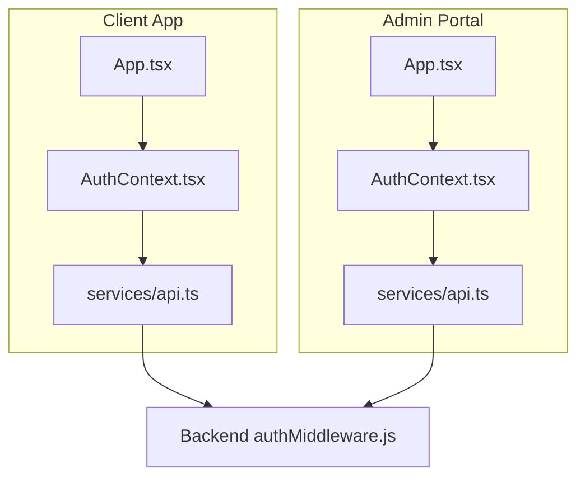
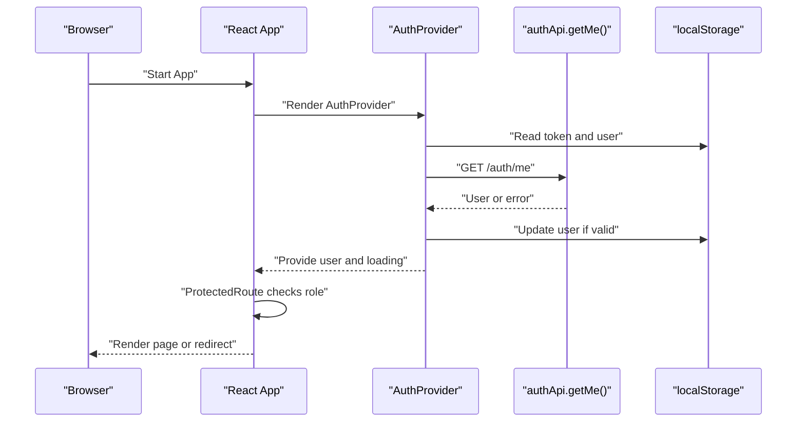
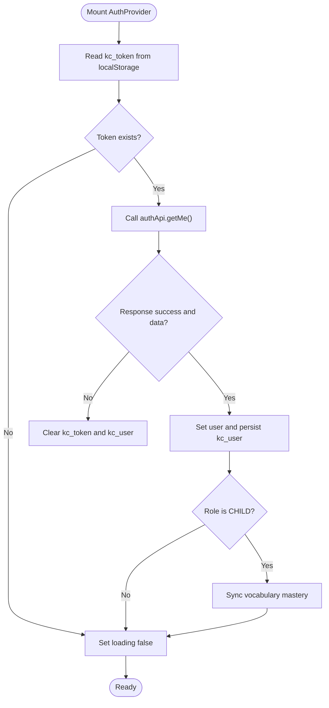
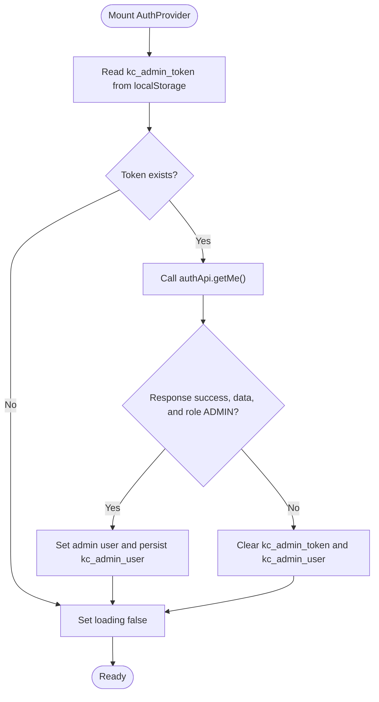
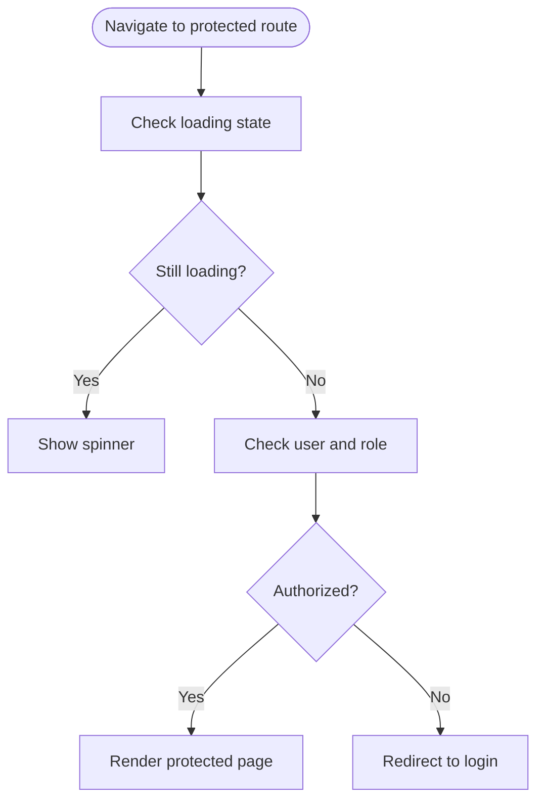
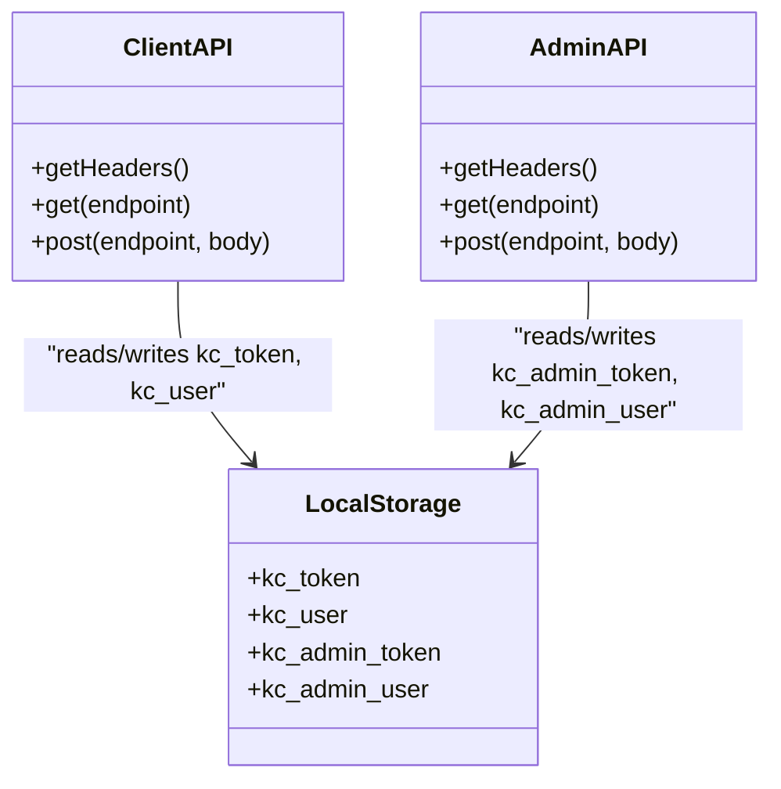
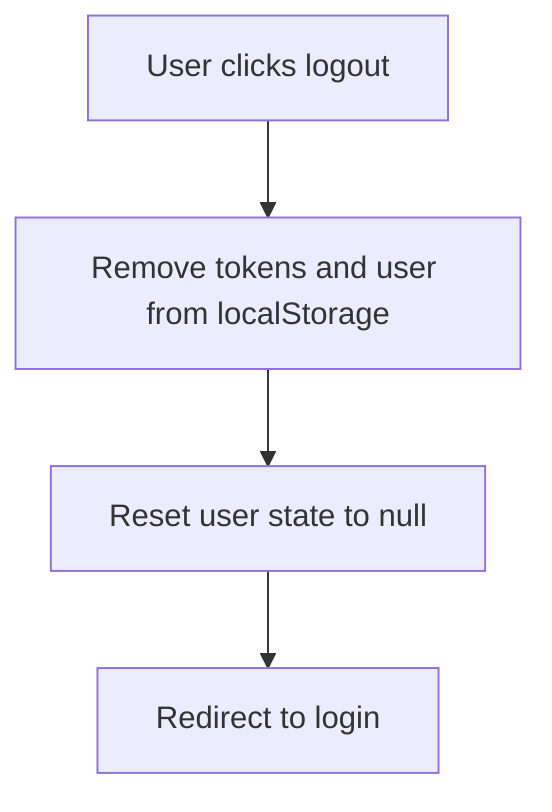
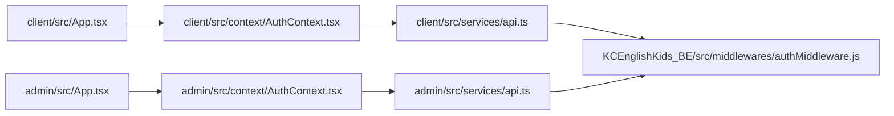

# Frontend Authentication State Management

<cite>
**Referenced Files in This Document**
- [client/src/context/AuthContext.tsx](file://client/src/context/AuthContext.tsx)
- [admin/src/context/AuthContext.tsx](file://admin/src/context/AuthContext.tsx)
- [client/src/App.tsx](file://client/src/App.tsx)
- [admin/src/App.tsx](file://admin/src/App.tsx)
- [client/src/services/api.ts](file://client/src/services/api.ts)
- [admin/src/services/api.ts](file://admin/src/services/api.ts)
- [KCEnglishKids_BE/src/middlewares/authMiddleware.js](file://KCEnglishKids_BE/src/middlewares/authMiddleware.js)
</cite>

## Table of Contents
1. [Introduction](#introduction)
2. [Project Structure](#project-structure)
3. [Core Components](#core-components)
4. [Architecture Overview](#architecture-overview)
5. [Detailed Component Analysis](#detailed-component-analysis)
6. [Dependency Analysis](#dependency-analysis)
7. [Performance Considerations](#performance-considerations)
8. [Troubleshooting Guide](#troubleshooting-guide)
9. [Conclusion](#conclusion)

## Introduction
This document explains how frontend authentication state is managed across two React applications: the child/teacher client and the admin portal. It focuses on the AuthContext implementations, token persistence, session verification, protected routes, logout behavior, and differences between child app and admin portal flows. It also provides guidance for consistent user experience patterns and where to extend automatic token refresh.

## Project Structure
The authentication logic is split into two independent React apps that share a common backend API:
- Client app (child and teacher experiences)
  - Context provider and hooks: [client/src/context/AuthContext.tsx](file://client/src/context/AuthContext.tsx)
  - App-level routing and protected routes: [client/src/App.tsx](file://client/src/App.tsx)
  - HTTP client with auth headers: [client/src/services/api.ts](file://client/src/services/api.ts)
- Admin portal
  - Context provider and hooks: [admin/src/context/AuthContext.tsx](file://admin/src/context/AuthContext.tsx)
  - App-level routing and protected routes: [admin/src/App.tsx](file://admin/src/App.tsx)
  - HTTP client with admin-specific tokens: [admin/src/services/api.ts](file://admin/src/services/api.ts)
- Backend middleware for JWT validation and role checks: [KCEnglishKids_BE/src/middlewares/authMiddleware.js](file://KCEnglishKids_BE/src/middlewares/authMiddleware.js)

**Diagram sources**
- [client/src/App.tsx:40-130](file://client/src/App.tsx#L40-L130)
- [client/src/context/AuthContext.tsx:30-154](file://client/src/context/AuthContext.tsx#L30-L154)
- [client/src/services/api.ts:1-94](file://client/src/services/api.ts#L1-L94)
- [admin/src/App.tsx:22-41](file://admin/src/App.tsx#L22-L41)
- [admin/src/context/AuthContext.tsx:15-75](file://admin/src/context/AuthContext.tsx#L15-L75)
- [admin/src/services/api.ts:1-58](file://admin/src/services/api.ts#L1-L58)
- [KCEnglishKids_BE/src/middlewares/authMiddleware.js:1-58](file://KCEnglishKids_BE/src/middlewares/authMiddleware.js#L1-L58)

**Section sources**
- [client/src/context/AuthContext.tsx:1-161](file://client/src/context/AuthContext.tsx#L1-L161)
- [admin/src/context/AuthContext.tsx:1-82](file://admin/src/context/AuthContext.tsx#L1-L82)
- [client/src/App.tsx:1-134](file://client/src/App.tsx#L1-L134)
- [admin/src/App.tsx:1-45](file://admin/src/App.tsx#L1-L45)
- [client/src/services/api.ts:1-354](file://client/src/services/api.ts#L1-L354)
- [admin/src/services/api.ts:1-90](file://admin/src/services/api.ts#L1-L90)
- [KCEnglishKids_BE/src/middlewares/authMiddleware.js:1-58](file://KCEnglishKids_BE/src/middlewares/authMiddleware.js#L1-L58)

## Core Components
- Client AuthContext
  - Manages user state for CHILD and TEACHER roles.
  - Persists tokens and user data in localStorage under keys like kc_token and kc_user.
  - Verifies sessions on mount by calling /auth/me.
  - Provides login methods for child, student home, admin, and teacher; plus logout and user updates.
- Admin AuthContext
  - Manages ADMIN-only sessions.
  - Persists tokens and user data under admin-specific keys like kc_admin_token and kc_admin_user.
  - Verifies sessions on mount by calling /auth/me and enforcing role === 'ADMIN'.
  - Provides admin login and logout.
- Protected Routes
  - Client app defines route guards for CHILD and TEACHER roles.
  - Admin portal defines a guard for ADMIN role.
- HTTP Clients
  - Both apps attach Authorization headers using stored tokens before each request.
  - Admin client supports fallback to shared token if needed.

**Section sources**
- [client/src/context/AuthContext.tsx:6-26](file://client/src/context/AuthContext.tsx#L6-L26)
- [client/src/context/AuthContext.tsx:30-154](file://client/src/context/AuthContext.tsx#L30-L154)
- [admin/src/context/AuthContext.tsx:5-11](file://admin/src/context/AuthContext.tsx#L5-L11)
- [admin/src/context/AuthContext.tsx:15-75](file://admin/src/context/AuthContext.tsx#L15-L75)
- [client/src/App.tsx:17-38](file://client/src/App.tsx#L17-L38)
- [admin/src/App.tsx:7-20](file://admin/src/App.tsx#L7-L20)
- [client/src/services/api.ts:1-94](file://client/src/services/api.ts#L1-L94)
- [admin/src/services/api.ts:1-58](file://admin/src/services/api.ts#L1-L58)

## Architecture Overview
The authentication architecture follows a consistent pattern across both apps:
- On application start, the AuthProvider initializes state from localStorage and validates the current session via /auth/me.
- Successful validation sets the authenticated user and persists user data.
- Login flows call role-specific endpoints, store tokens and user data, and update context state.
- Protected routes check loading and user role before rendering content.
- Logout clears persisted tokens and resets context state.

**Diagram sources**
- [client/src/context/AuthContext.tsx:30-61](file://client/src/context/AuthContext.tsx#L30-L61)
- [admin/src/context/AuthContext.tsx:15-45](file://admin/src/context/AuthContext.tsx#L15-L45)
- [client/src/App.tsx:17-38](file://client/src/App.tsx#L17-L38)
- [admin/src/App.tsx:7-20](file://admin/src/App.tsx#L7-L20)

## Detailed Component Analysis

### Client AuthContext
Responsibilities:
- Initialize user from localStorage and verify session on mount.
- Provide login methods for child, student home, admin, and teacher.
- Persist tokens and user data after successful login.
- Sync vocabulary mastery for children when applicable.
- Provide logout and user update helpers.

Key behaviors:
- Session verification calls /auth/me and updates local state and storage.
- Child login triggers vocabulary mastery sync with the backend service.
- Logout removes tokens and user data from localStorage and resets state.

**Diagram sources**
- [client/src/context/AuthContext.tsx:30-61](file://client/src/context/AuthContext.tsx#L30-L61)
- [client/src/context/AuthContext.tsx:63-85](file://client/src/context/AuthContext.tsx#L63-L85)
- [client/src/context/AuthContext.tsx:130-134](file://client/src/context/AuthContext.tsx#L130-L134)

**Section sources**
- [client/src/context/AuthContext.tsx:1-161](file://client/src/context/AuthContext.tsx#L1-L161)

### Admin AuthContext
Responsibilities:
- Initialize admin user from localStorage and verify session on mount.
- Enforce ADMIN role during session verification.
- Provide admin login and logout.

Key behaviors:
- Session verification requires role === 'ADMIN'; otherwise, it clears the session.
- Admin login stores admin-specific tokens and user data.
- Logout clears admin tokens and user data.

**Diagram sources**
- [admin/src/context/AuthContext.tsx:15-45](file://admin/src/context/AuthContext.tsx#L15-L45)
- [admin/src/context/AuthContext.tsx:47-60](file://admin/src/context/AuthContext.tsx#L47-L60)

**Section sources**
- [admin/src/context/AuthContext.tsx:1-82](file://admin/src/context/AuthContext.tsx#L1-L82)

### Protected Route Implementation
Client app:
- ProtectedChildRoute allows access only when user exists and role is CHILD.
- ProtectedTeacherRoute allows access only when user exists and role is TEACHER.
- Routes are wrapped with these guards to protect pages.

Admin portal:
- ProtectedAdminRoute allows access only when user exists and role is ADMIN.

**Diagram sources**
- [client/src/App.tsx:17-38](file://client/src/App.tsx#L17-L38)
- [admin/src/App.tsx:7-20](file://admin/src/App.tsx#L7-L20)

**Section sources**
- [client/src/App.tsx:17-38](file://client/src/App.tsx#L17-L38)
- [admin/src/App.tsx:7-20](file://admin/src/App.tsx#L7-L20)

### Token Persistence and HTTP Headers
Client app:
- The HTTP client reads kc_token from localStorage and attaches Authorization header.
- AuthContext stores kc_token and kc_user after successful login.

Admin portal:
- The HTTP client prefers kc_admin_token but falls back to kc_token if present.
- AuthContext stores kc_admin_token and kc_admin_user after successful login.

**Diagram sources**
- [client/src/services/api.ts:1-94](file://client/src/services/api.ts#L1-L94)
- [admin/src/services/api.ts:1-58](file://admin/src/services/api.ts#L1-L58)

**Section sources**
- [client/src/services/api.ts:1-94](file://client/src/services/api.ts#L1-L94)
- [admin/src/services/api.ts:1-58](file://admin/src/services/api.ts#L1-L58)

### Logout Functionality
- Client logout clears kc_token and kc_user and resets user state.
- Admin logout clears kc_admin_token and kc_admin_user and resets user state.

**Diagram sources**
- [client/src/context/AuthContext.tsx:130-134](file://client/src/context/AuthContext.tsx#L130-L134)
- [admin/src/context/AuthContext.tsx:56-60](file://admin/src/context/AuthContext.tsx#L56-L60)

**Section sources**
- [client/src/context/AuthContext.tsx:130-134](file://client/src/context/AuthContext.tsx#L130-L134)
- [admin/src/context/AuthContext.tsx:56-60](file://admin/src/context/AuthContext.tsx#L56-L60)

### Automatic Token Refresh
Current implementation:
- No automatic token refresh is implemented in either app.
- Session validity is checked on mount via /auth/me. If invalid, tokens and user are cleared.

Recommendation:
- Implement an interceptor in the HTTP clients to detect 401 responses and attempt silent refresh or redirect to login.
- Add a refresh endpoint on the backend and handle token rotation securely.

[No sources needed since this section provides general guidance]

### Differences Between Child App and Admin Portal Flows
- Tokens and storage keys:
  - Client uses kc_token and kc_user.
  - Admin uses kc_admin_token and kc_admin_user.
- Roles:
  - Client supports CHILD and TEACHER roles.
  - Admin enforces ADMIN role.
- Additional features:
  - Client triggers vocabulary mastery sync for CHILD users.
  - Admin does not include such sync logic.

**Section sources**
- [client/src/context/AuthContext.tsx:30-85](file://client/src/context/AuthContext.tsx#L30-L85)
- [admin/src/context/AuthContext.tsx:15-54](file://admin/src/context/AuthContext.tsx#L15-L54)

## Dependency Analysis
The following diagram shows how components depend on each other and the backend middleware.

**Diagram sources**
- [client/src/App.tsx:40-130](file://client/src/App.tsx#L40-L130)
- [client/src/context/AuthContext.tsx:30-154](file://client/src/context/AuthContext.tsx#L30-L154)
- [client/src/services/api.ts:1-94](file://client/src/services/api.ts#L1-L94)
- [admin/src/App.tsx:22-41](file://admin/src/App.tsx#L22-L41)
- [admin/src/context/AuthContext.tsx:15-75](file://admin/src/context/AuthContext.tsx#L15-L75)
- [admin/src/services/api.ts:1-58](file://admin/src/services/api.ts#L1-L58)
- [KCEnglishKids_BE/src/middlewares/authMiddleware.js:1-58](file://KCEnglishKids_BE/src/middlewares/authMiddleware.js#L1-L58)

**Section sources**
- [client/src/App.tsx:40-130](file://client/src/App.tsx#L40-L130)
- [admin/src/App.tsx:22-41](file://admin/src/App.tsx#L22-L41)
- [client/src/context/AuthContext.tsx:30-154](file://client/src/context/AuthContext.tsx#L30-L154)
- [admin/src/context/AuthContext.tsx:15-75](file://admin/src/context/AuthContext.tsx#L15-L75)
- [client/src/services/api.ts:1-94](file://client/src/services/api.ts#L1-L94)
- [admin/src/services/api.ts:1-58](file://admin/src/services/api.ts#L1-L58)
- [KCEnglishKids_BE/src/middlewares/authMiddleware.js:1-58](file://KCEnglishKids_BE/src/middlewares/authMiddleware.js#L1-L58)

## Performance Considerations
- Avoid unnecessary re-renders by keeping AuthContext minimal and stable.
- Defer heavy operations (like vocabulary mastery sync) until after initial render.
- Use lazy loading for protected pages to reduce bundle size.
- Consider batching API calls and caching user profile data to minimize network requests.

[No sources needed since this section provides general guidance]

## Troubleshooting Guide
Common issues and resolutions:
- Session expired immediately after reload
  - Ensure /auth/me returns valid data and that tokens are correctly stored.
  - Verify backend middleware accepts the token and role.
- Unauthorized errors on API calls
  - Confirm Authorization header includes the correct token.
  - Check that the token key matches the app (kc_token vs kc_admin_token).
- Role-based redirects loop
  - Validate role checks in protected routes match backend roles.
  - Ensure login flows set the correct role in user object.

Relevant backend behavior:
- The middleware validates Bearer tokens and enforces user status and role authorization.

**Section sources**
- [client/src/context/AuthContext.tsx:30-61](file://client/src/context/AuthContext.tsx#L30-L61)
- [admin/src/context/AuthContext.tsx:15-45](file://admin/src/context/AuthContext.tsx#L15-L45)
- [client/src/services/api.ts:1-94](file://client/src/services/api.ts#L1-L94)
- [admin/src/services/api.ts:1-58](file://admin/src/services/api.ts#L1-L58)
- [KCEnglishKids_BE/src/middlewares/authMiddleware.js:1-58](file://KCEnglishKids_BE/src/middlewares/authMiddleware.js#L1-L58)

## Conclusion
Both the client and admin applications implement consistent authentication patterns using React Context, localStorage persistence, and protected routes. The client app supports multiple roles and integrates additional features like vocabulary mastery sync, while the admin portal focuses on ADMIN-only access. To improve resilience, consider adding automatic token refresh and centralized error handling in the HTTP clients.

[No sources needed since this section summarizes without analyzing specific files]