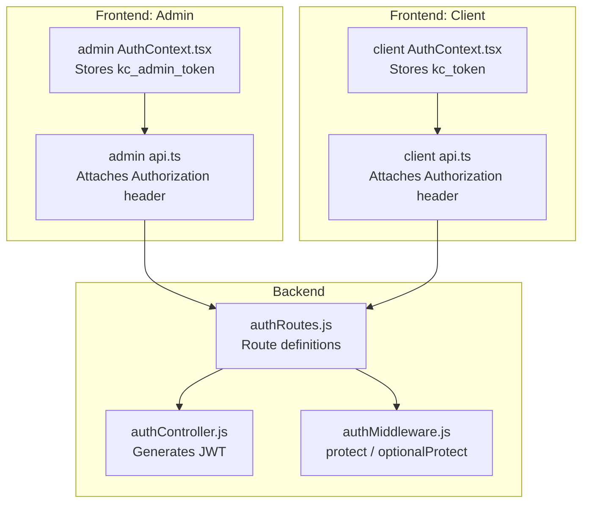
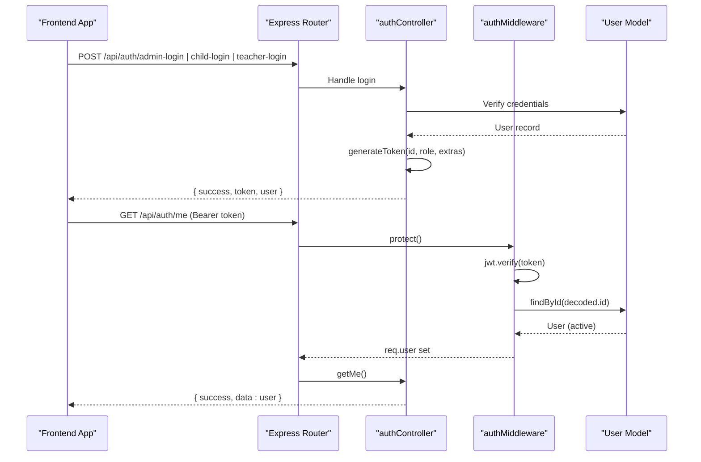
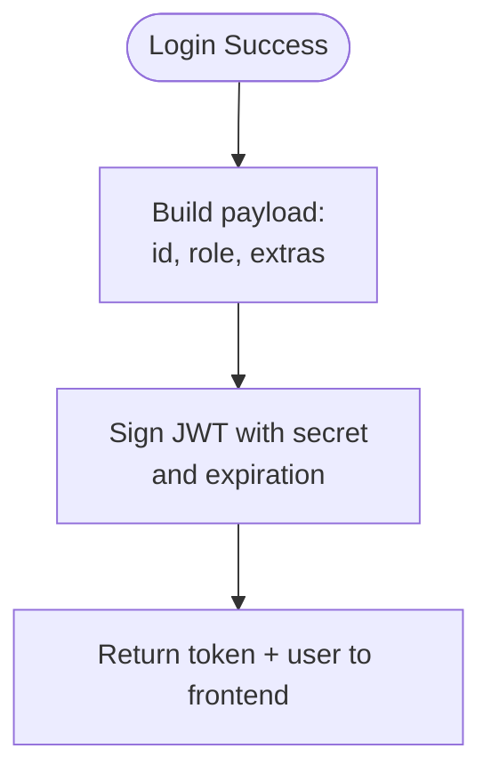
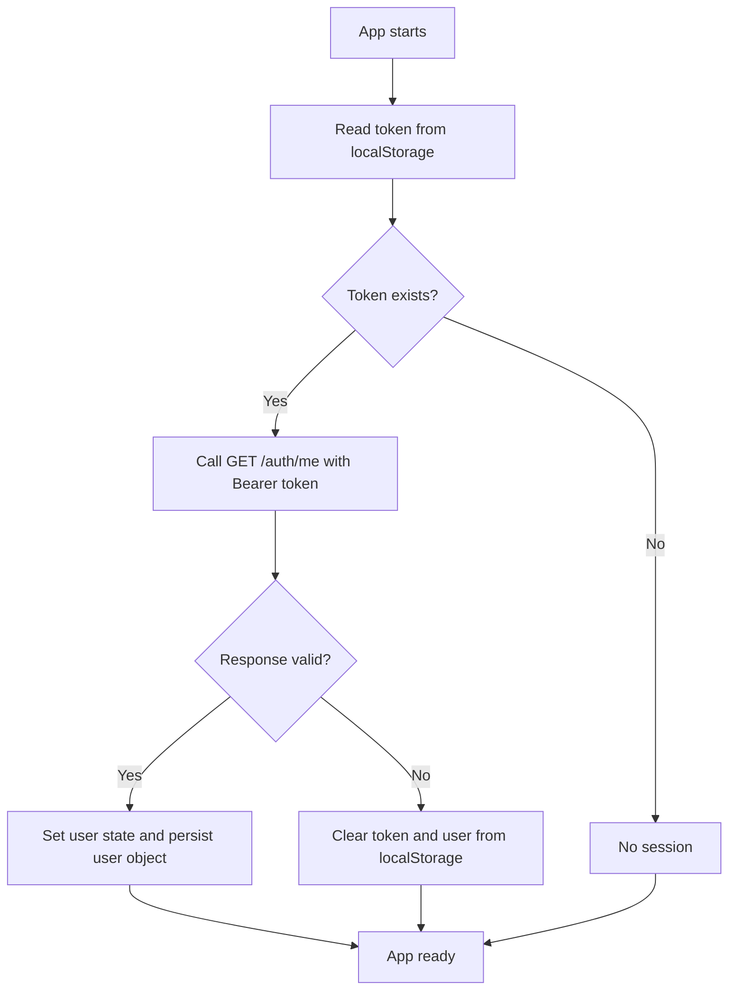
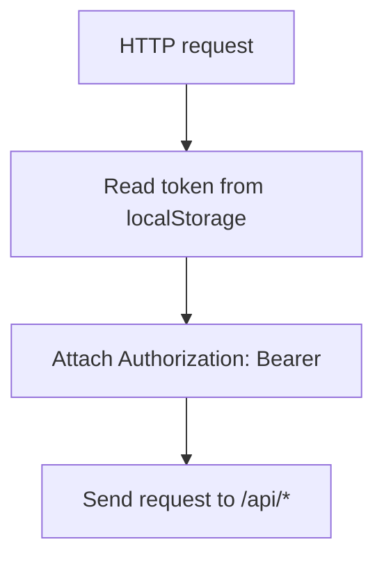
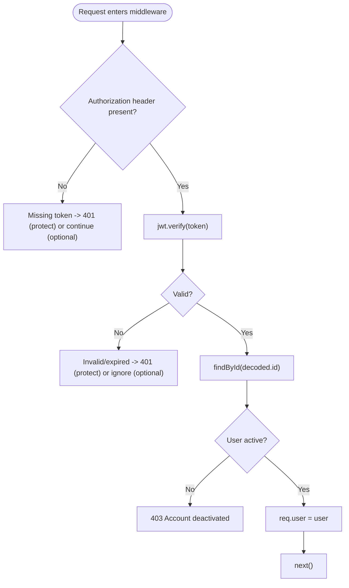
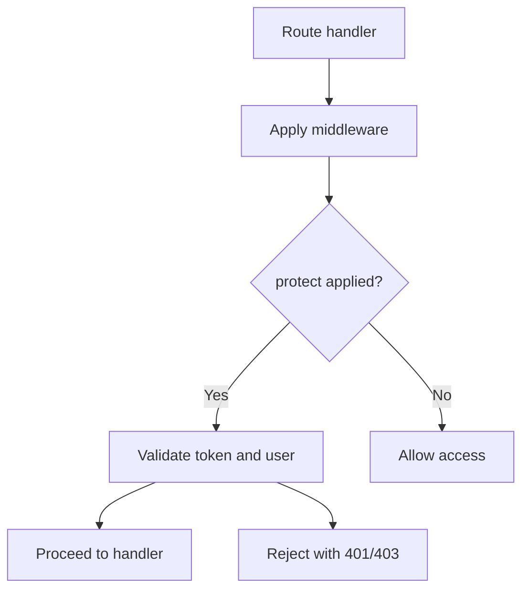
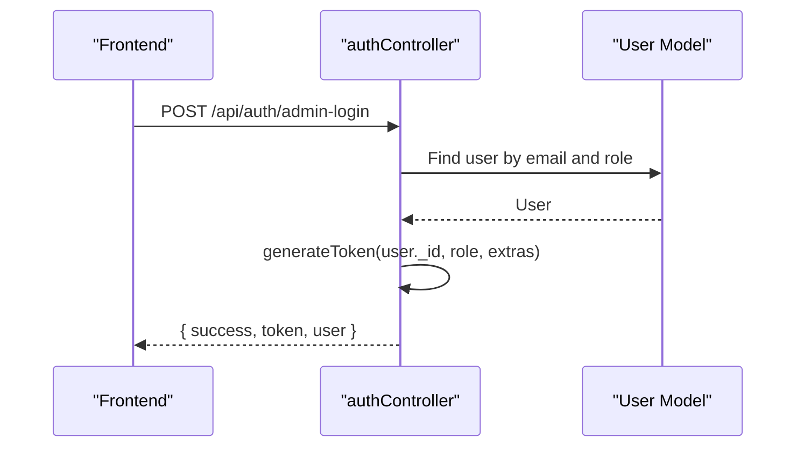
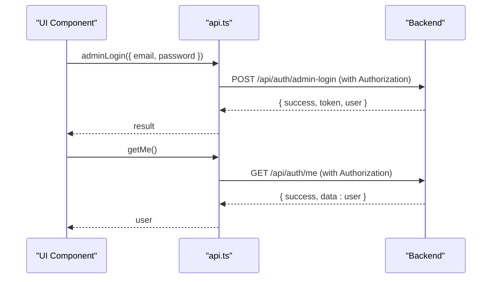
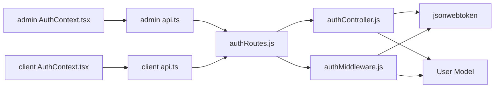

# JWT Token Management

<cite>
**Referenced Files in This Document**
- [authController.js](file://KCEnglishKids_BE/src/controllers/authController.js)
- [authMiddleware.js](file://KCEnglishKids_BE/src/middlewares/authMiddleware.js)
- [authRoutes.js](file://KCEnglishKids_BE/src/routes/authRoutes.js)
- [AuthContext.tsx (Admin)](file://admin/src/context/AuthContext.tsx)
- [api.ts (Admin)](file://admin/src/services/api.ts)
- [AuthContext.tsx (Client)](file://client/src/context/AuthContext.tsx)
- [api.ts (Client)](file://client/src/services/api.ts)
</cite>

## Table of Contents
1. [Introduction](#introduction)
2. [Project Structure](#project-structure)
3. [Core Components](#core-components)
4. [Architecture Overview](#architecture-overview)
5. [Detailed Component Analysis](#detailed-component-analysis)
6. [Dependency Analysis](#dependency-analysis)
7. [Performance Considerations](#performance-considerations)
8. [Troubleshooting Guide](#troubleshooting-guide)
9. [Conclusion](#conclusion)
10. [Appendices](#appendices)

## Introduction
This document explains how JSON Web Tokens (JWT) are used across the application for authentication and authorization. It covers token generation during login, storage strategies in frontend applications, and server-side validation via middleware. It also documents the JWT payload structure, expiration handling, and guidance on refresh mechanisms. Finally, it details route protection with protect and optionalProtect, and provides security best practices for token storage, transmission, and rotation.

## Project Structure
The JWT flow spans backend controllers, middlewares, routes, and two frontends (admin and client). The backend generates tokens upon successful authentication and validates them using a shared middleware. Frontend apps store tokens in localStorage and attach them to requests as Bearer tokens.

**Diagram sources**
- [authController.js:4-10](file://KCEnglishKids_BE/src/controllers/authController.js#L4-L10)
- [authMiddleware.js:4-31](file://KCEnglishKids_BE/src/middlewares/authMiddleware.js#L4-L31)
- [authRoutes.js:15-22](file://KCEnglishKids_BE/src/routes/authRoutes.js#L15-L22)
- [AuthContext.tsx (Admin):15-60](file://admin/src/context/AuthContext.tsx#L15-L60)
- [api.ts (Admin):3-8](file://admin/src/services/api.ts#L3-L8)
- [AuthContext.tsx (Client):30-61](file://client/src/context/AuthContext.tsx#L30-L61)
- [api.ts (Client):3-9](file://client/src/services/api.ts#L3-L9)

**Section sources**
- [authController.js:4-10](file://KCEnglishKids_BE/src/controllers/authController.js#L4-L10)
- [authMiddleware.js:4-31](file://KCEnglishKids_BE/src/middlewares/authMiddleware.js#L4-L31)
- [authRoutes.js:15-22](file://KCEnglishKids_BE/src/routes/authRoutes.js#L15-L22)
- [AuthContext.tsx (Admin):15-60](file://admin/src/context/AuthContext.tsx#L15-L60)
- [api.ts (Admin):3-8](file://admin/src/services/api.ts#L3-L8)
- [AuthContext.tsx (Client):30-61](file://client/src/context/AuthContext.tsx#L30-L61)
- [api.ts (Client):3-9](file://client/src/services/api.ts#L3-L9)

## Core Components
- Token generation: A helper signs a JWT with user id, role, and selected extra fields, with a fixed expiration.
- Route protection: protect middleware verifies the token, loads the user, checks account status, and attaches the user to the request.
- Optional protection: optionalProtect attempts to verify the token but does not fail if missing or invalid; it sets req.user when valid.
- Frontend storage: Both admin and client apps persist tokens in localStorage and attach them to API calls via Authorization headers.

Key responsibilities:
- Backend controller: authenticates credentials and returns a JWT along with user data.
- Middleware: enforces authentication and optional identity resolution.
- Routes: apply protect where required.
- Frontend contexts: manage login state, persistence, and logout.
- Frontend API clients: inject Authorization headers automatically.

**Section sources**
- [authController.js:4-10](file://KCEnglishKids_BE/src/controllers/authController.js#L4-L10)
- [authMiddleware.js:4-31](file://KCEnglishKids_BE/src/middlewares/authMiddleware.js#L4-L31)
- [authMiddleware.js:45-56](file://KCEnglishKids_BE/src/middlewares/authMiddleware.js#L45-L56)
- [authRoutes.js:20-21](file://KCEnglishKids_BE/src/routes/authRoutes.js#L20-L21)
- [AuthContext.tsx (Admin):15-60](file://admin/src/context/AuthContext.tsx#L15-L60)
- [AuthContext.tsx (Client):30-61](file://client/src/context/AuthContext.tsx#L30-L61)
- [api.ts (Admin):3-8](file://admin/src/services/api.ts#L3-L8)
- [api.ts (Client):3-9](file://client/src/services/api.ts#L3-L9)

## Architecture Overview
The authentication flow involves the frontend calling an auth endpoint, receiving a JWT, storing it, and attaching it to subsequent requests. The backend validates the token and protects sensitive routes.

**Diagram sources**
- [authController.js:166-212](file://KCEnglishKids_BE/src/controllers/authController.js#L166-L212)
- [authController.js:34-161](file://KCEnglishKids_BE/src/controllers/authController.js#L34-L161)
- [authController.js:217-266](file://KCEnglishKids_BE/src/controllers/authController.js#L217-L266)
- [authController.js:271-285](file://KCEnglishKids_BE/src/controllers/authController.js#L271-L285)
- [authMiddleware.js:4-31](file://KCEnglishKids_BE/src/middlewares/authMiddleware.js#L4-L31)
- [authRoutes.js:15-22](file://KCEnglishKids_BE/src/routes/authRoutes.js#L15-L22)

## Detailed Component Analysis

### JWT Generation and Payload
- The token is generated with a helper that includes:
  - id: user identifier
  - role: user role (e.g., CHILD, ADMIN, TEACHER)
  - extra fields: such as name, email, ageGroupCode depending on the login path
- Expiration: tokens expire after a fixed duration configured at signing time.
- Secret: uses environment variable with a fallback value.

**Diagram sources**
- [authController.js:4-10](file://KCEnglishKids_BE/src/controllers/authController.js#L4-L10)
- [authController.js:78-96](file://KCEnglishKids_BE/src/controllers/authController.js#L78-L96)
- [authController.js:139-157](file://KCEnglishKids_BE/src/controllers/authController.js#L139-L157)
- [authController.js:196-208](file://KCEnglishKids_BE/src/controllers/authController.js#L196-L208)
- [authController.js:249-262](file://KCEnglishKids_BE/src/controllers/authController.js#L249-L262)

**Section sources**
- [authController.js:4-10](file://KCEnglishKids_BE/src/controllers/authController.js#L4-L10)
- [authController.js:78-96](file://KCEnglishKids_BE/src/controllers/authController.js#L78-L96)
- [authController.js:139-157](file://KCEnglishKids_BE/src/controllers/authController.js#L139-L157)
- [authController.js:196-208](file://KCEnglishKids_BE/src/controllers/authController.js#L196-L208)
- [authController.js:249-262](file://KCEnglishKids_BE/src/controllers/authController.js#L249-L262)

### Token Storage Strategies in Frontend Applications
- Admin app:
  - Stores token under key kc_admin_token and user under kc_admin_user.
  - On app start, verifies session by calling /auth/me and rehydrates state.
  - Clears tokens on failure or logout.
- Client app:
  - Stores token under key kc_token and user under kc_user.
  - On app start, verifies session by calling /auth/me and rehydrates state.
  - For child users, triggers vocabulary mastery sync after successful verification.
  - Clears tokens on failure or logout.

**Diagram sources**
- [AuthContext.tsx (Admin):15-60](file://admin/src/context/AuthContext.tsx#L15-L60)
- [AuthContext.tsx (Client):30-61](file://client/src/context/AuthContext.tsx#L30-L61)

**Section sources**
- [AuthContext.tsx (Admin):15-60](file://admin/src/context/AuthContext.tsx#L15-L60)
- [AuthContext.tsx (Client):30-61](file://client/src/context/AuthContext.tsx#L30-L61)

### Token Transmission in API Clients
- Both admin and client API clients read the token from localStorage and attach it as Authorization: Bearer <token>.
- If no token is present, requests proceed without authentication.

**Diagram sources**
- [api.ts (Admin):3-8](file://admin/src/services/api.ts#L3-L8)
- [api.ts (Client):3-9](file://client/src/services/api.ts#L3-L9)

**Section sources**
- [api.ts (Admin):3-8](file://admin/src/services/api.ts#L3-L8)
- [api.ts (Client):3-9](file://client/src/services/api.ts#L3-L9)

### Token Validation in Middleware
- protect:
  - Extracts token from Authorization header.
  - Verifies signature and expiration.
  - Loads user by decoded id and excludes sensitive fields.
  - Checks user status is ACTIVE.
  - Attaches user to request and proceeds.
  - Returns 401/403 on errors.
- optionalProtect:
  - Attempts to verify and load user similarly.
  - Does not fail if token is missing or invalid.
  - Sets req.user only when valid.

**Diagram sources**
- [authMiddleware.js:4-31](file://KCEnglishKids_BE/src/middlewares/authMiddleware.js#L4-L31)
- [authMiddleware.js:45-56](file://KCEnglishKids_BE/src/middlewares/authMiddleware.js#L45-L56)

**Section sources**
- [authMiddleware.js:4-31](file://KCEnglishKids_BE/src/middlewares/authMiddleware.js#L4-L31)
- [authMiddleware.js:45-56](file://KCEnglishKids_BE/src/middlewares/authMiddleware.js#L45-L56)

### Route Protection Usage
- Protected endpoints:
  - GET /api/auth/me requires a valid token.
  - POST /api/auth/change-pin requires a valid token.
- Public endpoints:
  - Login and registration endpoints do not require a token.
- Optional protection:
  - Can be applied to endpoints that accept authenticated users optionally.

**Diagram sources**
- [authRoutes.js:15-22](file://KCEnglishKids_BE/src/routes/authRoutes.js#L15-L22)
- [authMiddleware.js:4-31](file://KCEnglishKids_BE/src/middlewares/authMiddleware.js#L4-L31)

**Section sources**
- [authRoutes.js:15-22](file://KCEnglishKids_BE/src/routes/authRoutes.js#L15-L22)
- [authMiddleware.js:4-31](file://KCEnglishKids_BE/src/middlewares/authMiddleware.js#L4-L31)

### Examples of Token Handling

#### Backend Controller Example
- Admin login:
  - Validates credentials, updates lastLogin, generates token, returns token and user.
- Child login:
  - Supports multiple identifiers and PIN-based quick login, generates token, returns token and user.
- Teacher login:
  - Validates credentials, generates token, returns token and user.
- Get current user:
  - Requires protect middleware, returns user profile without sensitive fields.

**Diagram sources**
- [authController.js:166-212](file://KCEnglishKids_BE/src/controllers/authController.js#L166-L212)

**Section sources**
- [authController.js:166-212](file://KCEnglishKids_BE/src/controllers/authController.js#L166-L212)
- [authController.js:34-161](file://KCEnglishKids_BE/src/controllers/authController.js#L34-L161)
- [authController.js:217-266](file://KCEnglishKids_BE/src/controllers/authController.js#L217-L266)
- [authController.js:271-285](file://KCEnglishKids_BE/src/controllers/authController.js#L271-L285)

#### Frontend API Client Example
- Admin API:
  - Reads token from kc_admin_token or kc_token and attaches Authorization header.
  - Calls /auth/admin-login and /auth/me.
- Client API:
  - Reads token from kc_token and attaches Authorization header.
  - Calls /auth/child-login, /auth/teacher-login, /auth/me, etc.

**Diagram sources**
- [api.ts (Admin):54-58](file://admin/src/services/api.ts#L54-L58)
- [api.ts (Client):64-94](file://client/src/services/api.ts#L64-L94)

**Section sources**
- [api.ts (Admin):3-8](file://admin/src/services/api.ts#L3-L8)
- [api.ts (Admin):54-58](file://admin/src/services/api.ts#L54-L58)
- [api.ts (Client):3-9](file://client/src/services/api.ts#L3-L9)
- [api.ts (Client):64-94](file://client/src/services/api.ts#L64-L94)

### Refresh Mechanisms
- Current implementation:
  - Tokens have a fixed expiration and are verified on each protected request.
  - Frontend clears expired sessions by calling /auth/me and removing stored tokens on failure.
- Recommended enhancement:
  - Implement short-lived access tokens and long-lived refresh tokens.
  - Add a refresh endpoint that accepts a refresh token and issues a new access token.
  - Store refresh tokens securely (e.g., httpOnly cookies) and rotate them on use.

[No sources needed since this section provides general guidance]

## Dependency Analysis
The JWT system has clear separation between generation, validation, and usage:
- Controllers depend on models and JWT library to sign tokens.
- Middlewares depend on JWT library and models to validate tokens and load users.
- Routes compose controllers and middlewares.
- Frontend contexts depend on API clients to perform auth flows and persist tokens.
- API clients depend on localStorage for token retrieval and injection.

**Diagram sources**
- [authController.js:1-2](file://KCEnglishKids_BE/src/controllers/authController.js#L1-L2)
- [authMiddleware.js:1-2](file://KCEnglishKids_BE/src/middlewares/authMiddleware.js#L1-L2)
- [authRoutes.js:1-13](file://KCEnglishKids_BE/src/routes/authRoutes.js#L1-L13)
- [api.ts (Admin):1-8](file://admin/src/services/api.ts#L1-L8)
- [api.ts (Client):1-9](file://client/src/services/api.ts#L1-L9)
- [AuthContext.tsx (Admin):1-4](file://admin/src/context/AuthContext.tsx#L1-L4)
- [AuthContext.tsx (Client):1-4](file://client/src/context/AuthContext.tsx#L1-L4)

**Section sources**
- [authController.js:1-2](file://KCEnglishKids_BE/src/controllers/authController.js#L1-L2)
- [authMiddleware.js:1-2](file://KCEnglishKids_BE/src/middlewares/authMiddleware.js#L1-L2)
- [authRoutes.js:1-13](file://KCEnglishKids_BE/src/routes/authRoutes.js#L1-L13)
- [api.ts (Admin):1-8](file://admin/src/services/api.ts#L1-L8)
- [api.ts (Client):1-9](file://client/src/services/api.ts#L1-L9)
- [AuthContext.tsx (Admin):1-4](file://admin/src/context/AuthContext.tsx#L1-L4)
- [AuthContext.tsx (Client):1-4](file://client/src/context/AuthContext.tsx#L1-L4)

## Performance Considerations
- Token verification cost: Each protected request performs JWT verification and a database lookup. Consider caching user profiles briefly if appropriate.
- Database queries: Avoid unnecessary population of sensitive fields; the middleware already excludes password and pin.
- Frontend overhead: Session verification on app start adds one network call; consider lazy verification for non-critical routes.

[No sources needed since this section provides general guidance]

## Troubleshooting Guide
Common issues and resolutions:
- Invalid or expired token:
  - Backend returns 401 with message indicating invalid or expired token.
  - Frontend clears stored tokens and resets user state.
- Account deactivated:
  - Backend returns 403 when user status is not ACTIVE.
  - Frontend should handle 403 and prompt re-authentication.
- Missing Authorization header:
  - Protected routes return 401 requiring a token.
  - Ensure frontend API client attaches Authorization header.
- Role mismatch:
  - Use authorize middleware to restrict endpoints by role.
  - Ensure correct roles are included in JWT payload and checked.

Operational tips:
- Verify environment variables for JWT_SECRET are consistent across deployments.
- Log failed verifications for monitoring while avoiding sensitive data exposure.
- Implement refresh token rotation to mitigate token theft risks.

**Section sources**
- [authMiddleware.js:4-31](file://KCEnglishKids_BE/src/middlewares/authMiddleware.js#L4-L31)
- [authMiddleware.js:45-56](file://KCEnglishKids_BE/src/middlewares/authMiddleware.js#L45-L56)
- [AuthContext.tsx (Admin):22-45](file://admin/src/context/AuthContext.tsx#L22-L45)
- [AuthContext.tsx (Client):37-61](file://client/src/context/AuthContext.tsx#L37-L61)

## Conclusion
The application uses JWTs to authenticate users and protect routes. Tokens are generated with minimal payloads including id, role, and contextual extras, and validated by middleware that ensures active accounts. Frontend apps persist tokens in localStorage and attach them to requests. To improve security and resilience, adopt short-lived access tokens with secure refresh tokens, enforce HTTPS, and implement token rotation.

[No sources needed since this section summarizes without analyzing specific files]

## Appendices

### Security Best Practices
- Storage:
  - Prefer httpOnly cookies for refresh tokens; avoid storing secrets in localStorage when possible.
  - If using localStorage for access tokens, ensure strict CSP and XSS protections.
- Transmission:
  - Always use HTTPS to prevent interception.
  - Include Content-Type and other security headers.
- Rotation:
  - Rotate refresh tokens on use and invalidate old ones.
  - Revoke access tokens on sensitive actions like password changes.
- Secrets management:
  - Use environment variables for JWT_SECRET and never hardcode secrets.
- Expiration:
  - Keep access tokens short-lived; refresh tokens longer-lived but rotated.
- Auditing:
  - Log authentication events and failures for monitoring and incident response.

[No sources needed since this section provides general guidance]