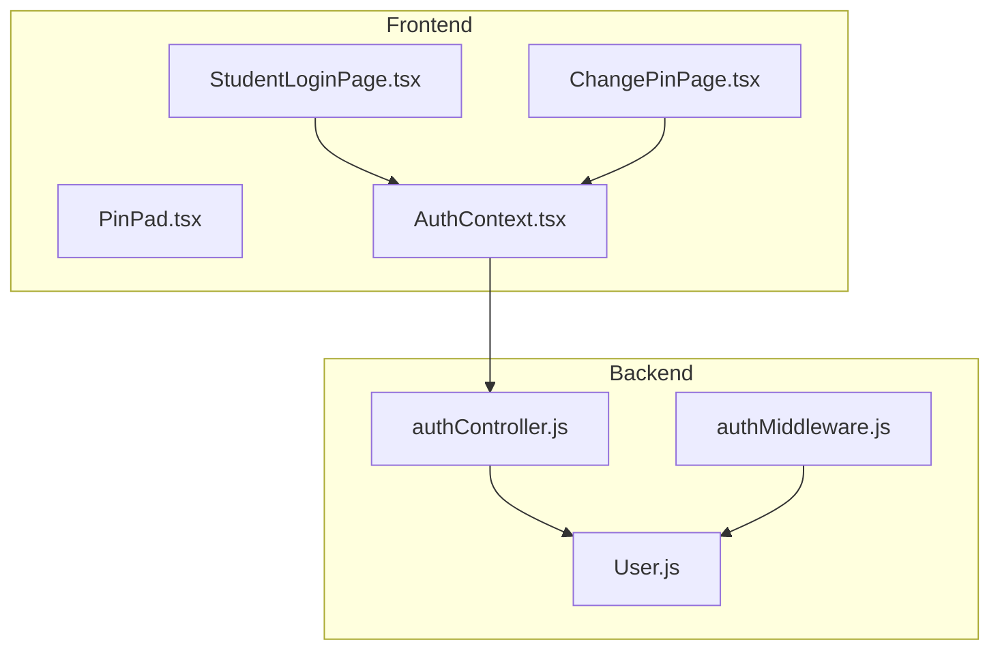
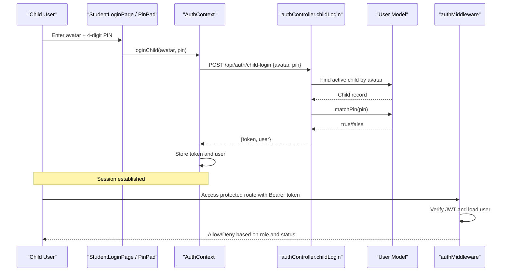
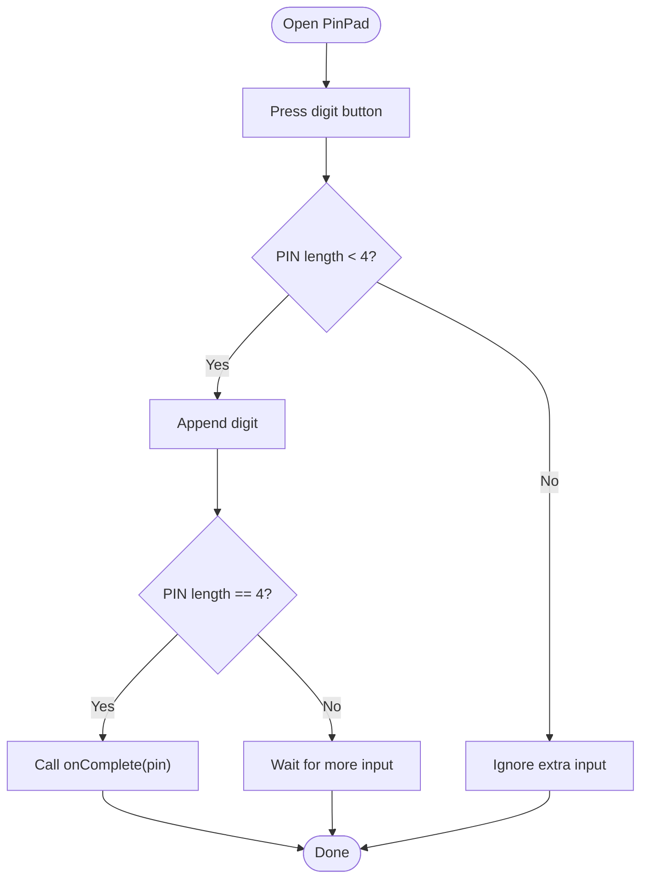
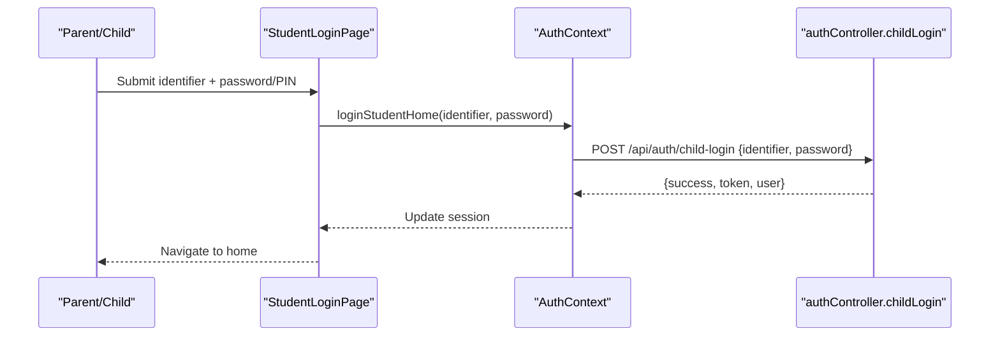
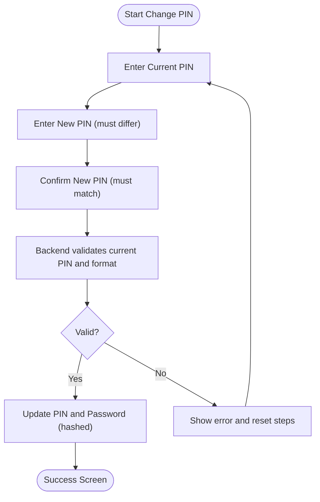
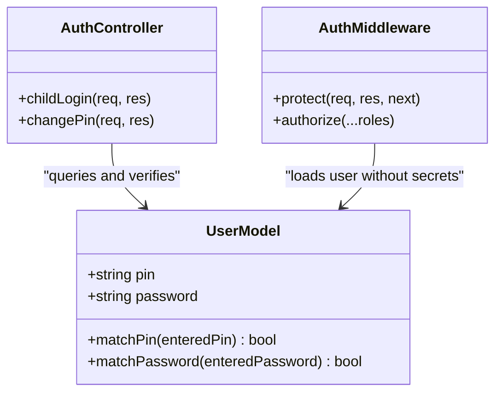
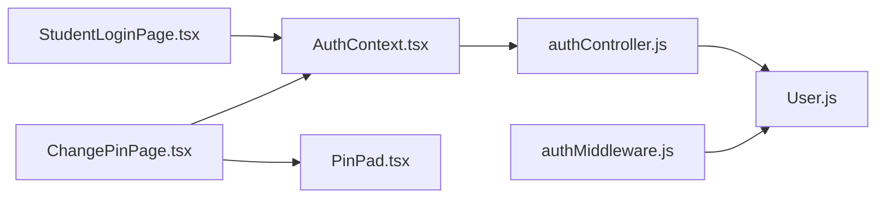

# PIN-Based Child Authentication

<cite>
**Referenced Files in This Document**
- [PinPad.tsx](file://client/src/components/child/PinPad.tsx)
- [StudentLoginPage.tsx](file://client/src/pages/child/StudentLoginPage.tsx)
- [ChangePinPage.tsx](file://client/src/pages/child/ChangePinPage.tsx)
- [AuthContext.tsx](file://client/src/context/AuthContext.tsx)
- [authController.js](file://KCEnglishKids_BE/src/controllers/authController.js)
- [User.js](file://KCEnglishKids_BE/src/models/User.js)
- [authMiddleware.js](file://KCEnglishKids_BE/src/middlewares/authMiddleware.js)
</cite>

## Table of Contents
1. [Introduction](#introduction)
2. [Project Structure](#project-structure)
3. [Core Components](#core-components)
4. [Architecture Overview](#architecture-overview)
5. [Detailed Component Analysis](#detailed-component-analysis)
6. [Dependency Analysis](#dependency-analysis)
7. [Performance Considerations](#performance-considerations)
8. [Troubleshooting Guide](#troubleshooting-guide)
9. [Conclusion](#conclusion)

## Introduction
This document explains the PIN-based authentication system designed for children ages 3–6. It provides an age-appropriate alternative to traditional login by using a simple numeric PIN, while still maintaining secure storage and validation on the server. The system supports:
- Visual child login with avatar + 4-digit PIN
- Home login with email or phone plus password or PIN
- Secure PIN hashing and verification
- A guided PIN change flow for children
- Integration into the main authentication flow via JWT tokens

The goal is to make authentication easy and engaging for young children while preserving security best practices.

## Project Structure
The PIN-based authentication spans both frontend and backend:
- Frontend components provide a child-friendly keypad and guided flows
- Backend controllers handle two login modes and secure PIN operations
- Models implement secure PIN hashing and comparison
- Middleware protects routes and enforces roles

**Diagram sources**
- [StudentLoginPage.tsx:51-63](file://client/src/pages/child/StudentLoginPage.tsx#L51-L63)
- [PinPad.tsx:14-23](file://client/src/components/child/PinPad.tsx#L14-L23)
- [ChangePinPage.tsx:39-65](file://client/src/pages/child/ChangePinPage.tsx#L39-L65)
- [AuthContext.tsx:63-85](file://client/src/context/AuthContext.tsx#L63-L85)
- [authController.js:34-160](file://KCEnglishKids_BE/src/controllers/authController.js#L34-L160)
- [User.js:84-106](file://KCEnglishKids_BE/src/models/User.js#L84-L106)
- [authMiddleware.js:4-31](file://KCEnglishKids_BE/src/middlewares/authMiddleware.js#L4-L31)

**Section sources**
- [StudentLoginPage.tsx:51-63](file://client/src/pages/child/StudentLoginPage.tsx#L51-L63)
- [PinPad.tsx:14-23](file://client/src/components/child/PinPad.tsx#L14-L23)
- [ChangePinPage.tsx:39-65](file://client/src/pages/child/ChangePinPage.tsx#L39-L65)
- [AuthContext.tsx:63-85](file://client/src/context/AuthContext.tsx#L63-L85)
- [authController.js:34-160](file://KCEnglishKids_BE/src/controllers/authController.js#L34-L160)
- [User.js:84-106](file://KCEnglishKids_BE/src/models/User.js#L84-L106)
- [authMiddleware.js:4-31](file://KCEnglishKids_BE/src/middlewares/authMiddleware.js#L4-L31)

## Core Components
- PinPad component: A large, friendly numeric keypad that accepts exactly four digits, plays sound feedback, and clears input on errors.
- Student login page: Supports home login with email/phone and password or PIN, and includes parent lookup by phone number.
- Change PIN page: Guided three-step process (current PIN, new PIN, confirm new PIN) with client-side validation and backend verification.
- Auth context: Orchestrates child login flows and persists session tokens and user data.
- Auth controller: Implements child login endpoints for both visual PIN login and identifier/password or PIN login; also handles PIN change.
- User model: Hashes and verifies PINs securely using bcrypt.
- Auth middleware: Validates JWT tokens and enforces role-based access.

**Section sources**
- [PinPad.tsx:11-41](file://client/src/components/child/PinPad.tsx#L11-L41)
- [StudentLoginPage.tsx:51-63](file://client/src/pages/child/StudentLoginPage.tsx#L51-L63)
- [ChangePinPage.tsx:21-65](file://client/src/pages/child/ChangePinPage.tsx#L21-L65)
- [AuthContext.tsx:63-85](file://client/src/context/AuthContext.tsx#L63-L85)
- [authController.js:34-160](file://KCEnglishKids_BE/src/controllers/authController.js#L34-L160)
- [User.js:84-106](file://KCEnglishKids_BE/src/models/User.js#L84-L106)
- [authMiddleware.js:4-31](file://KCEnglishKids_BE/src/middlewares/authMiddleware.js#L4-L31)

## Architecture Overview
The PIN-based authentication integrates multiple layers:
- UI layer: Child-friendly inputs and guidance
- State/session layer: Context manages token persistence and user state
- API layer: Controller validates inputs, queries users, and issues JWT tokens
- Data layer: Model hashes and compares PINs securely
- Security layer: Middleware protects routes and enforces roles

**Diagram sources**
- [StudentLoginPage.tsx:51-63](file://client/src/pages/child/StudentLoginPage.tsx#L51-L63)
- [PinPad.tsx:14-23](file://client/src/components/child/PinPad.tsx#L14-L23)
- [AuthContext.tsx:63-85](file://client/src/context/AuthContext.tsx#L63-L85)
- [authController.js:99-157](file://KCEnglishKids_BE/src/controllers/authController.js#L99-L157)
- [User.js:102-106](file://KCEnglishKids_BE/src/models/User.js#L102-L106)
- [authMiddleware.js:4-31](file://KCEnglishKids_BE/src/middlewares/authMiddleware.js#L4-L31)

## Detailed Component Analysis

### PIN Keypad UX (PinPad)
- Accepts exactly four digits and triggers completion callback when full
- Provides immediate audio feedback for interactions
- Clears input automatically after error feedback
- Uses large buttons and clear visual indicators suitable for young children

**Diagram sources**
- [PinPad.tsx:14-23](file://client/src/components/child/PinPad.tsx#L14-L23)
- [PinPad.tsx:32-41](file://client/src/components/child/PinPad.tsx#L32-L41)

**Section sources**
- [PinPad.tsx:11-41](file://client/src/components/child/PinPad.tsx#L11-L41)

### Student Login Page
- Supports home login with email or phone plus password or PIN
- Integrates with parent account lookup by phone number
- Plays positive/negative audio feedback for success/error states
- Navigates to the app root upon successful login

**Diagram sources**
- [StudentLoginPage.tsx:51-63](file://client/src/pages/child/StudentLoginPage.tsx#L51-L63)
- [AuthContext.tsx:75-85](file://client/src/context/AuthContext.tsx#L75-L85)
- [authController.js:34-97](file://KCEnglishKids_BE/src/controllers/authController.js#L34-L97)

**Section sources**
- [StudentLoginPage.tsx:51-63](file://client/src/pages/child/StudentLoginPage.tsx#L51-L63)
- [AuthContext.tsx:75-85](file://client/src/context/AuthContext.tsx#L75-L85)

### Change PIN Flow
- Three-step guided process: current PIN, new PIN, confirm new PIN
- Client-side checks prevent same PIN reuse and mismatched confirmation
- Backend validates current PIN and enforces 4-digit format
- On success, both PIN and password are updated and hashed

**Diagram sources**
- [ChangePinPage.tsx:21-65](file://client/src/pages/child/ChangePinPage.tsx#L21-L65)
- [authController.js:374-422](file://KCEnglishKids_BE/src/controllers/authController.js#L374-L422)

**Section sources**
- [ChangePinPage.tsx:21-65](file://client/src/pages/child/ChangePinPage.tsx#L21-L65)
- [authController.js:374-422](file://KCEnglishKids_BE/src/controllers/authController.js#L374-L422)

### PIN Validation and Security
- PINs are stored as bcrypt-hashed strings
- Verification uses bcrypt.compare for constant-time comparison
- Pre-save hooks ensure PINs are always hashed before persistence
- Public endpoints avoid exposing sensitive fields like PIN or password

**Diagram sources**
- [User.js:84-106](file://KCEnglishKids_BE/src/models/User.js#L84-L106)
- [authController.js:34-160](file://KCEnglishKids_BE/src/controllers/authController.js#L34-L160)
- [authMiddleware.js:4-31](file://KCEnglishKids_BE/src/middlewares/authMiddleware.js#L4-L31)

**Section sources**
- [User.js:84-106](file://KCEnglishKids_BE/src/models/User.js#L84-L106)
- [authController.js:34-160](file://KCEnglishKids_BE/src/controllers/authController.js#L34-L160)
- [authMiddleware.js:4-31](file://KCEnglishKids_BE/src/middlewares/authMiddleware.js#L4-L31)

## Dependency Analysis
- Frontend dependencies:
  - StudentLoginPage depends on AuthContext for login orchestration
  - ChangePinPage depends on PinPad for input and AuthContext for navigation/state
  - PinPad is reusable across PIN entry flows
- Backend dependencies:
  - authController depends on User model for querying and verifying credentials
  - authMiddleware depends on User model to load user profiles without secrets
  - User model implements secure hashing and verification methods

**Diagram sources**
- [StudentLoginPage.tsx:51-63](file://client/src/pages/child/StudentLoginPage.tsx#L51-L63)
- [ChangePinPage.tsx:39-65](file://client/src/pages/child/ChangePinPage.tsx#L39-L65)
- [PinPad.tsx:14-23](file://client/src/components/child/PinPad.tsx#L14-L23)
- [AuthContext.tsx:63-85](file://client/src/context/AuthContext.tsx#L63-L85)
- [authController.js:34-160](file://KCEnglishKids_BE/src/controllers/authController.js#L34-L160)
- [User.js:84-106](file://KCEnglishKids_BE/src/models/User.js#L84-L106)
- [authMiddleware.js:4-31](file://KCEnglishKids_BE/src/middlewares/authMiddleware.js#L4-L31)

**Section sources**
- [StudentLoginPage.tsx:51-63](file://client/src/pages/child/StudentLoginPage.tsx#L51-L63)
- [ChangePinPage.tsx:39-65](file://client/src/pages/child/ChangePinPage.tsx#L39-L65)
- [PinPad.tsx:14-23](file://client/src/components/child/PinPad.tsx#L14-L23)
- [AuthContext.tsx:63-85](file://client/src/context/AuthContext.tsx#L63-L85)
- [authController.js:34-160](file://KCEnglishKids_BE/src/controllers/authController.js#L34-L160)
- [User.js:84-106](file://KCEnglishKids_BE/src/models/User.js#L84-L106)
- [authMiddleware.js:4-31](file://KCEnglishKids_BE/src/middlewares/authMiddleware.js#L4-L31)

## Performance Considerations
- PIN hashing uses bcrypt with salt rounds configured in the pre-save hook; this adds CPU cost but ensures strong security
- Avoid unnecessary re-hashing by only hashing when PIN or password fields are modified
- Keep UI interactions lightweight; PinPad avoids heavy computations and relies on simple string concatenation
- Token generation uses short-lived JWTs with reasonable expiration; consider rotating secrets and enforcing refresh strategies if needed

[No sources needed since this section provides general guidance]

## Troubleshooting Guide
Common issues and resolutions:
- Incorrect PIN during classroom login:
  - Ensure the PIN is exactly four digits
  - Confirm the selected avatar matches the intended child profile
  - Check backend error messages indicating incorrect PIN
- Home login fails with identifier/password or PIN:
  - Verify the identifier (email/phone/contact/username) exists and is active
  - Try both password and PIN matching paths
- PIN change fails:
  - Ensure current PIN is correct
  - Ensure new PIN is different from current and exactly four digits
  - Confirm confirmation step matches the new PIN
- Session not persisting:
  - Verify token storage in local storage and that getMe endpoint returns valid user data
  - Check middleware for invalid/expired token handling

**Section sources**
- [authController.js:99-157](file://KCEnglishKids_BE/src/controllers/authController.js#L99-L157)
- [authController.js:374-422](file://KCEnglishKids_BE/src/controllers/authController.js#L374-L422)
- [authMiddleware.js:4-31](file://KCEnglishKids_BE/src/middlewares/authMiddleware.js#L4-L31)

## Conclusion
The PIN-based authentication system balances accessibility for young children with robust security:
- Simple numeric PINs reduce cognitive load for ages 3–6
- Secure hashing and verification protect stored credentials
- Guided UI flows support independent use by children
- Flexible login modes accommodate both classroom and home environments
- Role-based middleware ensures safe access to protected resources

[No sources needed since this section summarizes without analyzing specific files]