# Role-Based Access Control (RBAC)

<cite>
**Referenced Files in This Document**
- [authMiddleware.js](file://KCEnglishKids_BE/src/middlewares/authMiddleware.js)
- [User.js](file://KCEnglishKids_BE/src/models/User.js)
- [adminRoutes.js](file://KCEnglishKids_BE/src/routes/adminRoutes.js)
- [teacherRoutes.js](file://KCEnglishKids_BE/src/routes/teacherRoutes.js)
- [authRoutes.js](file://KCEnglishKids_BE/src/routes/authRoutes.js)
- [authController.js](file://KCEnglishKids_BE/src/controllers/authController.js)
- [adminController.js](file://KCEnglishKids_BE/src/controllers/adminController.js)
- [teacherController.js](file://KCEnglishKids_BE/src/controllers/teacherController.js)
- [App.tsx](file://client/src/App.tsx)
- [api.ts](file://admin/src/services/api.ts)
</cite>

## Table of Contents
1. [Introduction](#introduction)
2. [Project Structure](#project-structure)
3. [Core Components](#core-components)
4. [Architecture Overview](#architecture-overview)
5. [Detailed Component Analysis](#detailed-component-analysis)
6. [Dependency Analysis](#dependency-analysis)
7. [Performance Considerations](#performance-considerations)
8. [Troubleshooting Guide](#troubleshooting-guide)
9. [Conclusion](#conclusion)

## Introduction
This document explains the role-based access control (RBAC) system for KCEnglishKids, focusing on three primary roles: CHILD, TEACHER, and ADMIN. It covers how route protection is implemented using middleware, the permission hierarchy, protected routes per application area, and how roles map to features across the child learning app, teacher dashboard, and admin portal. It also documents role assignment, modification, and deactivation processes.

## Project Structure
The RBAC implementation spans backend middleware, models, routes, controllers, and frontend routing/service layers:
- Backend middleware handles authentication and authorization.
- The User model defines roles and account status.
- Route files apply middleware to protect endpoints.
- Controllers implement business logic with additional role-scoped checks.
- Frontend enforces role-based navigation and API calls.

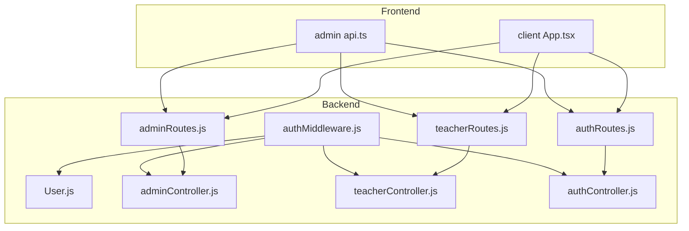

**Diagram sources**
- [authMiddleware.js:1-59](file://KCEnglishKids_BE/src/middlewares/authMiddleware.js#L1-L59)
- [User.js:1-109](file://KCEnglishKids_BE/src/models/User.js#L1-L109)
- [adminRoutes.js:1-34](file://KCEnglishKids_BE/src/routes/adminRoutes.js#L1-L34)
- [teacherRoutes.js:1-50](file://KCEnglishKids_BE/src/routes/teacherRoutes.js#L1-L50)
- [authRoutes.js:1-25](file://KCEnglishKids_BE/src/routes/authRoutes.js#L1-L25)
- [adminController.js:1-396](file://KCEnglishKids_BE/src/controllers/adminController.js#L1-L396)
- [teacherController.js:1-79](file://KCEnglishKids_BE/src/controllers/teacherController.js#L1-L79)
- [authController.js:1-488](file://KCEnglishKids_BE/src/controllers/authController.js#L1-L488)
- [App.tsx:17-38](file://client/src/App.tsx#L17-L38)
- [api.ts:1-52](file://admin/src/services/api.ts#L1-L52)

**Section sources**
- [authMiddleware.js:1-59](file://KCEnglishKids_BE/src/middlewares/authMiddleware.js#L1-L59)
- [User.js:1-109](file://KCEnglishKids_BE/src/models/User.js#L1-L109)
- [adminRoutes.js:1-34](file://KCEnglishKids_BE/src/routes/adminRoutes.js#L1-L34)
- [teacherRoutes.js:1-50](file://KCEnglishKids_BE/src/routes/teacherRoutes.js#L1-L50)
- [authRoutes.js:1-25](file://KCEnglishKids_BE/src/routes/authRoutes.js#L1-L25)
- [adminController.js:1-396](file://KCEnglishKids_BE/src/controllers/adminController.js#L1-L396)
- [teacherController.js:1-79](file://KCEnglishKids_BE/src/controllers/teacherController.js#L1-L79)
- [authController.js:1-488](file://KCEnglishKids_BE/src/controllers/authController.js#L1-L488)
- [App.tsx:17-38](file://client/src/App.tsx#L17-L38)
- [api.ts:1-52](file://admin/src/services/api.ts#L1-L52)

## Core Components
- Authentication and Authorization Middleware
  - protect: validates JWT, loads user, ensures ACTIVE status, attaches user to request.
  - authorize(...roles): enforces that req.user.role is included in allowed roles.
  - optionalProtect: attaches user if token exists but does not block requests otherwise.
- User Model
  - role field supports ADMIN, TEACHER, CHILD, PARENT.
  - status field supports ACTIVE, INACTIVE, LOCKED; default ACTIVE.
  - Pre-save hooks hash password and pin; methods verify password/pin.
- Route Protection
  - Admin routes require ADMIN.
  - Teacher routes require TEACHER or ADMIN.
  - Auth routes expose public login/register and protected profile endpoints.
- Controllers
  - authController: issues tokens, validates credentials, manages child PIN changes, lookup student.
  - adminController: admin-only operations like user management, curriculum, audit logs, topic toggles.
  - teacherController: teacher-only operations scoped by class ownership and student membership.

**Section sources**
- [authMiddleware.js:4-43](file://KCEnglishKids_BE/src/middlewares/authMiddleware.js#L4-L43)
- [User.js:4-82](file://KCEnglishKids_BE/src/models/User.js#L4-L82)
- [adminRoutes.js:15-28](file://KCEnglishKids_BE/src/routes/adminRoutes.js#L15-L28)
- [teacherRoutes.js:8-47](file://KCEnglishKids_BE/src/routes/teacherRoutes.js#L8-L47)
- [authRoutes.js:15-22](file://KCEnglishKids_BE/src/routes/authRoutes.js#L15-L22)
- [authController.js:4-10](file://KCEnglishKids_BE/src/controllers/authController.js#L4-L10)
- [adminController.js:28-84](file://KCEnglishKids_BE/src/controllers/adminController.js#L28-L84)
- [teacherController.js:12-79](file://KCEnglishKids_BE/src/controllers/teacherController.js#L12-L79)

## Architecture Overview
The RBAC flow combines server-side middleware enforcement with client-side route guards and service-layer token handling.

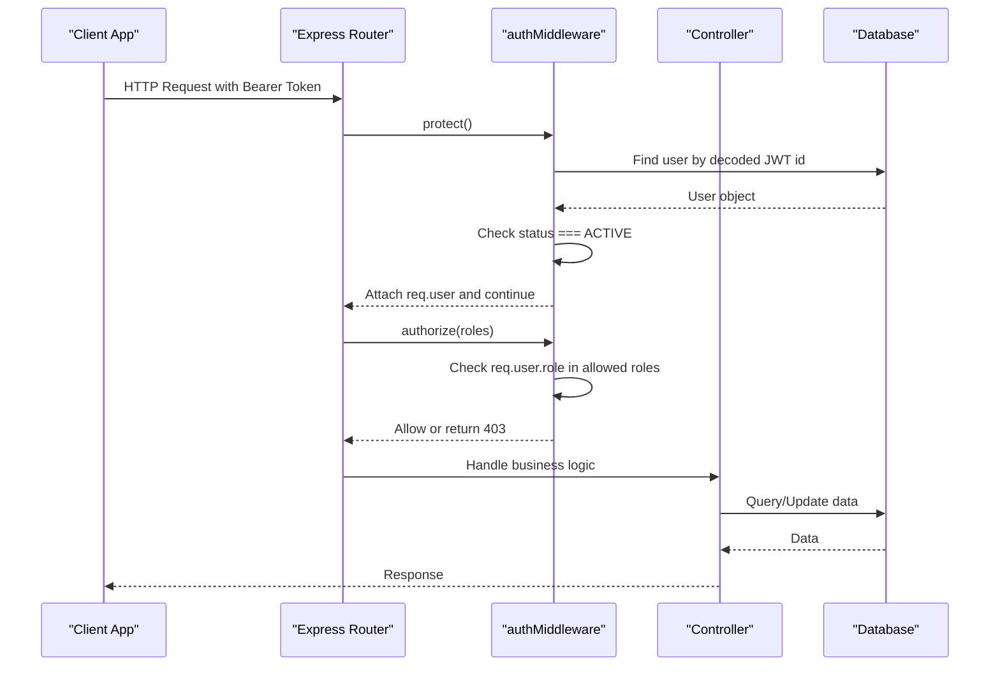

**Diagram sources**
- [authMiddleware.js:4-43](file://KCEnglishKids_BE/src/middlewares/authMiddleware.js#L4-L43)
- [User.js:72-76](file://KCEnglishKids_BE/src/models/User.js#L72-L76)
- [adminRoutes.js:15-28](file://KCEnglishKids_BE/src/routes/adminRoutes.js#L15-L28)
- [teacherRoutes.js:8-47](file://KCEnglishKids_BE/src/routes/teacherRoutes.js#L8-L47)

## Detailed Component Analysis

### Authentication and Authorization Middleware
- protect
  - Extracts Bearer token from Authorization header.
  - Verifies JWT and loads user without sensitive fields.
  - Rejects inactive or locked accounts with 403.
  - Attaches user to request context for downstream middlewares and controllers.
- authorize(...roles)
  - Factory returning a middleware that checks req.user.role against provided roles.
  - Returns 403 with a message listing required roles when unauthorized.
- optionalProtect
  - Attempts to load user if token present; ignores invalid tokens; always proceeds.

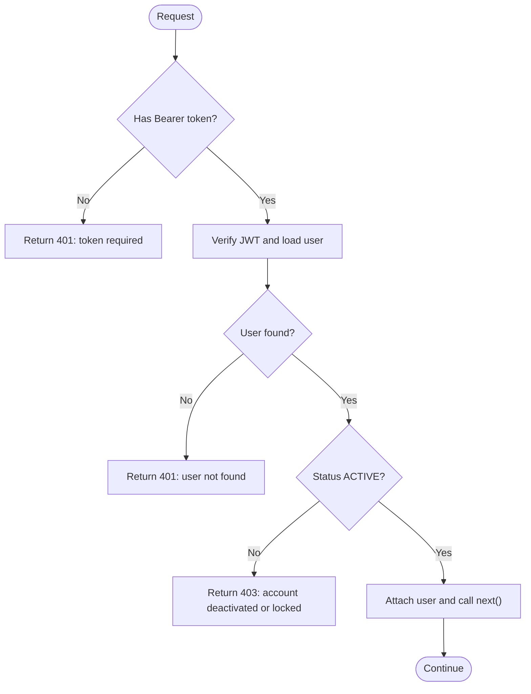

**Diagram sources**
- [authMiddleware.js:4-31](file://KCEnglishKids_BE/src/middlewares/authMiddleware.js#L4-L31)

**Section sources**
- [authMiddleware.js:4-59](file://KCEnglishKids_BE/src/middlewares/authMiddleware.js#L4-L59)

### User Model and Role Semantics
- Roles
  - ADMIN: full administrative capabilities.
  - TEACHER: classroom and student management within assigned classes.
  - CHILD: learning activities and progress tracking.
  - PARENT: supported by schema; current usage focuses on CHILD/TEACHER/ADMIN flows.
- Status
  - ACTIVE: normal operation.
  - INACTIVE: not actively used; may be reserved for future soft-deletion.
  - LOCKED: temporarily disabled; protect middleware blocks access.
- Security
  - Password and PIN are hashed before save.
  - Methods exist to compare entered credentials securely.

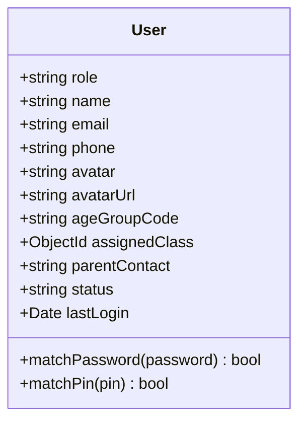

**Diagram sources**
- [User.js:4-82](file://KCEnglishKids_BE/src/models/User.js#L4-L82)
- [User.js:84-106](file://KCEnglishKids_BE/src/models/User.js#L84-L106)

**Section sources**
- [User.js:1-109](file://KCEnglishKids_BE/src/models/User.js#L1-L109)

### Protected Routes and Role Enforcement

#### Admin Portal
- Protected endpoints require ADMIN:
  - GET /api/admin/dashboard
  - GET /api/admin/curriculum
  - GET /api/admin/users
  - POST /api/admin/teachers
  - POST /api/admin/children
  - PATCH /api/admin/users/:id/status
  - GET /api/admin/audit-logs
  - PATCH /api/admin/topics/:id/status
- Public endpoint:
  - GET /api/admin/public-stats

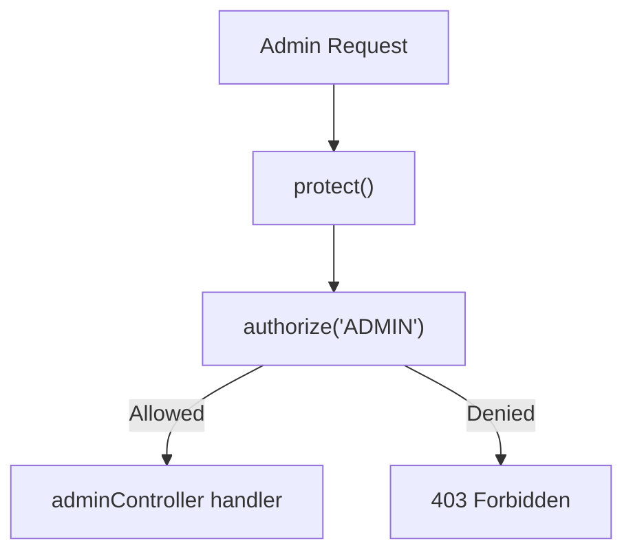

**Diagram sources**
- [adminRoutes.js:15-28](file://KCEnglishKids_BE/src/routes/adminRoutes.js#L15-L28)

**Section sources**
- [adminRoutes.js:1-34](file://KCEnglishKids_BE/src/routes/adminRoutes.js#L1-L34)
- [adminController.js:28-84](file://KCEnglishKids_BE/src/controllers/adminController.js#L28-L84)

#### Teacher Dashboard
- All teacher routes are protected and allow TEACHER or ADMIN:
  - Class management, student lists, assignments, notes, vocabulary mastery view, parent notifications.
- Additional scoping:
  - Controllers enforce teacher ownership of classrooms and restrict student access to those in the teacher’s classes.

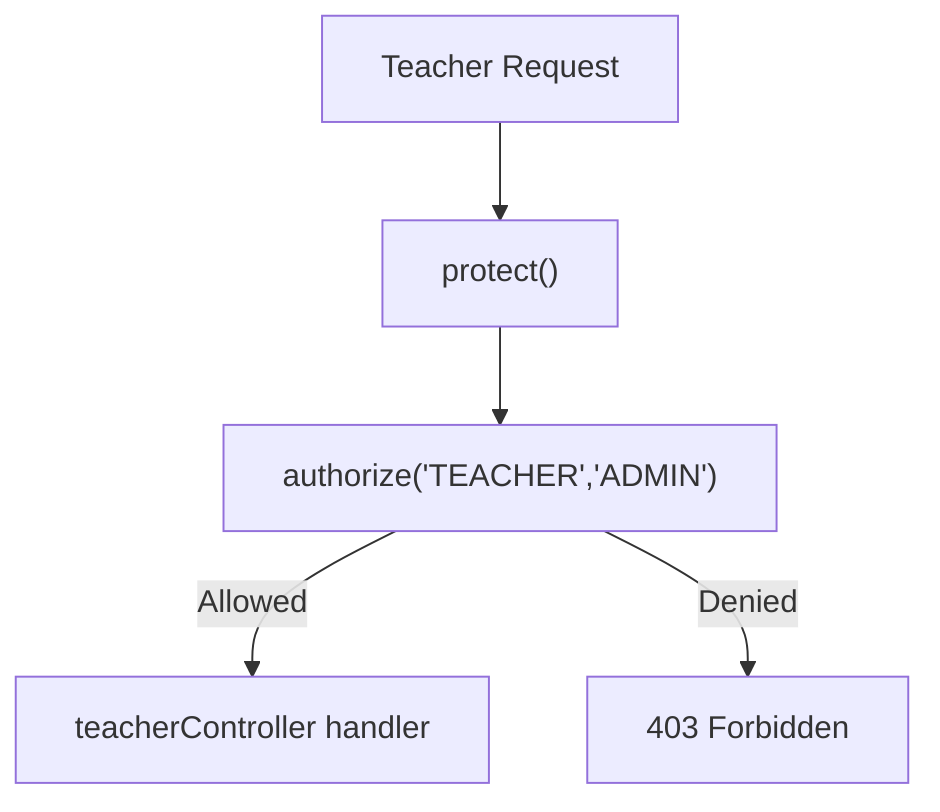

**Diagram sources**
- [teacherRoutes.js:8-47](file://KCEnglishKids_BE/src/routes/teacherRoutes.js#L8-L47)
- [teacherController.js:6-8](file://KCEnglishKids_BE/src/controllers/teacherController.js#L6-L8)

**Section sources**
- [teacherRoutes.js:1-50](file://KCEnglishKids_BE/src/routes/teacherRoutes.js#L1-L50)
- [teacherController.js:12-79](file://KCEnglishKids_BE/src/controllers/teacherController.js#L12-L79)

#### Child Learning App
- Public auth endpoints:
  - GET /api/auth/children-avatars
  - POST /api/auth/child-login
  - POST /api/auth/child-register
  - POST /api/auth/lookup-student
- Protected endpoints:
  - GET /api/auth/me
  - POST /api/auth/change-pin
- Frontend route guards:
  - ProtectedChildRoute enforces user.role === 'CHILD'.
  - ProtectedTeacherRoute enforces user.role === 'TEACHER'.

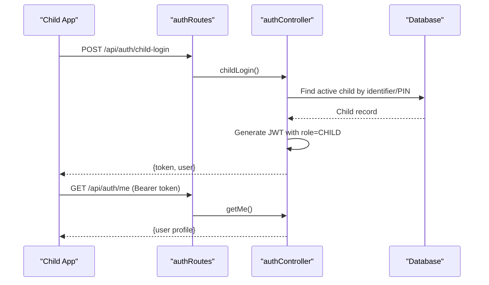

**Diagram sources**
- [authRoutes.js:15-22](file://KCEnglishKids_BE/src/routes/authRoutes.js#L15-L22)
- [authController.js:34-161](file://KCEnglishKids_BE/src/controllers/authController.js#L34-L161)
- [authController.js:271-285](file://KCEnglishKids_BE/src/controllers/authController.js#L271-L285)
- [App.tsx:17-38](file://client/src/App.tsx#L17-L38)

**Section sources**
- [authRoutes.js:1-25](file://KCEnglishKids_BE/src/routes/authRoutes.js#L1-L25)
- [authController.js:34-161](file://KCEnglishKids_BE/src/controllers/authController.js#L34-L161)
- [authController.js:271-285](file://KCEnglishKids_BE/src/controllers/authController.js#L271-L285)
- [App.tsx:17-38](file://client/src/App.tsx#L17-L38)

### Permission Hierarchy and Access Rules
- ADMIN
  - Full access to admin endpoints.
  - Can create teachers and children, toggle user status, manage topics, view audit logs.
- TEACHER
  - Access to teacher endpoints.
  - Scoped to own classes and students; cannot access admin endpoints.
- CHILD
  - Access to child learning endpoints and personal profile updates.
  - Cannot access teacher or admin endpoints.

Access rules summary:
- Admin-only routes: require ADMIN.
- Teacher routes: require TEACHER or ADMIN.
- Child routes: typically no role check at route level; controller-level checks ensure only the authenticated child can modify their own data (e.g., change-pin).

**Section sources**
- [adminRoutes.js:15-28](file://KCEnglishKids_BE/src/routes/adminRoutes.js#L15-L28)
- [teacherRoutes.js:8-47](file://KCEnglishKids_BE/src/routes/teacherRoutes.js#L8-L47)
- [authController.js:374-422](file://KCEnglishKids_BE/src/controllers/authController.js#L374-L422)

### Role Assignment, Modification, and Deactivation

#### Role Assignment
- Creating a teacher:
  - Endpoint: POST /api/admin/teachers
  - Requires ADMIN.
  - Creates a User with role TEACHER and sets initial status ACTIVE.
- Creating a child:
  - Endpoint: POST /api/admin/children
  - Requires ADMIN.
  - Creates a User with role CHILD, assigns age group based on DOB or body, and optionally links to a class.

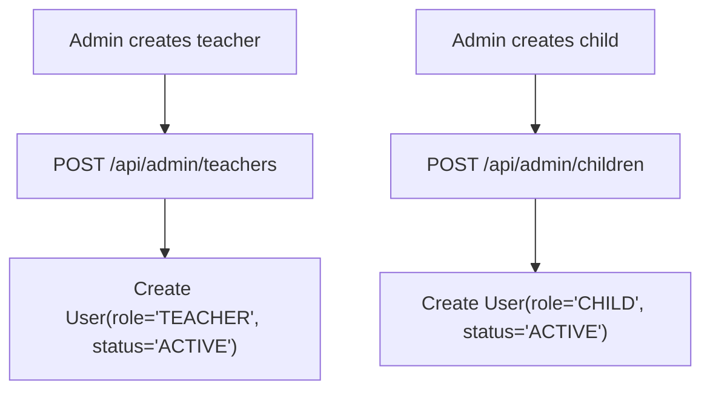

**Diagram sources**
- [adminController.js:147-199](file://KCEnglishKids_BE/src/controllers/adminController.js#L147-L199)
- [adminController.js:204-288](file://KCEnglishKids_BE/src/controllers/adminController.js#L204-L288)

**Section sources**
- [adminController.js:147-199](file://KCEnglishKids_BE/src/controllers/adminController.js#L147-L199)
- [adminController.js:204-288](file://KCEnglishKids_BE/src/controllers/adminController.js#L204-L288)

#### Role Modification
- Changing a child’s PIN:
  - Endpoint: POST /api/auth/change-pin
  - Requires authentication; controller verifies role === 'CHILD' and validates current/new PIN.
- Updating teacher/classroom metadata:
  - Teacher endpoints update class details and assignments; these do not change roles but affect feature availability.

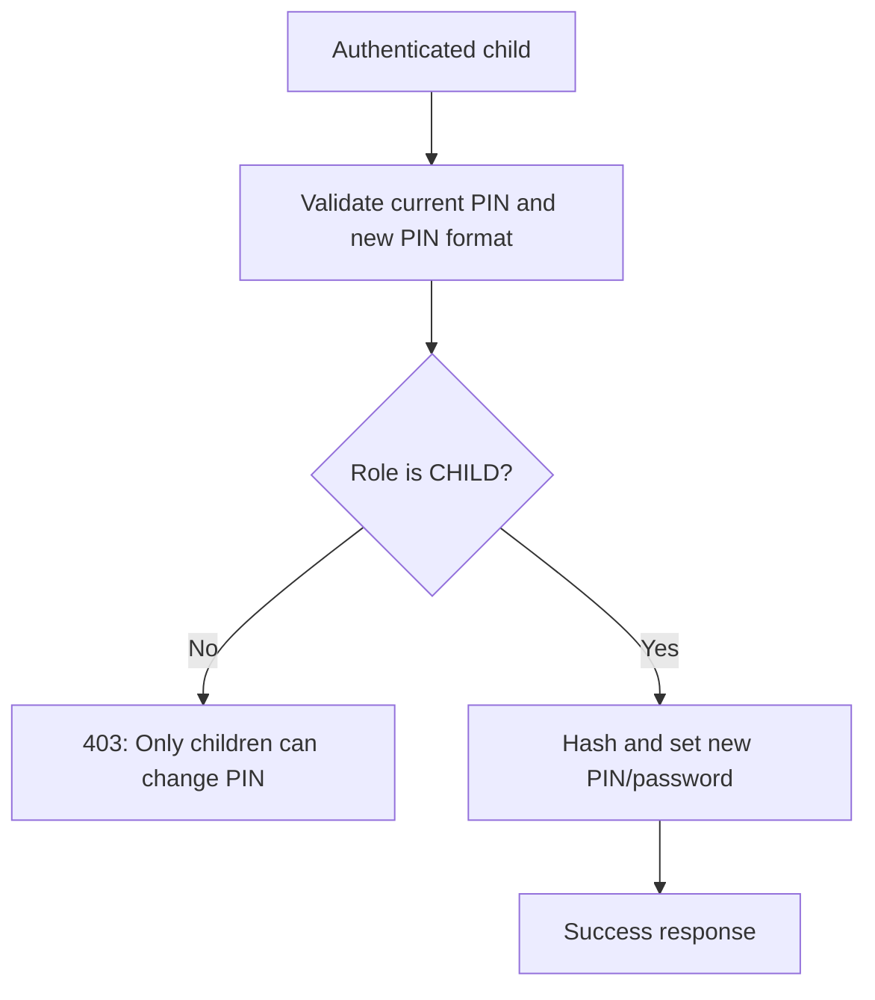

**Diagram sources**
- [authController.js:374-422](file://KCEnglishKids_BE/src/controllers/authController.js#L374-L422)

**Section sources**
- [authController.js:374-422](file://KCEnglishKids_BE/src/controllers/authController.js#L374-L422)

#### Role Deactivation
- Locking/unlocking users:
  - Endpoint: PATCH /api/admin/users/:id/status
  - Requires ADMIN.
  - Toggles between ACTIVE and LOCKED; protects main admin accounts from being locked.
- Effect on access:
  - protect middleware rejects users with status !== 'ACTIVE' with 403.

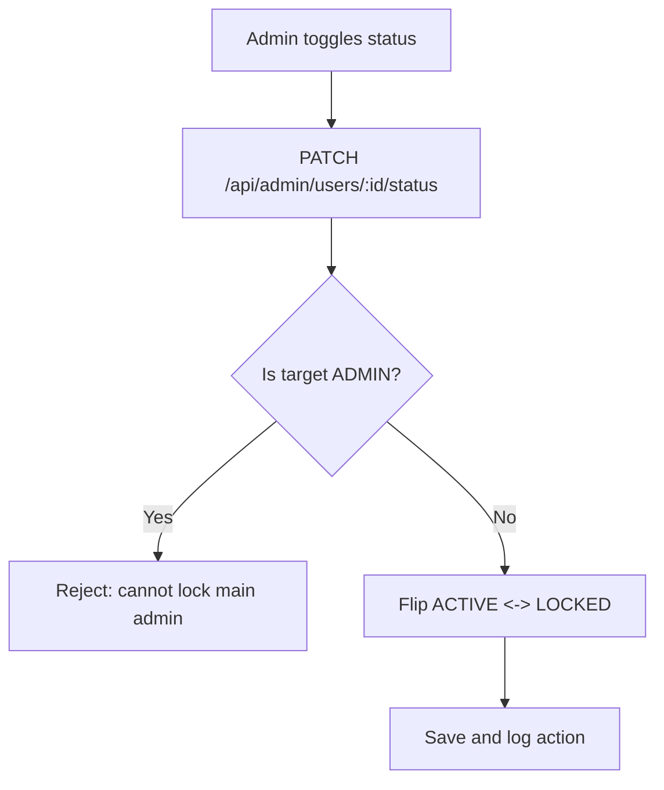

**Diagram sources**
- [adminController.js:293-329](file://KCEnglishKids_BE/src/controllers/adminController.js#L293-L329)
- [authMiddleware.js:17-19](file://KCEnglishKids_BE/src/middlewares/authMiddleware.js#L17-L19)

**Section sources**
- [adminController.js:293-329](file://KCEnglishKids_BE/src/controllers/adminController.js#L293-L329)
- [authMiddleware.js:17-19](file://KCEnglishKids_BE/src/middlewares/authMiddleware.js#L17-L19)

### Relationship Between Roles and Features

- Child Learning App
  - Login via avatar+PIN or identifier+password.
  - Access learning content, activities, and personal progress.
  - Change own PIN; retrieve profile.
- Teacher Dashboard
  - Manage classes, add/remove students, assign lessons/activities.
  - View student overviews, history, notes, and vocabulary mastery.
  - Send parent notifications.
- Admin Portal
  - Dashboard metrics, curriculum overview.
  - Create/manage teachers and children.
  - Toggle user status, audit logs, topic status controls.

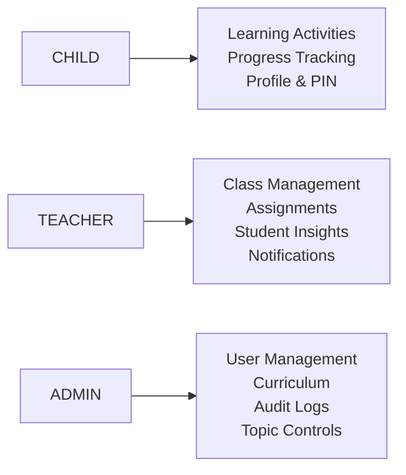

[No sources needed since this diagram shows conceptual workflow, not actual code structure]

## Dependency Analysis
Key dependencies and relationships:
- Middlewares depend on JWT library and User model.
- Routes compose middlewares and controllers.
- Controllers depend on multiple domain models and perform role-scoped queries.
- Frontend services attach Authorization headers; route guards enforce role checks.

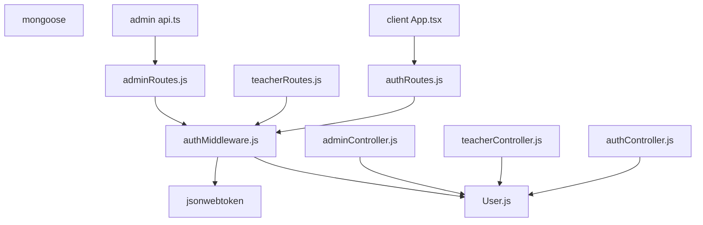

**Diagram sources**
- [authMiddleware.js:1-2](file://KCEnglishKids_BE/src/middlewares/authMiddleware.js#L1-L2)
- [User.js:1-2](file://KCEnglishKids_BE/src/models/User.js#L1-L2)
- [adminRoutes.js:1-13](file://KCEnglishKids_BE/src/routes/adminRoutes.js#L1-L13)
- [teacherRoutes.js:1-6](file://KCEnglishKids_BE/src/routes/teacherRoutes.js#L1-L6)
- [authRoutes.js:1-13](file://KCEnglishKids_BE/src/routes/authRoutes.js#L1-L13)
- [adminController.js:1-14](file://KCEnglishKids_BE/src/controllers/adminController.js#L1-L14)
- [teacherController.js:1-2](file://KCEnglishKids_BE/src/controllers/teacherController.js#L1-L2)
- [authController.js:1-2](file://KCEnglishKids_BE/src/controllers/authController.js#L1-L2)
- [App.tsx:17-38](file://client/src/App.tsx#L17-L38)
- [api.ts:1-52](file://admin/src/services/api.ts#L1-L52)

**Section sources**
- [authMiddleware.js:1-59](file://KCEnglishKids_BE/src/middlewares/authMiddleware.js#L1-L59)
- [User.js:1-109](file://KCEnglishKids_BE/src/models/User.js#L1-L109)
- [adminRoutes.js:1-34](file://KCEnglishKids_BE/src/routes/adminRoutes.js#L1-L34)
- [teacherRoutes.js:1-50](file://KCEnglishKids_BE/src/routes/teacherRoutes.js#L1-L50)
- [authRoutes.js:1-25](file://KCEnglishKids_BE/src/routes/authRoutes.js#L1-L25)
- [adminController.js:1-396](file://KCEnglishKids_BE/src/controllers/adminController.js#L1-L396)
- [teacherController.js:1-79](file://KCEnglishKids_BE/src/controllers/teacherController.js#L1-L79)
- [authController.js:1-488](file://KCEnglishKids_BE/src/controllers/authController.js#L1-L488)
- [App.tsx:17-38](file://client/src/App.tsx#L17-L38)
- [api.ts:1-52](file://admin/src/services/api.ts#L1-L52)

## Performance Considerations
- Middleware overhead is minimal: JWT verification and one database lookup per protected request.
- Use optionalProtect for endpoints where user context is beneficial but not mandatory.
- Avoid unnecessary population in high-throughput routes; populate selectively in controllers.
- Indexes on frequently queried fields (role, status) improve performance.

[No sources needed since this section provides general guidance]

## Troubleshooting Guide
Common issues and resolutions:
- 401 Unauthorized
  - Missing or invalid Bearer token.
  - Expired or malformed JWT.
  - Ensure clients send Authorization header with valid token.
- 403 Forbidden
  - Account status is not ACTIVE (deactivated or locked).
  - Insufficient role for the requested endpoint.
  - Verify user.status and role alignment with route requirements.
- Role mismatch in controllers
  - Some controllers enforce additional checks beyond middleware (e.g., teacher owns classroom).
  - Confirm resource ownership and membership constraints.

Operational tips:
- Use admin endpoints to toggle user status when troubleshooting access issues.
- Validate token payload includes correct role and user id.
- Review audit logs for recent administrative actions.

**Section sources**
- [authMiddleware.js:4-43](file://KCEnglishKids_BE/src/middlewares/authMiddleware.js#L4-L43)
- [adminController.js:293-329](file://KCEnglishKids_BE/src/controllers/adminController.js#L293-L329)
- [teacherController.js:6-8](file://KCEnglishKids_BE/src/controllers/teacherController.js#L6-L8)

## Conclusion
The RBAC system in KCEnglishKids uses a clear separation of concerns: middleware authenticates and authorizes requests, the User model defines roles and statuses, routes declare required roles, and controllers enforce business-specific permissions. This design ensures secure access across the child learning app, teacher dashboard, and admin portal while supporting flexible role assignment, modification, and deactivation workflows.