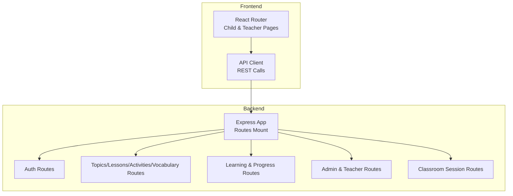
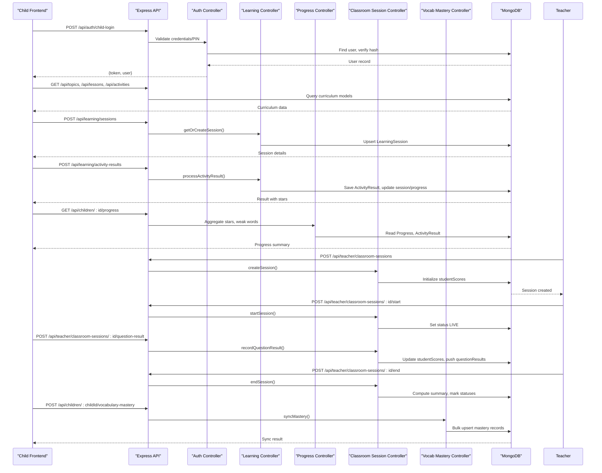
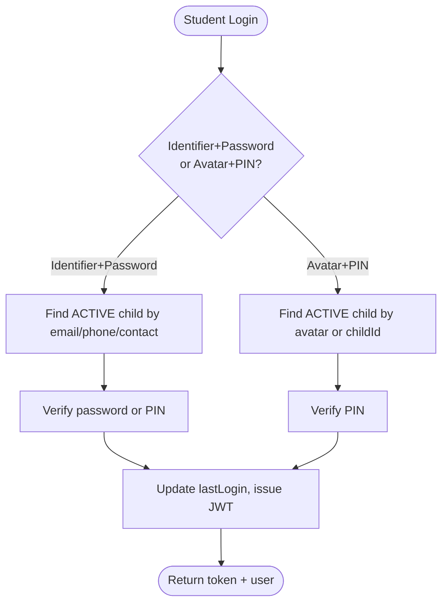
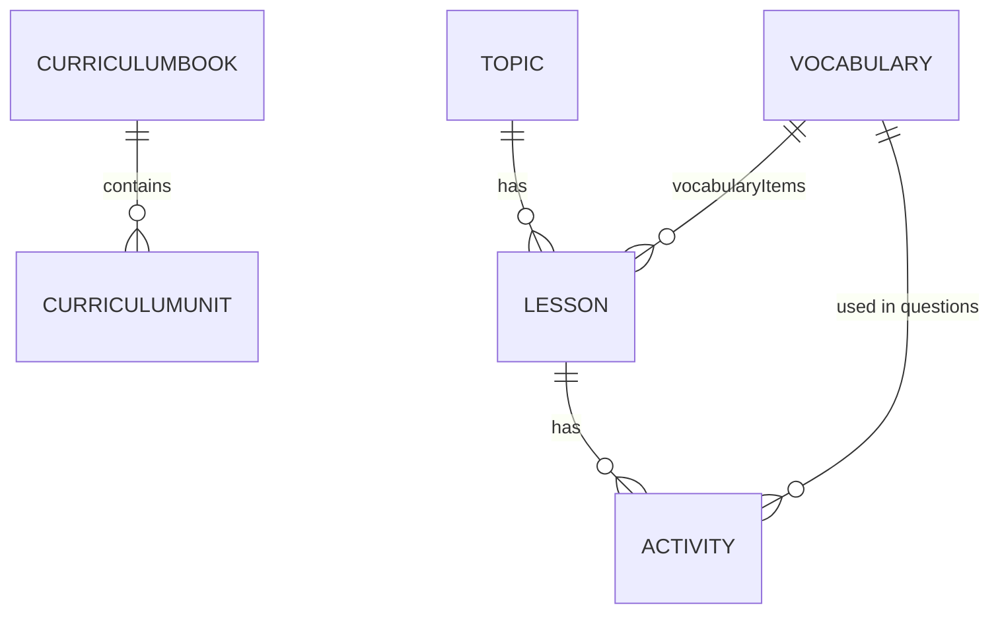
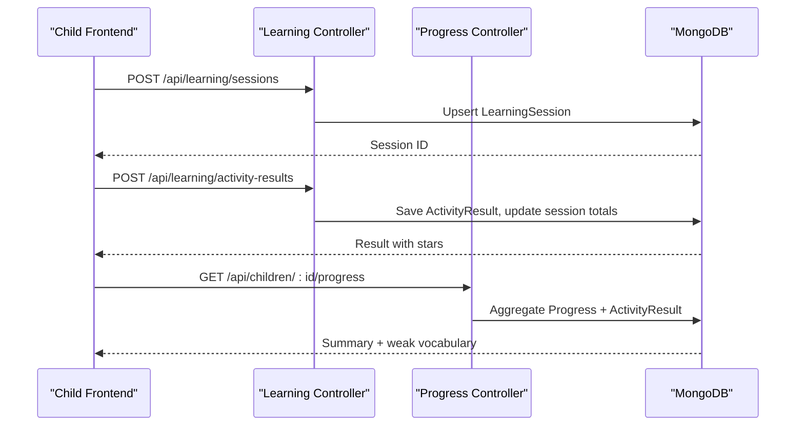
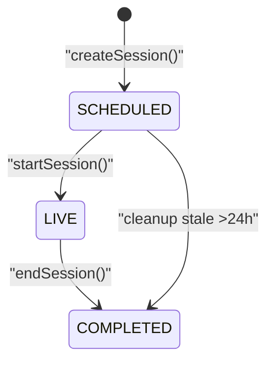
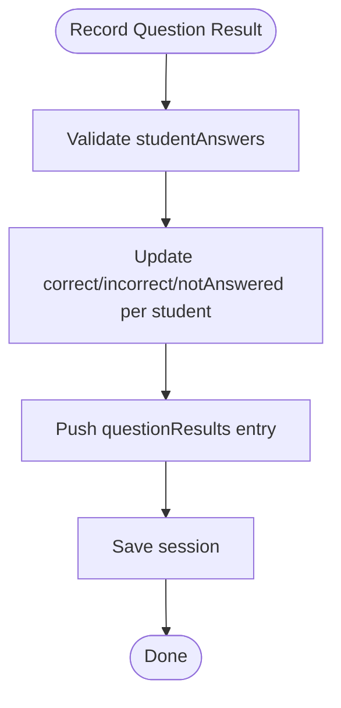
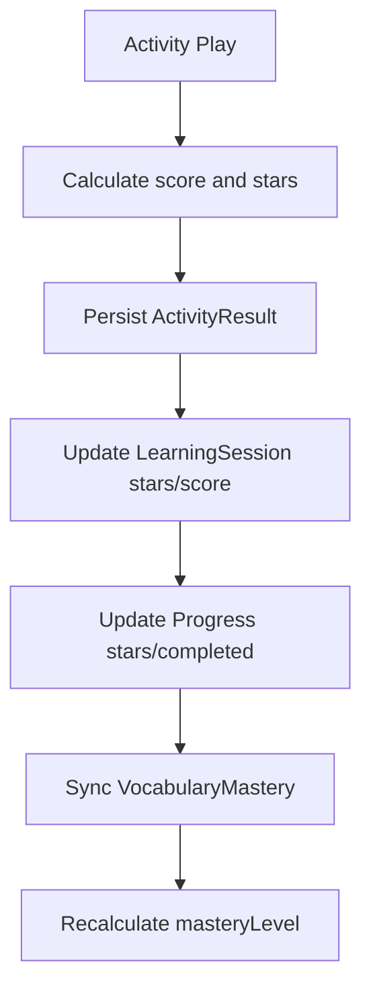
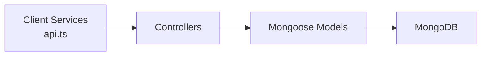

# Data Flow Patterns

<cite>
**Referenced Files in This Document**
- [README.md](file://README.md)
- [architecture.md](file://docs/architecture.md)
- [database.md](file://docs/database.md)
- [app.js](file://KCEnglishKids_BE/src/app.js)
- [App.tsx](file://client/src/App.tsx)
- [api.ts](file://client/src/services/api.ts)
- [User.js](file://KCEnglishKids_BE/src/models/User.js)
- [CurriculumBook.js](file://KCEnglishKids_BE/src/models/CurriculumBook.js)
- [Topic.js](file://KCEnglishKids_BE/src/models/Topic.js)
- [Lesson.js](file://KCEnglishKids_BE/src/models/Lesson.js)
- [Activity.js](file://KCEnglishKids_BE/src/models/Activity.js)
- [LearningSession.js](file://KCEnglishKids_BE/src/models/LearningSession.js)
- [ActivityResult.js](file://KCEnglishKids_BE/src/models/ActivityResult.js)
- [Progress.js](file://KCEnglishKids_BE/src/models/Progress.js)
- [authController.js](file://KCEnglishKids_BE/src/controllers/authController.js)
- [learningController.js](file://KCEnglishKids_BE/src/controllers/learningController.js)
- [progressController.js](file://KCEnglishKids_BE/src/controllers/progressController.js)
- [classroomSessionController.js](file://KCEnglishKids_BE/src/controllers/classroomSessionController.js)
- [vocabMasteryController.js](file://KCEnglishKids_BE/src/controllers/vocabMasteryController.js)
</cite>

## Table of Contents
1. [Introduction](#introduction)
2. [Project Structure](#project-structure)
3. [Core Components](#core-components)
4. [Architecture Overview](#architecture-overview)
5. [Detailed Component Analysis](#detailed-component-analysis)
6. [Dependency Analysis](#dependency-analysis)
7. [Performance Considerations](#performance-considerations)
8. [Troubleshooting Guide](#troubleshooting-guide)
9. [Conclusion](#conclusion)

## Introduction
This document explains the end-to-end data flow patterns in KCEnglishKids, covering:
- Student learning flow from login through activity completion to progress updates
- Curriculum data flow from admin content creation to frontend display
- Real-time classroom session synchronization for live monitoring and participation tracking
- Gamification data flow translating game results into stars, badges, and vocabulary mastery progression
- Error handling strategies, validation patterns, and caching considerations
- Performance guidance for large curriculum datasets and real-time updates during sessions

The system follows a two-layer architecture:
- Curriculum Foundation: Books, Units, Topics, Lessons, Activities, Vocabulary
- Application Learning Experience: Sessions, Results, Progress, Stars, Mastery

**Section sources**
- [README.md:7-27](file://README.md#L7-L27)
- [architecture.md:3-18](file://docs/architecture.md#L3-L18)

## Project Structure
At runtime:
- The backend Express app mounts REST routes under /api for auth, topics, lessons, activities, vocabulary, learning, children progress, admin, teacher, and classroom sessions.
- The React client defines protected routes for child and teacher flows, including lesson detail, activity play, and teacher classroom session management.

**Diagram sources**
- [app.js:34-49](file://KCEnglishKids_BE/src/app.js#L34-L49)
- [App.tsx:40-127](file://client/src/App.tsx#L40-L127)

**Section sources**
- [app.js:1-53](file://KCEnglishKids_BE/src/app.js#L1-L53)
- [App.tsx:1-134](file://client/src/App.tsx#L1-L134)

## Core Components
Key domain models that drive data flows:
- User: Role-based accounts (ADMIN, TEACHER, CHILD), secure credentials (password/PIN), age group scoping
- CurriculumBook, Topic, Lesson, Activity: Structured curriculum with media references and question sets
- LearningSession: Per-child per-lesson active session state
- ActivityResult: Detailed per-activity performance records
- Progress: Aggregated per-topic/per-lesson completion, stars, attempts, weak vocabulary
- ClassroomSession: Live teaching session with student scores and question results
- VocabularyMastery: Long-term vocabulary practice metrics and mastery levels

These models define the canonical data contracts between controllers and the database.

**Section sources**
- [User.js:1-109](file://KCEnglishKids_BE/src/models/User.js#L1-L109)
- [CurriculumBook.js:1-41](file://KCEnglishKids_BE/src/models/CurriculumBook.js#L1-L41)
- [Topic.js:1-78](file://KCEnglishKids_BE/src/models/Topic.js#L1-L78)
- [Lesson.js:1-101](file://KCEnglishKids_BE/src/models/Lesson.js#L1-L101)
- [Activity.js:1-176](file://KCEnglishKids_BE/src/models/Activity.js#L1-L176)
- [LearningSession.js:1-61](file://KCEnglishKids_BE/src/models/LearningSession.js#L1-L61)
- [ActivityResult.js:1-78](file://KCEnglishKids_BE/src/models/ActivityResult.js#L1-L78)
- [Progress.js:1-65](file://KCEnglishKids_BE/src/models/Progress.js#L1-L65)

## Architecture Overview
High-level request/response paths:
- Auth: Child avatar selection + PIN or email/phone + password → JWT token
- Curriculum browsing: Topics → Lessons → Activities
- Learning: Start session → Play activity → Submit answers → Calculate stars/progress
- Classroom: Create session → Start live → Record answers/scores → End session with summary
- Vocabulary mastery: Practice → Sync to DB → View mastery levels

**Diagram sources**
- [authController.js:31-161](file://KCEnglishKids_BE/src/controllers/authController.js#L31-L161)
- [learningController.js:7-91](file://KCEnglishKids_BE/src/controllers/learningController.js#L7-L91)
- [progressController.js:6-66](file://KCEnglishKids_BE/src/controllers/progressController.js#L6-L66)
- [classroomSessionController.js:74-460](file://KCEnglishKids_BE/src/controllers/classroomSessionController.js#L74-L460)
- [vocabMasteryController.js:11-184](file://KCEnglishKids_BE/src/controllers/vocabMasteryController.js#L11-L184)

## Detailed Component Analysis

### Student Login and Session Flow
- Authentication supports two modes:
  - Home mode: identifier/email/phone + password; fallback to PIN if needed
  - Classroom quick mode: avatar + 4-digit PIN
- On success, a JWT token is returned with role and metadata; lastLogin timestamp updated.
- Frontend stores token and uses it for subsequent requests.

**Diagram sources**
- [authController.js:31-161](file://KCEnglishKids_BE/src/controllers/authController.js#L31-L161)
- [User.js:84-106](file://KCEnglishKids_BE/src/models/User.js#L84-L106)

**Section sources**
- [authController.js:31-161](file://KCEnglishKids_BE/src/controllers/authController.js#L31-L161)
- [User.js:1-109](file://KCEnglishKids_BE/src/models/User.js#L1-L109)

### Curriculum Data Flow (Admin Creation to Frontend Display)
- Curriculum foundation includes books, units, topics, lessons, activities, and vocabulary.
- Frontend fetches topics, lessons, and activities via REST endpoints; models include indexes for efficient queries by ageGroupCode and status.
- Media assets are referenced via IDs and URLs for images/audio.

**Diagram sources**
- [CurriculumBook.js:1-41](file://KCEnglishKids_BE/src/models/CurriculumBook.js#L1-L41)
- [Topic.js:1-78](file://KCEnglishKids_BE/src/models/Topic.js#L1-L78)
- [Lesson.js:1-101](file://KCEnglishKids_BE/src/models/Lesson.js#L1-L101)
- [Activity.js:1-176](file://KCEnglishKids_BE/src/models/Activity.js#L1-L176)

**Section sources**
- [database.md:1-18](file://docs/database.md#L1-L18)
- [Lesson.js:1-101](file://KCEnglishKids_BE/src/models/Lesson.js#L1-L101)
- [Activity.js:1-176](file://KCEnglishKids_BE/src/models/Activity.js#L1-L176)

### Learning Flow: Activity Completion to Progress Updates
- Start/resume a LearningSession per child and lesson.
- Submit ActivityResult with answers, duration, and derived score/stars.
- Progress aggregation computes total stars, completed lessons, weak vocabulary, and recent results.

**Diagram sources**
- [learningController.js:7-91](file://KCEnglishKids_BE/src/controllers/learningController.js#L7-L91)
- [progressController.js:6-66](file://KCEnglishKids_BE/src/controllers/progressController.js#L6-L66)
- [LearningSession.js:1-61](file://KCEnglishKids_BE/src/models/LearningSession.js#L1-L61)
- [ActivityResult.js:1-78](file://KCEnglishKids_BE/src/models/ActivityResult.js#L1-L78)
- [Progress.js:1-65](file://KCEnglishKids_BE/src/models/Progress.js#L1-L65)

**Section sources**
- [learningController.js:7-91](file://KCEnglishKids_BE/src/controllers/learningController.js#L7-L91)
- [progressController.js:6-66](file://KCEnglishKids_BE/src/controllers/progressController.js#L6-L66)

### Real-Time Classroom Synchronization
- Teacher creates a ClassroomSession with initial studentScore rows.
- Session transitions: SCHEDULED → LIVE → COMPLETED.
- During LIVE:
  - recordQuestionResult aggregates per-student answer outcomes and updates counters.
  - scoreStudent/scoreBulk allow manual scoring adjustments.
- On endSession:
  - Computes average accuracy, top performers, students needing practice.
  - Marks student statuses based on accuracy thresholds.

**Diagram sources**
- [classroomSessionController.js:74-136](file://KCEnglishKids_BE/src/controllers/classroomSessionController.js#L74-L136)
- [classroomSessionController.js:169-184](file://KCEnglishKids_BE/src/controllers/classroomSessionController.js#L169-L184)
- [classroomSessionController.js:363-411](file://KCEnglishKids_BE/src/controllers/classroomSessionController.js#L363-L411)
- [classroomSessionController.js:190-260](file://KCEnglishKids_BE/src/controllers/classroomSessionController.js#L190-L260)

**Section sources**
- [classroomSessionController.js:42-460](file://KCEnglishKids_BE/src/controllers/classroomSessionController.js#L42-L460)

### Gamification Data Flow: Stars, Badges, and Vocabulary Mastery
- Stars:
  - Activity starConfig defines thresholds for 1–3 stars based on percentage score.
  - ActivityResult.stars and LearningSession.stars accumulate gamification rewards.
  - Progress.stars aggregates across lessons for overall achievement.
- Badges:
  - Frontend displays badges using curated badge data; badges are UI-driven and can be tied to milestones such as stars or completed lessons.
- Vocabulary Mastery:
  - VocabularyMastery tracks attemptCount, correctCount, wrongCount, streak, and masteryLevel.
  - syncMastery performs bulk upserts; recordPractice increments counts and recalculates mastery level.

**Diagram sources**
- [Activity.js:140-157](file://KCEnglishKids_BE/src/models/Activity.js#L140-L157)
- [ActivityResult.js:28-37](file://KCEnglishKids_BE/src/models/ActivityResult.js#L28-L37)
- [LearningSession.js:43-52](file://KCEnglishKids_BE/src/models/LearningSession.js#L43-L52)
- [Progress.js:27-32](file://KCEnglishKids_BE/src/models/Progress.js#L27-L32)
- [vocabMasteryController.js:48-112](file://KCEnglishKids_BE/src/controllers/vocabMasteryController.js#L48-L112)
- [vocabMasteryController.js:119-155](file://KCEnglishKids_BE/src/controllers/vocabMasteryController.js#L119-L155)

**Section sources**
- [Activity.js:140-157](file://KCEnglishKids_BE/src/models/Activity.js#L140-L157)
- [ActivityResult.js:28-37](file://KCEnglishKids_BE/src/models/ActivityResult.js#L28-L37)
- [LearningSession.js:43-52](file://KCEnglishKids_BE/src/models/LearningSession.js#L43-L52)
- [Progress.js:27-32](file://KCEnglishKids_BE/src/models/Progress.js#L27-L32)
- [vocabMasteryController.js:48-184](file://KCEnglishKids_BE/src/controllers/vocabMasteryController.js#L48-L184)

## Dependency Analysis
Component coupling and integration points:
- Controllers depend on Mongoose models for persistence and validation.
- Frontend services encapsulate REST calls and error handling.
- Classroom session controller depends on class roster and lesson/activity references.
- Progress controller aggregates across multiple models to produce summaries.

**Diagram sources**
- [api.ts:1-354](file://client/src/services/api.ts#L1-L354)
- [app.js:34-49](file://KCEnglishKids_BE/src/app.js#L34-L49)

**Section sources**
- [api.ts:1-354](file://client/src/services/api.ts#L1-L354)
- [app.js:1-53](file://KCEnglishKids_BE/src/app.js#L1-L53)

## Performance Considerations
- Large curriculum datasets:
  - Use indexed fields (ageGroupCode, status, displayOrder) to optimize topic/lesson/activity queries.
  - Prefer selective population to reduce payload size when fetching related entities.
- Real-time classroom sessions:
  - Batch updates via scoreBulk and recordQuestionResult to minimize write amplification.
  - Avoid frequent full-session re-population; only populate necessary relations for live views.
- Vocabulary mastery:
  - Use bulkWrite for syncMastery to efficiently upsert many records.
  - Keep local localStorage caches for short-lived practice sessions and sync periodically.
- Frontend caching:
  - Cache static curriculum data (topics, lessons, activities) at the application layer to reduce repeated network calls.
  - Invalidate caches on content updates or when switching age groups.

[No sources needed since this section provides general guidance]

## Troubleshooting Guide
Common issues and resolutions:
- Authentication failures:
  - Ensure identifiers are normalized (lowercase emails) and match stored values.
  - Verify bcrypt hashing for passwords and PINs; pre-save hooks handle hashing automatically.
- Invalid IDs:
  - Validate ObjectId inputs before querying; helper functions return consistent error responses.
- Access control:
  - Enforce role checks (CHILD self-access, TEACHER scoped access, ADMIN overrides).
- Data integrity:
  - Validate required fields (e.g., childId, activityId, lessonId) before processing.
  - Use enums and constraints in schemas to prevent invalid states.

**Section sources**
- [authController.js:31-161](file://KCEnglishKids_BE/src/controllers/authController.js#L31-L161)
- [User.js:84-106](file://KCEnglishKids_BE/src/models/User.js#L84-L106)
- [classroomSessionController.js:11-36](file://KCEnglishKids_BE/src/controllers/classroomSessionController.js#L11-L36)

## Conclusion
KCEnglishKids implements clear, scalable data flows:
- Secure, role-aware authentication enables child, teacher, and admin experiences.
- Curriculum data is structured and indexed for efficient retrieval and display.
- Learning sessions capture detailed performance and compute gamification rewards.
- Classroom sessions provide robust live monitoring and summarization.
- Vocabulary mastery tracks long-term learning progression with efficient batch operations.
Adopting the recommended indexing, batching, and caching strategies will improve performance and reliability under load.

[No sources needed since this section summarizes without analyzing specific files]