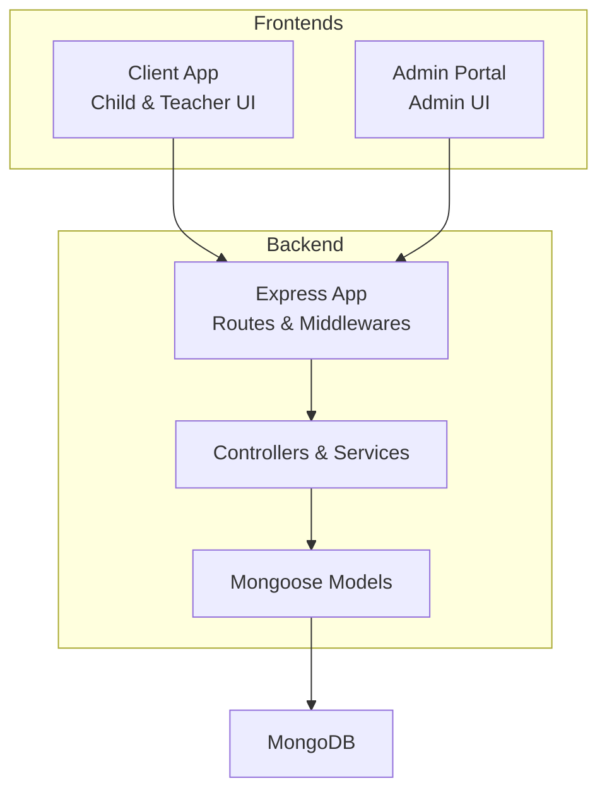
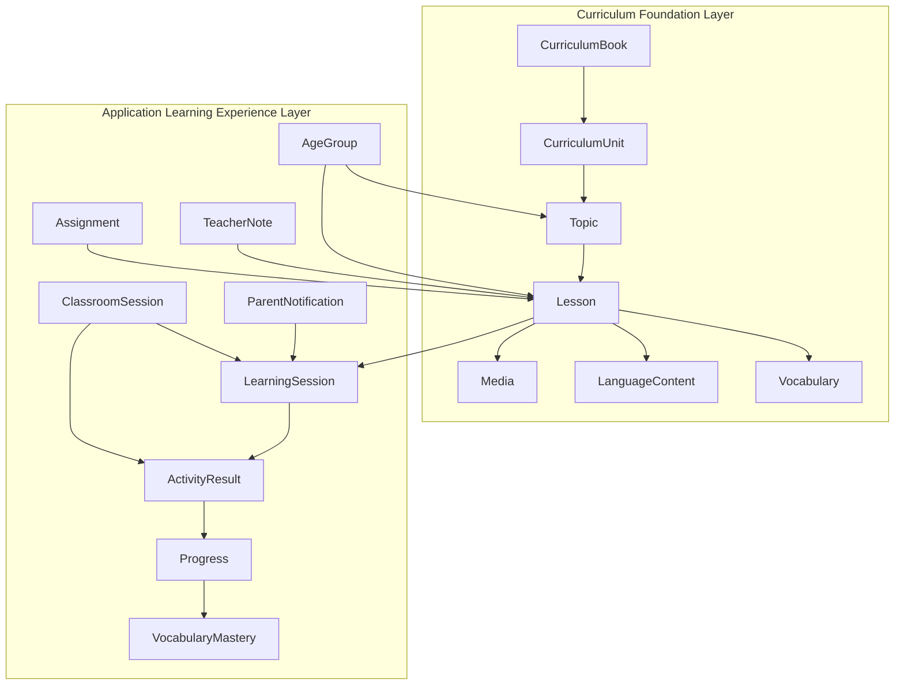
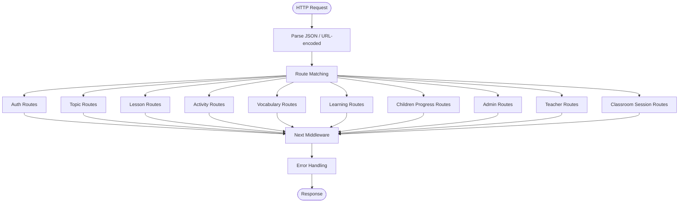
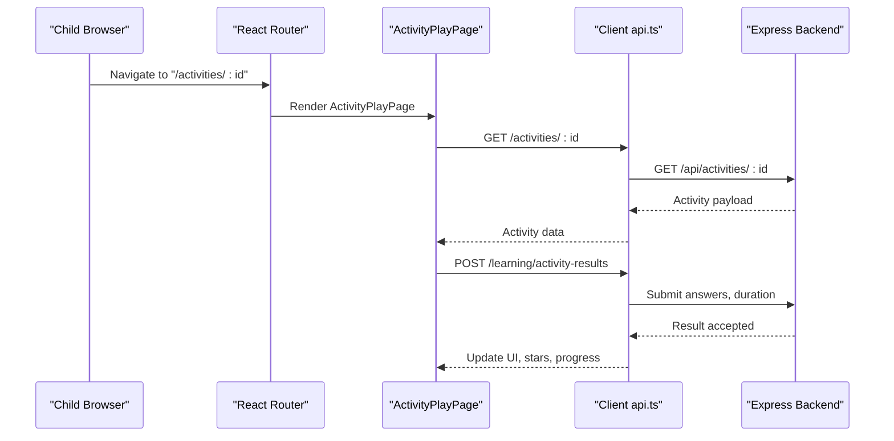
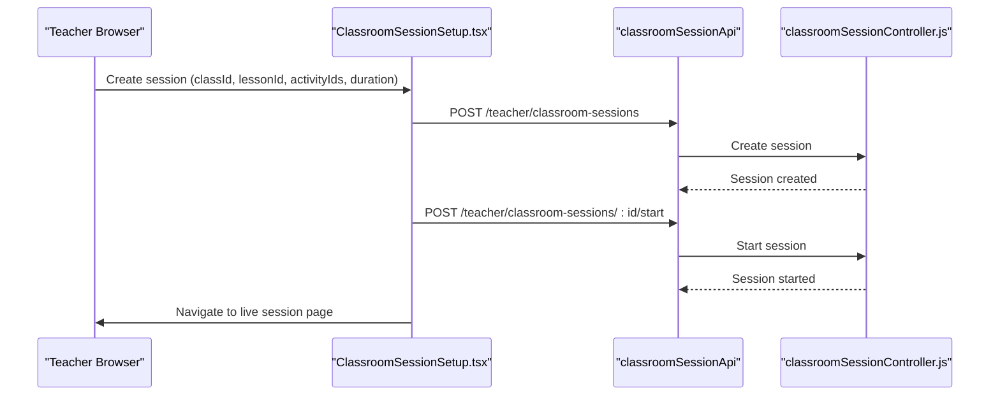
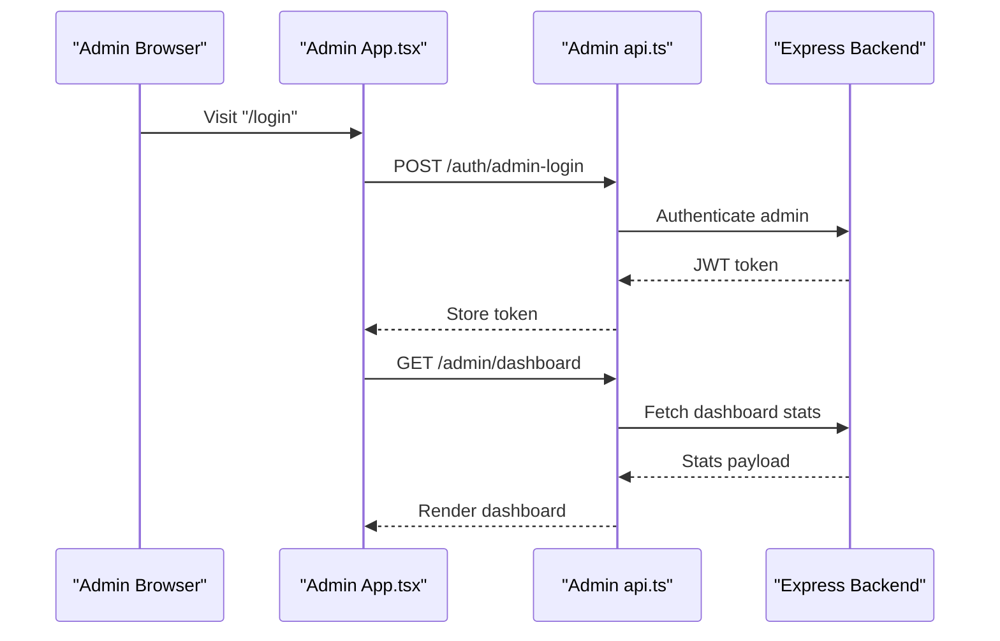
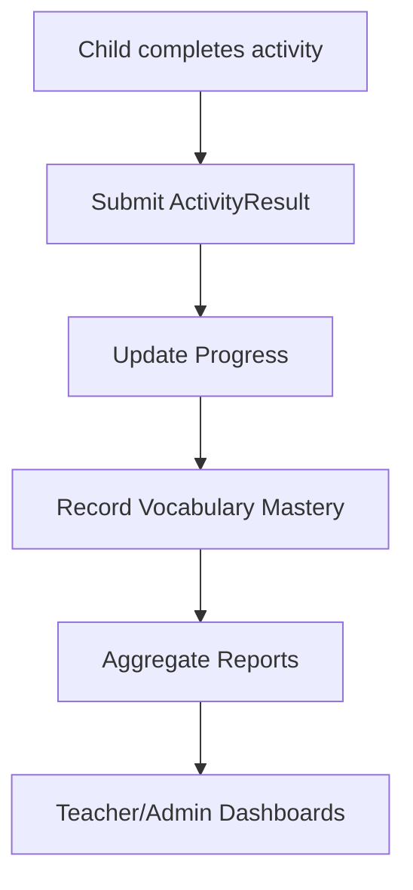
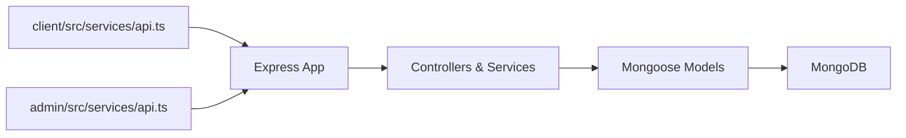

# Overall System Design

<cite>
**Referenced Files in This Document**
- [README.md](file://README.md)
- [architecture.md](file://docs/architecture.md)
- [app.js](file://KCEnglishKids_BE/src/app.js)
- [index.js](file://KCEnglishKids_BE/src/models/index.js)
- [User.js](file://KCEnglishKids_BE/src/models/User.js)
- [CurriculumBook.js](file://KCEnglishKids_BE/src/models/CurriculumBook.js)
- [CurriculumUnit.js](file://KCEnglishKids_BE/src/models/CurriculumUnit.js)
- [Topic.js](file://KCEnglishKids_BE/src/models/Topic.js)
- [Lesson.js](file://KCEnglishKids_BE/src/models/Lesson.js)
- [App.tsx (Client)](file://client/src/App.tsx)
- [api.ts (Client)](file://client/src/services/api.ts)
- [App.tsx (Admin)](file://admin/src/App.tsx)
- [api.ts (Admin)](file://admin/src/services/api.ts)
- [ClassroomSessionSetup.tsx](file://client/src/dashboards/teacher/ClassroomSessionSetup.tsx)
- [classroomSessionController.js](file://KCEnglishKids_BE/src/controllers/classroomSessionController.js)
</cite>

## Table of Contents
1. [Introduction](#introduction)
2. [Project Structure](#project-structure)
3. [Core Components](#core-components)
4. [Architecture Overview](#architecture-overview)
5. [Detailed Component Analysis](#detailed-component-analysis)
6. [Dependency Analysis](#dependency-analysis)
7. [Performance Considerations](#performance-considerations)
8. [Troubleshooting Guide](#troubleshooting-guide)
9. [Conclusion](#conclusion)

## Introduction
KCEnglishKids is an interactive English learning platform for children aged 3–6 that tightly couples a Curriculum Foundation Layer with an Application Learning Experience Layer. The system provides three primary actors: Child, Teacher, and Admin. Children learn through engaging activities; teachers manage classes, sessions, and student progress; admins oversee curriculum, users, and KPIs.

The two-layer architecture ensures that official curriculum content remains stable and reusable while the application layer adapts it into age-appropriate topics, lessons, activities, and learning sessions. Communication between frontend applications and the backend uses REST APIs. Real-time classroom features are supported by session state management on the server, with potential extension points for WebSocket-based live updates.

## Project Structure
At a high level, the repository contains:
- Backend API (Express.js + Mongoose + MongoDB)
- Client Frontend (React + TypeScript) for Child and Teacher experiences
- Admin Portal (React + TypeScript) for curriculum and user administration
- Documentation and seed data

**Diagram sources**
- [app.js:18-49](file://KCEnglishKids_BE/src/app.js#L18-L49)
- [index.js:1-45](file://KCEnglishKids_BE/src/models/index.js#L1-L45)

**Section sources**
- [README.md:31-48](file://README.md#L31-L48)
- [README.md:95-138](file://README.md#L95-L138)

## Core Components
- Backend API: Express app mounts REST endpoints for authentication, curriculum, lessons, activities, vocabulary, learning sessions, progress, admin, teacher, and classroom sessions.
- Data Layer: Mongoose models represent curriculum books, units, topics, lessons, vocabulary, language content, media, users, classrooms, learning sessions, activity results, progress, assignments, notes, classroom sessions, vocabulary mastery, and parent notifications.
- Client Frontend: React Router defines protected routes for child and teacher flows, including lesson browsing, activity play, and classroom session setup/live/summary.
- Admin Portal: Separate React app with protected admin routes for dashboard and curriculum/user management.

Key responsibilities:
- Authentication and authorization across roles (ADMIN, TEACHER, CHILD).
- Curriculum foundation: Books → Units → Topics → Lessons → Activities.
- Learning experience: Sessions, Activity Results, Progress, Stars, Vocabulary Mastery.
- Classroom operations: Session lifecycle, scoring, question results, summaries.

**Section sources**
- [app.js:34-49](file://KCEnglishKids_BE/src/app.js#L34-L49)
- [index.js:1-45](file://KCEnglishKids_BE/src/models/index.js#L1-L45)
- [App.tsx (Client):40-131](file://client/src/App.tsx#L40-L131)
- [App.tsx (Admin):22-42](file://admin/src/App.tsx#L22-L42)

## Architecture Overview
The system follows a two-layer design:
- Curriculum Foundation Layer: Official curriculum structure (Books, Units), educational values, vocabulary references, and language patterns.
- Application Learning Experience Layer: Age-grouped Topics, Lessons, Activities, Learning Sessions, Activity Results, Progress, and Vocabulary Mastery.

**Diagram sources**
- [CurriculumBook.js:1-41](file://KCEnglishKids_BE/src/models/CurriculumBook.js#L1-L41)
- [CurriculumUnit.js:1-88](file://KCEnglishKids_BE/src/models/CurriculumUnit.js#L1-L88)
- [Topic.js:1-78](file://KCEnglishKids_BE/src/models/Topic.js#L1-L78)
- [Lesson.js:1-101](file://KCEnglishKids_BE/src/models/Lesson.js#L1-L101)
- [index.js:1-45](file://KCEnglishKids_BE/src/models/index.js#L1-L45)

**Section sources**
- [architecture.md:1-29](file://docs/architecture.md#L1-L29)
- [README.md:7-28](file://README.md#L7-L28)

## Detailed Component Analysis

### Backend API (Express.js)
The Express app configures CORS, JSON parsing, health check, and mounts route modules for auth, topics, lessons, activities, vocabulary, learning, children progress, admin, teacher, and classroom sessions. Error handling is centralized via middlewares.

**Diagram sources**
- [app.js:18-49](file://KCEnglishKids_BE/src/app.js#L18-L49)

**Section sources**
- [app.js:18-49](file://KCEnglishKids_BE/src/app.js#L18-L49)

### Child Learning Frontend (React/TypeScript)
The client app defines protected routes for child login, home, topic detail, lesson detail, activity play, and PIN change. It also includes teacher dashboards and classroom session flows.

**Diagram sources**
- [App.tsx (Client):79-86](file://client/src/App.tsx#L79-L86)
- [api.ts (Client):137-158](file://client/src/services/api.ts#L137-L158)

**Section sources**
- [App.tsx (Client):40-131](file://client/src/App.tsx#L40-L131)
- [api.ts (Client):124-158](file://client/src/services/api.ts#L124-L158)

### Teacher Dashboard
Teachers manage classes, students, assignments, and classroom sessions. The classroom session flow includes creating a session, starting it, navigating to live view, and viewing summary.

**Diagram sources**
- [ClassroomSessionSetup.tsx:66-83](file://client/src/dashboards/teacher/ClassroomSessionSetup.tsx#L66-L83)
- [classroomSessionController.js:39-68](file://KCEnglishKids_BE/src/controllers/classroomSessionController.js#L39-L68)

**Section sources**
- [App.tsx (Client):96-123](file://client/src/App.tsx#L96-L123)
- [ClassroomSessionSetup.tsx:66-83](file://client/src/dashboards/teacher/ClassroomSessionSetup.tsx#L66-L83)
- [classroomSessionController.js:39-68](file://KCEnglishKids_BE/src/controllers/classroomSessionController.js#L39-L68)

### Admin Portal
The admin portal provides protected routes for login and dashboard access, enabling curriculum and user management via REST calls.

**Diagram sources**
- [App.tsx (Admin):22-42](file://admin/src/App.tsx#L22-L42)
- [api.ts (Admin):54-89](file://admin/src/services/api.ts#L54-L89)

**Section sources**
- [App.tsx (Admin):22-42](file://admin/src/App.tsx#L22-L42)
- [api.ts (Admin):54-89](file://admin/src/services/api.ts#L54-L89)

### Data Synchronization Patterns
- REST API calls: All frontends communicate with the backend using fetch-based clients with Authorization headers for authenticated requests.
- Session state: Classroom sessions maintain lifecycle states (SCHEDULED, LIVE, COMPLETED) with server-side cleanup for stale sessions.
- Progress tracking: Activity results feed into progress and vocabulary mastery records.

**Diagram sources**
- [api.ts (Client):142-158](file://client/src/services/api.ts#L142-L158)
- [classroomSessionController.js:39-68](file://KCEnglishKids_BE/src/controllers/classroomSessionController.js#L39-L68)

**Section sources**
- [api.ts (Client):142-158](file://client/src/services/api.ts#L142-L158)
- [classroomSessionController.js:39-68](file://KCEnglishKids_BE/src/controllers/classroomSessionController.js#L39-L68)

## Dependency Analysis
The backend exposes multiple route groups that depend on controllers and services, which in turn interact with Mongoose models. The client and admin frontends depend on their respective API clients.

**Diagram sources**
- [api.ts (Client):1-61](file://client/src/services/api.ts#L1-L61)
- [api.ts (Admin):1-52](file://admin/src/services/api.ts#L1-L52)
- [app.js:18-49](file://KCEnglishKids_BE/src/app.js#L18-L49)
- [index.js:1-45](file://KCEnglishKids_BE/src/models/index.js#L1-L45)

**Section sources**
- [app.js:18-49](file://KCEnglishKids_BE/src/app.js#L18-L49)
- [index.js:1-45](file://KCEnglishKids_BE/src/models/index.js#L1-L45)

## Performance Considerations
- Audio playback: Use Howler.js for remote audio streams and Web Audio API synthesis for sound effects to minimize external dependencies and improve responsiveness.
- Network efficiency: Batch or cache curriculum and vocabulary data where appropriate; avoid redundant requests during activity play.
- Database indexing: Ensure indexes on frequently queried fields such as ageGroupCode, status, displayOrder, and foreign keys to optimize lookups.
- Session cleanup: Server-side cleanup of stale classroom sessions prevents memory growth and keeps lists responsive.

[No sources needed since this section provides general guidance]

## Troubleshooting Guide
- Authentication issues: Verify JWT tokens are present in Authorization headers and that role checks match expected values.
- Missing curriculum data: Confirm seeds have populated Books, Units, Topics, Lessons, and Vocabulary.
- Classroom session errors: Check session lifecycle transitions and ensure start/end calls succeed; verify stale session cleanup runs as scheduled.
- Audio problems: Validate network connectivity for remote audio URLs and confirm browser support for Web Audio API and Speech Synthesis fallback.

**Section sources**
- [User.js:84-106](file://KCEnglishKids_BE/src/models/User.js#L84-L106)
- [classroomSessionController.js:39-68](file://KCEnglishKids_BE/src/controllers/classroomSessionController.js#L39-L68)

## Conclusion
KCEnglishKids implements a clear separation between the Curriculum Foundation Layer and the Application Learning Experience Layer, enabling robust, scalable learning workflows for young children. The Express backend provides well-structured REST endpoints consumed by the Child/Teacher client and Admin portal. Data synchronization relies on REST calls with session state management, and the model layer encapsulates both curriculum and learning experience entities. This design supports future enhancements such as WebSocket-based real-time features and expanded third-party integrations while maintaining clarity and performance.

[No sources needed since this section summarizes without analyzing specific files]