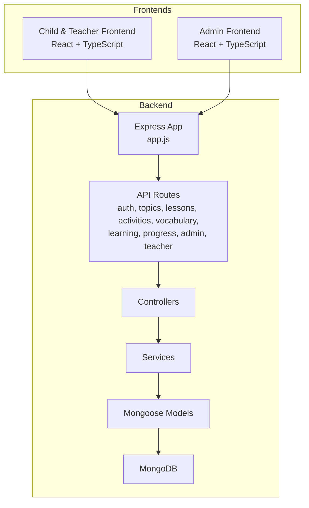
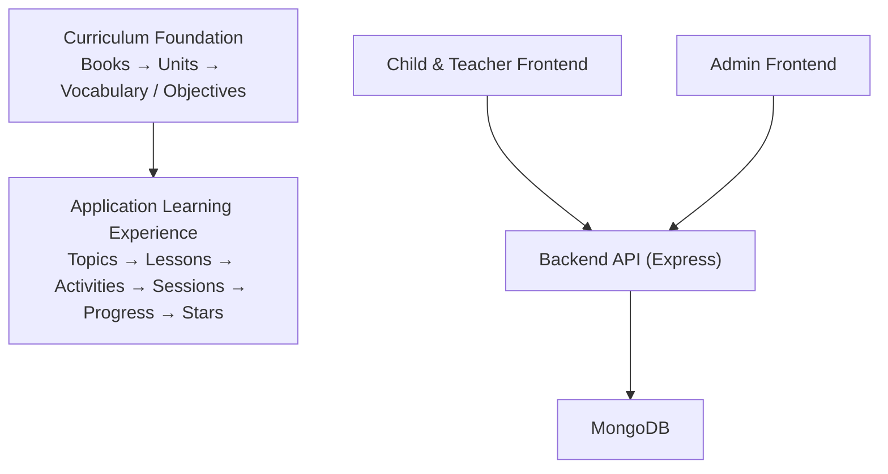
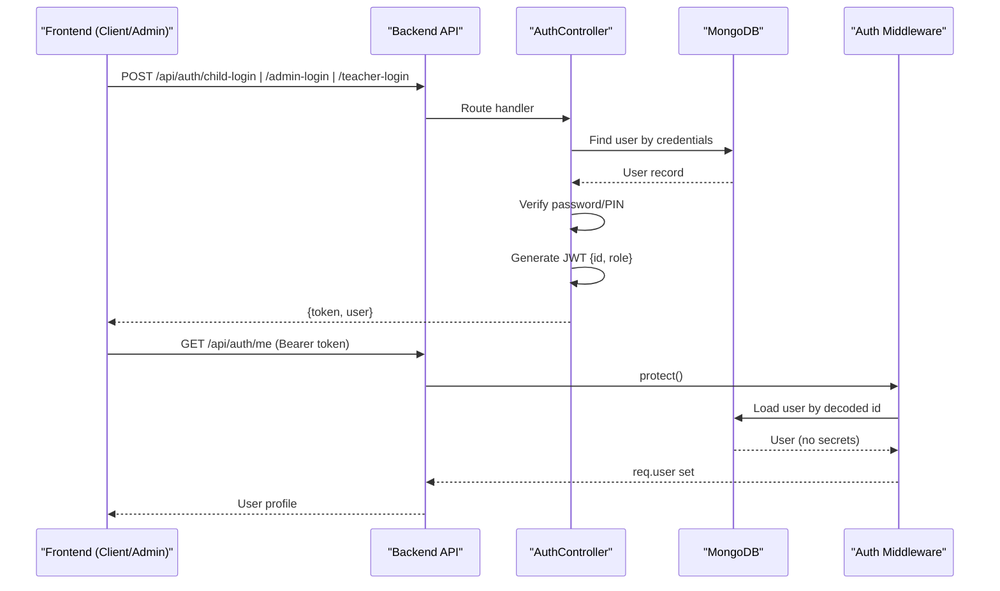
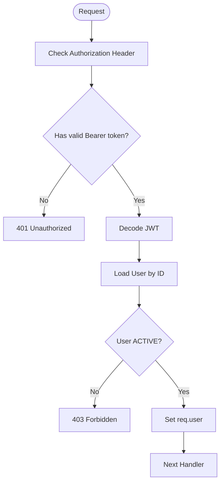
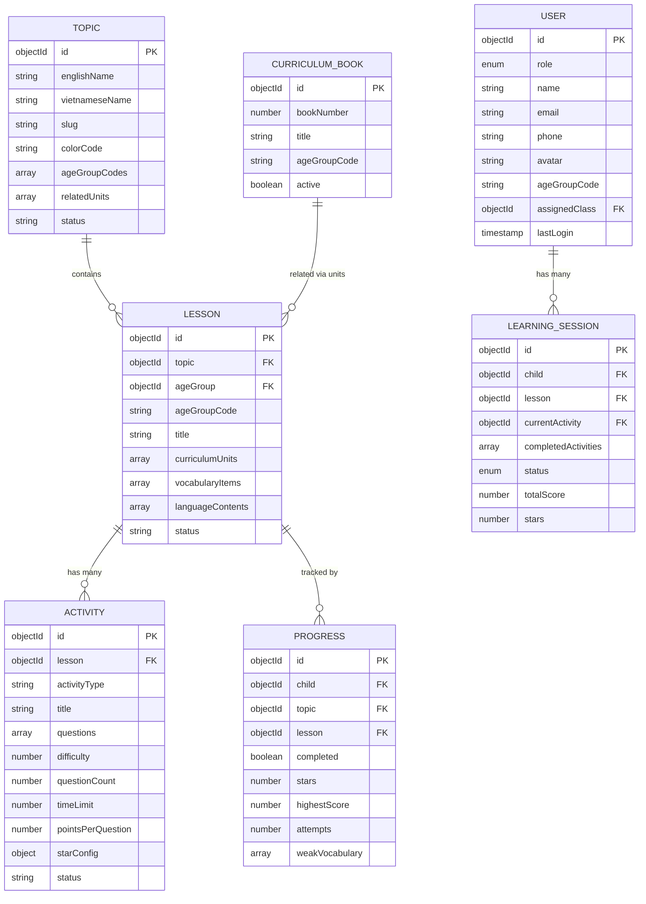
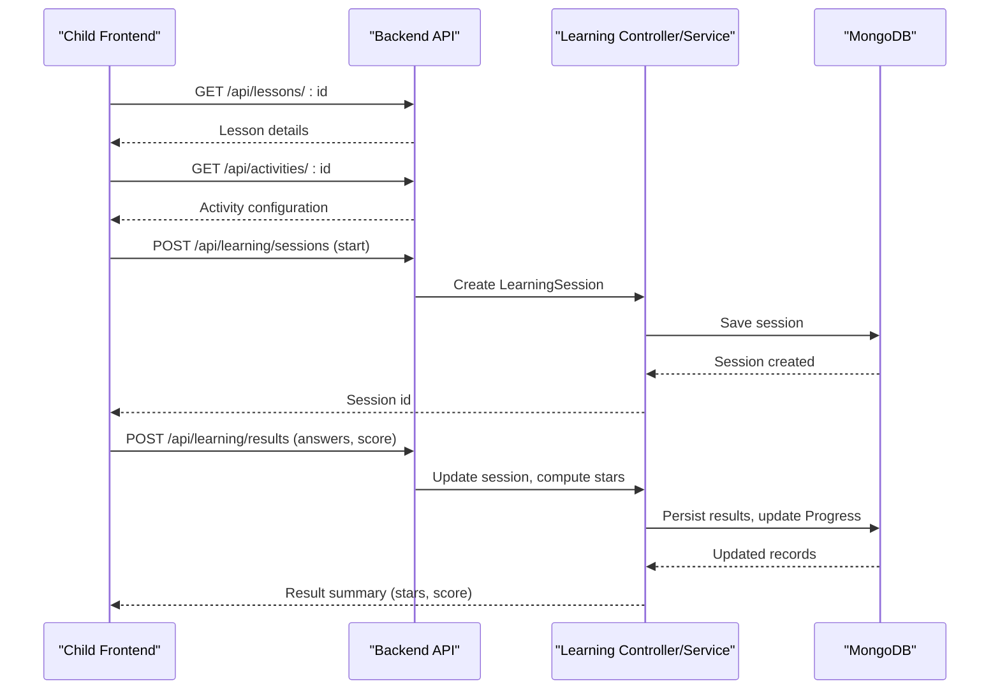
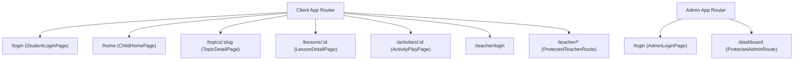
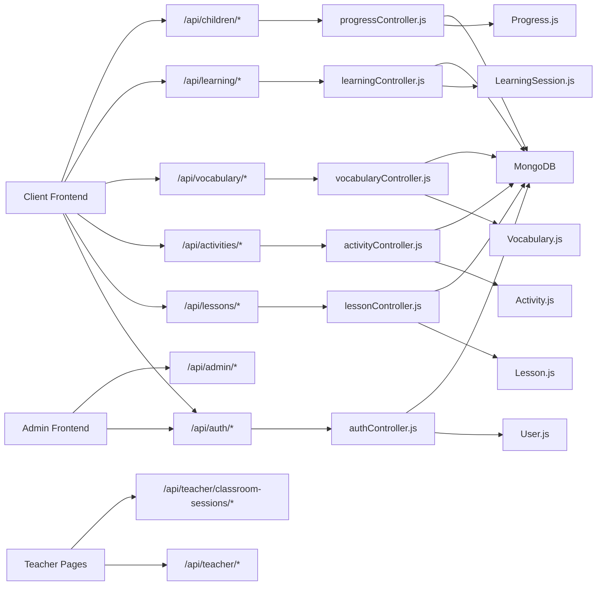

# System Architecture

<cite>
**Referenced Files in This Document**
- [README.md](file://README.md)
- [architecture.md](file://docs/architecture.md)
- [app.js](file://KCEnglishKids_BE/src/app.js)
- [server.js](file://KCEnglishKids_BE/src/server.js)
- [authController.js](file://KCEnglishKids_BE/src/controllers/authController.js)
- [authRoutes.js](file://KCEnglishKids_BE/src/routes/authRoutes.js)
- [authMiddleware.js](file://KCEnglishKids_BE/src/middlewares/authMiddleware.js)
- [User.js](file://KCEnglishKids_BE/src/models/User.js)
- [CurriculumBook.js](file://KCEnglishKids_BE/src/models/CurriculumBook.js)
- [Topic.js](file://KCEnglishKids_BE/src/models/Topic.js)
- [Lesson.js](file://KCEnglishKids_BE/src/models/Lesson.js)
- [Activity.js](file://KCEnglishKids_BE/src/models/Activity.js)
- [LearningSession.js](file://KCEnglishKids_BE/src/models/LearningSession.js)
- [Progress.js](file://KCEnglishKids_BE/src/models/Progress.js)
- [App.tsx (Admin)](file://admin/src/App.tsx)
- [AuthContext.tsx (Admin)](file://admin/src/context/AuthContext.tsx)
- [App.tsx (Client)](file://client/src/App.tsx)
- [AuthContext.tsx (Client)](file://client/src/context/AuthContext.tsx)
</cite>

## Table of Contents
1. Introduction
2. Project Structure
3. Core Components
4. Architecture Overview
5. Detailed Component Analysis
6. Dependency Analysis
7. Performance Considerations
8. Troubleshooting Guide
9. Conclusion

## Introduction
This document describes the KCEnglishKids system architecture, focusing on the two-layer design that separates Curriculum Foundation from Application Learning Experience. It explains how Backend API, Child Learning Frontend, Teacher Dashboard, and Admin Portal interact; how authentication and authorization work using JWT tokens and role-based access control; and how data flows from curriculum content creation through student interaction to progress tracking. It also covers system boundaries, integration points, communication protocols, security considerations, scalability constraints, deployment topology, and technology stack decisions.

## Project Structure
The repository is organized into three main applications:
- Backend REST API: Express + Mongoose + MongoDB under KCEnglishKids_BE
- Client Frontend: React + TypeScript + Vite for children and teachers under client
- Admin Portal: React + TypeScript + Vite for administrators under admin

**Diagram sources**
- [app.js:1-53](file://KCEnglishKids_BE/src/app.js#L1-L53)
- [server.js:1-21](file://KCEnglishKids_BE/src/server.js#L1-L21)

**Section sources**
- [README.md:31-79](file://README.md#L31-L79)
- [README.md:95-138](file://README.md#L95-L138)

## Core Components
- Backend API Server: Express application with CORS, JSON parsing, health check, and route registration.
- Authentication Controller: Handles child login (avatar+PIN or identifier+password), admin/teacher login, profile retrieval, PIN change, and student lookup.
- Auth Middleware: JWT verification, user loading, status checks, and role-based authorization helpers.
- Domain Models: User, CurriculumBook, Topic, Lesson, Activity, LearningSession, Progress.
- Frontend Apps:
  - Client app: Child learning pages and teacher dashboard routes with protected routes.
  - Admin app: Admin login and dashboard with protected routes.

Key responsibilities:
- Curriculum Foundation: Book, Age Group, Unit, Vocabulary, Language Content.
- Application Learning Experience: Topics, Lessons, Activities, Sessions, Results, Progress, Stars.

**Section sources**
- [app.js:1-53](file://KCEnglishKids_BE/src/app.js#L1-L53)
- [authController.js:1-488](file://KCEnglishKids_BE/src/controllers/authController.js#L1-L488)
- [authMiddleware.js:1-59](file://KCEnglishKids_BE/src/middlewares/authMiddleware.js#L1-L59)
- [User.js:1-109](file://KCEnglishKids_BE/src/models/User.js#L1-L109)
- [CurriculumBook.js:1-41](file://KCEnglishKids_BE/src/models/CurriculumBook.js#L1-L41)
- [Topic.js:1-78](file://KCEnglishKids_BE/src/models/Topic.js#L1-L78)
- [Lesson.js:1-101](file://KCEnglishKids_BE/src/models/Lesson.js#L1-L101)
- [Activity.js:1-176](file://KCEnglishKids_BE/src/models/Activity.js#L1-L176)
- [LearningSession.js:1-61](file://KCEnglishKids_BE/src/models/LearningSession.js#L1-L61)
- [Progress.js:1-65](file://KCEnglishKids_BE/src/models/Progress.js#L1-L65)
- [App.tsx (Client):1-134](file://client/src/App.tsx#L1-L134)
- [App.tsx (Admin):1-45](file://admin/src/App.tsx#L1-L45)

## Architecture Overview
KCEnglishKids uses a two-layer architecture:
- Curriculum Foundation: Official textbooks and units (Books 1–3, each with 9 Units).
- Application Learning Experience: App Topics, Lessons, Activities, Sessions, Results, Progress, and stars.

**Diagram sources**
- [architecture.md:1-29](file://docs/architecture.md#L1-L29)
- [README.md:7-28](file://README.md#L7-L28)

## Detailed Component Analysis

### Authentication and Authorization Flow
The system supports multiple actors:
- CHILD: Avatar + 4-digit PIN or identifier + password. Returns a restricted child session token.
- TEACHER: Email + password. Returns a teacher token scoped to class rosters and student records.
- ADMIN: Email + password. Returns an admin token for managing curriculum and KPIs.

JWT flow:
- Login endpoints return signed JWT tokens containing user id and role.
- Protected routes use middleware to verify tokens, load user, enforce active status, and authorize by role.

**Diagram sources**
- [authController.js:1-488](file://KCEnglishKids_BE/src/controllers/authController.js#L1-L488)
- [authRoutes.js:1-25](file://KCEnglishKids_BE/src/routes/authRoutes.js#L1-L25)
- [authMiddleware.js:1-59](file://KCEnglishKids_BE/src/middlewares/authMiddleware.js#L1-L59)

#### Role-Based Access Control
- protect(): Validates Bearer JWT, loads user, rejects inactive accounts.
- authorize(...roles): Ensures current user has required roles.
- optionalProtect(): Attempts to load user if token present without failing.

Frontend protection:
- Client app: ProtectedChildRoute and ProtectedTeacherRoute guard routes based on user.role.
- Admin app: ProtectedAdminRoute guards dashboard for role 'ADMIN'.

**Diagram sources**
- [authMiddleware.js:1-59](file://KCEnglishKids_BE/src/middlewares/authMiddleware.js#L1-L59)

**Section sources**
- [authController.js:1-488](file://KCEnglishKids_BE/src/controllers/authController.js#L1-L488)
- [authMiddleware.js:1-59](file://KCEnglishKids_BE/src/middlewares/authMiddleware.js#L1-L59)
- [App.tsx (Client):17-38](file://client/src/App.tsx#L17-L38)
- [App.tsx (Admin):7-20](file://admin/src/App.tsx#L7-L20)

### Data Model Relationships
Core domain entities and relationships:

**Diagram sources**
- [User.js:1-109](file://KCEnglishKids_BE/src/models/User.js#L1-L109)
- [CurriculumBook.js:1-41](file://KCEnglishKids_BE/src/models/CurriculumBook.js#L1-L41)
- [Topic.js:1-78](file://KCEnglishKids_BE/src/models/Topic.js#L1-L78)
- [Lesson.js:1-101](file://KCEnglishKids_BE/src/models/Lesson.js#L1-L101)
- [Activity.js:1-176](file://KCEnglishKids_BE/src/models/Activity.js#L1-L176)
- [LearningSession.js:1-61](file://KCEnglishKids_BE/src/models/LearningSession.js#L1-L61)
- [Progress.js:1-65](file://KCEnglishKids_BE/src/models/Progress.js#L1-L65)

### Student Interaction and Progress Tracking Flow
End-to-end flow from activity play to progress update:

**Diagram sources**
- [LearningSession.js:1-61](file://KCEnglishKids_BE/src/models/LearningSession.js#L1-L61)
- [Progress.js:1-65](file://KCEnglishKids_BE/src/models/Progress.js#L1-L65)
- [activityRoutes.js](file://KCEnglishKids_BE/src/routes/activityRoutes.js)
- [learningRoutes.js](file://KCEnglishKids_BE/src/routes/learningRoutes.js)

### Frontend Routing and Protection
- Client app defines routes for child pages and teacher workspace, with protected routes enforcing role checks.
- Admin app defines login and dashboard routes with a protected route requiring role 'ADMIN'.

**Diagram sources**
- [App.tsx (Client):1-134](file://client/src/App.tsx#L1-L134)
- [App.tsx (Admin):1-45](file://admin/src/App.tsx#L1-L45)

**Section sources**
- [App.tsx (Client):1-134](file://client/src/App.tsx#L1-L134)
- [App.tsx (Admin):1-45](file://admin/src/App.tsx#L1-L45)

## Dependency Analysis
High-level component dependencies:

**Diagram sources**
- [app.js:1-53](file://KCEnglishKids_BE/src/app.js#L1-L53)
- [authController.js:1-488](file://KCEnglishKids_BE/src/controllers/authController.js#L1-L488)
- [User.js:1-109](file://KCEnglishKids_BE/src/models/User.js#L1-L109)
- [Lesson.js:1-101](file://KCEnglishKids_BE/src/models/Lesson.js#L1-L101)
- [Activity.js:1-176](file://KCEnglishKids_BE/src/models/Activity.js#L1-L176)
- [LearningSession.js:1-61](file://KCEnglishKids_BE/src/models/LearningSession.js#L1-L61)
- [Progress.js:1-65](file://KCEnglishKids_BE/src/models/Progress.js#L1-L65)

**Section sources**
- [app.js:1-53](file://KCEnglishKids_BE/src/app.js#L1-L53)

## Performance Considerations
- Database indexing:
  - User.role indexed for fast role-based queries.
  - Topic.ageGroupCodes, Topic.status, Topic.displayOrder indexed for efficient filtering.
  - Lesson.topic, Lesson.status, Lesson.displayOrder and Lesson.ageGroupCode indexed.
  - Activity.lesson, Activity.status, Activity.order and Activity.ageGroupCode indexed.
  - LearningSession.child and LearningSession.lesson indexed for session lookups.
  - Progress.child and Progress.lesson unique index ensures one progress per child per lesson.
- Caching strategy:
  - Frontend caches auth state and tokens in localStorage.
  - Consider adding server-side caching for static curriculum content (books, topics, lessons) to reduce DB load.
- Audio assets:
  - Howler.js streams remote audio; consider CDN hosting and caching headers for pronunciation files.
  - Web Audio API synthesizer provides fallback sounds without external dependencies.
- Concurrency:
  - Use connection pooling for MongoDB.
  - Batch updates for progress and mastery when possible.

[No sources needed since this section provides general guidance]

## Troubleshooting Guide
Common issues and resolutions:
- Invalid or expired token:
  - Ensure Authorization header includes Bearer token.
  - Verify JWT_SECRET matches between server and environment.
- Account locked or deactivated:
  - Check User.status; only ACTIVE users are allowed.
- Role access forbidden:
  - Confirm user.role matches required roles in authorize middleware.
- Child login failures:
  - Validate PIN length and format; ensure bcrypt-hashed PIN comparison.
- Missing curriculum data:
  - Run seed scripts to populate Books, Units, Topics, Lessons, Activities.

**Section sources**
- [authMiddleware.js:1-59](file://KCEnglishKids_BE/src/middlewares/authMiddleware.js#L1-L59)
- [authController.js:1-488](file://KCEnglishKids_BE/src/controllers/authController.js#L1-L488)
- [User.js:1-109](file://KCEnglishKids_BE/src/models/User.js#L1-L109)

## Conclusion
KCEnglishKids implements a clear two-layer architecture separating Curriculum Foundation from Application Learning Experience. The backend exposes a well-structured REST API secured by JWT and role-based access control. The frontend apps provide distinct experiences for children and teachers, with robust routing and protection. Data models reflect the educational structure and support rich interactions, scoring, and progress tracking. Security is enforced at both middleware and model levels, while performance is supported by strategic indexing and audio asset strategies. Deployment should isolate frontends behind a web server or CDN, run the Node/Express backend as a service, and connect to a managed MongoDB instance.

[No sources needed since this section summarizes without analyzing specific files]