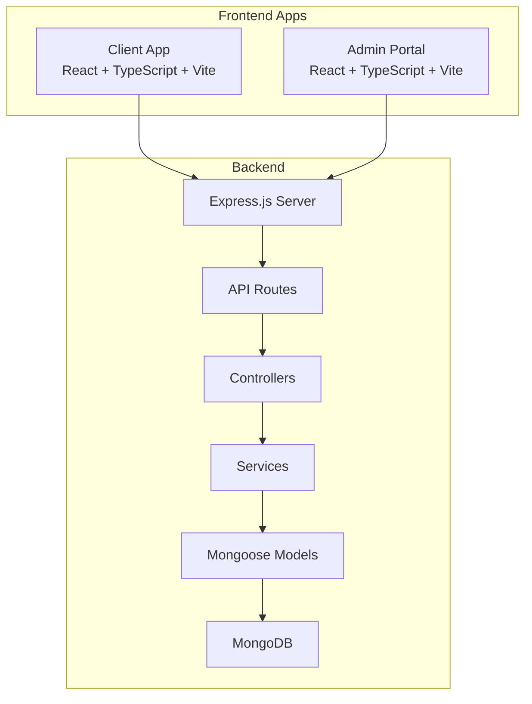
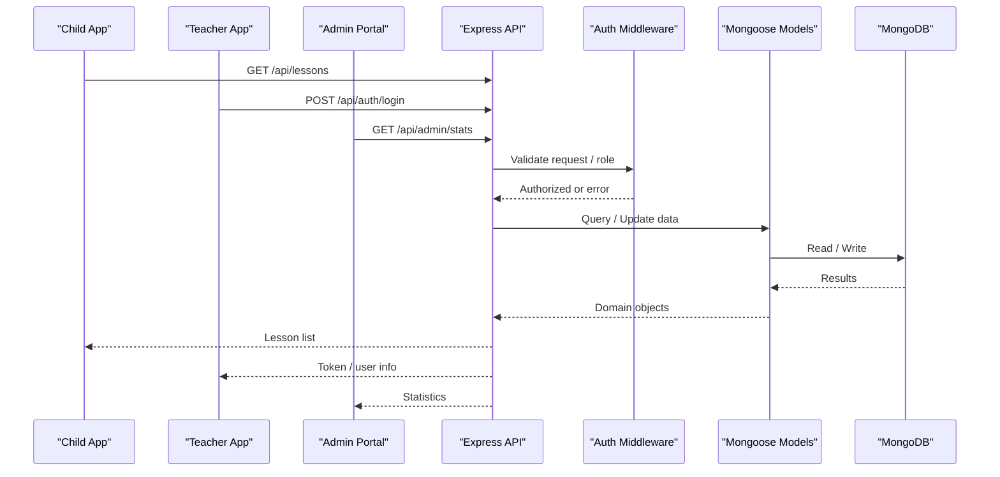
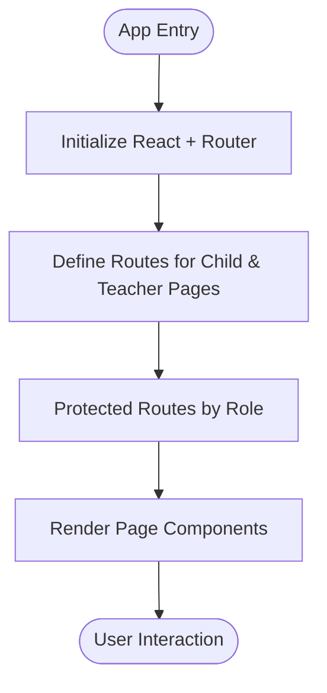
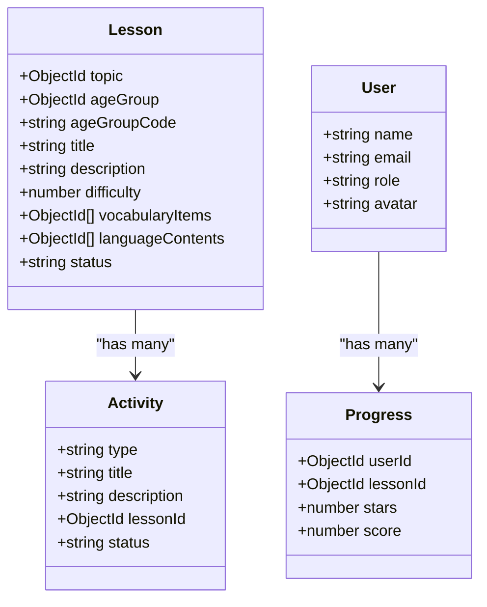
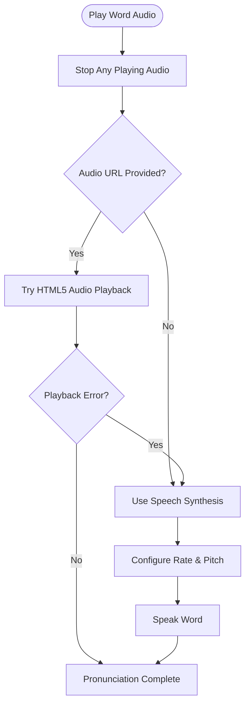
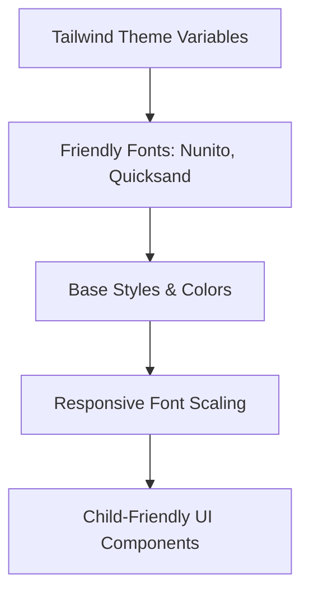
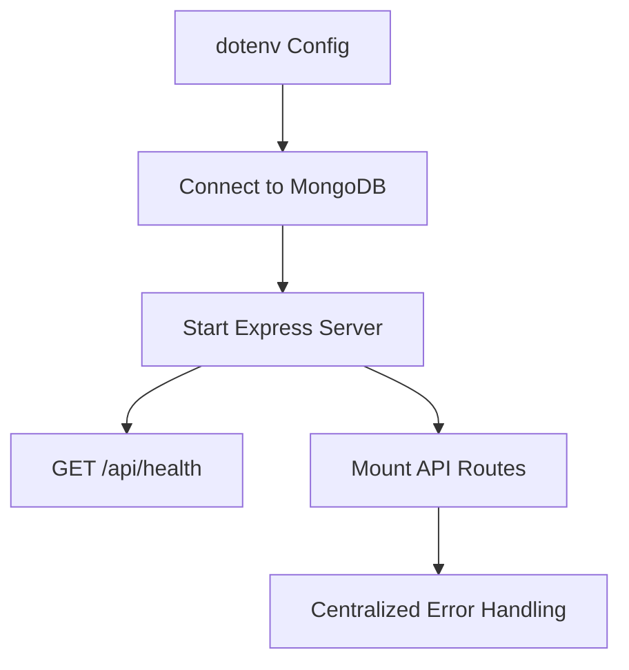
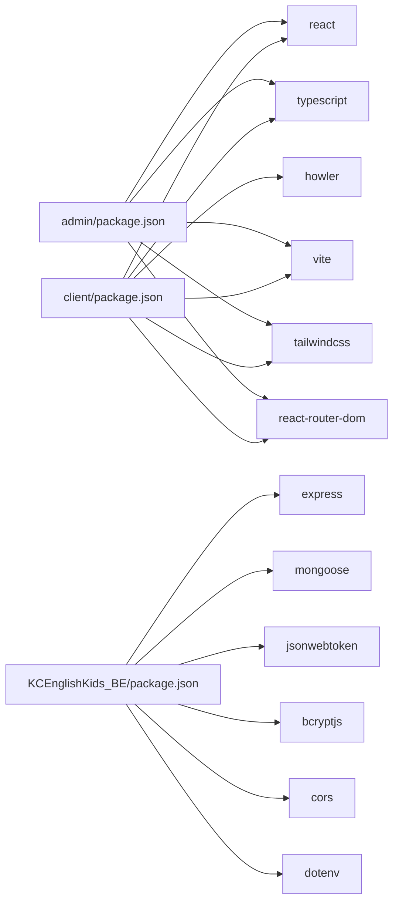

# Technology Stack Decisions

<cite>
**Referenced Files in This Document**
- [README.md](file://README.md)
- [client/package.json](file://client/package.json)
- [admin/package.json](file://admin/package.json)
- [KCEnglishKids_BE/package.json](file://KCEnglishKids_BE/package.json)
- [client/src/App.tsx](file://client/src/App.tsx)
- [admin/src/App.tsx](file://admin/src/App.tsx)
- [client/src/index.css](file://client/src/index.css)
- [client/src/utils/audio.ts](file://client/src/utils/audio.ts)
- [KCEnglishKids_BE/src/app.js](file://KCEnglishKids_BE/src/app.js)
- [KCEnglishKids_BE/src/server.js](file://KCEnglishKids_BE/src/server.js)
- [KCEnglishKids_BE/src/middlewares/errorMiddleware.js](file://KCEnglishKids_BE/src/middlewares/errorMiddleware.js)
- [KCEnglishKids_BE/src/models/Lesson.js](file://KCEnglishKids_BE/src/models/Lesson.js)
- [KCEnglishKids_BE/src/models/Activity.js](file://KCEnglishKids_BE/src/models/Activity.js)
- [KCEnglishKids_BE/src/models/User.js](file://KCEnglishKids_BE/src/models/User.js)
- [KCEnglishKids_BE/src/models/Progress.js](file://KCEnglishKids_BE/src/models/Progress.js)
</cite>

## Table of Contents
1. [Introduction](#introduction)
2. [Project Structure](#project-structure)
3. [Core Components](#core-components)
4. [Architecture Overview](#architecture-overview)
5. [Detailed Component Analysis](#detailed-component-analysis)
6. [Dependency Analysis](#dependency-analysis)
7. [Performance Considerations](#performance-considerations)
8. [Troubleshooting Guide](#troubleshooting-guide)
9. [Conclusion](#conclusion)

## Introduction
This document explains the technology stack decisions for KCEnglishKids, an interactive English learning platform for children aged 3–6. It focuses on why React with TypeScript was chosen for all frontend applications, why Express.js was selected for the backend API, why MongoDB with Mongoose was used for flexible educational content modeling, why Howler.js and Web Audio APIs were adopted for audio management, and why Tailwind CSS was selected for rapid, child-friendly UI development. It also outlines deployment-related choices that support scalability and maintainability.

The project is organized into:
- A Node.js + Express backend API
- A client frontend for children and teachers
- An admin portal for curriculum and system administration
- MongoDB-backed data models representing curriculum, lessons, activities, users, and progress

**Section sources**
- [README.md:1-48](file://README.md#L1-L48)

## Project Structure
KCEnglishKids uses a multi-package structure:
- Backend: `KCEnglishKids_BE`
- Client app (children and teachers): `client`
- Admin portal: `admin`
- Documentation: `docs`

**Diagram sources**
- [client/src/App.tsx:1-134](file://client/src/App.tsx#L1-L134)
- [admin/src/App.tsx:1-45](file://admin/src/App.tsx#L1-L45)
- [KCEnglishKids_BE/src/app.js:1-53](file://KCEnglishKids_BE/src/app.js#L1-L53)
- [KCEnglishKids_BE/src/server.js:1-20](file://KCEnglishKids_BE/src/server.js#L1-L20)

**Section sources**
- [README.md:95-138](file://README.md#L95-L138)

## Core Components
- Frontend apps:
  - React 19 + TypeScript + Vite 8
  - React Router DOM v7 for routing
  - Tailwind CSS v4 for styling
  - Howler.js and Web Audio API synthesis for audio
  - Canvas Confetti for celebratory effects
  - Lucide Icons for consistent iconography
- Backend:
  - Node.js + Express.js REST API
  - Mongoose 9 + MongoDB
  - JWT authentication and bcrypt password hashing
- Actors:
  - CHILD: avatar-based login with PIN
  - ADMIN: curriculum and statistics management
  - TEACHER: classroom sessions, student lists, and progress tracking

These choices align with the product’s goals: safe, engaging, and accessible experiences for young learners, while keeping the codebase maintainable and scalable.

**Section sources**
- [README.md:31-48](file://README.md#L31-L48)

## Architecture Overview
The system follows a clear separation between frontend apps and a centralized backend API. The client and admin apps communicate with the Express server via REST endpoints. Data persistence is handled by MongoDB through Mongoose models.

**Diagram sources**
- [KCEnglishKids_BE/src/app.js:18-51](file://KCEnglishKids_BE/src/app.js#L18-L51)
- [KCEnglishKids_BE/src/server.js:11-20](file://KCEnglishKids_BE/src/server.js#L11-L20)

## Detailed Component Analysis

### Frontend: React + TypeScript + Vite
Rationale:
- Type safety reduces runtime errors and improves developer experience when building complex child-facing interfaces.
- Vite provides fast development feedback loops and efficient builds.
- React Router DOM organizes routes for child pages and teacher dashboards.
- Tailwind CSS enables rapid, responsive design optimized for touch interactions and playful aesthetics.

Evidence from the codebase:
- Both `client` and `admin` packages use React 19, TypeScript, Vite, and Tailwind CSS.
- Routing is configured in each app’s root component using React Router DOM.
- Global styles and theme configuration are defined in the client’s CSS entry file.

**Diagram sources**
- [client/src/App.tsx:1-134](file://client/src/App.tsx#L1-L134)
- [admin/src/App.tsx:1-45](file://admin/src/App.tsx#L1-L45)

**Section sources**
- [client/package.json:1-36](file://client/package.json#L1-L36)
- [admin/package.json:1-30](file://admin/package.json#L1-L30)
- [client/src/App.tsx:1-134](file://client/src/App.tsx#L1-L134)
- [admin/src/App.tsx:1-45](file://admin/src/App.tsx#L1-L45)
- [client/src/index.css:1-46](file://client/src/index.css#L1-L46)

### Backend: Express.js + Mongoose + MongoDB
Rationale:
- Express.js offers simplicity and a large ecosystem, making it straightforward to build RESTful APIs for curriculum, lessons, activities, and user management.
- Mongoose provides schema validation and relationships suitable for hierarchical educational content such as books, units, topics, lessons, vocabulary, and language content.
- MongoDB supports flexible schemas and scales well for evolving curriculum structures and diverse activity types.

Evidence from the codebase:
- The Express application sets up CORS, JSON parsing, health check, and route mounting.
- Error handling middleware centralizes error responses and hides stack traces in production.
- Mongoose models define structured data for lessons, activities, users, and progress.

**Diagram sources**
- [KCEnglishKids_BE/src/models/Lesson.js:1-100](file://KCEnglishKids_BE/src/models/Lesson.js#L1-L100)
- [KCEnglishKids_BE/src/models/Activity.js:1-120](file://KCEnglishKids_BE/src/models/Activity.js#L1-L120)
- [KCEnglishKids_BE/src/models/User.js:1-120](file://KCEnglishKids_BE/src/models/User.js#L1-L120)
- [KCEnglishKids_BE/src/models/Progress.js:1-120](file://KCEnglishKids_BE/src/models/Progress.js#L1-L120)

**Section sources**
- [KCEnglishKids_BE/package.json:1-29](file://KCEnglishKids_BE/package.json#L1-L29)
- [KCEnglishKids_BE/src/app.js:1-53](file://KCEnglishKids_BE/src/app.js#L1-L53)
- [KCEnglishKids_BE/src/server.js:1-20](file://KCEnglishKids_BE/src/server.js#L1-L20)
- [KCEnglishKids_BE/src/middlewares/errorMiddleware.js:1-16](file://KCEnglishKids_BE/src/middlewares/errorMiddleware.js#L1-L16)
- [KCEnglishKids_BE/src/models/Lesson.js:1-100](file://KCEnglishKids_BE/src/models/Lesson.js#L1-L100)

### Audio Management: Howler.js + Web Audio API Synthesis
Rationale:
- Pronunciation and sound effects are critical for early childhood learning; reliable audio playback ensures accurate phonetic exposure and positive reinforcement.
- Howler.js simplifies audio loading and playback across browsers, while Web Audio API synthesis adds fallback pronunciation and celebratory sound effects.

Evidence from the codebase:
- The client package includes Howler.js and related types.
- A dedicated audio utility manages word pronunciation, background effects, and speech synthesis fallbacks.
- The README explicitly mentions Howler.js plus Web Audio API synthesis for pronunciation and celebration sounds.

**Diagram sources**
- [client/src/utils/audio.ts:1-343](file://client/src/utils/audio.ts#L1-L343)

**Section sources**
- [client/package.json:1-36](file://client/package.json#L1-L36)
- [client/src/utils/audio.ts:1-343](file://client/src/utils/audio.ts#L1-L343)
- [README.md:31-48](file://README.md#L31-L48)

### Styling: Tailwind CSS for Rapid, Responsive UI
Rationale:
- Tailwind CSS enables rapid iteration and consistent design tokens, which is essential for creating playful, rounded, and colorful interfaces suited for young children.
- Responsive scaling and typography adjustments ensure usability across mobile, tablets, laptops, and interactive classroom whiteboards.

Evidence from the codebase:
- Tailwind CSS v4 is included in both client and admin packages.
- The client’s global CSS imports Tailwind and defines theme variables, font families, and responsive base font sizes.

**Diagram sources**
- [client/src/index.css:1-46](file://client/src/index.css#L1-L46)

**Section sources**
- [client/package.json:1-36](file://client/package.json#L1-L36)
- [admin/package.json:1-30](file://admin/package.json#L1-L30)
- [client/src/index.css:1-46](file://client/src/index.css#L1-L46)

### Deployment Technology Choices and Rationale
Rationale:
- The backend runs as a Node.js process managed by npm scripts, enabling easy containerization and orchestration.
- Environment variables via dotenv allow secure configuration for different environments (development, staging, production).
- Centralized error handling and health checks support observability and reliability.
- Modular route and model organization facilitates horizontal scaling and independent service evolution.

Evidence from the codebase:
- The server script loads environment variables, connects to the database, and starts the Express server.
- Health check endpoint provides a simple readiness probe.
- Error middleware standardizes error responses and suppresses stack traces in production.

**Diagram sources**
- [KCEnglishKids_BE/src/server.js:1-20](file://KCEnglishKids_BE/src/server.js#L1-L20)
- [KCEnglishKids_BE/src/app.js:25-51](file://KCEnglishKids_BE/src/app.js#L25-L51)
- [KCEnglishKids_BE/src/middlewares/errorMiddleware.js:1-16](file://KCEnglishKids_BE/src/middlewares/errorMiddleware.js#L1-L16)

**Section sources**
- [KCEnglishKids_BE/src/server.js:1-20](file://KCEnglishKids_BE/src/server.js#L1-L20)
- [KCEnglishKids_BE/src/app.js:18-51](file://KCEnglishKids_BE/src/app.js#L18-L51)
- [KCEnglishKids_BE/src/middlewares/errorMiddleware.js:1-16](file://KCEnglishKids_BE/src/middlewares/errorMiddleware.js#L1-L16)

## Dependency Analysis
The following diagram maps key dependencies across the stack:

**Diagram sources**
- [client/package.json:1-36](file://client/package.json#L1-L36)
- [admin/package.json:1-30](file://admin/package.json#L1-L30)
- [KCEnglishKids_BE/package.json:1-29](file://KCEnglishKids_BE/package.json#L1-L29)

**Section sources**
- [client/package.json:1-36](file://client/package.json#L1-L36)
- [admin/package.json:1-30](file://admin/package.json#L1-L30)
- [KCEnglishKids_BE/package.json:1-29](file://KCEnglishKids_BE/package.json#L1-L29)

## Performance Considerations
- Frontend performance:
  - Vite provides fast HMR and optimized builds, improving developer productivity and reducing bundle size.
  - Tailwind CSS generates minimal CSS when unused classes are purged in production builds.
  - Audio utilities avoid unnecessary re-renders and manage media lifecycle carefully to prevent memory leaks.
- Backend performance:
  - Express middleware order ensures efficient request processing.
  - Centralized error handling avoids repeated try/catch blocks and reduces overhead.
  - Mongoose indexes on frequently queried fields improve lookup performance for lessons and vocabulary.

[No sources needed since this section provides general guidance]

## Troubleshooting Guide
Common issues and resolutions:
- Audio not playing:
  - Ensure user interaction has occurred to unlock Web Audio API context.
  - Verify network availability for remote audio URLs; fallback to speech synthesis if playback fails.
- Authentication failures:
  - Check JWT token validity and role-based route protection.
  - Confirm environment variables for secret keys and database connection strings.
- API errors:
  - Inspect centralized error responses for message details.
  - Use the health check endpoint to verify backend availability.

**Section sources**
- [client/src/utils/audio.ts:1-343](file://client/src/utils/audio.ts#L1-L343)
- [KCEnglishKids_BE/src/middlewares/errorMiddleware.js:1-16](file://KCEnglishKids_BE/src/middlewares/errorMiddleware.js#L1-L16)
- [KCEnglishKids_BE/src/app.js:25-32](file://KCEnglishKids_BE/src/app.js#L25-L32)

## Conclusion
KCEnglishKids’ technology stack balances pedagogical needs with engineering best practices:
- React + TypeScript + Vite deliver a robust, type-safe, and rapidly iterated frontend tailored for children and educators.
- Express.js provides a simple, extensible backend API with strong ecosystem support.
- MongoDB + Mongoose enable flexible, hierarchical modeling of curriculum content and learner progress.
- Howler.js and Web Audio API synthesis ensure reliable pronunciation and engaging sound effects.
- Tailwind CSS accelerates UI development while maintaining responsive, child-friendly design.
- Deployment-oriented patterns (environment variables, health checks, centralized error handling) support scalability and maintainability.

[No sources needed since this section summarizes without analyzing specific files]