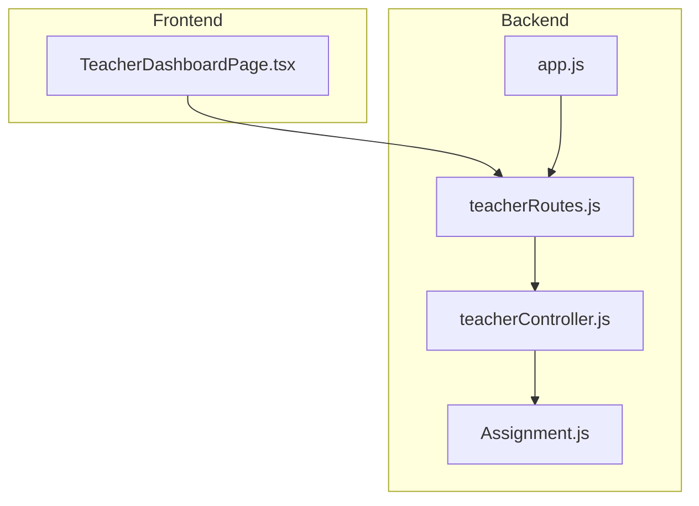
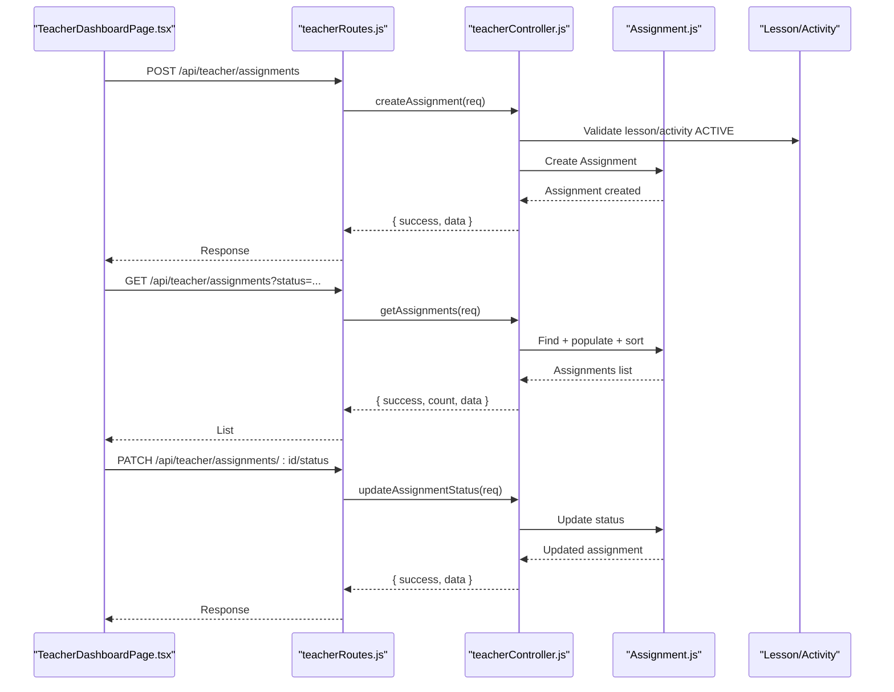
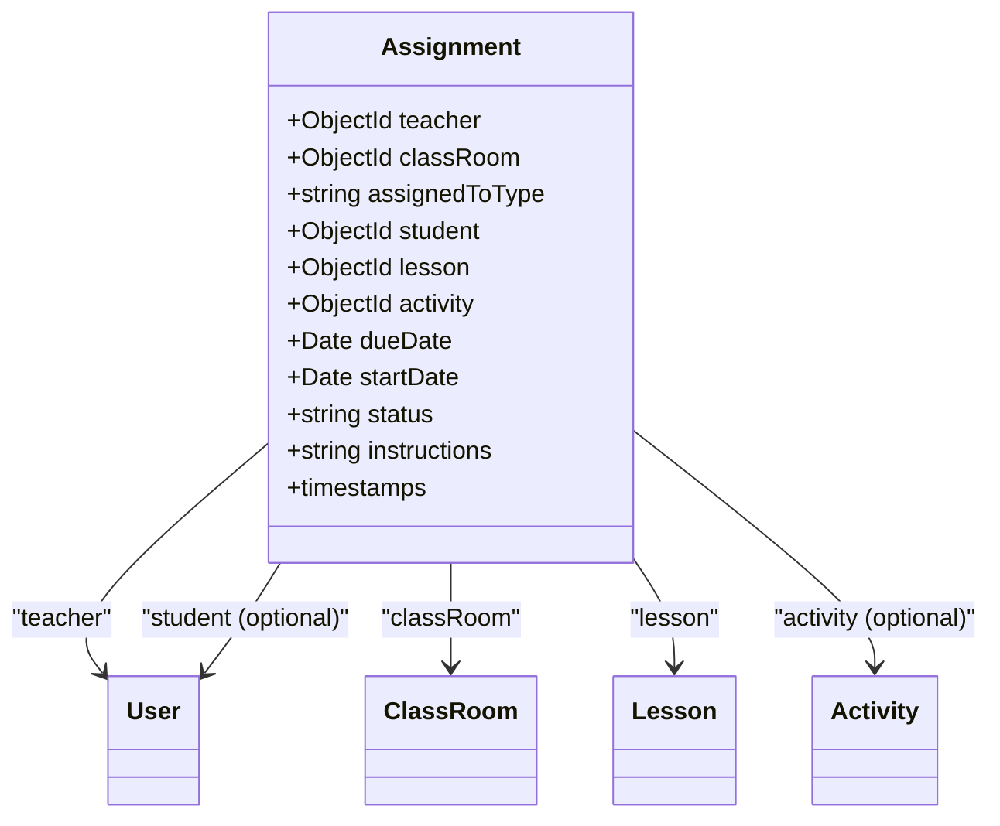
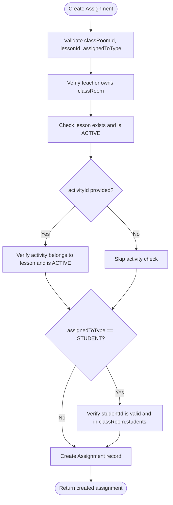
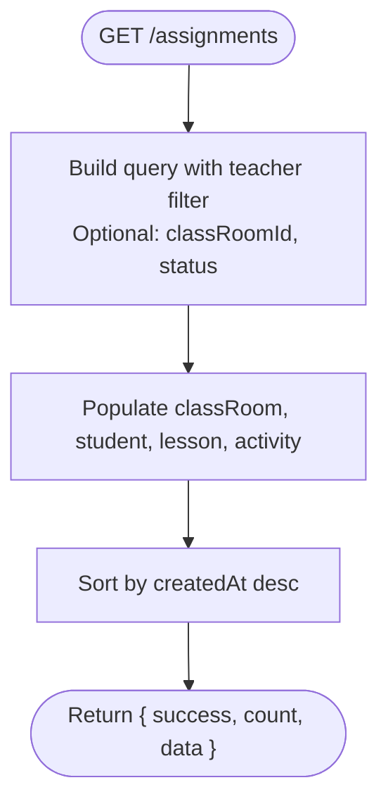
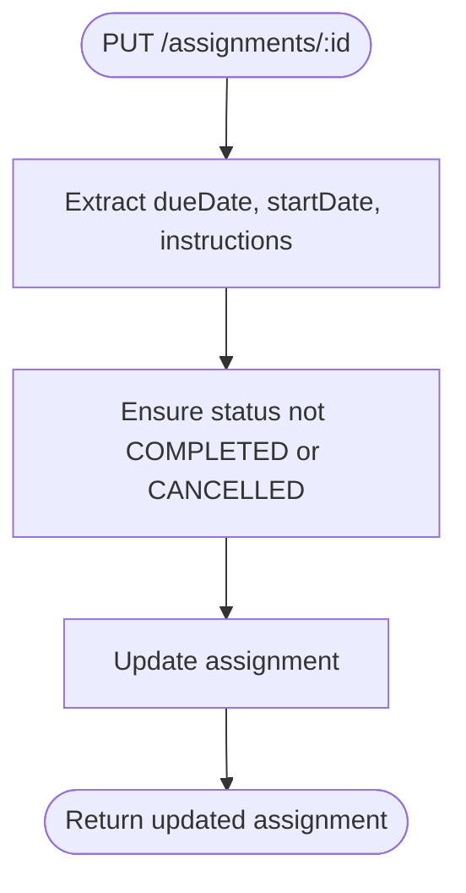
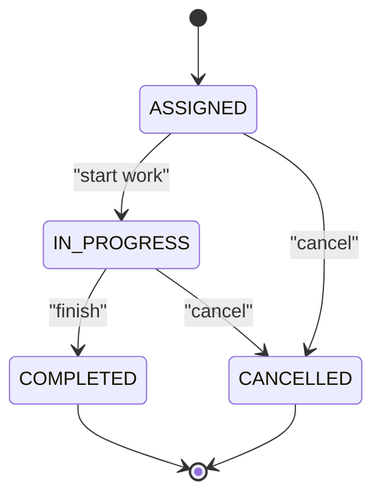
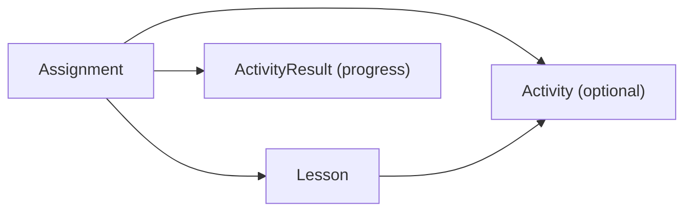
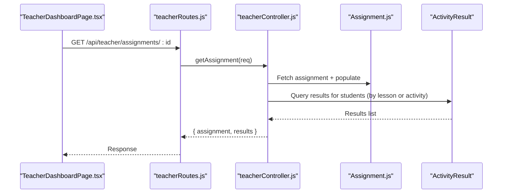
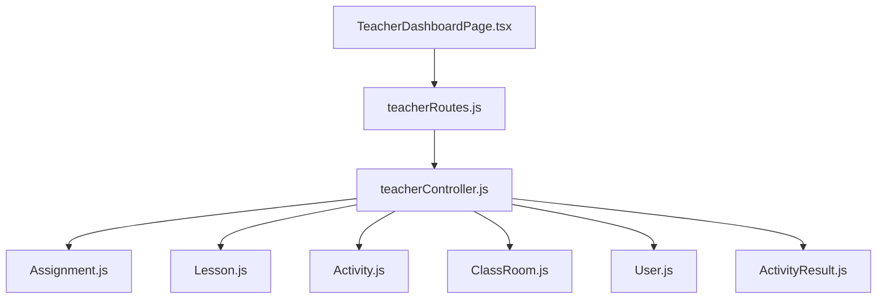

# Assignment Management

<cite>
**Referenced Files in This Document**
- [Assignment.js](file://KCEnglishKids_BE/src/models/Assignment.js)
- [teacherController.js](file://KCEnglishKids_BE/src/controllers/teacherController.js)
- [teacherRoutes.js](file://KCEnglishKids_BE/src/routes/teacherRoutes.js)
- [app.js](file://KCEnglishKids_BE/src/app.js)
- [TeacherDashboardPage.tsx](file://client/src/dashboards/teacher/TeacherDashboardPage.tsx)
</cite>

## Table of Contents
1. [Introduction](#introduction)
2. [Project Structure](#project-structure)
3. [Core Components](#core-components)
4. [Architecture Overview](#architecture-overview)
5. [Detailed Component Analysis](#detailed-component-analysis)
6. [Dependency Analysis](#dependency-analysis)
7. [Performance Considerations](#performance-considerations)
8. [Troubleshooting Guide](#troubleshooting-guide)
9. [Conclusion](#conclusion)

## Introduction
This document explains the Assignment Management system that enables teachers to create, distribute, and track educational assignments aligned with curriculum lessons and activities. It covers assignment types (CLASS vs STUDENT), creation workflow, filtering and sorting, status lifecycle, modification rules, progress tracking, UI design patterns, validation, error handling, and integration points with the curriculum database.

## Project Structure
The Assignment Management feature spans backend models, controllers, routes, and a teacher dashboard frontend:
- Backend model defines the Assignment schema and its relationships.
- Teacher controller implements assignment CRUD, filtering, and progress aggregation.
- Routes expose assignment endpoints under /api/teacher.
- Frontend provides the teacher UI for creating assignments, filtering by status, updating status, and viewing results.

**Diagram sources**
- [app.js:34-45](file://KCEnglishKids_BE/src/app.js#L34-L45)
- [teacherRoutes.js:23-27](file://KCEnglishKids_BE/src/routes/teacherRoutes.js#L23-L27)
- [teacherController.js:66-72](file://KCEnglishKids_BE/src/controllers/teacherController.js#L66-L72)
- [Assignment.js:3-50](file://KCEnglishKids_BE/src/models/Assignment.js#L3-L50)

**Section sources**
- [app.js:34-45](file://KCEnglishKids_BE/src/app.js#L34-L45)
- [teacherRoutes.js:23-27](file://KCEnglishKids_BE/src/routes/teacherRoutes.js#L23-L27)

## Core Components
- Assignment Model: Defines fields for teacher, classRoom, assignedToType (CLASS or STUDENT), student, lesson, activity, dueDate, startDate, status, instructions, and timestamps.
- Teacher Controller: Implements assignment creation, listing, retrieval, update, and status transitions; integrates with Lesson and Activity to ensure curriculum alignment.
- Routes: Expose endpoints for assignments under /api/teacher.
- Teacher Dashboard: Provides UI for selecting curriculum content, target audience, due dates, instructions, filtering by status, updating status, and viewing results.

Key responsibilities:
- Creation validates classroom ownership, active lesson/activity, and student membership when targeting an individual student.
- Listing supports optional filters by classRoomId and status, with population of related entities and default sort by creation time.
- Update allows editing dueDate, startDate, and instructions unless the assignment is completed or cancelled.
- Status updates enforce allowed states and ownership.

**Section sources**
- [Assignment.js:3-50](file://KCEnglishKids_BE/src/models/Assignment.js#L3-L50)
- [teacherController.js:66-72](file://KCEnglishKids_BE/src/controllers/teacherController.js#L66-L72)
- [teacherRoutes.js:23-27](file://KCEnglishKids_BE/src/routes/teacherRoutes.js#L23-L27)
- [TeacherDashboardPage.tsx:221-276](file://client/src/dashboards/teacher/TeacherDashboardPage.tsx#L221-L276)

## Architecture Overview
The assignment flow connects the teacher UI to backend endpoints, which validate inputs against curriculum data and persist assignments. Progress is tracked via ActivityResult records linked to students and either the lesson or activity referenced by the assignment.

**Diagram sources**
- [teacherRoutes.js:23-27](file://KCEnglishKids_BE/src/routes/teacherRoutes.js#L23-L27)
- [teacherController.js:66-72](file://KCEnglishKids_BE/src/controllers/teacherController.js#L66-L72)
- [Assignment.js:3-50](file://KCEnglishKids_BE/src/models/Assignment.js#L3-L50)

## Detailed Component Analysis

### Assignment Data Model
The Assignment schema enforces:
- Ownership: teacher and classRoom references are required.
- Targeting: assignedToType enum supports CLASS or STUDENT; student reference is used only for STUDENT targets.
- Curriculum linkage: lesson is required; activity is optional.
- Scheduling: dueDate and startDate are optional.
- Lifecycle: status enum includes ASSIGNED, IN_PROGRESS, COMPLETED, CANCELLED.
- Instructions: free-form text field.

**Diagram sources**
- [Assignment.js:3-50](file://KCEnglishKids_BE/src/models/Assignment.js#L3-L50)

**Section sources**
- [Assignment.js:3-50](file://KCEnglishKids_BE/src/models/Assignment.js#L3-L50)

### Assignment Creation Workflow
Creation validates:
- Required identifiers: classRoomId and lessonId must be valid ObjectIds.
- Target type: assignedToType must be CLASS or STUDENT.
- Classroom access: teacher must own the classRoom.
- Curriculum validity: lesson must exist and be ACTIVE; if activityId is provided, it must belong to the selected lesson and be ACTIVE.
- Student membership: if assignedToType is STUDENT, studentId must be valid and present in the classRoom’s student list.
- Persistence: creates assignment with teacher, classRoom, assignedToType, student (if applicable), lesson, activity (nullable), dueDate, startDate, and trimmed instructions.

**Diagram sources**
- [teacherController.js:66-68](file://KCEnglishKids_BE/src/controllers/teacherController.js#L66-L68)

**Section sources**
- [teacherController.js:66-68](file://KCEnglishKids_BE/src/controllers/teacherController.js#L66-L68)

### Assignment Listing, Filtering, and Sorting
Listing supports:
- Filtering by classRoomId and status via query parameters.
- Population of related entities: classRoom (name, students), student (name, avatar, avatarUrl), lesson (title), activity (title, activityType).
- Default sorting by createdAt descending.

**Diagram sources**
- [teacherController.js:69](file://KCEnglishKids_BE/src/controllers/teacherController.js#L69)

**Section sources**
- [teacherController.js:69](file://KCEnglishKids_BE/src/controllers/teacherController.js#L69)

### Assignment Modification and Deletion
Modification:
- Allowed fields: dueDate, startDate, instructions.
- Restriction: cannot edit assignments with status COMPLETED or CANCELLED.
- Ownership: only the assignment’s teacher can modify.

Deletion:
- The frontend calls deleteAssignment; however, no corresponding backend route or controller method is exposed in the current routes and controller. As implemented, deletion is not available through the API.

**Diagram sources**
- [teacherController.js:71](file://KCEnglishKids_BE/src/controllers/teacherController.js#L71)

**Section sources**
- [teacherController.js:71](file://KCEnglishKids_BE/src/controllers/teacherController.js#L71)
- [teacherRoutes.js:23-27](file://KCEnglishKids_BE/src/routes/teacherRoutes.js#L23-L27)

### Assignment Status Tracking and Lifecycle
Supported statuses:
- ASSIGNED: initial state after creation.
- IN_PROGRESS: work started.
- COMPLETED: finished.
- CANCELLED: cancelled by teacher.

Status updates:
- Enforce allowed values.
- Require ownership.

**Diagram sources**
- [Assignment.js:42-45](file://KCEnglishKids_BE/src/models/Assignment.js#L42-L45)
- [teacherController.js:72](file://KCEnglishKids_BE/src/controllers/teacherController.js#L72)

**Section sources**
- [Assignment.js:42-45](file://KCEnglishKids_BE/src/models/Assignment.js#L42-L45)
- [teacherController.js:72](file://KCEnglishKids_BE/src/controllers/teacherController.js#L72)

### Curriculum Integration with Lessons and Activities
- Lessons and activities are validated during assignment creation to ensure they are ACTIVE and properly associated.
- The teacher dashboard loads curriculum options (books, units, lessons, activities) to support selection in the assignment form.
- When retrieving assignment details, progress results are aggregated based on the assignment’s scope:
  - For CLASS assignments: results from all classRoom students.
  - For STUDENT assignments: results from the specific student.
  - If an activity is specified, results are filtered by activity; otherwise, by lesson.

**Diagram sources**
- [teacherController.js:66-70](file://KCEnglishKids_BE/src/controllers/teacherController.js#L66-L70)

**Section sources**
- [teacherController.js:66-70](file://KCEnglishKids_BE/src/controllers/teacherController.js#L66-L70)

### Assignment Distribution Mechanism and Notifications
- Distribution is modeled by creating an Assignment record scoped to a classRoom or a single student.
- There is no explicit notification service wired into the assignment creation flow in the current implementation. Parent notifications are available as separate endpoints but are not triggered automatically upon assignment creation.

**Section sources**
- [teacherController.js:66-68](file://KCEnglishKids_BE/src/controllers/teacherController.js#L66-L68)
- [teacherRoutes.js:42-46](file://KCEnglishKids_BE/src/routes/teacherRoutes.js#L42-L46)

### Progress Tracking Interfaces
- Assignment detail endpoint returns assignment metadata and aggregated ActivityResult records for the relevant students, sorted by creation time.
- The teacher dashboard displays assignment cards with status badges and allows inline status changes.

**Diagram sources**
- [teacherController.js:70](file://KCEnglishKids_BE/src/controllers/teacherController.js#L70)

**Section sources**
- [teacherController.js:70](file://KCEnglishKids_BE/src/controllers/teacherController.js#L70)
- [TeacherDashboardPage.tsx:829-943](file://client/src/dashboards/teacher/TeacherDashboardPage.tsx#L829-L943)

### User Interface Design Patterns and Validation Rules
- Form fields include class selection, target audience (CLASS/STUDENT), optional student selector, lesson/activity selectors, due date, and instructions.
- Client-side validation ensures class and lesson are selected before submission.
- Error handling shows alerts for failures and clears form state on success.
- Status filter dropdown allows quick filtering by ASSIGNED, IN_PROGRESS, COMPLETED.
- Inline status controls per assignment card enable quick lifecycle updates.

**Section sources**
- [TeacherDashboardPage.tsx:221-276](file://client/src/dashboards/teacher/TeacherDashboardPage.tsx#L221-L276)
- [TeacherDashboardPage.tsx:829-943](file://client/src/dashboards/teacher/TeacherDashboardPage.tsx#L829-L943)
- [TeacherDashboardPage.tsx:1186-1382](file://client/src/dashboards/teacher/TeacherDashboardPage.tsx#L1186-L1382)

## Dependency Analysis
- Routes depend on Express router and middleware for protection and authorization.
- Controller depends on Mongoose models: Assignment, ClassRoom, User, Lesson, Activity, ActivityResult.
- Frontend depends on API services to call teacher endpoints.

**Diagram sources**
- [teacherRoutes.js:1-48](file://KCEnglishKids_BE/src/routes/teacherRoutes.js#L1-L48)
- [teacherController.js:1-2](file://KCEnglishKids_BE/src/controllers/teacherController.js#L1-L2)

**Section sources**
- [teacherRoutes.js:1-48](file://KCEnglishKids_BE/src/routes/teacherRoutes.js#L1-L48)
- [teacherController.js:1-2](file://KCEnglishKids_BE/src/controllers/teacherController.js#L1-L2)

## Performance Considerations
- Use selective population in listing to avoid over-fetching; currently populates several relations, which is acceptable for teacher dashboards but should be tuned for large classes.
- Aggregation for progress metrics is efficient using MongoDB $match and $group stages.
- Avoid unnecessary re-renders in the frontend by caching curriculum tree and assignment lists until filters change.

[No sources needed since this section provides general guidance]

## Troubleshooting Guide
Common issues and resolutions:
- Invalid classroom or lesson IDs: Ensure ObjectIds are valid and the teacher has access to the classroom.
- Selected lesson unavailable: Only ACTIVE lessons can be assigned.
- Selected activity unavailable: Activity must be ACTIVE and belong to the selected lesson.
- Student not in classroom: When assigning to a specific student, verify membership in the classRoom.
- Cannot edit assignment: Completed or cancelled assignments cannot be edited.
- No delete endpoint: The frontend expects a delete operation, but no backend route is exposed; implement a DELETE endpoint if needed.

**Section sources**
- [teacherController.js:66-72](file://KCEnglishKids_BE/src/controllers/teacherController.js#L66-L72)
- [teacherRoutes.js:23-27](file://KCEnglishKids_BE/src/routes/teacherRoutes.js#L23-L27)

## Conclusion
The Assignment Management system provides a robust foundation for teachers to assign curriculum-aligned lessons and activities to entire classes or individual students, track progress, and manage assignment lifecycles. While distribution and notifications are modeled at the data level, explicit notification triggers are not yet integrated. Deletion is not exposed via the API despite frontend expectations. Future enhancements could include automated parent notifications, bulk operations, and a dedicated delete endpoint.