# Classroom Management

<cite>
**Referenced Files in This Document**
- [TeacherDashboardPage.tsx](file://client/src/dashboards/teacher/TeacherDashboardPage.tsx)
- [TeacherWorkspace.tsx](file://client/src/dashboards/teacher/TeacherWorkspace.tsx)
- [api.ts](file://client/src/services/api.ts)
- [ClassRoom.js](file://KCEnglishKids_BE/src/models/ClassRoom.js)
- [User.js](file://KCEnglishKids_BE/src/models/User.js)
- [AgeGroup.js](file://KCEnglishKids_BE/src/models/AgeGroup.js)
- [teacherController.js](file://KCEnglishKids_BE/src/controllers/teacherController.js)
- [teacherRoutes.js](file://KCEnglishKids_BE/src/routes/teacherRoutes.js)
</cite>

## Table of Contents
1. [Introduction](#introduction)
2. [Project Structure](#project-structure)
3. [Core Components](#core-components)
4. [Architecture Overview](#architecture-overview)
5. [Detailed Component Analysis](#detailed-component-analysis)
6. [Dependency Analysis](#dependency-analysis)
7. [Performance Considerations](#performance-considerations)
8. [Troubleshooting Guide](#troubleshooting-guide)
9. [Conclusion](#conclusion)

## Introduction
This document explains the Classroom Management functionality within the Teacher Dashboard for KCEnglishKids. It covers how teachers create and organize classes, manage rosters, enroll students, group by age groups, switch between multiple classrooms, view class statistics, manage student profiles (including avatars and contact information), track academic year data, display performance metrics, accumulate stars, visualize progress, and handle assignments and pedagogical notes. It also documents UI guidelines, responsive design considerations, accessibility features, data synchronization patterns, real-time update strategies, and error handling.

## Project Structure
The classroom management feature spans both frontend React components and backend Express routes/controllers with Mongoose models:

- Frontend
  - Teacher dashboard pages and workspace layout
  - API service layer for teacher endpoints
- Backend
  - Teacher controller methods for classes, students, assignments, content, and notes
  - Routes protecting teacher/admin access
  - Data models for ClassRoom, User, AgeGroup

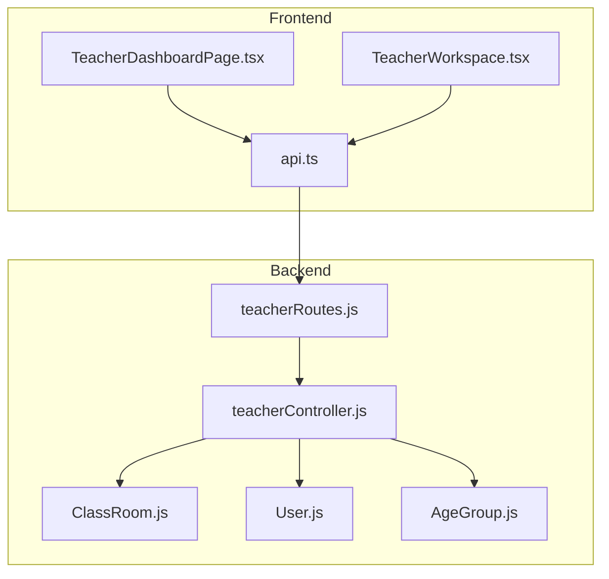

**Diagram sources**
- [TeacherDashboardPage.tsx:1-1383](file://client/src/dashboards/teacher/TeacherDashboardPage.tsx#L1-L1383)
- [TeacherWorkspace.tsx:1-39](file://client/src/dashboards/teacher/TeacherWorkspace.tsx#L1-L39)
- [api.ts:192-239](file://client/src/services/api.ts#L192-L239)
- [teacherRoutes.js:1-50](file://KCEnglishKids_BE/src/routes/teacherRoutes.js#L1-L50)
- [teacherController.js:1-79](file://KCEnglishKids_BE/src/controllers/teacherController.js#L1-L79)
- [ClassRoom.js:1-49](file://KCEnglishKids_BE/src/models/ClassRoom.js#L1-L49)
- [User.js:1-109](file://KCEnglishKids_BE/src/models/User.js#L1-L109)
- [AgeGroup.js:1-48](file://KCEnglishKids_BE/src/models/AgeGroup.js#L1-L48)

**Section sources**
- [TeacherDashboardPage.tsx:1-1383](file://client/src/dashboards/teacher/TeacherDashboardPage.tsx#L1-L1383)
- [TeacherWorkspace.tsx:1-39](file://client/src/dashboards/teacher/TeacherWorkspace.tsx#L1-L39)
- [api.ts:192-239](file://client/src/services/api.ts#L192-L239)
- [teacherRoutes.js:1-50](file://KCEnglishKids_BE/src/routes/teacherRoutes.js#L1-L50)
- [teacherController.js:1-79](file://KCEnglishKids_BE/src/controllers/teacherController.js#L1-L79)
- [ClassRoom.js:1-49](file://KCEnglishKids_BE/src/models/ClassRoom.js#L1-L49)
- [User.js:1-109](file://KCEnglishKids_BE/src/models/User.js#L1-L109)
- [AgeGroup.js:1-48](file://KCEnglishKids_BE/src/models/AgeGroup.js#L1-L48)

## Core Components
- Teacher Dashboard Page
  - Multi-tab interface: Teaching, Roster, Assignments, Notes
  - Class selector and switching
  - Student drilldown modal with stats, notes, and recent activities
  - Assignment creation flow with curriculum tree selection
- Teacher Workspace Layout
  - Sidebar navigation and overview metrics
  - Class list, class detail, assignment management, student overview
- API Service Layer
  - Encapsulates all teacher endpoints for classes, students, assignments, content, notes, sessions, vocabulary mastery, and parent notifications
- Backend Controller and Routes
  - Protects routes for TEACHER/ADMIN roles
  - Provides CRUD for classes, enrollment, student overview, assignments, notes, and content browsing

Key responsibilities:
- Class organization and roster management
- Student enrollment and removal
- Age-group-based grouping and filtering
- Performance metrics and star accumulation
- Assignment lifecycle and status tracking
- Pedagogical note-taking per student

**Section sources**
- [TeacherDashboardPage.tsx:38-1383](file://client/src/dashboards/teacher/TeacherDashboardPage.tsx#L38-L1383)
- [TeacherWorkspace.tsx:13-39](file://client/src/dashboards/teacher/TeacherWorkspace.tsx#L13-L39)
- [api.ts:192-239](file://client/src/services/api.ts#L192-L239)
- [teacherController.js:12-79](file://KCEnglishKids_BE/src/controllers/teacherController.js#L12-L79)
- [teacherRoutes.js:8-48](file://KCEnglishKids_BE/src/routes/teacherRoutes.js#L8-L48)

## Architecture Overview
The system follows a standard MVC pattern on the backend and a component-driven architecture on the frontend. The teacher dashboard initiates requests to the teacher API, which is protected by middleware and routed to controller methods that query and aggregate data from Mongoose models.

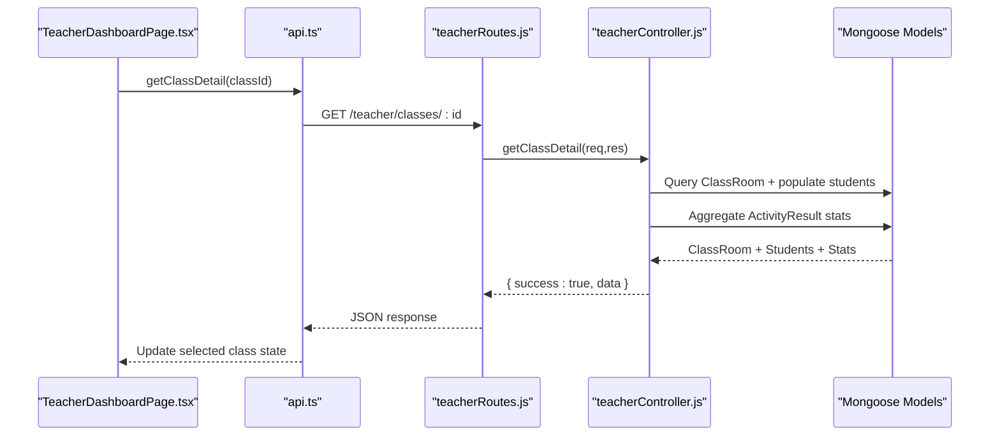

**Diagram sources**
- [TeacherDashboardPage.tsx:196-205](file://client/src/dashboards/teacher/TeacherDashboardPage.tsx#L196-L205)
- [api.ts:196-197](file://client/src/services/api.ts#L196-L197)
- [teacherRoutes.js:10-11](file://KCEnglishKids_BE/src/routes/teacherRoutes.js#L10-L11)
- [teacherController.js:24-29](file://KCEnglishKids_BE/src/controllers/teacherController.js#L24-L29)
- [ClassRoom.js:1-49](file://KCEnglishKids_BE/src/models/ClassRoom.js#L1-L49)

## Detailed Component Analysis

### Classroom Creation and Organization
- Class model fields include name, description, teacher reference, age group reference and code, academic year, students array, and status.
- Teachers can filter classes by status, age group code, and search by name via backend queries.
- The dashboard displays assigned classes and allows switching between them.

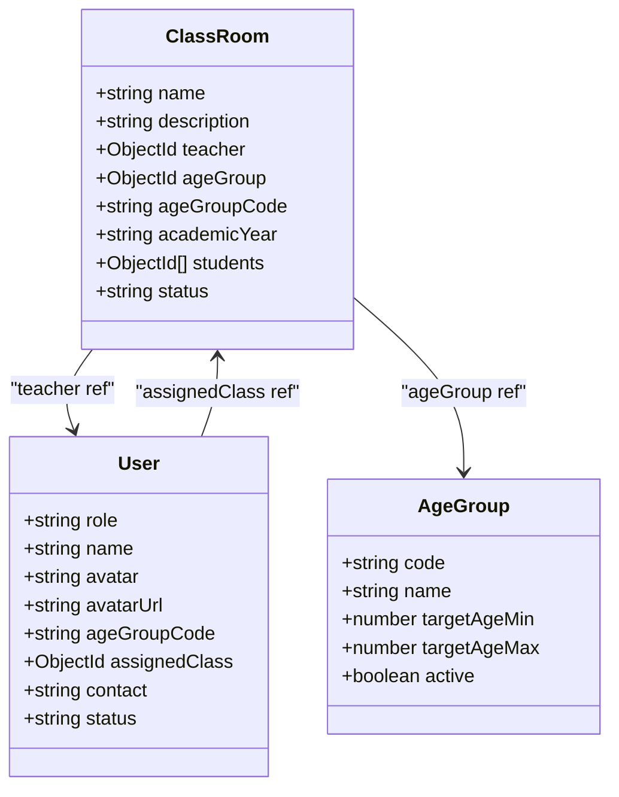

**Diagram sources**
- [ClassRoom.js:3-46](file://KCEnglishKids_BE/src/models/ClassRoom.js#L3-L46)
- [User.js:4-82](file://KCEnglishKids_BE/src/models/User.js#L4-L82)
- [AgeGroup.js:3-44](file://KCEnglishKids_BE/src/models/AgeGroup.js#L3-L44)

**Section sources**
- [ClassRoom.js:1-49](file://KCEnglishKids_BE/src/models/ClassRoom.js#L1-L49)
- [teacherController.js:19-22](file://KCEnglishKids_BE/src/controllers/teacherController.js#L19-L22)
- [TeacherDashboardPage.tsx:692-739](file://client/src/dashboards/teacher/TeacherDashboardPage.tsx#L692-L739)

### Class Roster Management and Enrollment
- Eligible students are filtered by role CHILD, ACTIVE status, and optional age group matching.
- Enrolling students updates both the class’s students array and the child’s assignedClass field.
- Removing a student removes the reference from the class and clears the child’s assignedClass.

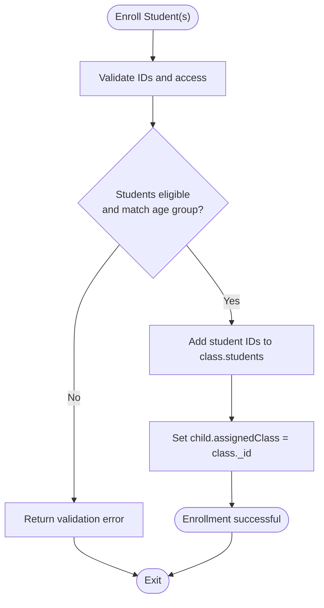

**Diagram sources**
- [teacherController.js:36-44](file://KCEnglishKids_BE/src/controllers/teacherController.js#L36-L44)
- [api.ts:198-200](file://client/src/services/api.ts#L198-L200)

**Section sources**
- [teacherController.js:36-48](file://KCEnglishKids_BE/src/controllers/teacherController.js#L36-L48)
- [api.ts:198-200](file://client/src/services/api.ts#L198-L200)

### Age Grouping and Academic Year Tracking
- Classes store ageGroupCode and academicYear; children also have ageGroupCode and assignedClass.
- Filtering and eligibility checks ensure students belong to the same age group as the class.
- AgeGroup model defines codes and metadata used across the system.

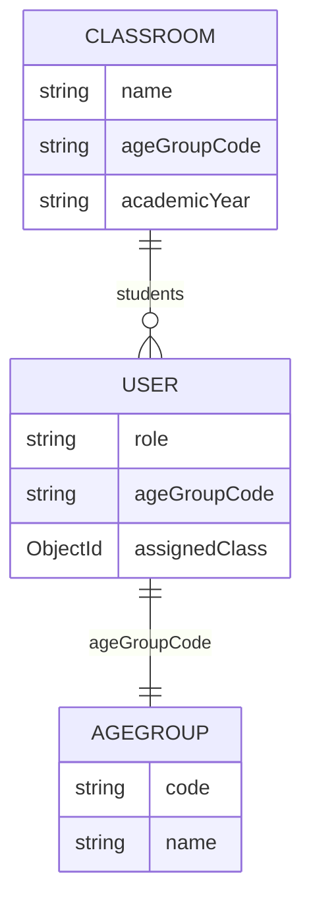

**Diagram sources**
- [ClassRoom.js:21-32](file://KCEnglishKids_BE/src/models/ClassRoom.js#L21-L32)
- [User.js:55-66](file://KCEnglishKids_BE/src/models/User.js#L55-L66)
- [AgeGroup.js:3-44](file://KCEnglishKids_BE/src/models/AgeGroup.js#L3-L44)

**Section sources**
- [ClassRoom.js:1-49](file://KCEnglishKids_BE/src/models/ClassRoom.js#L1-L49)
- [User.js:1-109](file://KCEnglishKids_BE/src/models/User.js#L1-L109)
- [AgeGroup.js:1-48](file://KCEnglishKids_BE/src/models/AgeGroup.js#L1-L48)

### Switching Between Multiple Classrooms
- The dashboard loads all classes for the current teacher and sets the first class as default.
- Selecting another class triggers a request to fetch its details and updates the selected class state.

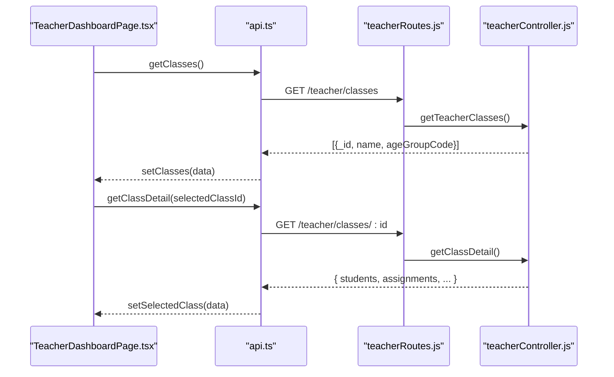

**Diagram sources**
- [TeacherDashboardPage.tsx:129-184](file://client/src/dashboards/teacher/TeacherDashboardPage.tsx#L129-L184)
- [TeacherDashboardPage.tsx:196-205](file://client/src/dashboards/teacher/TeacherDashboardPage.tsx#L196-L205)
- [api.ts:194-197](file://client/src/services/api.ts#L194-L197)
- [teacherRoutes.js:9-11](file://KCEnglishKids_BE/src/routes/teacherRoutes.js#L9-L11)
- [teacherController.js:19-29](file://KCEnglishKids_BE/src/controllers/teacherController.js#L19-L29)

**Section sources**
- [TeacherDashboardPage.tsx:129-205](file://client/src/dashboards/teacher/TeacherDashboardPage.tsx#L129-L205)
- [api.ts:194-197](file://client/src/services/api.ts#L194-L197)
- [teacherController.js:19-29](file://KCEnglishKids_BE/src/controllers/teacherController.js#L19-L29)

### Student Profile Management
- Student overview includes profile info, stats (stars, completed lessons, average score, attempts, learning time), recent activities, sessions, and teacher notes.
- Avatar handling supports avatarUrl fallback to a default icon when missing.
- Contact information is displayed if present.

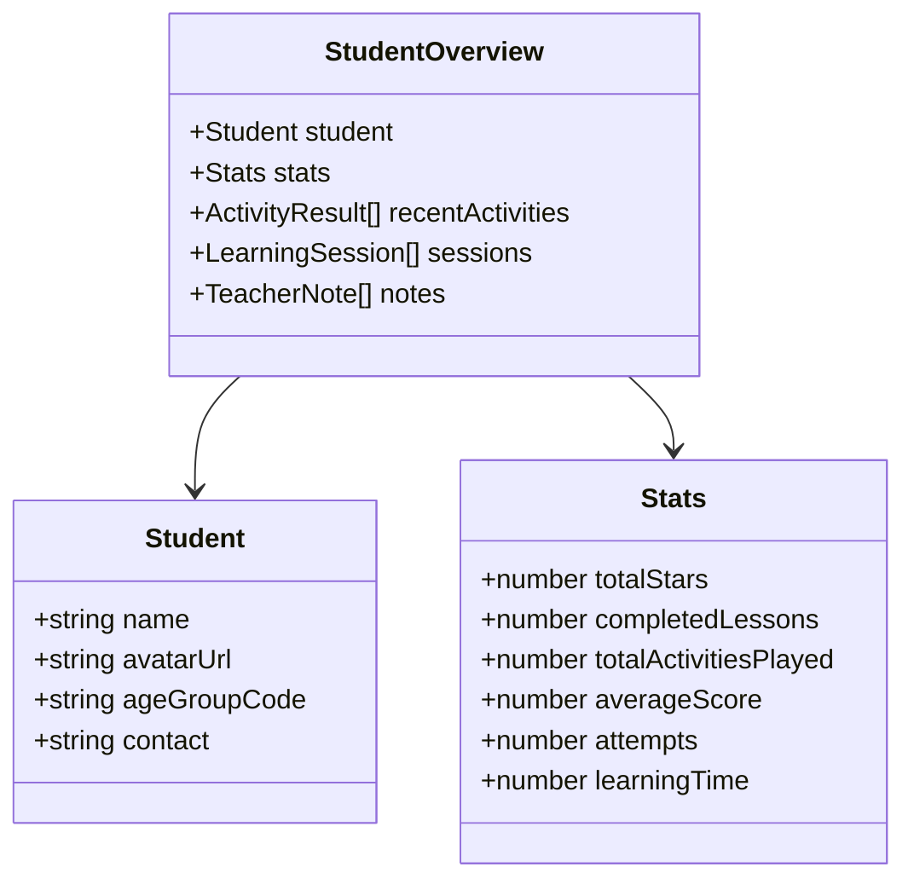

**Diagram sources**
- [teacherController.js:54-56](file://KCEnglishKids_BE/src/controllers/teacherController.js#L54-L56)
- [TeacherDashboardPage.tsx:1054-1181](file://client/src/dashboards/teacher/TeacherDashboardPage.tsx#L1054-L1181)

**Section sources**
- [teacherController.js:54-56](file://KCEnglishKids_BE/src/controllers/teacherController.js#L54-L56)
- [TeacherDashboardPage.tsx:1054-1181](file://client/src/dashboards/teacher/TeacherDashboardPage.tsx#L1054-L1181)

### Class Performance Metrics and Star Accumulation
- Dashboard aggregates average scores, total stars, completed assignments, and counts needing attention.
- Per-student stats include stars accumulated from activity results and completed lessons count.

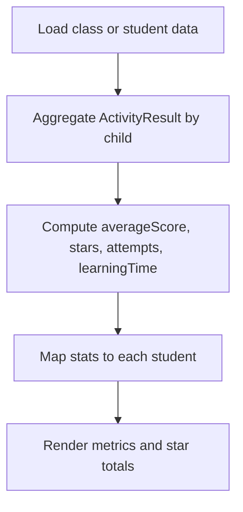

**Diagram sources**
- [teacherController.js:9-17](file://KCEnglishKids_BE/src/controllers/teacherController.js#L9-L17)
- [teacherController.js:27-28](file://KCEnglishKids_BE/src/controllers/teacherController.js#L27-L28)
- [TeacherDashboardPage.tsx:1084-1109](file://client/src/dashboards/teacher/TeacherDashboardPage.tsx#L1084-L1109)

**Section sources**
- [teacherController.js:9-17](file://KCEnglishKids_BE/src/controllers/teacherController.js#L9-L17)
- [TeacherDashboardPage.tsx:1084-1109](file://client/src/dashboards/teacher/TeacherDashboardPage.tsx#L1084-L1109)

### Student Progress Visualization
- Recent activities show lesson title, activity title, type, score, and stars awarded.
- Learning sessions provide last activity timestamps for recency.
- Teacher notes capture qualitative observations categorized by type.

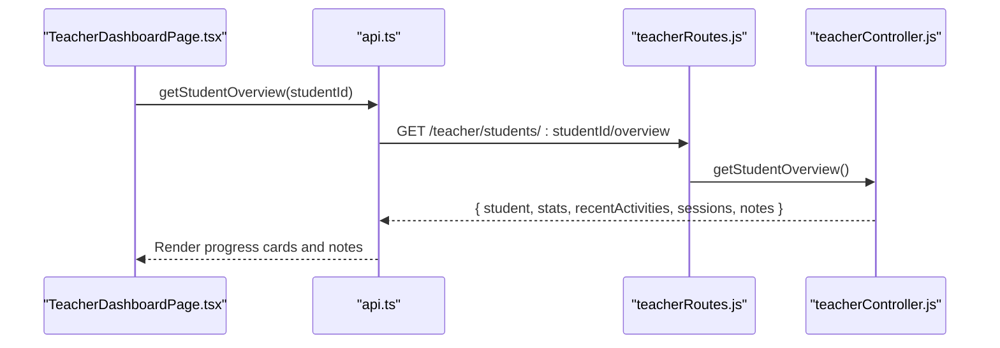

**Diagram sources**
- [TeacherDashboardPage.tsx:207-219](file://client/src/dashboards/teacher/TeacherDashboardPage.tsx#L207-L219)
- [api.ts:202-203](file://client/src/services/api.ts#L202-L203)
- [teacherRoutes.js:29-31](file://KCEnglishKids_BE/src/routes/teacherRoutes.js#L29-L31)
- [teacherController.js:54-56](file://KCEnglishKids_BE/src/controllers/teacherController.js#L54-L56)

**Section sources**
- [TeacherDashboardPage.tsx:1144-1179](file://client/src/dashboards/teacher/TeacherDashboardPage.tsx#L1144-L1179)
- [teacherController.js:54-56](file://KCEnglishKids_BE/src/controllers/teacherController.js#L54-L56)

### Assignments and Status Lifecycle
- Teachers can assign lessons or specific activities to a class or individual student.
- Assignment statuses include ASSIGNED, IN_PROGRESS, COMPLETED, CANCELLED.
- Filters allow viewing assignments by status and class.

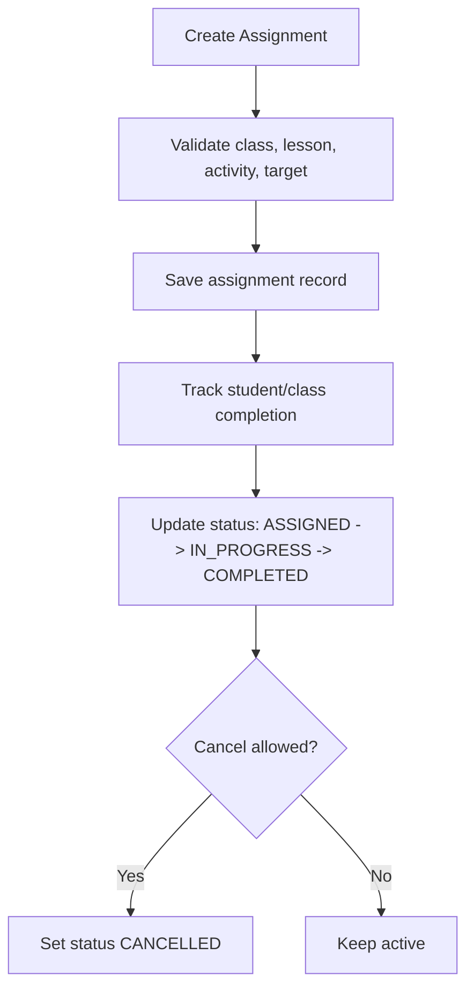

**Diagram sources**
- [teacherController.js:66-72](file://KCEnglishKids_BE/src/controllers/teacherController.js#L66-L72)
- [TeacherDashboardPage.tsx:221-276](file://client/src/dashboards/teacher/TeacherDashboardPage.tsx#L221-L276)
- [api.ts:216-229](file://client/src/services/api.ts#L216-L229)

**Section sources**
- [teacherController.js:66-72](file://KCEnglishKids_BE/src/controllers/teacherController.js#L66-L72)
- [TeacherDashboardPage.tsx:818-943](file://client/src/dashboards/teacher/TeacherDashboardPage.tsx#L818-L943)
- [api.ts:216-229](file://client/src/services/api.ts#L216-L229)

### Pedagogical Notes
- Teachers can add qualitative notes per student with types such as Interest, Vocabulary Mastery, Participation, Reinforcement, General.
- Notes are stored with teacher and optional lesson references and sorted by creation date.

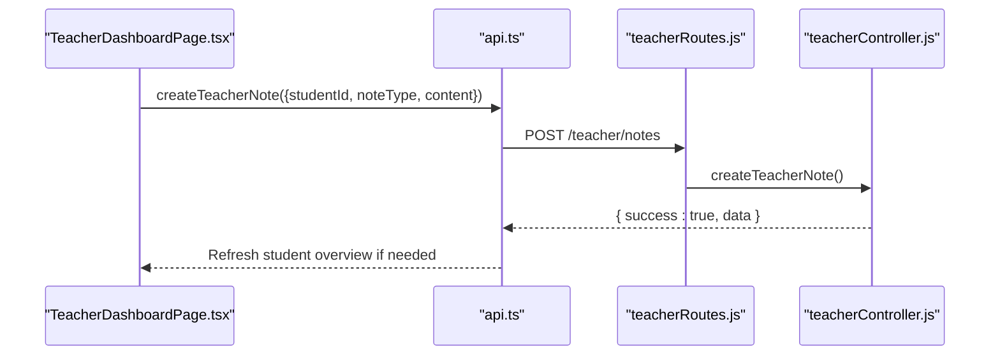

**Diagram sources**
- [TeacherDashboardPage.tsx:278-307](file://client/src/dashboards/teacher/TeacherDashboardPage.tsx#L278-L307)
- [api.ts:205-206](file://client/src/services/api.ts#L205-L206)
- [teacherRoutes.js:34-35](file://KCEnglishKids_BE/src/routes/teacherRoutes.js#L34-L35)
- [teacherController.js:74-74](file://KCEnglishKids_BE/src/controllers/teacherController.js#L74-L74)

**Section sources**
- [TeacherDashboardPage.tsx:945-1029](file://client/src/dashboards/teacher/TeacherDashboardPage.tsx#L945-L1029)
- [teacherController.js:74-74](file://KCEnglishKids_BE/src/controllers/teacherController.js#L74-L74)

### Curriculum and Lesson Selection for Assignments
- The dashboard loads curriculum options (units, lessons, activities) and pre-selects a relevant lesson for teaching mode.
- Assignment creation uses a cascading selector: Unit -> Lesson -> Activity.

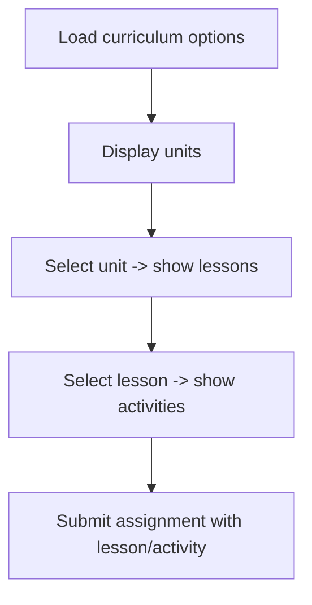

**Diagram sources**
- [TeacherDashboardPage.tsx:150-172](file://client/src/dashboards/teacher/TeacherDashboardPage.tsx#L150-L172)
- [TeacherDashboardPage.tsx:1261-1329](file://client/src/dashboards/teacher/TeacherDashboardPage.tsx#L1261-L1329)
- [teacherController.js:60-62](file://KCEnglishKids_BE/src/controllers/teacherController.js#L60-L62)

**Section sources**
- [TeacherDashboardPage.tsx:150-172](file://client/src/dashboards/teacher/TeacherDashboardPage.tsx#L150-L172)
- [TeacherDashboardPage.tsx:1261-1329](file://client/src/dashboards/teacher/TeacherDashboardPage.tsx#L1261-L1329)
- [teacherController.js:60-62](file://KCEnglishKids_BE/src/controllers/teacherController.js#L60-L62)

### User Interface Guidelines and Responsive Design
- Navigation tabs are accessible and visually distinct with clear labels and icons.
- Grid layouts adapt across screen sizes using responsive Tailwind classes.
- Modals for student details and assignment creation are centered and scrollable on small screens.
- Form controls use unique IDs for accessibility and proper labeling.

Guidelines:
- Use semantic headings and labels for forms.
- Provide keyboard focus states and visible outlines.
- Ensure color contrast meets WCAG guidelines.
- Maintain consistent spacing and typography hierarchy.

**Section sources**
- [TeacherDashboardPage.tsx:318-421](file://client/src/dashboards/teacher/TeacherDashboardPage.tsx#L318-L421)
- [TeacherDashboardPage.tsx:741-814](file://client/src/dashboards/teacher/TeacherDashboardPage.tsx#L741-L814)
- [TeacherDashboardPage.tsx:1036-1184](file://client/src/dashboards/teacher/TeacherDashboardPage.tsx#L1036-L1184)

### Accessibility Features
- All interactive elements have descriptive titles and aria-friendly labels where applicable.
- Unique IDs are generated for form inputs to associate labels and controls.
- Modal overlays include close buttons and backdrop interactions.

**Section sources**
- [TeacherDashboardPage.tsx:85-98](file://client/src/dashboards/teacher/TeacherDashboardPage.tsx#L85-L98)
- [TeacherDashboardPage.tsx:1036-1184](file://client/src/dashboards/teacher/TeacherDashboardPage.tsx#L1036-L1184)

### Data Synchronization Patterns and Real-Time Updates
- Current implementation uses synchronous HTTP requests for data loading and updates.
- Real-time updates are not implemented; refreshes occur after mutations (e.g., reload assignments, re-fetch class detail).
- For future enhancements, consider WebSocket events or polling intervals for live session scoring and student status changes.

Recommendations:
- Introduce optimistic UI updates for quick feedback.
- Implement event-driven updates for activity results and session scoring.
- Debounce search inputs and pagination for large datasets.

**Section sources**
- [TeacherDashboardPage.tsx:186-194](file://client/src/dashboards/teacher/TeacherDashboardPage.tsx#L186-L194)
- [TeacherDashboardPage.tsx:257-276](file://client/src/dashboards/teacher/TeacherDashboardPage.tsx#L257-L276)

### Error Handling for Classroom Operations
- Frontend catches network errors and logs them; user-facing alerts inform about failures.
- Backend validates inputs and returns structured error messages with success flags.
- Access control ensures teachers cannot modify resources outside their scope.

Common scenarios:
- Invalid classroom ID or unauthorized access
- Missing required fields in forms
- Student not eligible or already assigned
- Lesson or activity not found or inactive

**Section sources**
- [TeacherDashboardPage.tsx:108-113](file://client/src/dashboards/teacher/TeacherDashboardPage.tsx#L108-L113)
- [TeacherDashboardPage.tsx:249-254](file://client/src/dashboards/teacher/TeacherDashboardPage.tsx#L249-L254)
- [teacherController.js:4-10](file://KCEnglishKids_BE/src/controllers/teacherController.js#L4-L10)

## Dependency Analysis
The following diagram shows key dependencies among frontend components, services, backend routes, controllers, and models.

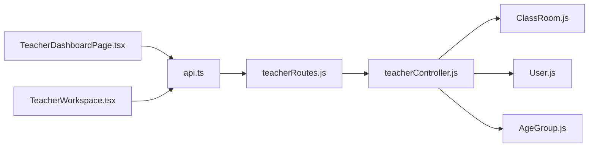

**Diagram sources**
- [TeacherDashboardPage.tsx:1-1383](file://client/src/dashboards/teacher/TeacherDashboardPage.tsx#L1-L1383)
- [TeacherWorkspace.tsx:1-39](file://client/src/dashboards/teacher/TeacherWorkspace.tsx#L1-L39)
- [api.ts:192-239](file://client/src/services/api.ts#L192-L239)
- [teacherRoutes.js:1-50](file://KCEnglishKids_BE/src/routes/teacherRoutes.js#L1-L50)
- [teacherController.js:1-79](file://KCEnglishKids_BE/src/controllers/teacherController.js#L1-L79)
- [ClassRoom.js:1-49](file://KCEnglishKids_BE/src/models/ClassRoom.js#L1-L49)
- [User.js:1-109](file://KCEnglishKids_BE/src/models/User.js#L1-L109)
- [AgeGroup.js:1-48](file://KCEnglishKids_BE/src/models/AgeGroup.js#L1-L48)

**Section sources**
- [api.ts:192-239](file://client/src/services/api.ts#L192-L239)
- [teacherRoutes.js:1-50](file://KCEnglishKids_BE/src/routes/teacherRoutes.js#L1-L50)
- [teacherController.js:1-79](file://KCEnglishKids_BE/src/controllers/teacherController.js#L1-L79)

## Performance Considerations
- Aggregation pipelines compute per-student stats efficiently using MongoDB aggregation.
- Parallel population reduces round-trips for class details and student lists.
- Pagination or virtualization may be needed for large rosters and activity histories.
- Debouncing search inputs prevents excessive queries.

[No sources needed since this section provides general guidance]

## Troubleshooting Guide
- If class switching fails, verify the selected class ID and teacher ownership.
- If enrollment fails, check student eligibility and age group matching.
- If assignment creation fails, confirm lesson and activity validity and target selection.
- If student overview is empty, ensure the student belongs to one of your classes.

Checkpoints:
- Network errors logged in console; inspect payload and headers.
- Backend returns structured messages indicating validation or authorization issues.
- UI shows loading spinners during data fetching; ensure no infinite loops.

**Section sources**
- [TeacherDashboardPage.tsx:108-113](file://client/src/dashboards/teacher/TeacherDashboardPage.tsx#L108-L113)
- [TeacherDashboardPage.tsx:249-254](file://client/src/dashboards/teacher/TeacherDashboardPage.tsx#L249-L254)
- [teacherController.js:4-10](file://KCEnglishKids_BE/src/controllers/teacherController.js#L4-L10)

## Conclusion
The Classroom Management feature provides a comprehensive toolkit for teachers to organize classes, manage rosters, enroll students by age groups, switch between classrooms, and monitor student progress through metrics and star accumulation. The UI emphasizes clarity, responsiveness, and accessibility, while the backend enforces robust validation and access control. Future improvements can introduce real-time updates and advanced analytics to further enhance the teacher experience.

[No sources needed since this section summarizes without analyzing specific files]