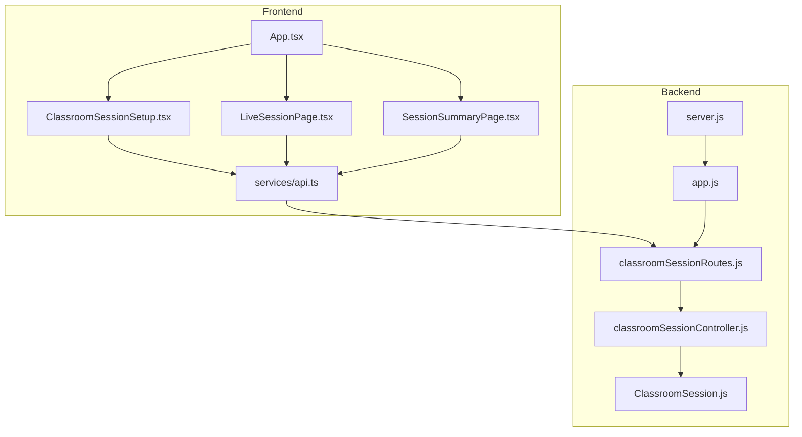
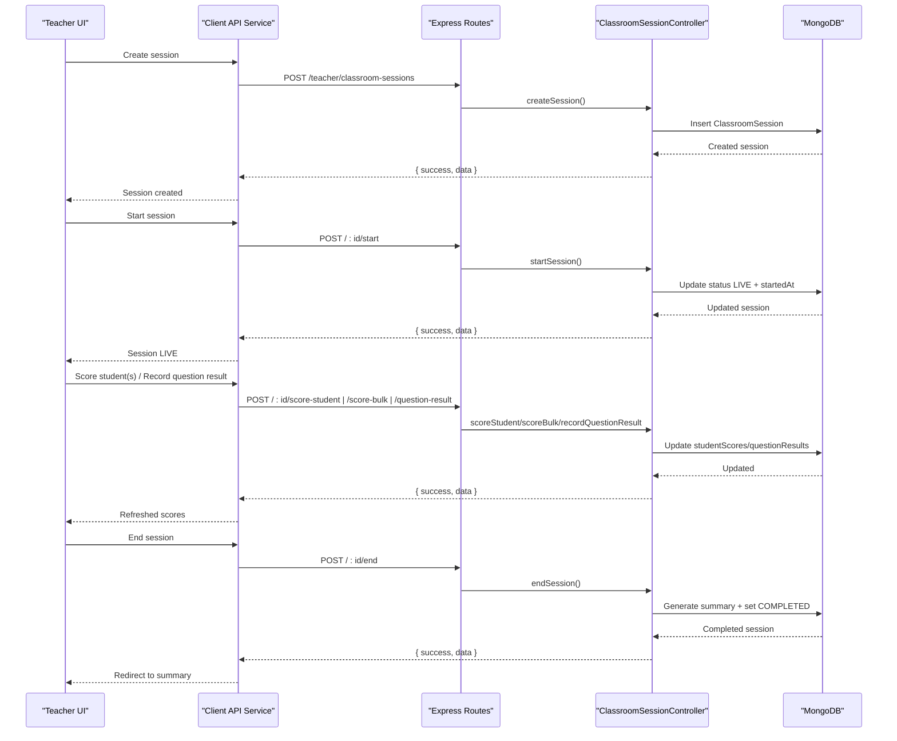
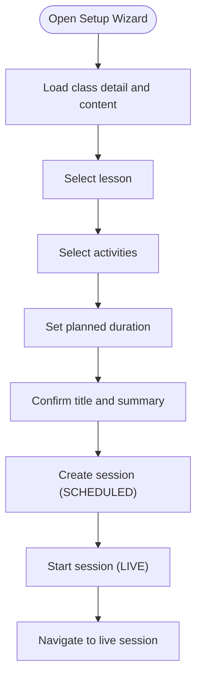
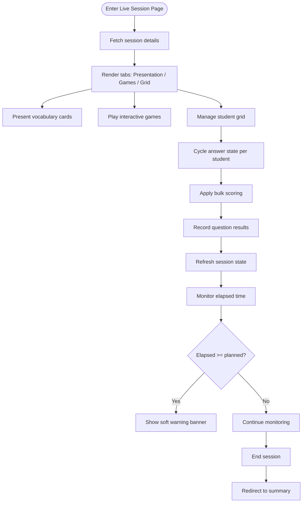
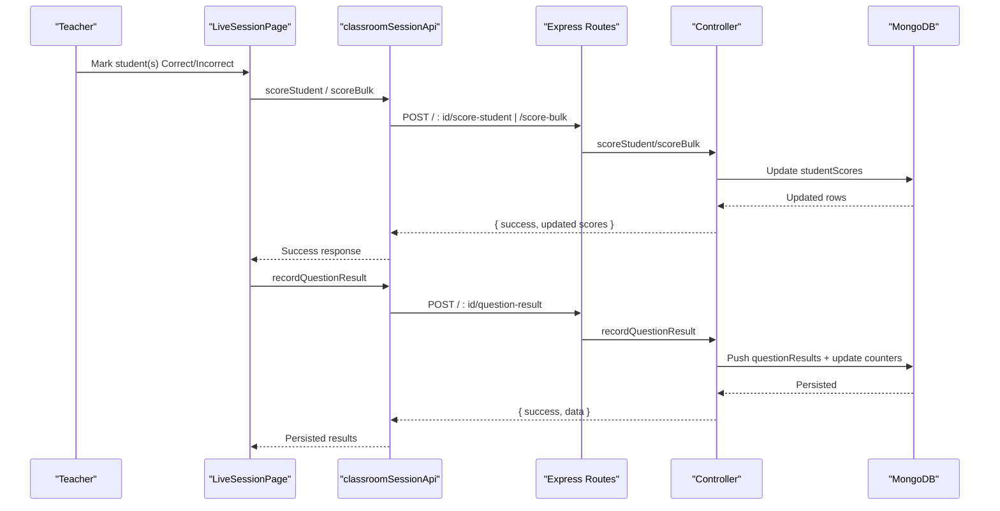
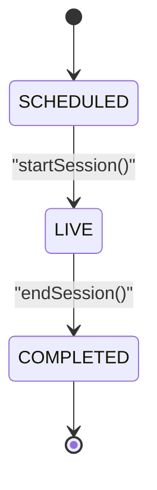
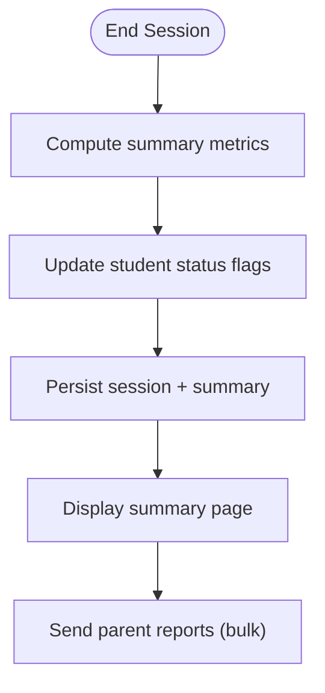
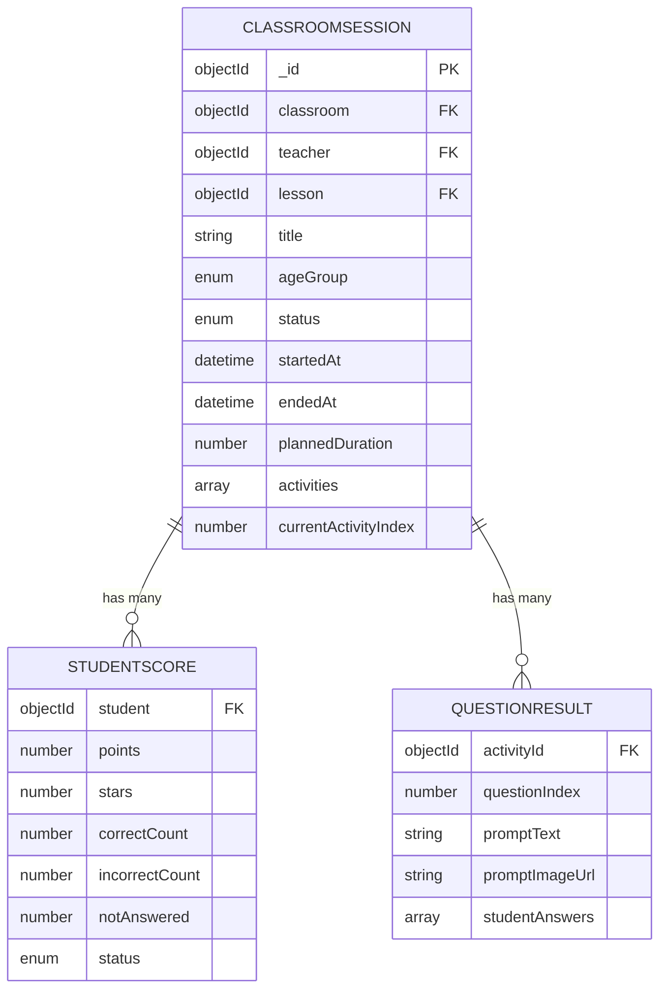
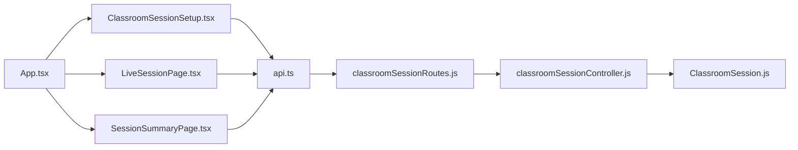

# Live Session Monitoring

<cite>
**Referenced Files in This Document**
- [LiveSessionPage.tsx](file://client/src/dashboards/teacher/LiveSessionPage.tsx)
- [ClassroomSessionSetup.tsx](file://client/src/dashboards/teacher/ClassroomSessionSetup.tsx)
- [SessionSummaryPage.tsx](file://client/src/dashboards/teacher/SessionSummaryPage.tsx)
- [api.ts](file://client/src/services/api.ts)
- [App.tsx](file://client/src/App.tsx)
- [classroomSessionController.js](file://KCEnglishKids_BE/src/controllers/classroomSessionController.js)
- [classroomSessionRoutes.js](file://KCEnglishKids_BE/src/routes/classroomSessionRoutes.js)
- [ClassroomSession.js](file://KCEnglishKids_BE/src/models/ClassroomSession.js)
- [app.js](file://KCEnglishKids_BE/src/app.js)
- [server.js](file://KCEnglishKids_BE/src/server.js)
</cite>

## Table of Contents
1. [Introduction](#introduction)
2. [Project Structure](#project-structure)
3. [Core Components](#core-components)
4. [Architecture Overview](#architecture-overview)
5. [Detailed Component Analysis](#detailed-component-analysis)
6. [Dependency Analysis](#dependency-analysis)
7. [Performance Considerations](#performance-considerations)
8. [Troubleshooting Guide](#troubleshooting-guide)
9. [Conclusion](#conclusion)

## Introduction
This document explains the Live Session Monitoring system that enables teachers to observe and guide student activities during active learning sessions. It covers session creation, real-time monitoring, scoring and engagement tracking, session controls (start/end), post-session summaries, and reporting to parents. The current implementation uses REST APIs for state synchronization; there is no WebSocket integration present in the codebase.

## Project Structure
The Live Session Monitoring feature spans both frontend and backend:

- Frontend teacher dashboard pages:
  - Classroom session setup wizard
  - Live session monitoring interface
  - Post-session summary and parent reporting
- Backend Express routes and controller handling classroom session lifecycle and scoring
- Mongoose model defining session data structure and indexes
- API client services used by the frontend

**Diagram sources**
- [App.tsx:111-123](file://client/src/App.tsx#L111-L123)
- [ClassroomSessionSetup.tsx:1-353](file://client/src/dashboards/teacher/ClassroomSessionSetup.tsx#L1-L353)
- [LiveSessionPage.tsx:1-800](file://client/src/dashboards/teacher/LiveSessionPage.tsx#L1-L800)
- [SessionSummaryPage.tsx:1-458](file://client/src/dashboards/teacher/SessionSummaryPage.tsx#L1-L458)
- [api.ts:241-296](file://client/src/services/api.ts#L241-L296)
- [classroomSessionRoutes.js:1-28](file://KCEnglishKids_BE/src/routes/classroomSessionRoutes.js#L1-L28)
- [classroomSessionController.js:1-460](file://KCEnglishKids_BE/src/controllers/classroomSessionController.js#L1-L460)
- [ClassroomSession.js:1-122](file://KCEnglishKids_BE/src/models/ClassroomSession.js#L1-L122)
- [app.js:1-53](file://KCEnglishKids_BE/src/app.js#L1-L53)
- [server.js:1-21](file://KCEnglishKids_BE/src/server.js#L1-L21)

**Section sources**
- [App.tsx:111-123](file://client/src/App.tsx#L111-L123)
- [app.js:18-49](file://KCEnglishKids_BE/src/app.js#L18-L49)
- [server.js:11-15](file://KCEnglishKids_BE/src/server.js#L11-L15)

## Core Components
- Classroom session setup wizard: guides teachers through lesson selection, activity selection, duration planning, and starting a live session.
- Live session monitoring page: displays vocabulary presentation, interactive games, student grid with bulk scoring, question result recording, and session controls.
- Session summary page: shows participation metrics, accuracy, stars, top performers, students needing practice, and supports sending reports to parents.
- Backend controller and routes: manage session lifecycle, scoring, question results, activity index updates, and summary generation.
- Data model: defines per-student scores, question results, session metadata, and generated summary fields.

Key responsibilities:
- Session creation and start: create scheduled session, then transition to live.
- Real-time monitoring: teacher-driven actions update per-student scores and question results via REST calls.
- Engagement tracking: correct/incorrect counts, stars, points, status flags.
- Session controls: start, end, and navigate activities.
- Reporting: generate summary and send parent notifications.

**Section sources**
- [ClassroomSessionSetup.tsx:63-83](file://client/src/dashboards/teacher/ClassroomSessionSetup.tsx#L63-L83)
- [LiveSessionPage.tsx:109-188](file://client/src/dashboards/teacher/LiveSessionPage.tsx#L109-L188)
- [SessionSummaryPage.tsx:46-77](file://client/src/dashboards/teacher/SessionSummaryPage.tsx#L46-L77)
- [classroomSessionController.js:74-136](file://KCEnglishKids_BE/src/controllers/classroomSessionController.js#L74-L136)
- [ClassroomSession.js:44-116](file://KCEnglishKids_BE/src/models/ClassroomSession.js#L44-L116)

## Architecture Overview
The system follows a standard REST-based architecture without WebSockets. The frontend triggers actions (create, start, score, record answers, end, summarize), and the backend persists changes to MongoDB via Mongoose models.

**Diagram sources**
- [classroomSessionRoutes.js:9-25](file://KCEnglishKids_BE/src/routes/classroomSessionRoutes.js#L9-L25)
- [classroomSessionController.js:74-136](file://KCEnglishKids_BE/src/controllers/classroomSessionController.js#L74-L136)
- [classroomSessionController.js:169-184](file://KCEnglishKids_BE/src/controllers/classroomSessionController.js#L169-L184)
- [classroomSessionController.js:267-306](file://KCEnglishKids_BE/src/controllers/classroomSessionController.js#L267-L306)
- [classroomSessionController.js:313-355](file://KCEnglishKids_BE/src/controllers/classroomSessionController.js#L313-L355)
- [classroomSessionController.js:363-411](file://KCEnglishKids_BE/src/controllers/classroomSessionController.js#L363-L411)
- [classroomSessionController.js:190-260](file://KCEnglishKids_BE/src/controllers/classroomSessionController.js#L190-L260)

## Detailed Component Analysis

### Session Creation Flow
The setup wizard collects class context, lesson, activities, and planned duration, then creates a scheduled session and immediately starts it.

**Diagram sources**
- [ClassroomSessionSetup.tsx:29-55](file://client/src/dashboards/teacher/ClassroomSessionSetup.tsx#L29-L55)
- [ClassroomSessionSetup.tsx:63-83](file://client/src/dashboards/teacher/ClassroomSessionSetup.tsx#L63-L83)
- [api.ts:250-259](file://client/src/services/api.ts#L250-L259)
- [classroomSessionController.js:74-136](file://KCEnglishKids_BE/src/controllers/classroomSessionController.js#L74-L136)
- [classroomSessionController.js:169-184](file://KCEnglishKids_BE/src/controllers/classroomSessionController.js#L169-L184)

**Section sources**
- [ClassroomSessionSetup.tsx:63-83](file://client/src/dashboards/teacher/ClassroomSessionSetup.tsx#L63-L83)
- [api.ts:250-259](file://client/src/services/api.ts#L250-L259)
- [classroomSessionController.js:74-136](file://KCEnglishKids_BE/src/controllers/classroomSessionController.js#L74-L136)

### Live Session Monitoring Interface
The live page provides three main views:
- Presentation: vocabulary flashcards with audio pronunciation and random student callouts.
- Games: interactive classroom games using vocabulary items.
- Grid: student management with quick scoring, multi-select bulk scoring, and question result recording.

Key capabilities:
- Fetch session details including lesson vocabulary and student scores.
- Track elapsed time and warn when approaching planned duration.
- Cycle answer states per student (Correct/Incorrect/Not Answered).
- Apply single or bulk scoring updates.
- Submit question results to persist per-student answers and update counters.
- End session and navigate to summary.

**Diagram sources**
- [LiveSessionPage.tsx:109-188](file://client/src/dashboards/teacher/LiveSessionPage.tsx#L109-L188)
- [LiveSessionPage.tsx:190-283](file://client/src/dashboards/teacher/LiveSessionPage.tsx#L190-L283)
- [LiveSessionPage.tsx:285-295](file://client/src/dashboards/teacher/LiveSessionPage.tsx#L285-L295)
- [LiveSessionPage.tsx:132-145](file://client/src/dashboards/teacher/LiveSessionPage.tsx#L132-L145)

**Section sources**
- [LiveSessionPage.tsx:109-188](file://client/src/dashboards/teacher/LiveSessionPage.tsx#L109-L188)
- [LiveSessionPage.tsx:190-283](file://client/src/dashboards/teacher/LiveSessionPage.tsx#L190-L283)
- [LiveSessionPage.tsx:285-295](file://client/src/dashboards/teacher/LiveSessionPage.tsx#L285-L295)
- [LiveSessionPage.tsx:132-145](file://client/src/dashboards/teacher/LiveSessionPage.tsx#L132-L145)

### Student Participation Tracking and Scoring
Scoring can be applied individually or in bulk. Question results are recorded to track per-student correctness and update counters.

**Diagram sources**
- [LiveSessionPage.tsx:166-188](file://client/src/dashboards/teacher/LiveSessionPage.tsx#L166-L188)
- [LiveSessionPage.tsx:190-283](file://client/src/dashboards/teacher/LiveSessionPage.tsx#L190-L283)
- [api.ts:262-291](file://client/src/services/api.ts#L262-L291)
- [classroomSessionController.js:267-306](file://KCEnglishKids_BE/src/controllers/classroomSessionController.js#L267-L306)
- [classroomSessionController.js:313-355](file://KCEnglishKids_BE/src/controllers/classroomSessionController.js#L313-L355)
- [classroomSessionController.js:363-411](file://KCEnglishKids_BE/src/controllers/classroomSessionController.js#L363-L411)

**Section sources**
- [LiveSessionPage.tsx:166-188](file://client/src/dashboards/teacher/LiveSessionPage.tsx#L166-L188)
- [LiveSessionPage.tsx:190-283](file://client/src/dashboards/teacher/LiveSessionPage.tsx#L190-L283)
- [api.ts:262-291](file://client/src/services/api.ts#L262-L291)
- [classroomSessionController.js:267-306](file://KCEnglishKids_BE/src/controllers/classroomSessionController.js#L267-L306)
- [classroomSessionController.js:313-355](file://KCEnglishKids_BE/src/controllers/classroomSessionController.js#L313-L355)
- [classroomSessionController.js:363-411](file://KCEnglishKids_BE/src/controllers/classroomSessionController.js#L363-L411)

### Session Controls and State Management
Controls include starting, ending, and navigating activities. Status transitions are enforced server-side.

**Diagram sources**
- [classroomSessionController.js:169-184](file://KCEnglishKids_BE/src/controllers/classroomSessionController.js#L169-L184)
- [classroomSessionController.js:190-260](file://KCEnglishKids_BE/src/controllers/classroomSessionController.js#L190-L260)
- [ClassroomSession.js:74-79](file://KCEnglishKids_BE/src/models/ClassroomSession.js#L74-L79)

**Section sources**
- [classroomSessionController.js:169-184](file://KCEnglishKids_BE/src/controllers/classroomSessionController.js#L169-L184)
- [classroomSessionController.js:190-260](file://KCEnglishKids_BE/src/controllers/classroomSessionController.js#L190-L260)
- [ClassroomSession.js:74-79](file://KCEnglishKids_BE/src/models/ClassroomSession.js#L74-L79)

### Session Summary Generation and Reporting
After ending a session, the backend computes participation count, average accuracy, total stars/points, identifies students needing practice, and selects top performers. The frontend displays these metrics and allows sending parent reports.

**Diagram sources**
- [classroomSessionController.js:190-260](file://KCEnglishKids_BE/src/controllers/classroomSessionController.js#L190-L260)
- [SessionSummaryPage.tsx:46-77](file://client/src/dashboards/teacher/SessionSummaryPage.tsx#L46-L77)
- [SessionSummaryPage.tsx:316-458](file://client/src/dashboards/teacher/SessionSummaryPage.tsx#L316-L458)
- [api.ts:321-352](file://client/src/services/api.ts#L321-L352)

**Section sources**
- [classroomSessionController.js:190-260](file://KCEnglishKids_BE/src/controllers/classroomSessionController.js#L190-L260)
- [SessionSummaryPage.tsx:46-77](file://client/src/dashboards/teacher/SessionSummaryPage.tsx#L46-L77)
- [SessionSummaryPage.tsx:316-458](file://client/src/dashboards/teacher/SessionSummaryPage.tsx#L316-L458)
- [api.ts:321-352](file://client/src/services/api.ts#L321-L352)

### Data Model and Relationships
The ClassroomSession model encapsulates:
- Per-student score records with points, stars, correct/incorrect/not answered counts, and status.
- Per-question results capturing activity reference, question index, prompt text/image, and per-student answers.
- Session metadata including classroom, teacher, lesson, title, age group, status, timestamps, planned duration, activities, current activity index.
- Generated summary with participation, accuracy, stars, points, students needing practice, and top performers.

**Diagram sources**
- [ClassroomSession.js:4-42](file://KCEnglishKids_BE/src/models/ClassroomSession.js#L4-L42)
- [ClassroomSession.js:44-116](file://KCEnglishKids_BE/src/models/ClassroomSession.js#L44-L116)

**Section sources**
- [ClassroomSession.js:4-42](file://KCEnglishKids_BE/src/models/ClassroomSession.js#L4-L42)
- [ClassroomSession.js:44-116](file://KCEnglishKids_BE/src/models/ClassroomSession.js#L44-L116)

## Dependency Analysis
- Frontend routing maps teacher session URLs to components:
  - `/teacher/classes/:classId/sessions/new` → ClassroomSessionSetup
  - `/teacher/classroom-sessions/:sessionId/live` → LiveSessionPage
  - `/teacher/classroom-sessions/:sessionId/summary` → SessionSummaryPage
- API client exposes methods for classroom sessions and parent notifications.
- Backend routes require authentication and authorize TEACHER/ADMIN roles.
- Controller enforces ownership checks and validates IDs before operations.
- Model defines indexes for efficient queries on classroom/status and teacher/createdAt.

**Diagram sources**
- [App.tsx:111-123](file://client/src/App.tsx#L111-L123)
- [api.ts:241-296](file://client/src/services/api.ts#L241-L296)
- [classroomSessionRoutes.js:1-28](file://KCEnglishKids_BE/src/routes/classroomSessionRoutes.js#L1-L28)
- [classroomSessionController.js:1-460](file://KCEnglishKids_BE/src/controllers/classroomSessionController.js#L1-L460)
- [ClassroomSession.js:1-122](file://KCEnglishKids_BE/src/models/ClassroomSession.js#L1-L122)

**Section sources**
- [App.tsx:111-123](file://client/src/App.tsx#L111-L123)
- [api.ts:241-296](file://client/src/services/api.ts#L241-L296)
- [classroomSessionRoutes.js:1-28](file://KCEnglishKids_BE/src/routes/classroomSessionRoutes.js#L1-L28)

## Performance Considerations
- Polling-based refresh: The live page periodically recalculates elapsed time and may re-fetch session data after actions. For large classes, consider batching updates and minimizing full reloads.
- Bulk operations: Use bulk scoring endpoints to reduce network overhead when applying rewards to multiple students simultaneously.
- Indexes: The model includes indexes on classroom+status and teacher+createdAt to optimize listing and cleanup operations.
- Cleanup: The list endpoint auto-deletes stale SCHEDULED/LIVE sessions older than 24 hours to prevent accumulation.

[No sources needed since this section provides general guidance]

## Troubleshooting Guide
Common issues and resolutions:
- Session not found: Ensure the teacher owns the session or has admin privileges; verify ID validity.
- Cannot score after session ends: Scoring endpoints reject requests once status is COMPLETED.
- Invalid studentId: Validate IDs before calling scoring endpoints.
- Network errors: The API client throws errors on non-ok responses; handle gracefully in the UI.
- Database connection failures: The server logs MongoDB connection attempts and exits if all URIs fail; check environment variables and DNS settings.

Operational notes:
- Authentication required: All classroom session routes require valid teacher/admin tokens.
- Error middleware: Centralized error handling returns structured messages.

**Section sources**
- [classroomSessionController.js:11-16](file://KCEnglishKids_BE/src/controllers/classroomSessionController.js#L11-L16)
- [classroomSessionController.js:141-163](file://KCEnglishKids_BE/src/controllers/classroomSessionController.js#L141-L163)
- [classroomSessionController.js:267-306](file://KCEnglishKids_BE/src/controllers/classroomSessionController.js#L267-L306)
- [api.ts:11-60](file://client/src/services/api.ts#L11-L60)
- [db.js:11-30](file://KCEnglishKids_BE/src/config/db.js#L11-L30)

## Conclusion
The Live Session Monitoring system provides a robust workflow for teachers to plan, run, and evaluate classroom sessions. It supports vocabulary presentation, interactive games, real-time student engagement tracking, bulk scoring, and comprehensive post-session analytics. While the current implementation relies on REST APIs rather than WebSockets, it offers reliable state synchronization and clear interfaces for managing live sessions and generating actionable reports for parents. Future enhancements could introduce real-time push updates via WebSockets to further improve responsiveness during live sessions.

[No sources needed since this section summarizes without analyzing specific files]