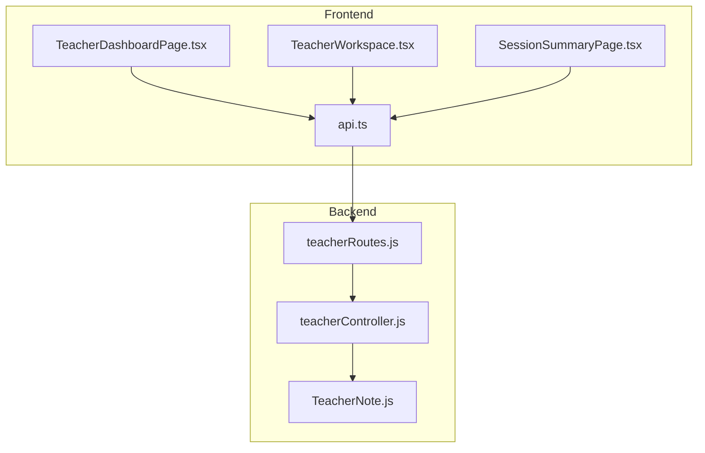
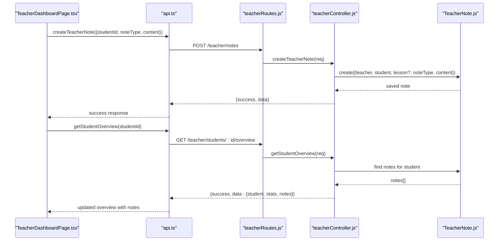
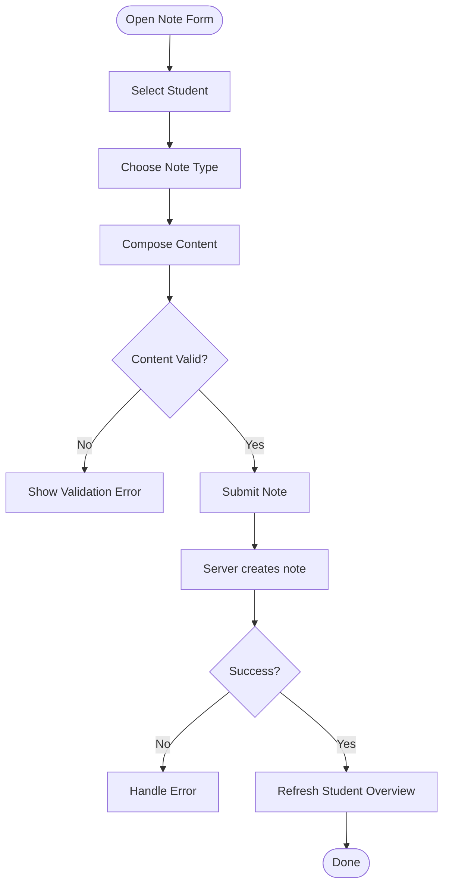
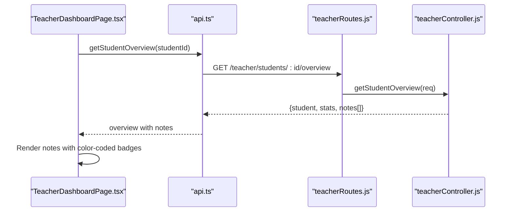
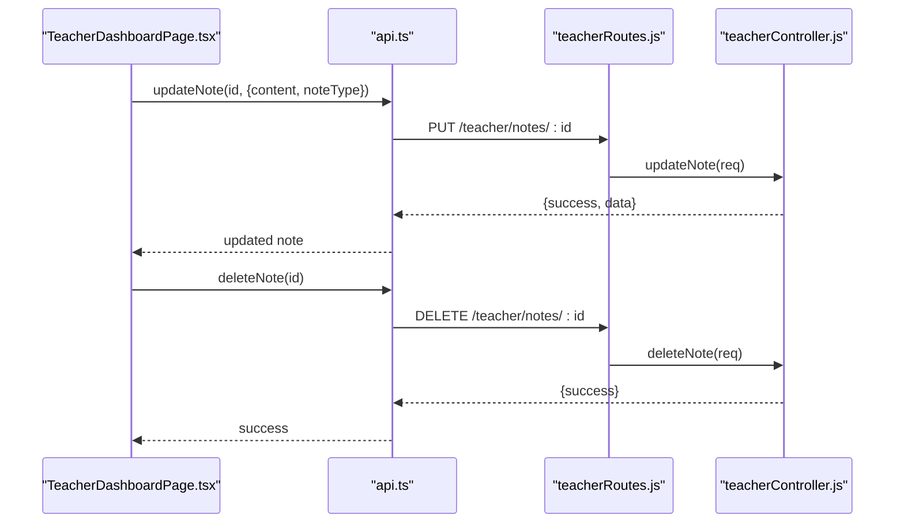
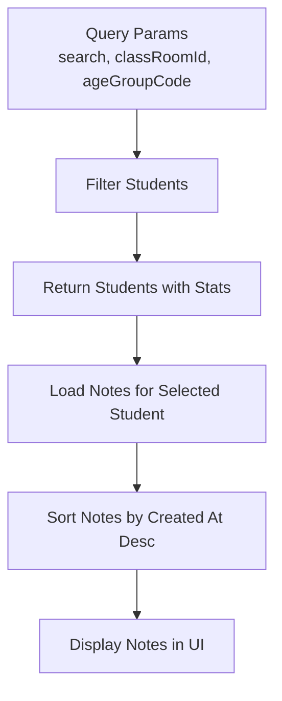
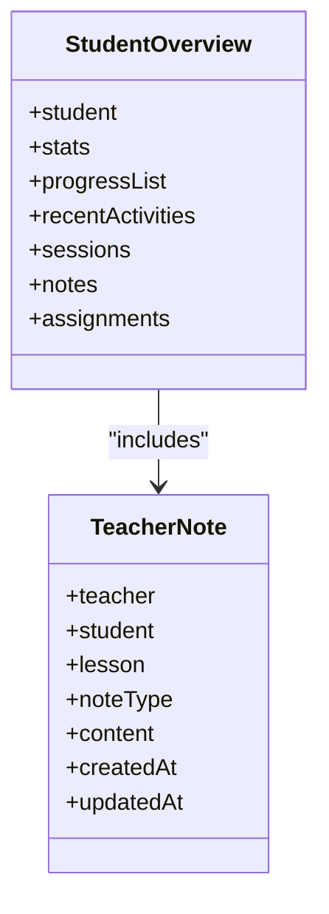
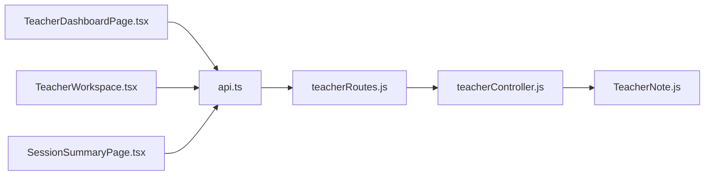

# Pedagogical Notes System

<cite>
**Referenced Files in This Document**
- [TeacherNote.js](file://KCEnglishKids_BE/src/models/TeacherNote.js)
- [teacherController.js](file://KCEnglishKids_BE/src/controllers/teacherController.js)
- [teacherRoutes.js](file://KCEnglishKids_BE/src/routes/teacherRoutes.js)
- [api.ts](file://client/src/services/api.ts)
- [TeacherDashboardPage.tsx](file://client/src/dashboards/teacher/TeacherDashboardPage.tsx)
- [SessionSummaryPage.tsx](file://client/src/dashboards/teacher/SessionSummaryPage.tsx)
- [TeacherWorkspace.tsx](file://client/src/dashboards/teacher/TeacherWorkspace.tsx)
- [teachernotes.json](file://KCEnglishKids_BE/data_backup/teachernotes.json)
</cite>

## Table of Contents
1. [Introduction](#introduction)
2. [Project Structure](#project-structure)
3. [Core Components](#core-components)
4. [Architecture Overview](#architecture-overview)
5. [Detailed Component Analysis](#detailed-component-analysis)
6. [Dependency Analysis](#dependency-analysis)
7. [Performance Considerations](#performance-considerations)
8. [Troubleshooting Guide](#troubleshooting-guide)
9. [Conclusion](#conclusion)
10. [Appendices](#appendices)

## Introduction
This document explains the Pedagogical Notes System that enables teachers to record, manage, and review observations about individual students. It covers the note creation interface (student selection, categorization, content composition), the note type system with color-coded categories, search and filtering capabilities, integration with student profiles, persistence and real-time updates, editing and deletion workflows, bulk operations, export considerations, accessibility guidelines, data validation, and technical implementation details for storage and synchronization.

## Project Structure
The Pedagogical Notes feature spans backend models, controllers, routes, and frontend pages:
- Backend model defines the note schema and allowed types.
- Controller implements CRUD endpoints and integrates notes with student overviews.
- Routes expose protected endpoints for note management.
- Frontend API client exposes typed methods for creating, updating, deleting, and fetching notes.
- Teacher dashboard and workspace UIs provide note entry, display, and refresh behavior.

**Diagram sources**
- [TeacherDashboardPage.tsx:278-307](file://client/src/dashboards/teacher/TeacherDashboardPage.tsx#L278-L307)
- [TeacherWorkspace.tsx:38-38](file://client/src/dashboards/teacher/TeacherWorkspace.tsx#L38-L38)
- [SessionSummaryPage.tsx:324-418](file://client/src/dashboards/teacher/SessionSummaryPage.tsx#L324-L418)
- [api.ts:192-239](file://client/src/services/api.ts#L192-L239)
- [teacherRoutes.js:29-37](file://KCEnglishKids_BE/src/routes/teacherRoutes.js#L29-L37)
- [teacherController.js:54-77](file://KCEnglishKids_BE/src/controllers/teacherController.js#L54-L77)
- [TeacherNote.js:1-34](file://KCEnglishKids_BE/src/models/TeacherNote.js#L1-L34)

**Section sources**
- [TeacherNote.js:1-34](file://KCEnglishKids_BE/src/models/TeacherNote.js#L1-L34)
- [teacherController.js:54-77](file://KCEnglishKids_BE/src/controllers/teacherController.js#L54-L77)
- [teacherRoutes.js:29-37](file://KCEnglishKids_BE/src/routes/teacherRoutes.js#L29-L37)
- [api.ts:192-239](file://client/src/services/api.ts#L192-L239)
- [TeacherDashboardPage.tsx:278-307](file://client/src/dashboards/teacher/TeacherDashboardPage.tsx#L278-L307)
- [TeacherWorkspace.tsx:38-38](file://client/src/dashboards/teacher/TeacherWorkspace.tsx#L38-L38)
- [SessionSummaryPage.tsx:324-418](file://client/src/dashboards/teacher/SessionSummaryPage.tsx#L324-L418)

## Core Components
- Note Model: Defines fields teacher, student, lesson, noteType, content, and timestamps. The noteType enum includes INTEREST, VOCABULARY, PARTICIPATION, LISTENING, SPEAKING, STRENGTH, DIFFICULTY, REINFORCEMENT, GENERAL.
- Controller Endpoints: Create, read, update, delete notes; fetch student overview including notes; enforce ownership and access control.
- Routes: Protected by role-based middleware; expose GET/POST/PUT/DELETE for notes and student-related endpoints.
- Frontend API Client: Provides methods for note lifecycle and student overview retrieval.
- UI Pages: Dashboard note creation form, student detail view with notes list, session summary note capture.

Key responsibilities:
- Data validation at both controller and model layers.
- Access control ensuring teachers can only manage their own notes and students they are authorized to view.
- Integration of notes into student overview for real-time visibility.

**Section sources**
- [TeacherNote.js:1-34](file://KCEnglishKids_BE/src/models/TeacherNote.js#L1-L34)
- [teacherController.js:54-77](file://KCEnglishKids_BE/src/controllers/teacherController.js#L54-L77)
- [teacherRoutes.js:29-37](file://KCEnglishKids_BE/src/routes/teacherRoutes.js#L29-L37)
- [api.ts:192-239](file://client/src/services/api.ts#L192-L239)

## Architecture Overview
The Pedagogical Notes System follows a standard MVC-like pattern with React frontend calling Express routes backed by Mongoose models.

**Diagram sources**
- [TeacherDashboardPage.tsx:278-307](file://client/src/dashboards/teacher/TeacherDashboardPage.tsx#L278-L307)
- [api.ts:204-206](file://client/src/services/api.ts#L204-L206)
- [teacherRoutes.js:33-37](file://KCEnglishKids_BE/src/routes/teacherRoutes.js#L33-L37)
- [teacherController.js:54-77](file://KCEnglishKids_BE/src/controllers/teacherController.js#L54-L77)
- [TeacherNote.js:1-34](file://KCEnglishKids_BE/src/models/TeacherNote.js#L1-L34)

## Detailed Component Analysis

### Note Model and Type System
- Fields:
  - teacher: reference to User (author).
  - student: reference to User (subject).
  - lesson: optional reference to Lesson.
  - noteType: string enum with default GENERAL.
  - content: required trimmed text.
  - timestamps: createdAt, updatedAt.
- Allowed note types include INTEREST, VOCABULARY, PARTICIPATION, LISTENING, SPEAKING, STRENGTH, DIFFICULTY, REINFORCEMENT, GENERAL.
- Validation:
  - Required fields enforced at model level.
  - Content is trimmed and must be non-empty.

Color-coded categories in the UI:
- INTEREST: amber tones.
- VOCABULARY: emerald tones.
- PARTICIPATION: blue tones.
- REINFORCEMENT: rose tones.
- GENERAL: slate tones.

These labels and colors are defined in the teacher dashboard page and used when rendering notes.

**Section sources**
- [TeacherNote.js:1-34](file://KCEnglishKids_BE/src/models/TeacherNote.js#L1-L34)
- [TeacherDashboardPage.tsx:30-36](file://client/src/dashboards/teacher/TeacherDashboardPage.tsx#L30-L36)

### Note Creation Interface
- Student Selection:
  - Teachers select a student before creating a note.
  - The student ID is validated server-side against the current teacher’s accessible students.
- Note Categorization:
  - A dropdown provides note types; defaults to GENERAL if not specified.
- Content Composition:
  - A textarea captures free-form observation text.
  - Client-side validation ensures non-empty content.
- Submission Flow:
  - On submit, the frontend calls the API to create the note.
  - On success, the form resets and the student overview refreshes to show the new note.

**Diagram sources**
- [TeacherDashboardPage.tsx:278-307](file://client/src/dashboards/teacher/TeacherDashboardPage.tsx#L278-L307)
- [api.ts:204-206](file://client/src/services/api.ts#L204-L206)
- [teacherController.js:74-74](file://KCEnglishKids_BE/src/controllers/teacherController.js#L74-L74)

**Section sources**
- [TeacherDashboardPage.tsx:278-307](file://client/src/dashboards/teacher/TeacherDashboardPage.tsx#L278-L307)
- [api.ts:204-206](file://client/src/services/api.ts#L204-L206)
- [teacherController.js:74-74](file://KCEnglishKids_BE/src/controllers/teacherController.js#L74-L74)

### Reading Notes and Real-Time Updates
- Student Overview:
  - Fetching a student overview returns progress, recent activities, sessions, assignments, and notes.
  - Notes are sorted by most recent first and populated with teacher and lesson metadata.
- Real-Time Behavior:
  - After creating a note, the dashboard triggers a refresh of the student overview to reflect the new note immediately.
- Display:
  - Notes are rendered with category labels and colors.
  - The count of saved notes is shown in the student detail section.

**Diagram sources**
- [TeacherDashboardPage.tsx:207-219](file://client/src/dashboards/teacher/TeacherDashboardPage.tsx#L207-L219)
- [api.ts:202-202](file://client/src/services/api.ts#L202-L202)
- [teacherRoutes.js:29-31](file://KCEnglishKids_BE/src/routes/teacherRoutes.js#L29-L31)
- [teacherController.js:54-56](file://KCEnglishKids_BE/src/controllers/teacherController.js#L54-L56)

**Section sources**
- [teacherController.js:54-56](file://KCEnglishKids_BE/src/controllers/teacherController.js#L54-L56)
- [TeacherDashboardPage.tsx:207-219](file://client/src/dashboards/teacher/TeacherDashboardPage.tsx#L207-L219)
- [TeacherDashboardPage.tsx:1115-1125](file://client/src/dashboards/teacher/TeacherDashboardPage.tsx#L1115-L1125)

### Editing and Deleting Notes
- Edit:
  - PUT /teacher/notes/:id allows updating content and noteType.
  - Ownership check ensures only the author can edit.
- Delete:
  - DELETE /teacher/notes/:id removes the note.
  - Ownership check ensures only the author can delete.
- UI:
  - The teacher workspace shows a simple note input and displays existing notes.
  - The dashboard supports refreshing after edits/deletes to keep views consistent.

**Diagram sources**
- [api.ts:237-238](file://client/src/services/api.ts#L237-L238)
- [teacherRoutes.js:36-37](file://KCEnglishKids_BE/src/routes/teacherRoutes.js#L36-L37)
- [teacherController.js:76-77](file://KCEnglishKids_BE/src/controllers/teacherController.js#L76-L77)

**Section sources**
- [teacherController.js:76-77](file://KCEnglishKids_BE/src/controllers/teacherController.js#L76-L77)
- [teacherRoutes.js:36-37](file://KCEnglishKids_BE/src/routes/teacherRoutes.js#L36-L37)
- [api.ts:237-238](file://client/src/services/api.ts#L237-L238)

### Search and Filtering Capabilities
- Student Search:
  - The students endpoint supports query parameters for name or username search.
- Class-Level Filtering:
  - Students can be filtered by classRoomId and ageGroupCode.
- Notes Retrieval:
  - Notes are returned per student and sorted by creation date descending.
- UI Usage:
  - The dashboard uses these filters to present relevant students and their notes.

**Diagram sources**
- [teacherController.js:50-52](file://KCEnglishKids_BE/src/controllers/teacherController.js#L50-L52)
- [teacherController.js:75-75](file://KCEnglishKids_BE/src/controllers/teacherController.js#L75-L75)

**Section sources**
- [teacherController.js:50-52](file://KCEnglishKids_BE/src/controllers/teacherController.js#L50-L52)
- [teacherController.js:75-75](file://KCEnglishKids_BE/src/controllers/teacherController.js#L75-L75)

### Integration with Student Profiles and Progress Tracking
- Student Overview Aggregation:
  - Combines progress records, recent activity results, learning sessions, assignments, and notes.
  - Computes aggregate metrics such as total stars, completed lessons, average score, attempts, and learning time.
- Notes Relationship:
  - Notes are stored independently but displayed alongside progress and activity history to provide context for teacher observations.
- Export Considerations:
  - While no dedicated export endpoint exists for notes, the overview payload includes notes which can be consumed by external tools or screens for sharing with parents or other educators.

**Diagram sources**
- [teacherController.js:54-56](file://KCEnglishKids_BE/src/controllers/teacherController.js#L54-L56)
- [TeacherNote.js:1-34](file://KCEnglishKids_BE/src/models/TeacherNote.js#L1-L34)

**Section sources**
- [teacherController.js:54-56](file://KCEnglishKids_BE/src/controllers/teacherController.js#L54-L56)
- [TeacherNote.js:1-34](file://KCEnglishKids_BE/src/models/TeacherNote.js#L1-L34)

### Bulk Operations and Export Capabilities
- Bulk Operations:
  - No explicit bulk endpoints for notes are exposed.
  - Teachers can perform multiple create/update/delete operations via repeated API calls from the frontend.
- Export:
  - There is no dedicated export endpoint for notes.
  - The student overview includes notes; clients can assemble and share this data externally if needed.

[No sources needed since this section summarizes available capabilities without analyzing specific files]

### Accessibility Guidelines for Note Management
- Keyboard Navigation:
  - Ensure all interactive elements (dropdowns, buttons, textareas) are reachable via keyboard.
- Labels and Descriptions:
  - Use descriptive labels for note type selectors and content areas.
- Focus Management:
  - After submitting a note, move focus to a confirmation message or the refreshed notes list.
- Color Contrast:
  - Category badges use distinct colors; ensure sufficient contrast for readability.
- Screen Readers:
  - Provide aria-labels for dynamic content like note counts and status messages.

[No sources needed since this section provides general guidance]

### Data Validation Rules
- Client-Side:
  - Non-empty content validation before submission.
- Server-Side:
  - Required fields: studentId, content.
  - Content trimming and non-empty check.
  - Student existence and authorization check.
  - Optional lessonId validation.
  - noteType defaults to GENERAL if omitted.

**Section sources**
- [TeacherDashboardPage.tsx:278-307](file://client/src/dashboards/teacher/TeacherDashboardPage.tsx#L278-L307)
- [teacherController.js:74-74](file://KCEnglishKids_BE/src/controllers/teacherController.js#L74-L74)
- [TeacherNote.js:19-28](file://KCEnglishKids_BE/src/models/TeacherNote.js#L19-L28)

## Dependency Analysis
The following diagram maps key dependencies between frontend components, API client, backend routes, controller, and model.

**Diagram sources**
- [TeacherDashboardPage.tsx:278-307](file://client/src/dashboards/teacher/TeacherDashboardPage.tsx#L278-L307)
- [TeacherWorkspace.tsx:38-38](file://client/src/dashboards/teacher/TeacherWorkspace.tsx#L38-L38)
- [SessionSummaryPage.tsx:324-418](file://client/src/dashboards/teacher/SessionSummaryPage.tsx#L324-L418)
- [api.ts:192-239](file://client/src/services/api.ts#L192-L239)
- [teacherRoutes.js:29-37](file://KCEnglishKids_BE/src/routes/teacherRoutes.js#L29-L37)
- [teacherController.js:54-77](file://KCEnglishKids_BE/src/controllers/teacherController.js#L54-L77)
- [TeacherNote.js:1-34](file://KCEnglishKids_BE/src/models/TeacherNote.js#L1-L34)

**Section sources**
- [api.ts:192-239](file://client/src/services/api.ts#L192-L239)
- [teacherRoutes.js:29-37](file://KCEnglishKids_BE/src/routes/teacherRoutes.js#L29-L37)
- [teacherController.js:54-77](file://KCEnglishKids_BE/src/controllers/teacherController.js#L54-L77)
- [TeacherNote.js:1-34](file://KCEnglishKids_BE/src/models/TeacherNote.js#L1-L34)

## Performance Considerations
- Pagination:
  - Notes are returned without pagination; consider adding limit/skip for large datasets.
- Indexing:
  - Database indexes on student and teacher fields would improve lookup performance.
- Caching:
  - Cache student overview responses briefly to reduce repeated aggregation costs.
- Batch Operations:
  - Introduce batch endpoints for bulk note updates/deletes to minimize round trips.

[No sources needed since this section provides general guidance]

## Troubleshooting Guide
Common issues and resolutions:
- Unauthorized Access:
  - Ensure the requesting user is a TEACHER or ADMIN and has access to the student.
- Missing Content:
  - Validate that content is provided and non-empty before submission.
- Invalid Student ID:
  - Confirm the student belongs to the teacher’s accessible set.
- Edit/Delete Conflicts:
  - Verify ownership of the note before attempting updates or deletions.
- Real-Time Sync:
  - After creating/editing/deleting notes, refresh the student overview to reflect changes.

**Section sources**
- [teacherController.js:74-77](file://KCEnglishKids_BE/src/controllers/teacherController.js#L74-L77)
- [TeacherDashboardPage.tsx:278-307](file://client/src/dashboards/teacher/TeacherDashboardPage.tsx#L278-L307)

## Conclusion
The Pedagogical Notes System provides a robust foundation for teachers to document and manage student observations. It integrates seamlessly with student profiles and progress tracking, offers clear categorization with color-coded types, and supports essential CRUD operations. While bulk operations and export features are not explicitly implemented, the design allows for extension. Future enhancements should include pagination, indexing, caching, and export endpoints to further streamline teacher workflows.

[No sources needed since this section summarizes without analyzing specific files]

## Appendices

### API Endpoints Summary
- GET /teacher/students/:studentId/notes
- POST /teacher/notes
- PUT /teacher/notes/:id
- DELETE /teacher/notes/:id

**Section sources**
- [teacherRoutes.js:33-37](file://KCEnglishKids_BE/src/routes/teacherRoutes.js#L33-L37)

### Sample Note Record
A sample persisted note demonstrates the structure and values used in production backups.

**Section sources**
- [teachernotes.json:1-13](file://KCEnglishKids_BE/data_backup/teachernotes.json#L1-L13)