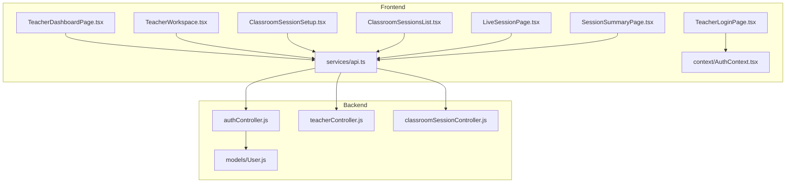
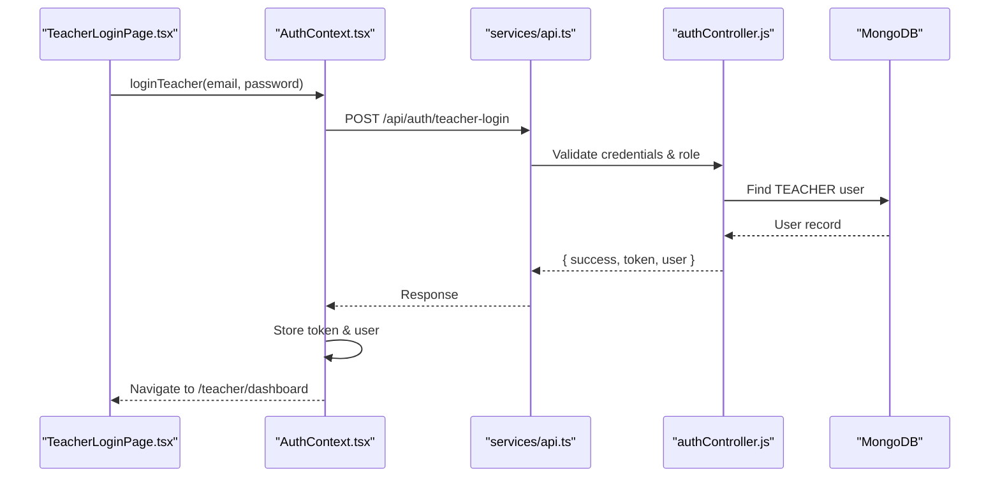
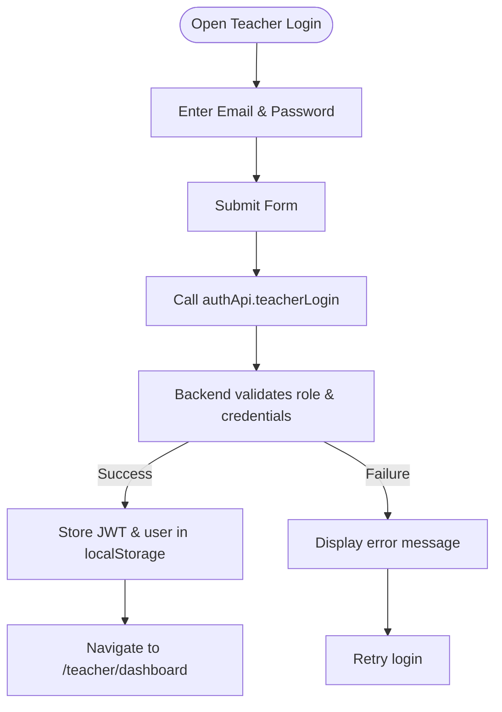
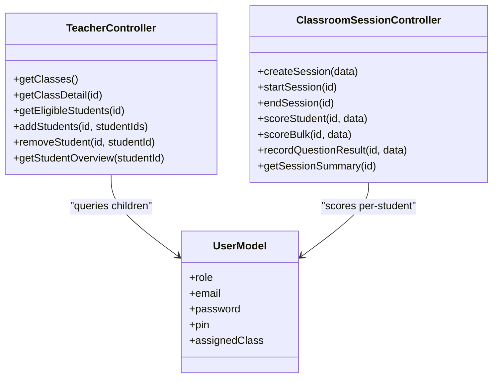
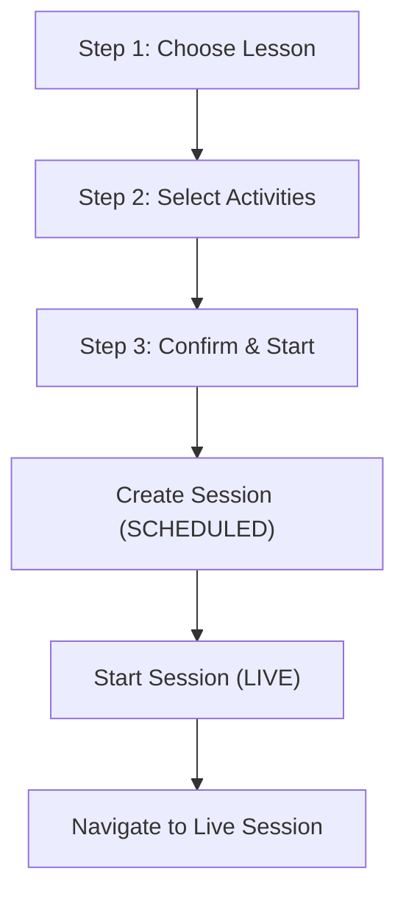
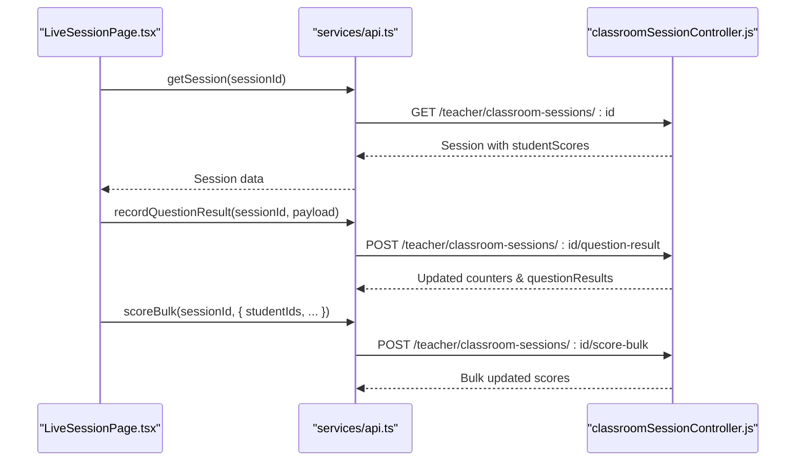
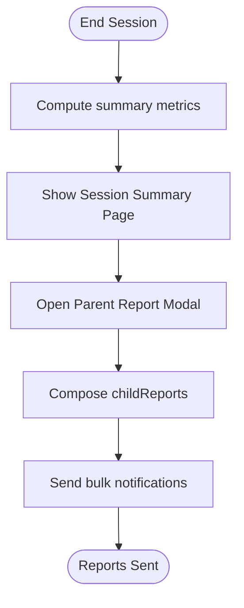
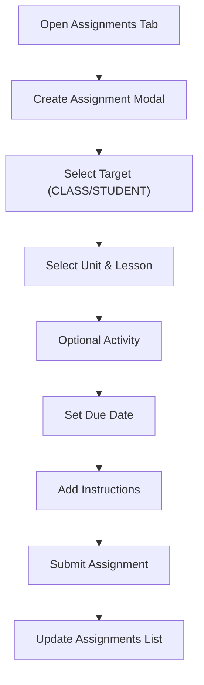
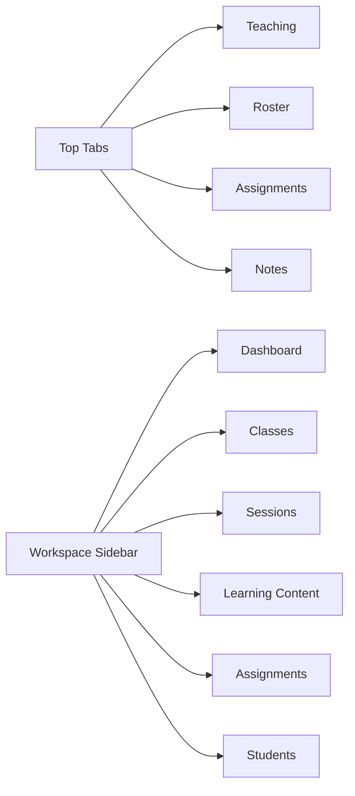
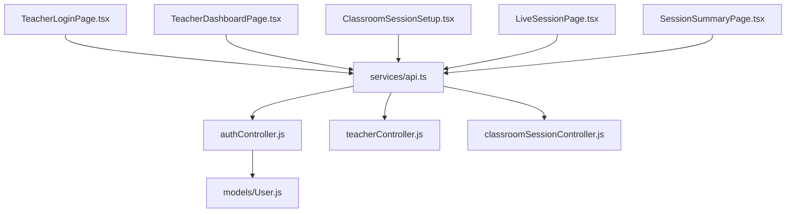

# Teacher Dashboard

<cite>
**Referenced Files in This Document**
- [TeacherDashboardPage.tsx](file://client/src/dashboards/teacher/TeacherDashboardPage.tsx)
- [TeacherWorkspace.tsx](file://client/src/dashboards/teacher/TeacherWorkspace.tsx)
- [LiveSessionPage.tsx](file://client/src/dashboards/teacher/LiveSessionPage.tsx)
- [SessionSummaryPage.tsx](file://client/src/dashboards/teacher/SessionSummaryPage.tsx)
- [ClassroomSessionsList.tsx](file://client/src/dashboards/teacher/ClassroomSessionsList.tsx)
- [ClassroomSessionSetup.tsx](file://client/src/dashboards/teacher/ClassroomSessionSetup.tsx)
- [TeacherLoginPage.tsx](file://client/src/dashboards/teacher/TeacherLoginPage.tsx)
- [api.ts](file://client/src/services/api.ts)
- [AuthContext.tsx](file://client/src/context/AuthContext.tsx)
- [authController.js](file://KCEnglishKids_BE/src/controllers/authController.js)
- [classroomSessionController.js](file://KCEnglishKids_BE/src/controllers/classroomSessionController.js)
- [teacherController.js](file://KCEnglishKids_BE/src/controllers/teacherController.js)
- [User.js](file://KCEnglishKids_BE/src/models/User.js)
</cite>

## Table of Contents
1. [Introduction](#introduction)
2. [Project Structure](#project-structure)
3. [Core Components](#core-components)
4. [Architecture Overview](#architecture-overview)
5. [Detailed Component Analysis](#detailed-component-analysis)
6. [Dependency Analysis](#dependency-analysis)
7. [Performance Considerations](#performance-considerations)
8. [Troubleshooting Guide](#troubleshooting-guide)
9. [Conclusion](#conclusion)

## Introduction
This document explains the Teacher Dashboard functionality for KCEnglishKids, focusing on classroom management, live session monitoring, scheduling, analytics, reporting, authentication and authorization, UI guidelines, real-time data synchronization, session state management, and performance optimization. The system provides teachers with tools to manage classes and students, plan and run interactive sessions, observe student participation in real time, track progress, and generate reports for parents.

## Project Structure
The teacher experience is implemented primarily in the client dashboard components and supported by backend controllers and models:
- Frontend teacher dashboards: pages for login, dashboard tabs (teaching content, roster, assignments, notes), classroom session setup, live session view, session summary, and a workspace layout.
- Backend controllers: authentication, teacher-specific endpoints (classes, students, assignments, curriculum options), and classroom session lifecycle operations.
- Models: user roles and credentials handling.

**Diagram sources**
- [TeacherLoginPage.tsx:1-134](file://client/src/dashboards/teacher/TeacherLoginPage.tsx#L1-L134)
- [TeacherDashboardPage.tsx:1-1383](file://client/src/dashboards/teacher/TeacherDashboardPage.tsx#L1-L1383)
- [TeacherWorkspace.tsx:1-39](file://client/src/dashboards/teacher/TeacherWorkspace.tsx#L1-L39)
- [ClassroomSessionSetup.tsx:1-353](file://client/src/dashboards/teacher/ClassroomSessionSetup.tsx#L1-L353)
- [ClassroomSessionsList.tsx:1-174](file://client/src/dashboards/teacher/ClassroomSessionsList.tsx#L1-L174)
- [LiveSessionPage.tsx:1-1469](file://client/src/dashboards/teacher/LiveSessionPage.tsx#L1-L1469)
- [SessionSummaryPage.tsx:1-458](file://client/src/dashboards/teacher/SessionSummaryPage.tsx#L1-L458)
- [api.ts:1-354](file://client/src/services/api.ts#L1-L354)
- [AuthContext.tsx:1-161](file://client/src/context/AuthContext.tsx#L1-L161)
- [authController.js:1-488](file://KCEnglishKids_BE/src/controllers/authController.js#L1-L488)
- [teacherController.js:1-79](file://KCEnglishKids_BE/src/controllers/teacherController.js#L1-L79)
- [classroomSessionController.js:1-460](file://KCEnglishKids_BE/src/controllers/classroomSessionController.js#L1-L460)
- [User.js:1-109](file://KCEnglishKids_BE/src/models/User.js#L1-L109)

**Section sources**
- [TeacherDashboardPage.tsx:1-1383](file://client/src/dashboards/teacher/TeacherDashboardPage.tsx#L1-L1383)
- [TeacherWorkspace.tsx:1-39](file://client/src/dashboards/teacher/TeacherWorkspace.tsx#L1-L39)
- [api.ts:1-354](file://client/src/services/api.ts#L1-L354)
- [AuthContext.tsx:1-161](file://client/src/context/AuthContext.tsx#L1-L161)
- [authController.js:1-488](file://KCEnglishKids_BE/src/controllers/authController.js#L1-L488)
- [teacherController.js:1-79](file://KCEnglishKids_BE/src/controllers/teacherController.js#L1-L79)
- [classroomSessionController.js:1-460](file://KCEnglishKids_BE/src/controllers/classroomSessionController.js#L1-L460)
- [User.js:1-109](file://KCEnglishKids_BE/src/models/User.js#L1-L109)

## Core Components
- Teacher Login and Authentication: Secure entry point using email/password; token-based session via JWT.
- Classroom Management: View assigned classes, add/remove students, view class details and student stats.
- Lesson and Content Selection: Browse curriculum units, lessons, and activities; assign content to classes or individual students.
- Session Scheduling and Setup: Create sessions with lesson/activity selection, planned duration, and immediate start.
- Live Session Monitoring: Real-time observation of student responses, bulk scoring, random callouts, and interactive mini-games.
- Session Summary and Reporting: Post-session metrics, top performers, needs-practice list, and parent report generation.
- Analytics and Notes: Student overview with learning history, pedagogical notes, and assignment tracking.

**Section sources**
- [TeacherLoginPage.tsx:1-134](file://client/src/dashboards/teacher/TeacherLoginPage.tsx#L1-L134)
- [AuthContext.tsx:1-161](file://client/src/context/AuthContext.tsx#L1-L161)
- [teacherController.js:1-79](file://KCEnglishKids_BE/src/controllers/teacherController.js#L1-L79)
- [ClassroomSessionSetup.tsx:1-353](file://client/src/dashboards/teacher/ClassroomSessionSetup.tsx#L1-L353)
- [LiveSessionPage.tsx:1-1469](file://client/src/dashboards/teacher/LiveSessionPage.tsx#L1-L1469)
- [SessionSummaryPage.tsx:1-458](file://client/src/dashboards/teacher/SessionSummaryPage.tsx#L1-L458)

## Architecture Overview
The teacher dashboard follows a layered architecture:
- Presentation layer: React components for teacher workflows (login, dashboard tabs, session setup, live monitoring, summary).
- Service layer: Centralized API clients for REST calls (auth, teacher, classroom sessions, parent notifications).
- Business logic layer: Express controllers enforcing role-based access, validation, and domain rules.
- Data layer: MongoDB via Mongoose models (User, ClassRoom, ClassroomSession, etc.).

**Diagram sources**
- [TeacherLoginPage.tsx:1-134](file://client/src/dashboards/teacher/TeacherLoginPage.tsx#L1-L134)
- [AuthContext.tsx:1-161](file://client/src/context/AuthContext.tsx#L1-L161)
- [api.ts:63-94](file://client/src/services/api.ts#L63-L94)
- [authController.js:214-266](file://KCEnglishKids_BE/src/controllers/authController.js#L214-L266)

## Detailed Component Analysis

### Teacher Authentication Flow
- The Teacher Login page collects email and password, triggers loginTeacher via AuthContext, which posts to the backend teacher-login endpoint.
- On success, the frontend stores JWT and user profile, then navigates to the teacher dashboard.
- Role checks ensure only TEACHER or ADMIN can access protected routes.

**Diagram sources**
- [TeacherLoginPage.tsx:17-31](file://client/src/dashboards/teacher/TeacherLoginPage.tsx#L17-L31)
- [AuthContext.tsx:114-121](file://client/src/context/AuthContext.tsx#L114-L121)
- [api.ts:85-88](file://client/src/services/api.ts#L85-L88)
- [authController.js:214-266](file://KCEnglishKids_BE/src/controllers/authController.js#L214-L266)

**Section sources**
- [TeacherLoginPage.tsx:1-134](file://client/src/dashboards/teacher/TeacherLoginPage.tsx#L1-L134)
- [AuthContext.tsx:1-161](file://client/src/context/AuthContext.tsx#L1-L161)
- [api.ts:63-94](file://client/src/services/api.ts#L63-L94)
- [authController.js:214-266](file://KCEnglishKids_BE/src/controllers/authController.js#L214-L266)
- [User.js:1-109](file://KCEnglishKids_BE/src/models/User.js#L1-L109)

### Classroom Management Features
- Classes listing and detail views show enrolled students, age group, academic year, and quick actions to add/remove students.
- Eligible students can be filtered by age group and search terms; adding students updates both User and ClassRoom records.
- Student overview aggregates stars, completed lessons, activity counts, average score, and recent activities.

**Diagram sources**
- [teacherController.js:12-79](file://KCEnglishKids_BE/src/controllers/teacherController.js#L12-L79)
- [classroomSessionController.js:74-460](file://KCEnglishKids_BE/src/controllers/classroomSessionController.js#L74-L460)
- [User.js:1-109](file://KCEnglishKids_BE/src/models/User.js#L1-L109)

**Section sources**
- [TeacherDashboardPage.tsx:128-219](file://client/src/dashboards/teacher/TeacherDashboardPage.tsx#L128-L219)
- [TeacherWorkspace.tsx:21-36](file://client/src/dashboards/teacher/TeacherWorkspace.tsx#L21-L36)
- [teacherController.js:19-56](file://KCEnglishKids_BE/src/controllers/teacherController.js#L19-L56)

### Session Scheduling Interface
- Three-step setup flow: choose lesson, select activities, confirm and start session.
- Filters lessons by age group; pre-selects all activities for chosen lesson; allows custom title and planned duration.
- Creates session (SCHEDULED) and immediately starts it (LIVE), navigating to the live session page.

**Diagram sources**
- [ClassroomSessionSetup.tsx:13-83](file://client/src/dashboards/teacher/ClassroomSessionSetup.tsx#L13-L83)
- [classroomSessionController.js:74-136](file://KCEnglishKids_BE/src/controllers/classroomSessionController.js#L74-L136)

**Section sources**
- [ClassroomSessionSetup.tsx:1-353](file://client/src/dashboards/teacher/ClassroomSessionSetup.tsx#L1-L353)
- [classroomSessionController.js:74-136](file://KCEnglishKids_BE/src/controllers/classroomSessionController.js#L74-L136)

### Live Session Monitoring System
- Three main views: presentation (vocabulary flashcards), games (interactive mini-games), grid (student management).
- Real-time answer tracking per question, bulk awarding of stars/points, random callout spotlight, and multi-select mode for efficient grading.
- Session timer and soft warning when elapsed time exceeds planned duration.

**Diagram sources**
- [LiveSessionPage.tsx:109-188](file://client/src/dashboards/teacher/LiveSessionPage.tsx#L109-L188)
- [api.ts:241-296](file://client/src/services/api.ts#L241-L296)
- [classroomSessionController.js:357-411](file://KCEnglishKids_BE/src/controllers/classroomSessionController.js#L357-L411)

**Section sources**
- [LiveSessionPage.tsx:1-1469](file://client/src/dashboards/teacher/LiveSessionPage.tsx#L1-L1469)
- [api.ts:241-296](file://client/src/services/api.ts#L241-L296)
- [classroomSessionController.js:169-411](file://KCEnglishKids_BE/src/controllers/classroomSessionController.js#L169-L411)

### Student Performance Analytics and Reporting
- Session summary displays participation count, average accuracy, total stars, duration, top performers, and students needing practice.
- Parent report modal composes per-child reports including score, accuracy, stars, and optional teacher notes; sends bulk notifications.

**Diagram sources**
- [SessionSummaryPage.tsx:46-267](file://client/src/dashboards/teacher/SessionSummaryPage.tsx#L46-L267)
- [classroomSessionController.js:186-260](file://KCEnglishKids_BE/src/controllers/classroomSessionController.js#L186-L260)
- [api.ts:320-352](file://client/src/services/api.ts#L320-L352)

**Section sources**
- [SessionSummaryPage.tsx:1-458](file://client/src/dashboards/teacher/SessionSummaryPage.tsx#L1-L458)
- [classroomSessionController.js:186-260](file://KCEnglishKids_BE/src/controllers/classroomSessionController.js#L186-L260)
- [api.ts:320-352](file://client/src/services/api.ts#L320-L352)

### Assignments and Pedagogical Notes
- Assignment creation supports class-wide or individual targeting, lesson/activity selection, due date, and instructions.
- Status filtering and update/delete operations are available.
- Pedagogical notes allow qualitative observations categorized by type (interest, vocabulary mastery, participation, reinforcement, general).

**Diagram sources**
- [TeacherDashboardPage.tsx:221-307](file://client/src/dashboards/teacher/TeacherDashboardPage.tsx#L221-L307)
- [teacherController.js:66-78](file://KCEnglishKids_BE/src/controllers/teacherController.js#L66-L78)

**Section sources**
- [TeacherDashboardPage.tsx:818-1029](file://client/src/dashboards/teacher/TeacherDashboardPage.tsx#L818-L1029)
- [teacherController.js:66-78](file://KCEnglishKids_BE/src/controllers/teacherController.js#L66-L78)

### UI Guidelines and Navigation Patterns
- Top navigation tabs: Teaching (lesson presentation), Roster (class & students), Assignments, Notes.
- Responsive design uses Tailwind breakpoints for mobile-first layouts; large cards and grids adapt across screen sizes.
- Workspace layout includes sidebar navigation for Dashboard, Classes, Sessions, Learning Content, Assignments, Students.

**Diagram sources**
- [TeacherDashboardPage.tsx:318-421](file://client/src/dashboards/teacher/TeacherDashboardPage.tsx#L318-L421)
- [TeacherWorkspace.tsx:13-16](file://client/src/dashboards/teacher/TeacherWorkspace.tsx#L13-L16)

**Section sources**
- [TeacherDashboardPage.tsx:318-421](file://client/src/dashboards/teacher/TeacherDashboardPage.tsx#L318-L421)
- [TeacherWorkspace.tsx:13-16](file://client/src/dashboards/teacher/TeacherWorkspace.tsx#L13-L16)

## Dependency Analysis
Key dependencies between frontend components and backend services:
- Authentication depends on authController and User model.
- Teacher dashboard features depend on teacherController for classes, students, assignments, curriculum options.
- Live session features depend on classroomSessionController for session lifecycle, scoring, and summaries.

**Diagram sources**
- [TeacherLoginPage.tsx:1-134](file://client/src/dashboards/teacher/TeacherLoginPage.tsx#L1-L134)
- [TeacherDashboardPage.tsx:1-1383](file://client/src/dashboards/teacher/TeacherDashboardPage.tsx#L1-L1383)
- [ClassroomSessionSetup.tsx:1-353](file://client/src/dashboards/teacher/ClassroomSessionSetup.tsx#L1-L353)
- [LiveSessionPage.tsx:1-1469](file://client/src/dashboards/teacher/LiveSessionPage.tsx#L1-L1469)
- [SessionSummaryPage.tsx:1-458](file://client/src/dashboards/teacher/SessionSummaryPage.tsx#L1-L458)
- [api.ts:1-354](file://client/src/services/api.ts#L1-L354)
- [authController.js:1-488](file://KCEnglishKids_BE/src/controllers/authController.js#L1-L488)
- [teacherController.js:1-79](file://KCEnglishKids_BE/src/controllers/teacherController.js#L1-L79)
- [classroomSessionController.js:1-460](file://KCEnglishKids_BE/src/controllers/classroomSessionController.js#L1-L460)
- [User.js:1-109](file://KCEnglishKids_BE/src/models/User.js#L1-L109)

**Section sources**
- [api.ts:1-354](file://client/src/services/api.ts#L1-L354)
- [authController.js:1-488](file://KCEnglishKids_BE/src/controllers/authController.js#L1-L488)
- [teacherController.js:1-79](file://KCEnglishKids_BE/src/controllers/teacherController.js#L1-L79)
- [classroomSessionController.js:1-460](file://KCEnglishKids_BE/src/controllers/classroomSessionController.js#L1-L460)
- [User.js:1-109](file://KCEnglishKids_BE/src/models/User.js#L1-L109)

## Performance Considerations
- Minimize re-renders in live session by batching state updates and using local answer maps before persisting.
- Use debounced polling or WebSocket upgrades if real-time updates become necessary beyond current request/response flows.
- Optimize image loading for vocabulary flashcards with lazy loading and appropriate sizing.
- Limit data payloads by selecting only required fields in backend queries (e.g., populate specific fields for lesson vocabulary).
- Avoid unnecessary network calls by caching curriculum options and class details where appropriate.

[No sources needed since this section provides general guidance]

## Troubleshooting Guide
- Authentication failures: Verify email/password and role; check JWT storage and token validity.
- Access denied errors: Ensure teacher owns the classroom/session; verify role checks in controllers.
- Session not found: Confirm sessionId exists and belongs to the logged-in teacher or admin.
- Scoring issues: Check that session status is not COMPLETED and student IDs are valid.
- Parent notification failures: Validate childReports structure and templateType.

**Section sources**
- [authController.js:214-266](file://KCEnglishKids_BE/src/controllers/authController.js#L214-L266)
- [classroomSessionController.js:18-36](file://KCEnglishKids_BE/src/controllers/classroomSessionController.js#L18-L36)
- [classroomSessionController.js:169-260](file://KCEnglishKids_BE/src/controllers/classroomSessionController.js#L169-L260)
- [SessionSummaryPage.tsx:316-458](file://client/src/dashboards/teacher/SessionSummaryPage.tsx#L316-L458)

## Conclusion
The Teacher Dashboard provides a comprehensive set of tools for managing classrooms, planning and running interactive sessions, observing student participation in real time, and generating actionable reports. Its modular architecture separates concerns across frontend components, service APIs, and backend controllers, ensuring clear responsibilities and maintainability. With responsive UI patterns and robust session state management, the system supports effective teaching workflows for early childhood English learning.