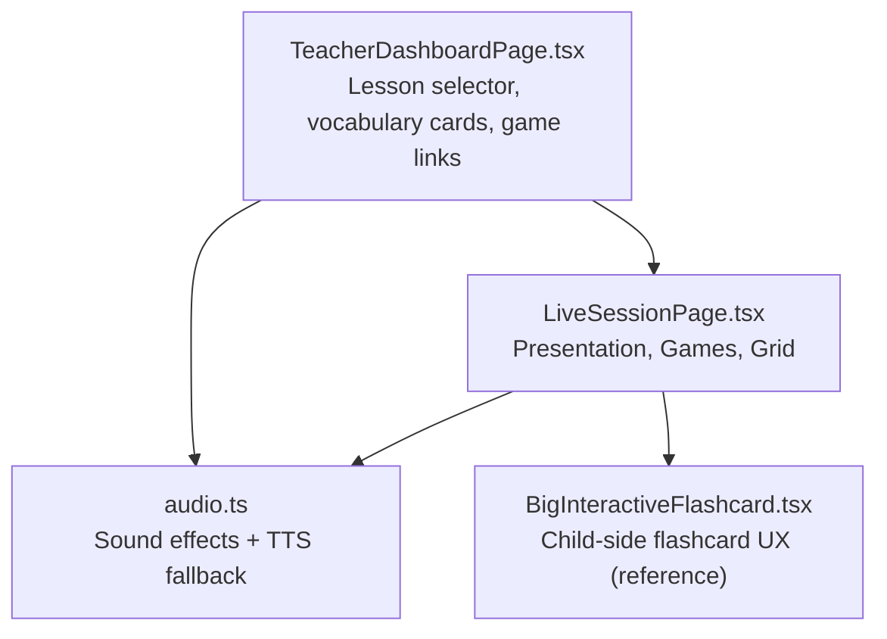
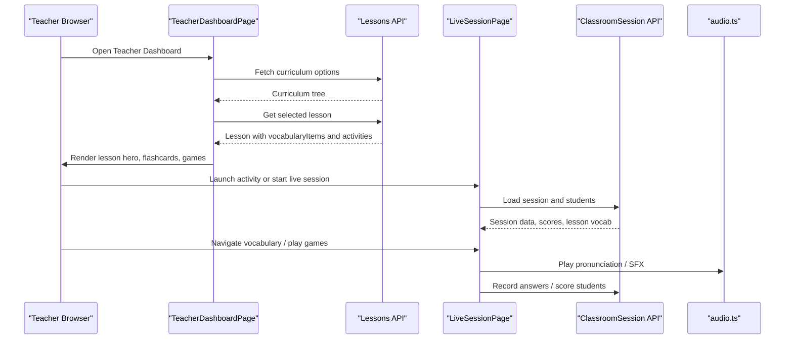
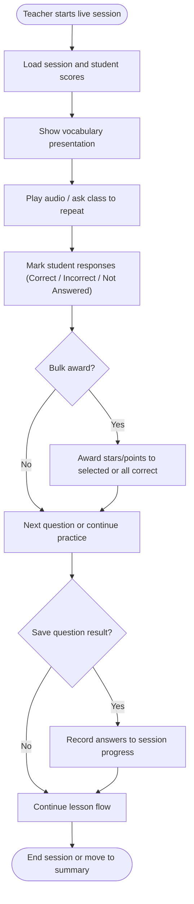
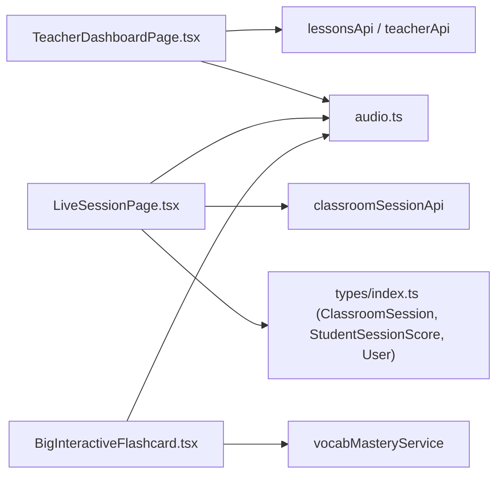

# Teaching Presentation Mode

<cite>
**Referenced Files in This Document**
- [README.md](file://README.md)
- [TeacherDashboardPage.tsx](file://client/src/dashboards/teacher/TeacherDashboardPage.tsx)
- [LiveSessionPage.tsx](file://client/src/dashboards/teacher/LiveSessionPage.tsx)
- [BigInteractiveFlashcard.tsx](file://client/src/components/child/BigInteractiveFlashcard.tsx)
- [audio.ts](file://client/src/utils/audio.ts)
</cite>

## Table of Contents
1. [Introduction](#introduction)
2. [Project Structure](#project-structure)
3. [Core Components](#core-components)
4. [Architecture Overview](#architecture-overview)
5. [Detailed Component Analysis](#detailed-component-analysis)
6. [Dependency Analysis](#dependency-analysis)
7. [Performance Considerations](#performance-considerations)
8. [Troubleshooting Guide](#troubleshooting-guide)
9. [Conclusion](#conclusion)

## Introduction
This document explains the Teaching Presentation Mode used by teachers to run whole-class English vocabulary lessons for preschool learners. It covers:
- Lesson selection and curriculum navigation from the teacher dashboard
- The classroom presentation layout optimized for projectors and large displays
- The vocabulary flashcard system with large visuals, pronunciation audio, example sentences, and bilingual English-Vietnamese support
- Integration with interactive mini-games launched directly from the presentation interface
- Audio system integration for text-to-speech pronunciation, sound effects, and feedback
- Responsive design, projection compatibility, and accessibility considerations
- Technical implementation details including media loading, real-time interaction, and scoring flows

The feature is part of an interactive English learning platform designed for children aged 3–6, combining a structured curriculum foundation with engaging application experiences.

**Section sources**
- [README.md:1-48](file://README.md#L1-L48)

## Project Structure
The Teaching Presentation Mode spans two main teacher-facing interfaces:
- Teacher Dashboard: lesson selection, vocabulary preview, and activity launch
- Live Classroom Session: full-screen presentation, games, and live student management

**Diagram sources**
- [TeacherDashboardPage.tsx:429-676](file://client/src/dashboards/teacher/TeacherDashboardPage.tsx#L429-L676)
- [LiveSessionPage.tsx:447-885](file://client/src/dashboards/teacher/LiveSessionPage.tsx#L447-L885)
- [audio.ts:1-360](file://client/src/utils/audio.ts#L1-L360)
- [BigInteractiveFlashcard.tsx:1-628](file://client/src/components/child/BigInteractiveFlashcard.tsx#L1-L628)

**Section sources**
- [README.md:95-138](file://README.md#L95-L138)

## Core Components
- Teacher Dashboard Teaching Tab
  - Displays “Classroom Presentation Mode” header and lesson selector
  - Loads curriculum tree and selects a default lesson
  - Shows lesson hero banner with unit/topic/title and big question
  - Renders vocabulary cards with image, English word, pronunciation hint, Vietnamese translation, example sentence, and audio button
  - Lists activities as mini-games that open in new tabs for class play

- Live Classroom Session Page
  - Three view modes: Vocabulary Presentation, Classroom Mini-Games, Student Grid
  - Giant flashcard display with navigation, pronunciation button, vocabulary carousel, and quick grading panel
  - Game board with Listen & Choose, True or False, and Animal Sound modes
  - Real-time answer tracking, bulk awarding, and session controls

- Audio System
  - SoundEffectsEngine provides synthesized sound effects (pop, correct, gentle wrong, fanfare, badge chime)
  - playWordAudio plays remote audio when available, falls back to SpeechSynthesis with child-friendly rate/pitch
  - stopWordAudio ensures no overlapping speech or audio playback

- Big Interactive Flashcard (Child UI reference)
  - Demonstrates flip/swipe interactions, bilingual sides, mastery/review states, and audio integration
  - Useful reference for consistent visual language and audio behavior across child and teacher modes

**Section sources**
- [TeacherDashboardPage.tsx:429-676](file://client/src/dashboards/teacher/TeacherDashboardPage.tsx#L429-L676)
- [LiveSessionPage.tsx:447-885](file://client/src/dashboards/teacher/LiveSessionPage.tsx#L447-L885)
- [audio.ts:1-360](file://client/src/utils/audio.ts#L1-L360)
- [BigInteractiveFlashcard.tsx:1-628](file://client/src/components/child/BigInteractiveFlashcard.tsx#L1-L628)

## Architecture Overview
The presentation mode integrates curriculum data, vocabulary assets, and audio into a responsive teacher interface.

**Diagram sources**
- [TeacherDashboardPage.tsx:100-171](file://client/src/dashboards/teacher/TeacherDashboardPage.tsx#L100-L171)
- [LiveSessionPage.tsx:109-126](file://client/src/dashboards/teacher/LiveSessionPage.tsx#L109-L126)
- [audio.ts:217-318](file://client/src/utils/audio.ts#L217-L318)

## Detailed Component Analysis

### Lesson Selection and Curriculum Navigation
- The teaching tab loads the curriculum tree and auto-selects a relevant lesson (e.g., pet/animal theme).
- Teachers can switch lessons via a grouped dropdown organized by Unit and Lesson.
- Once loaded, the lesson hero shows unit number, topic name, lesson title, optional Vietnamese title, and big question.
- A “Assign this lesson” action opens the assignment modal pre-filled with the current lesson.

Key behaviors:
- Default lesson detection by scanning titles for keywords like “pet” or “animal”.
- Fallback to first available lesson if no keyword match.
- Loading state and error handling for missing lesson content.

**Section sources**
- [TeacherDashboardPage.tsx:100-171](file://client/src/dashboards/teacher/TeacherDashboardPage.tsx#L100-L171)
- [TeacherDashboardPage.tsx:487-533](file://client/src/dashboards/teacher/TeacherDashboardPage.tsx#L487-L533)

### Classroom Presentation Layout
- The presentation area uses a dark high-contrast background suitable for projectors.
- Left column (large): giant flashcard with image frame, English word, Vietnamese meaning, pronunciation hint, and speaker button.
- Right column (compact): quick grading panel with whole-class awards and per-student actions.
- Bottom carousel allows quick navigation between vocabulary items.

Responsive considerations:
- On small screens, the layout stacks vertically; on larger screens, it uses a 12-column grid.
- Typography scales up for readability at distance.
- High-contrast colors and large touch targets improve usability in classroom environments.

**Section sources**
- [LiveSessionPage.tsx:447-566](file://client/src/dashboards/teacher/LiveSessionPage.tsx#L447-L566)

### Vocabulary Flashcard System
- Each card includes:
  - Large image placeholder or illustration
  - English word displayed prominently
  - Optional phonetic pronunciation hint
  - Vietnamese translation
  - Example sentence with optional Vietnamese translation
  - Audio button to play pronunciation

Interaction model:
- Clicking the speaker triggers pronunciation via audio.ts.
- In the teacher dashboard, each card has a dedicated audio button with loading state.
- In the live session, the giant card has a floating speaker button and a “whole class read aloud” prompt.

Bilingual support:
- English and Vietnamese fields are rendered consistently.
- Example sentences may include both languages.

**Section sources**
- [TeacherDashboardPage.tsx:556-617](file://client/src/dashboards/teacher/TeacherDashboardPage.tsx#L556-L617)
- [LiveSessionPage.tsx:483-520](file://client/src/dashboards/teacher/LiveSessionPage.tsx#L483-L520)

### Interactive Mini-Games Integration
From the teacher dashboard, activities are listed as mini-games with type labels and question counts. Clicking an activity opens the game in a new tab.

In the live session, three built-in game modes use the same vocabulary pool:
- Listen & Choose: play audio, choose correct image among four options
- True or False: show image and ask whether it matches the word
- Animal Sound: playful animal sounds prompt with audio cue

Real-time interaction:
- Teachers mark student responses as correct or reset them.
- Bulk awarding gives stars and points to all correct students or the entire class.
- Question results can be saved to the session progress.

**Section sources**
- [TeacherDashboardPage.tsx:620-675](file://client/src/dashboards/teacher/TeacherDashboardPage.tsx#L620-L675)
- [LiveSessionPage.tsx:660-885](file://client/src/dashboards/teacher/LiveSessionPage.tsx#L660-L885)

### Audio System Integration
The audio system combines synthesized sound effects and text-to-speech fallback:
- SoundEffectsEngine creates short tones for clicks, correct answers, gentle wrong feedback, celebration fanfares, and badge chimes.
- playWordAudio:
  - Stops any currently playing audio/speech immediately
  - Plays remote audio if provided and valid
  - Falls back to SpeechSynthesis with child-friendly rate and pitch
  - Uses safety timers to avoid hanging audio
- stopWordAudio cancels ongoing speech and resets audio state

Accessibility and inclusivity:
- Clear auditory feedback supports early readers and non-readers.
- Fallback ensures pronunciation works even without external audio files.
- Volume and pacing are tuned for young learners.

**Section sources**
- [audio.ts:1-182](file://client/src/utils/audio.ts#L1-L182)
- [audio.ts:184-318](file://client/src/utils/audio.ts#L184-L318)
- [audio.ts:320-358](file://client/src/utils/audio.ts#L320-L358)

### Responsive Design and Projection Compatibility
- Dark backgrounds and high-contrast accents reduce glare and improve visibility on projectors.
- Large typography and spacing ensure legibility from the back of the classroom.
- Touch-friendly buttons and icons support tablet-based teacher control.
- Grid layouts adapt from single-column mobile to multi-column desktop.

Accessibility features:
- Large tap targets and clear visual states (selected, correct, incorrect)
- Color-coded feedback with icons for low-vision clarity
- Text alternatives for images and descriptive labels for audio controls

**Section sources**
- [LiveSessionPage.tsx:311-441](file://client/src/dashboards/teacher/LiveSessionPage.tsx#L311-L441)
- [LiveSessionPage.tsx:447-566](file://client/src/dashboards/teacher/LiveSessionPage.tsx#L447-L566)

### Real-Time Interaction and Scoring Flow

**Diagram sources**
- [LiveSessionPage.tsx:165-188](file://client/src/dashboards/teacher/LiveSessionPage.tsx#L165-L188)
- [LiveSessionPage.tsx:201-264](file://client/src/dashboards/teacher/LiveSessionPage.tsx#L201-L264)
- [LiveSessionPage.tsx:801-885](file://client/src/dashboards/teacher/LiveSessionPage.tsx#L801-L885)

**Section sources**
- [LiveSessionPage.tsx:165-188](file://client/src/dashboards/teacher/LiveSessionPage.tsx#L165-L188)
- [LiveSessionPage.tsx:201-264](file://client/src/dashboards/teacher/LiveSessionPage.tsx#L201-L264)
- [LiveSessionPage.tsx:801-885](file://client/src/dashboards/teacher/LiveSessionPage.tsx#L801-L885)

## Dependency Analysis

Coupling and cohesion:
- TeacherDashboardPage depends on API services for curriculum and lesson data, and on audio utilities for pronunciation.
- LiveSessionPage depends on session APIs for live data and on audio utilities for feedback.
- Both components share the audio module, ensuring consistent sound behavior.
- BigInteractiveFlashcard demonstrates similar patterns for child-side interactions and mastery tracking.

Potential circular dependencies:
- None observed; components import utilities and services but do not import each other directly.

External integrations:
- REST APIs for curriculum, lessons, and classroom sessions
- Web Audio API and SpeechSynthesis for audio
- Image URLs for vocabulary illustrations

**Diagram sources**
- [TeacherDashboardPage.tsx:24-26](file://client/src/dashboards/teacher/TeacherDashboardPage.tsx#L24-L26)
- [LiveSessionPage.tsx:26-28](file://client/src/dashboards/teacher/LiveSessionPage.tsx#L26-L28)
- [BigInteractiveFlashcard.tsx:11-14](file://client/src/components/child/BigInteractiveFlashcard.tsx#L11-L14)
- [audio.ts:1-360](file://client/src/utils/audio.ts#L1-L360)

**Section sources**
- [TeacherDashboardPage.tsx:24-26](file://client/src/dashboards/teacher/TeacherDashboardPage.tsx#L24-L26)
- [LiveSessionPage.tsx:26-28](file://client/src/dashboards/teacher/LiveSessionPage.tsx#L26-L28)
- [BigInteractiveFlashcard.tsx:11-14](file://client/src/components/child/BigInteractiveFlashcard.tsx#L11-L14)

## Performance Considerations
- Media loading optimization:
  - Images are displayed with object-fit and lazy loading where applicable.
  - Audio playback stops previous instances to prevent overlap and resource contention.
  - Safety timeouts prevent hanging audio requests.
- Rendering efficiency:
  - Grid layouts minimize reflows on responsive breakpoints.
  - State updates are localized to specific panels (presentation, games, grid).
- Real-time operations:
  - Bulk scoring reduces repeated API calls when possible.
  - Answer maps are updated incrementally to avoid full re-renders.

Recommendations:
- Preload frequently used vocabulary images during lesson load.
- Cache audio URLs and consider using a CDN for pronunciation files.
- Debounce rapid user interactions (e.g., multiple audio triggers) to avoid excessive synthesis calls.

[No sources needed since this section provides general guidance]

## Troubleshooting Guide
Common issues and resolutions:
- No audio playback:
  - Ensure user gesture has unlocked the audio context.
  - Check network connectivity for remote audio URLs.
  - Verify browser supports SpeechSynthesis as fallback.
- Missing vocabulary images:
  - Confirm imageUrl values are valid and accessible.
  - Use fallback placeholders when images fail to load.
- Session data not loading:
  - Validate sessionId and API availability.
  - Handle silent fetch errors gracefully and show loading indicators.
- Overlapping audio:
  - Use stopWordAudio before starting new pronunciation.
  - Rely on safety timers to cancel stalled audio.

Operational tips:
- Use the “Reset question” action to clear answer states.
- Use “Award whole class” for inclusive positive reinforcement.
- Monitor elapsed time and planned duration to manage lesson pacing.

**Section sources**
- [audio.ts:184-318](file://client/src/utils/audio.ts#L184-L318)
- [LiveSessionPage.tsx:109-126](file://client/src/dashboards/teacher/LiveSessionPage.tsx#L109-L126)
- [LiveSessionPage.tsx:801-885](file://client/src/dashboards/teacher/LiveSessionPage.tsx#L801-L885)

## Conclusion
The Teaching Presentation Mode provides a robust, classroom-ready interface for whole-class English instruction. It combines curriculum-aligned lesson selection, large and accessible vocabulary flashcards, integrated pronunciation audio, and interactive mini-games. The live session page adds real-time engagement tools, including response tracking and bulk scoring, while maintaining responsive design and projection-friendly visuals. The shared audio system ensures consistent feedback and reliable pronunciation across devices. Together, these components create an inclusive, engaging environment for preschool learners and practical tools for teachers.

[No sources needed since this section summarizes without analyzing specific files]