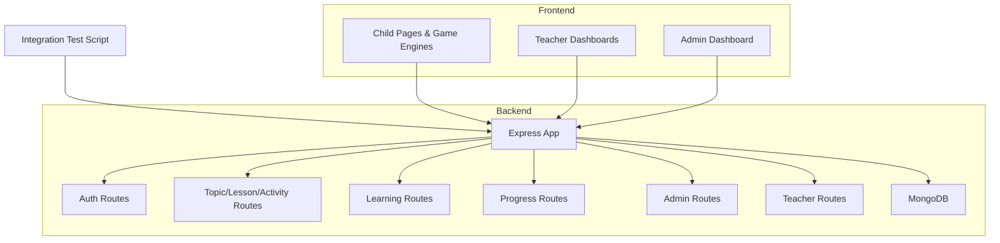
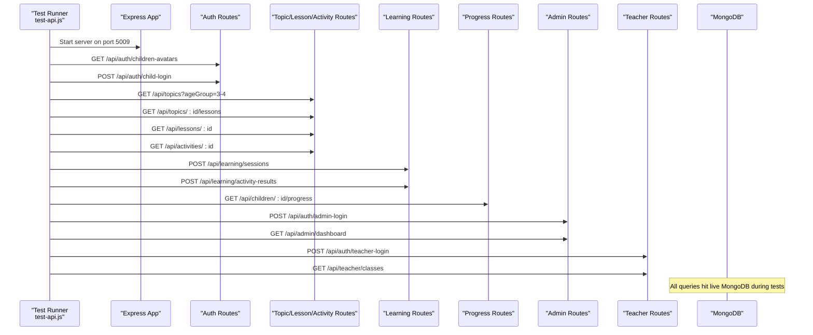
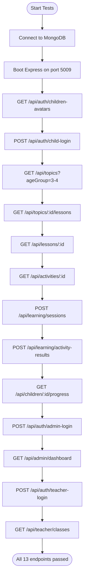
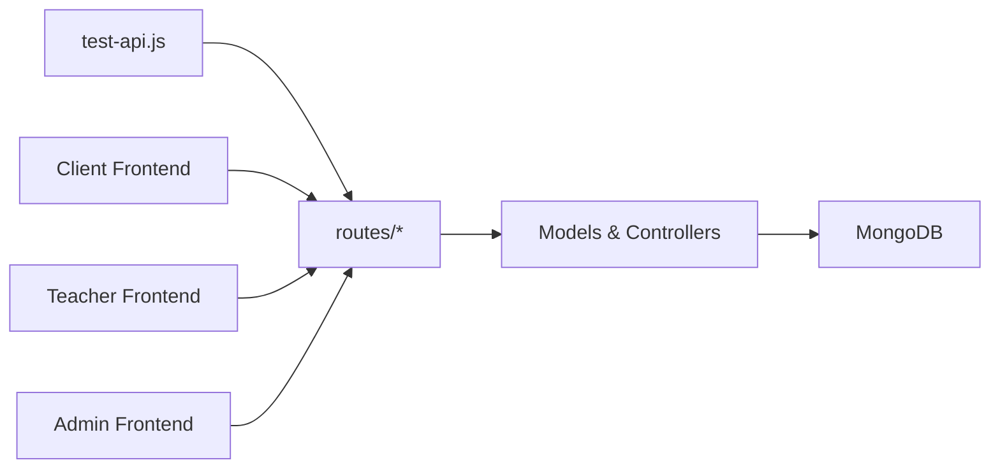

# Testing Strategy

<cite>
**Referenced Files in This Document**
- [README.md](file://README.md)
- [test-api.js](file://KCEnglishKids_BE/test-api.js)
- [package.json (BE)](file://KCEnglishKids_BE/package.json)
- [api.md](file://docs/api.md)
- [authRoutes.js](file://KCEnglishKids_BE/src/routes/authRoutes.js)
- [topicRoutes.js](file://KCEnglishKids_BE/src/routes/topicRoutes.js)
- [lessonRoutes.js](file://KCEnglishKids_BE/src/routes/lessonRoutes.js)
- [activityRoutes.js](file://KCEnglishKids_BE/src/routes/activityRoutes.js)
- [learningRoutes.js](file://KCEnglishKids_BE/src/routes/learningRoutes.js)
- [progressRoutes.js](file://KCEnglishKids_BE/src/routes/progressRoutes.js)
- [adminRoutes.js](file://KCEnglishKids_BE/src/routes/adminRoutes.js)
- [teacherRoutes.js](file://KCEnglishKids_BE/src/routes/teacherRoutes.js)
- [ActivityPlayPage.tsx](file://client/src/pages/child/ActivityPlayPage.tsx)
- [ChildArcadeSection.tsx](file://client/src/components/child/ChildArcadeSection.tsx)
- [SessionSummaryPage.tsx](file://client/src/dashboards/teacher/SessionSummaryPage.tsx)
- [AdminDashboardPage.tsx](file://admin/src/pages/AdminDashboardPage.tsx)
</cite>

## Table of Contents
1. [Introduction](#introduction)
2. [Project Structure](#project-structure)
3. [Core Components](#core-components)
4. [Architecture Overview](#architecture-overview)
5. [Detailed Component Analysis](#detailed-component-analysis)
6. [Dependency Analysis](#dependency-analysis)
7. [Performance Considerations](#performance-considerations)
8. [Troubleshooting Guide](#troubleshooting-guide)
9. [Conclusion](#conclusion)

## Introduction
This document defines the testing strategy for KCEnglishKids, covering:
- Backend API integration tests across 13 endpoints for authentication, curriculum management, learning tracking, and administrative functions.
- Test execution process, test data management, and mock strategies.
- Frontend component testing approach for interactive game engines and UI elements.
- Best practices for writing tests, maintaining coverage, debugging failures, performance/load testing, user acceptance testing (UAT), continuous integration (CI), automated execution, and reporting.

The project uses a two-layer architecture with a Node.js/Express backend and React frontends for children, teachers, and administrators. The integrated backend test suite validates end-to-end flows from child login through activity submission to progress updates and admin/teacher dashboards.

**Section sources**
- [README.md:1-138](file://README.md#L1-L138)

## Project Structure
Testing is primarily centered around:
- Backend integration test script that boots the Express app, connects to MongoDB, and exercises 13 endpoints.
- Route modules that define the API surface under test.
- Frontend components that render game engines and dashboards, which should be tested via unit and interaction tests.

**Diagram sources**
- [test-api.js:1-152](file://KCEnglishKids_BE/test-api.js#L1-L152)
- [authRoutes.js](file://KCEnglishKids_BE/src/routes/authRoutes.js)
- [topicRoutes.js](file://KCEnglishKids_BE/src/routes/topicRoutes.js)
- [lessonRoutes.js](file://KCEnglishKids_BE/src/routes/lessonRoutes.js)
- [activityRoutes.js](file://KCEnglishKids_BE/src/routes/activityRoutes.js)
- [learningRoutes.js](file://KCEnglishKids_BE/src/routes/learningRoutes.js)
- [progressRoutes.js](file://KCEnglishKids_BE/src/routes/progressRoutes.js)
- [adminRoutes.js](file://KCEnglishKids_BE/src/routes/adminRoutes.js)
- [teacherRoutes.js](file://KCEnglishKids_BE/src/routes/teacherRoutes.js)

**Section sources**
- [README.md:95-138](file://README.md#L95-L138)
- [test-api.js:1-152](file://KCEnglishKids_BE/test-api.js#L1-L152)

## Core Components
- Integrated API test runner: Boots the Express app on a dedicated port, connects to MongoDB, and sequentially executes 13 endpoint tests covering:
  - Authentication: child avatar listing, child login, admin login, teacher login.
  - Curriculum navigation: topics by age group, lessons under a topic, lesson details, activity details.
  - Learning flow: session creation, activity result submission, progress retrieval.
  - Admin/Teacher portals: dashboard metrics, class listings.
- Route definitions: Organized by feature area (auth, topics, lessons, activities, learning, progress, admin, teacher).
- Frontend components: Child game engines and pages, teacher session summary, admin dashboard.

Key responsibilities:
- test-api.js orchestrates HTTP calls against the running server and asserts status codes and response shapes.
- Route modules expose endpoints consumed by both frontend clients and the integration test.
- Frontend components implement interactive gameplay and dashboards; they should be covered by unit and interaction tests.

**Section sources**
- [test-api.js:23-148](file://KCEnglishKids_BE/test-api.js#L23-L148)
- [api.md:1-29](file://docs/api.md#L1-L29)

## Architecture Overview
The testing architecture integrates an in-process Express server with MongoDB and a lightweight test harness that performs real HTTP requests.

**Diagram sources**
- [test-api.js:23-148](file://KCEnglishKids_BE/test-api.js#L23-L148)
- [api.md:1-29](file://docs/api.md#L1-L29)

## Detailed Component Analysis

### API Integration Test Suite
The integrated test suite validates the full learning lifecycle:
- Authentication and authorization flows using JWT tokens.
- Curriculum discovery and navigation.
- Activity playback and scoring.
- Session state and progress persistence.
- Admin and teacher portal access.

**Diagram sources**
- [test-api.js:23-148](file://KCEnglishKids_BE/test-api.js#L23-L148)

Execution steps:
- Connect to MongoDB and start the Express app on a dedicated port.
- Use a helper to perform fetch-based HTTP requests with JSON payloads and headers.
- Execute each endpoint in sequence, capturing tokens and IDs for subsequent calls.
- Log statuses and key fields to verify correctness.

Test data management:
- Relies on seeded data (e.g., children avatars, topics, lessons, activities) created via seed scripts.
- Uses demo credentials documented in the README for admin and teacher logins.

Mock strategies:
- No external mocks are used; the suite runs against a live Express server and MongoDB instance.
- For future isolation, consider mocking time-dependent logic or third-party services if introduced.

Coverage scope:
- Covers 13 endpoints spanning authentication, curriculum navigation, learning sessions, activity results, progress, admin dashboard, and teacher classes.

**Section sources**
- [test-api.js:1-152](file://KCEnglishKids_BE/test-api.js#L1-L152)
- [README.md:83-92](file://README.md#L83-L92)
- [api.md:1-29](file://docs/api.md#L1-L29)

### Authentication Endpoints
Endpoints validated:
- GET /api/auth/children-avatars
- POST /api/auth/child-login
- POST /api/auth/admin-login
- POST /api/auth/teacher-login

Behavior:
- Returns structured responses with user/session data and JWT tokens where applicable.
- Requires correct roles and credentials.

Best practices:
- Validate token presence and expiration handling in tests.
- Add negative cases for invalid PINs, emails, and passwords.

**Section sources**
- [test-api.js:24-37](file://KCEnglishKids_BE/test-api.js#L24-L37)
- [test-api.js:112-133](file://KCEnglishKids_BE/test-api.js#L112-L133)
- [api.md:3-8](file://docs/api.md#L3-L8)

### Curriculum Navigation Endpoints
Endpoints validated:
- GET /api/topics?ageGroup=3-4
- GET /api/topics/:id/lessons
- GET /api/lessons/:id
- GET /api/activities/:id

Behavior:
- Filters topics by age group.
- Retrieves lessons under a topic with optional child context.
- Provides lesson details including vocabulary and activities.
- Returns activity configuration with questions.

Best practices:
- Assert counts and presence of expected entities (e.g., Animals topic, Pet lesson).
- Validate nested structures like vocabulary items and activities.

**Section sources**
- [test-api.js:39-65](file://KCEnglishKids_BE/test-api.js#L39-L65)
- [api.md:10-18](file://docs/api.md#L10-L18)

### Learning Flow Endpoints
Endpoints validated:
- POST /api/learning/sessions
- POST /api/learning/activity-results

Behavior:
- Creates or resumes a learning session for a child and lesson.
- Submits answers, computes score and stars, and updates progress.

Best practices:
- Verify session ID and status after creation.
- Validate scoring logic and star awards based on correct answers.
- Ensure duration and answer metadata are persisted correctly.

**Section sources**
- [test-api.js:67-102](file://KCEnglishKids_BE/test-api.js#L67-L102)
- [api.md:17-21](file://docs/api.md#L17-L21)

### Progress and Portal Endpoints
Endpoints validated:
- GET /api/children/:id/progress
- GET /api/admin/dashboard
- GET /api/teacher/classes

Behavior:
- Returns child’s total stars, completed lessons, and weak vocabulary.
- Provides platform KPI metrics for admins.
- Lists teacher’s assigned classes and student rosters.

Best practices:
- Assert numeric metrics and list sizes.
- Validate role-based access control for admin and teacher routes.

**Section sources**
- [test-api.js:104-140](file://KCEnglishKids_BE/test-api.js#L104-L140)
- [api.md:23-28](file://docs/api.md#L23-L28)

### Frontend Component Testing Approach
Interactive game engines and UI elements:
- Child game engines are rendered conditionally based on activity type within pages and sections.
- Teacher dashboards summarize session outcomes and student performance.
- Admin dashboard displays platform metrics and curriculum structure.

Recommended testing strategies:
- Unit tests for engine components:
  - Validate rendering of question prompts, options, and feedback states.
  - Simulate user interactions (tap, choose, match) and assert callbacks.
- Interaction tests for pages:
  - Navigate from topic to lesson to activity play page.
  - Verify correct engine selection based on activityType.
- Visual regression tests for UI consistency:
  - Capture snapshots of game screens and dashboards.
- Accessibility tests:
  - Ensure keyboard navigation and screen reader labels for child-friendly interfaces.

Example areas to target:
- ActivityPlayPage.tsx: Engine selection and answer handling.
- ChildArcadeSection.tsx: Arcade mode switching among multiple engines.
- SessionSummaryPage.tsx: Aggregation and display of session scores and stars.
- AdminDashboardPage.tsx: Metrics rendering and curriculum tree visualization.

**Section sources**
- [ActivityPlayPage.tsx:270-302](file://client/src/pages/child/ActivityPlayPage.tsx#L270-L302)
- [ChildArcadeSection.tsx:805-862](file://client/src/components/child/ChildArcadeSection.tsx#L805-L862)
- [SessionSummaryPage.tsx:167-408](file://client/src/dashboards/teacher/SessionSummaryPage.tsx#L167-L408)
- [AdminDashboardPage.tsx:325-350](file://admin/src/pages/AdminDashboardPage.tsx#L325-L350)

## Dependency Analysis
The test suite depends on:
- Express app initialization and route registration.
- MongoDB connection established before tests run.
- Seeded data for deterministic behavior.

**Diagram sources**
- [test-api.js:1-152](file://KCEnglishKids_BE/test-api.js#L1-L152)
- [authRoutes.js](file://KCEnglishKids_BE/src/routes/authRoutes.js)
- [topicRoutes.js](file://KCEnglishKids_BE/src/routes/topicRoutes.js)
- [lessonRoutes.js](file://KCEnglishKids_BE/src/routes/lessonRoutes.js)
- [activityRoutes.js](file://KCEnglishKids_BE/src/routes/activityRoutes.js)
- [learningRoutes.js](file://KCEnglishKids_BE/src/routes/learningRoutes.js)
- [progressRoutes.js](file://KCEnglishKids_BE/src/routes/progressRoutes.js)
- [adminRoutes.js](file://KCEnglishKids_BE/src/routes/adminRoutes.js)
- [teacherRoutes.js](file://KCEnglishKids_BE/src/routes/teacherRoutes.js)

**Section sources**
- [test-api.js:1-152](file://KCEnglishKids_BE/test-api.js#L1-L152)

## Performance Considerations
- Database performance:
  - Ensure indexes exist on frequently queried fields (e.g., ageGroup, childId, lessonId, activityId).
  - Monitor query latency during activity result submissions and progress retrieval.
- API throughput:
  - Measure response times for session creation and result submission under load.
- Frontend interactivity:
  - Profile game engines for frame drops and audio latency.
  - Validate memory usage during extended play sessions.

Recommendations:
- Implement load testing for critical paths (login, activity submission, progress queries).
- Use synthetic users to simulate concurrent children playing activities.
- Track p95/p99 latencies and error rates in CI reports.

[No sources needed since this section provides general guidance]

## Troubleshooting Guide
Common issues and resolutions:
- MongoDB connection failures:
  - Verify database URI and service availability.
  - Ensure seed data is loaded before running tests.
- Port conflicts:
  - Confirm the test server binds to an available port (default 5009).
- Authentication errors:
  - Check demo credentials and PIN formats.
  - Validate JWT issuance and header format.
- Missing or incorrect test data:
  - Re-run seed scripts to populate topics, lessons, activities, and users.
- Frontend engine mismatches:
  - Ensure activityType matches the intended engine component.
  - Validate props passed to engines (question, onAnswer, disabled).

Debugging tips:
- Enable verbose logging in the test runner to capture request/response details.
- Isolate failing endpoints by commenting out sequential dependencies temporarily.
- Use browser dev tools and network logs for frontend interaction tests.

**Section sources**
- [test-api.js:5-21](file://KCEnglishKids_BE/test-api.js#L5-L21)
- [test-api.js:143-148](file://KCEnglishKids_BE/test-api.js#L143-L148)

## Conclusion
The KCEnglishKids testing strategy centers on a robust backend integration test suite that validates the complete learning workflow across 13 endpoints, complemented by recommended frontend unit and interaction tests for game engines and dashboards. By following the outlined best practices—ensuring seeded data, validating response shapes, adding negative cases, profiling performance, and integrating automated CI checks—the team can maintain high confidence in system reliability and user experience.

[No sources needed since this section summarizes without analyzing specific files]