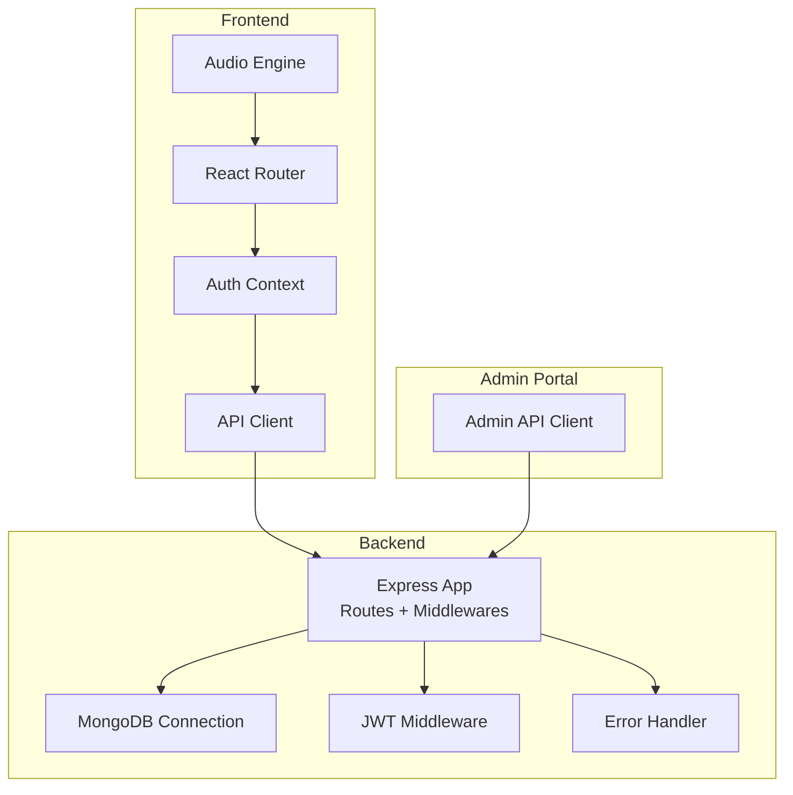
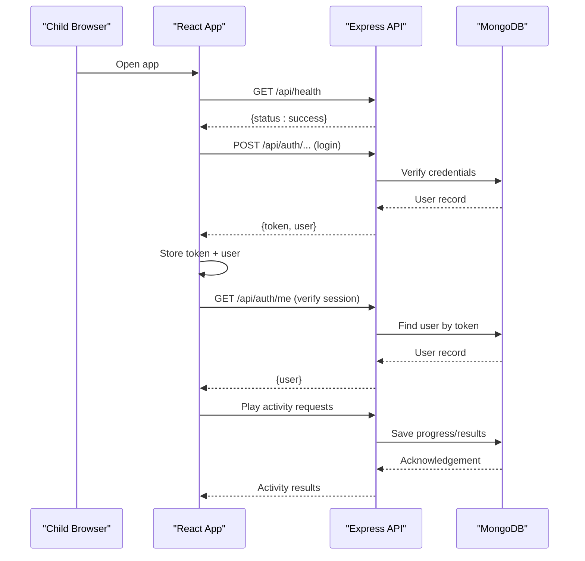
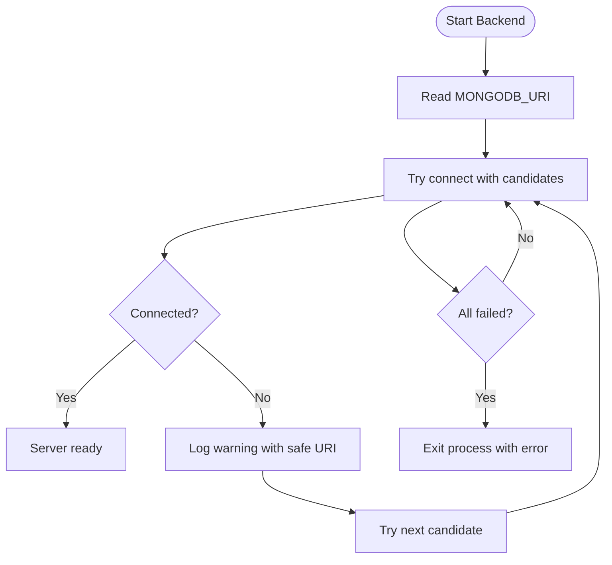
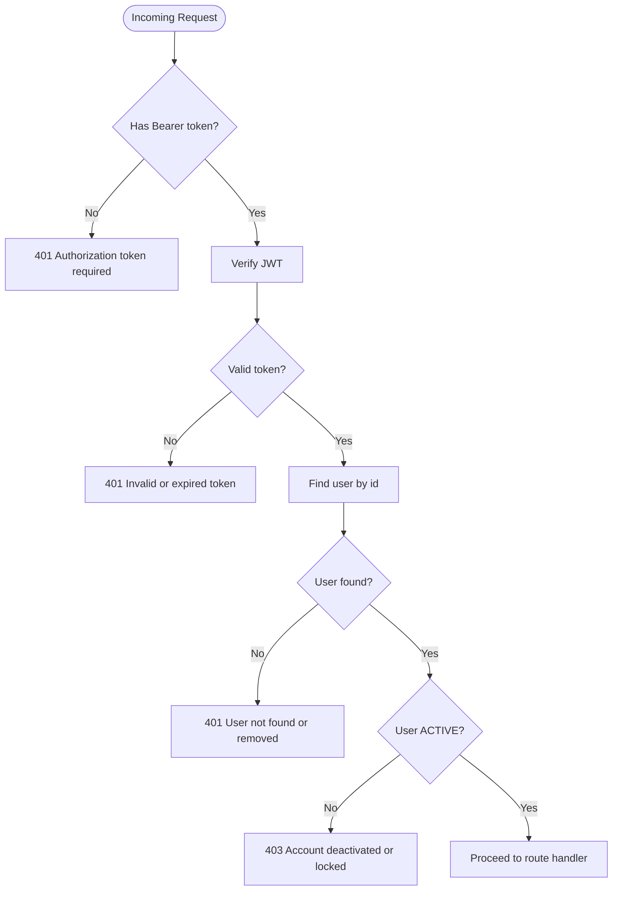
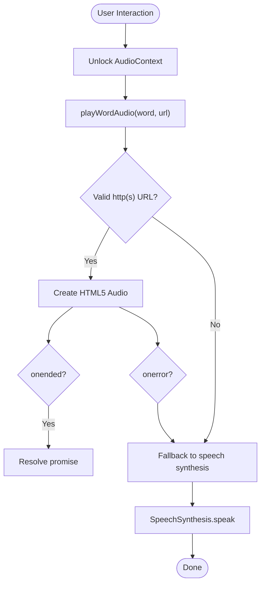
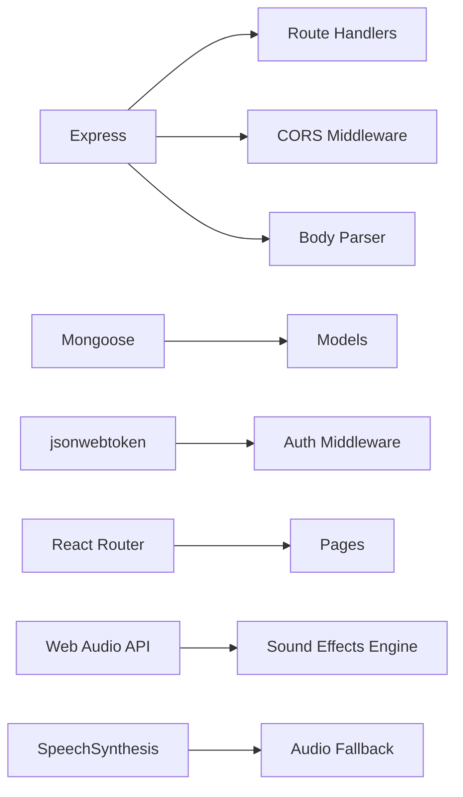

# Troubleshooting & FAQ

<cite>
**Referenced Files in This Document**
- [README.md](file://README.md)
- [app.js](file://KCEnglishKids_BE/src/app.js)
- [db.js](file://KCEnglishKids_BE/src/config/db.js)
- [authMiddleware.js](file://KCEnglishKids_BE/src/middlewares/authMiddleware.js)
- [errorMiddleware.js](file://KCEnglishKids_BE/src/middlewares/errorMiddleware.js)
- [migrate_to_atlas.js](file://KCEnglishKids_BE/scripts/migrate_to_atlas.js)
- [App.tsx](file://client/src/App.tsx)
- [AuthContext.tsx](file://client/src/context/AuthContext.tsx)
- [api.ts](file://admin/src/services/api.ts)
- [audio.ts](file://client/src/utils/audio.ts)
- [ActivityPlayPage.tsx](file://client/src/pages/child/ActivityPlayPage.tsx)
</cite>

## Table of Contents
1. [Introduction](#introduction)
2. [Project Structure](#project-structure)
3. [Core Components](#core-components)
4. [Architecture Overview](#architecture-overview)
5. [Detailed Component Analysis](#detailed-component-analysis)
6. [Dependency Analysis](#dependency-analysis)
7. [Performance Considerations](#performance-considerations)
8. [Troubleshooting Guide](#troubleshooting-guide)
9. [Conclusion](#conclusion)
10. [Appendices](#appendices)

## Introduction
This document provides practical troubleshooting guidance for KCEnglishKids, covering database connectivity, authentication, CORS, API routing, audio playback, browser and mobile compatibility, performance optimization, debugging strategies, and frequently asked questions about curriculum customization, game extensions, user system changes, and learning progression adjustments. It is designed to help developers quickly diagnose and resolve common issues while keeping the experience safe and engaging for young learners.

## Project Structure
KCEnglishKids consists of:
- Backend REST API using Express.js, Mongoose, and MongoDB (or Atlas).
- Frontend React application for children and teachers.
- Admin portal for curriculum and user management.
- Seed scripts and migration utilities for data setup and environment transitions.

**Diagram sources**
- [app.js:1-53](file://KCEnglishKids_BE/src/app.js#L1-L53)
- [db.js:1-33](file://KCEnglishKids_BE/src/config/db.js#L1-L33)
- [authMiddleware.js:1-59](file://KCEnglishKids_BE/src/middlewares/authMiddleware.js#L1-L59)
- [errorMiddleware.js:1-16](file://KCEnglishKids_BE/src/middlewares/errorMiddleware.js#L1-L16)
- [App.tsx:1-134](file://client/src/App.tsx#L1-L134)
- [AuthContext.tsx:1-161](file://client/src/context/AuthContext.tsx#L1-L161)
- [api.ts:1-90](file://admin/src/services/api.ts#L1-L90)
- [audio.ts:1-360](file://client/src/utils/audio.ts#L1-L360)

**Section sources**
- [README.md:31-138](file://README.md#L31-L138)

## Core Components
- Backend entrypoint and routing: Express app mounts routes, global middlewares, health check, and error handlers.
- Database connection: Mongoose connection with fallback URIs and DNS configuration for Atlas compatibility.
- Authentication middleware: JWT verification, role authorization, optional token handling.
- Frontend routing: Protected routes for child and teacher areas.
- Authentication context: Token persistence, session validation, user state, and vocabulary mastery sync.
- Audio engine: Web Audio API synthesis and HTML5 audio with speech synthesis fallback.
- Admin API client: Centralized fetch wrapper with Authorization header injection.

**Section sources**
- [app.js:1-53](file://KCEnglishKids_BE/src/app.js#L1-L53)
- [db.js:1-33](file://KCEnglishKids_BE/src/config/db.js#L1-L33)
- [authMiddleware.js:1-59](file://KCEnglishKids_BE/src/middlewares/authMiddleware.js#L1-L59)
- [App.tsx:1-134](file://client/src/App.tsx#L1-L134)
- [AuthContext.tsx:1-161](file://client/src/context/AuthContext.tsx#L1-L161)
- [audio.ts:1-360](file://client/src/utils/audio.ts#L1-L360)
- [api.ts:1-90](file://admin/src/services/api.ts#L1-L90)

## Architecture Overview
The backend exposes REST endpoints under /api/*, secured by JWT middleware where required. The frontend uses React Router to protect routes based on stored user roles and tokens. Audio playback relies on a robust engine that prefers HTML5 audio when available and falls back to speech synthesis if needed.

**Diagram sources**
- [app.js:25-49](file://KCEnglishKids_BE/src/app.js#L25-L49)
- [AuthContext.tsx:37-61](file://client/src/context/AuthContext.tsx#L37-L61)
- [AuthContext.tsx:63-85](file://client/src/context/AuthContext.tsx#L63-L85)

## Detailed Component Analysis

### Database Connectivity Troubleshooting
Symptoms:
- Backend fails to start due to MongoDB connection errors.
- Local development works but production or Atlas connections fail.
- DNS resolution issues on Windows with Mongo Atlas SRV records.

Diagnosis steps:
- Check backend logs for MongoDB connection warnings and final connection error messages.
- Validate environment variables for MONGODB_URI; ensure it points to local or Atlas correctly.
- Confirm MongoDB server is running locally or Atlas network access allows your IP.
- Use the provided migration script to test Atlas connectivity and update .env automatically if desired.

Resolution checklist:
- Ensure MONGODB_URI is set or fall back to localhost URI.
- For Atlas, verify Network Access settings and credentials.
- If SRV lookup fails on Windows, the code sets DNS servers to improve reliability.
- Run the migration tool to validate target Atlas connection and optionally update .env.

**Diagram sources**
- [db.js:11-30](file://KCEnglishKids_BE/src/config/db.js#L11-L30)

**Section sources**
- [db.js:1-33](file://KCEnglishKids_BE/src/config/db.js#L1-L33)
- [migrate_to_atlas.js:101-126](file://KCEnglishKids_BE/scripts/migrate_to_atlas.js#L101-L126)
- [migrate_to_atlas.js:213-229](file://KCEnglishKids_BE/scripts/migrate_to_atlas.js#L213-L229)

### Authentication Failures
Symptoms:
- Requests return 401 Unauthorized or 403 Forbidden.
- Session expires unexpectedly.
- Optional protected routes do not receive user context.

Diagnosis steps:
- Inspect Authorization header format: must be Bearer token.
- Verify JWT_SECRET matches between backend and token generation.
- Check user status is ACTIVE; deactivated accounts are rejected.
- Confirm frontend stores and sends kc_token consistently.

Resolution checklist:
- Ensure Authorization header includes valid Bearer token.
- Refresh token via login if expired.
- Re-enable user account if status is not ACTIVE.
- For optional protection, invalid tokens are ignored; user context may be null.

**Diagram sources**
- [authMiddleware.js:4-31](file://KCEnglishKids_BE/src/middlewares/authMiddleware.js#L4-L31)

**Section sources**
- [authMiddleware.js:1-59](file://KCEnglishKids_BE/src/middlewares/authMiddleware.js#L1-L59)
- [AuthContext.tsx:37-61](file://client/src/context/AuthContext.tsx#L37-L61)
- [AuthContext.tsx:63-85](file://client/src/context/AuthContext.tsx#L63-L85)

### CORS Issues
Symptoms:
- Frontend receives CORS policy errors when calling backend APIs.
- Development server cannot reach backend at different origin.

Diagnosis steps:
- Confirm backend has CORS enabled globally.
- Check frontend base URL and proxy configuration if using dev server.
- Validate that requests include correct headers and origins.

Resolution checklist:
- Keep global CORS enabled in backend.
- Ensure frontend requests target the correct backend host/port.
- If deploying behind reverse proxy, configure CORS accordingly.

**Section sources**
- [app.js:20-23](file://KCEnglishKids_BE/src/app.js#L20-L23)

### API Endpoint Errors
Symptoms:
- 404 Not Found for expected endpoints.
- Generic internal server errors without stack traces in production.

Diagnosis steps:
- Test /api/health endpoint to confirm backend is running.
- Review route mounting paths and ensure they match frontend calls.
- Inspect error middleware responses for message and stack (development only).

Resolution checklist:
- Verify route prefixes (/api/auth, /api/topics, etc.).
- In production, stack traces are hidden; use logs and structured error messages.
- Use admin API clients to validate endpoints and payloads.

**Section sources**
- [app.js:25-49](file://KCEnglishKids_BE/src/app.js#L25-L49)
- [errorMiddleware.js:1-16](file://KCEnglishKids_BE/src/middlewares/errorMiddleware.js#L1-L16)
- [api.ts:1-90](file://admin/src/services/api.ts#L1-L90)

### Audio Playback Issues
Symptoms:
- No sound on first interaction.
- Word pronunciation does not play or repeats unexpectedly.
- Speech synthesis fallback not triggered.

Diagnosis steps:
- Check for user gesture requirement; audio context starts after click/keydown/touch.
- Inspect HTML5 audio errors and safety timeout behavior.
- Verify speech synthesis availability and language settings.

Resolution checklist:
- Trigger any user interaction before playing audio.
- Ensure remote audio URLs are valid and accessible.
- Rely on built-in fallback to speech synthesis when HTML5 audio fails.
- Stop previous audio before starting new word pronunciation.

**Diagram sources**
- [audio.ts:1-360](file://client/src/utils/audio.ts#L1-L360)

**Section sources**
- [audio.ts:1-360](file://client/src/utils/audio.ts#L1-L360)

### Browser Compatibility Problems
Symptoms:
- Audio features unavailable in older browsers.
- Web Audio API or SpeechSynthesis not supported.

Diagnosis steps:
- Detect feature support before attempting to create AudioContext or SpeechSynthesis.
- Provide graceful degradation when APIs are missing.

Resolution checklist:
- Guard against undefined window.AudioContext and webkitAudioContext.
- Handle unsupported environments by skipping audio effects or falling back to text-only feedback.

**Section sources**
- [audio.ts:24-38](file://client/src/utils/audio.ts#L24-L38)
- [audio.ts:294-317](file://client/src/utils/audio.ts#L294-L317)

### Mobile Device-Specific Challenges
Symptoms:
- Autoplay blocked until user gesture.
- Touch interactions required to unlock audio.
- Performance issues on low-end devices.

Diagnosis steps:
- Listen for touchstart and pointerdown events to unlock audio.
- Avoid heavy animations during gameplay loops.
- Limit concurrent audio contexts and oscillators.

Resolution checklist:
- Add passive event listeners for touch and pointer interactions.
- Pause or stop audio when navigating away from activity pages.
- Reduce oscillator count and simplify effects on mobile.

**Section sources**
- [audio.ts:5-22](file://client/src/utils/audio.ts#L5-L22)
- [audio.ts:190-212](file://client/src/utils/audio.ts#L190-L212)

## Dependency Analysis
Key dependencies and their roles:
- Express: HTTP server and routing.
- cors: Cross-origin resource sharing.
- mongoose: MongoDB ODM.
- jsonwebtoken: JWT creation and verification.
- react-router-dom: Client-side routing.
- Web Audio API and SpeechSynthesis: Audio playback and fallback.

**Diagram sources**
- [app.js:1-23](file://KCEnglishKids_BE/src/app.js#L1-L23)
- [authMiddleware.js:1-59](file://KCEnglishKids_BE/src/middlewares/authMiddleware.js#L1-L59)
- [audio.ts:1-360](file://client/src/utils/audio.ts#L1-L360)

**Section sources**
- [app.js:1-53](file://KCEnglishKids_BE/src/app.js#L1-L53)
- [authMiddleware.js:1-59](file://KCEnglishKids_BE/src/middlewares/authMiddleware.js#L1-L59)
- [audio.ts:1-360](file://client/src/utils/audio.ts#L1-L360)

## Performance Considerations
- Slow loading times:
  - Minimize initial payload size; lazy-load heavy components.
  - Cache static assets and avoid unnecessary re-renders.
  - Use efficient routing and avoid deep nested component trees.
- Memory leaks in game engines:
  - Stop and release audio resources when navigating away.
  - Avoid creating multiple AudioContext instances; reuse one.
  - Clear timers and event listeners on unmount.
- Database query optimization:
  - Use indexes on frequently queried fields.
  - Limit returned fields and paginate large datasets.
  - Batch operations where possible to reduce round trips.

[No sources needed since this section provides general guidance]

## Troubleshooting Guide

### Debugging Strategies

#### React Components
- Verify protected routes render correctly based on user role.
- Inspect AuthContext state and localStorage tokens.
- Use React DevTools to track state updates and potential re-renders.
- Ensure audio-related components handle lifecycle properly to prevent memory leaks.

**Section sources**
- [App.tsx:17-38](file://client/src/App.tsx#L17-L38)
- [AuthContext.tsx:31-61](file://client/src/context/AuthContext.tsx#L31-L61)

#### Express.js Middleware
- Log incoming requests and responses for problematic endpoints.
- Validate Authorization header presence and format.
- Confirm error middleware returns consistent error shapes.

**Section sources**
- [authMiddleware.js:4-31](file://KCEnglishKids_BE/src/middlewares/authMiddleware.js#L4-L31)
- [errorMiddleware.js:7-14](file://KCEnglishKids_BE/src/middlewares/errorMiddleware.js#L7-L14)

#### MongoDB Queries
- Monitor connection attempts and failures.
- Use migration tools to validate Atlas connectivity and index replication.
- Ensure environment variables point to the intended database.

**Section sources**
- [db.js:11-30](file://KCEnglishKids_BE/src/config/db.js#L11-L30)
- [migrate_to_atlas.js:101-126](file://KCEnglishKids_BE/scripts/migrate_to_atlas.js#L101-L126)

### Diagnostic Tools
- Health check endpoint: GET /api/health to confirm backend status.
- Migration script: Validate Atlas connectivity and optionally update .env.
- Admin API client: Test authenticated endpoints and inspect responses.

**Section sources**
- [app.js:25-32](file://KCEnglishKids_BE/src/app.js#L25-L32)
- [migrate_to_atlas.js:213-229](file://KCEnglishKids_BE/scripts/migrate_to_atlas.js#L213-L229)
- [api.ts:1-90](file://admin/src/services/api.ts#L1-L90)

### Performance Profiling Methods
- Frontend:
  - Use browser performance panels to identify slow renders and layout thrashing.
  - Profile audio playback timing and oscillator usage.
- Backend:
  - Measure request latency and database query duration.
  - Monitor memory usage during long-running operations like migrations.

[No sources needed since this section provides general guidance]

## Conclusion
By following the diagnostic steps, leveraging built-in tools, and applying the recommended fixes, most common issues in KCEnglishKids can be resolved efficiently. Focus on validating connectivity, ensuring proper authentication flows, enabling CORS appropriately, and optimizing audio and rendering performance for a smooth child-friendly experience.

[No sources needed since this section summarizes without analyzing specific files]

## Appendices

### Frequently Asked Questions

- How do I customize the curriculum?
  - Modify seed data and curriculum models to add or adjust units, topics, lessons, and vocabulary aligned with age groups.
  - Use admin endpoints to manage curriculum content and toggle topic status.

- How do I add a new game type?
  - Implement a new game engine component and integrate it into the activity page routing logic.
  - Ensure audio and feedback mechanisms align with existing patterns.

- How do I extend the user system?
  - Update models and controllers to support additional roles or attributes.
  - Extend auth middleware to enforce new role-based permissions.

- How do I modify the learning progression?
  - Adjust scoring logic and progress tracking services to reflect new milestones and star thresholds.
  - Sync vocabulary mastery and progress data with the backend.

[No sources needed since this section provides conceptual guidance]