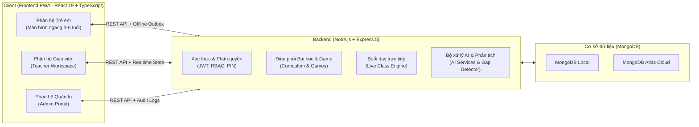
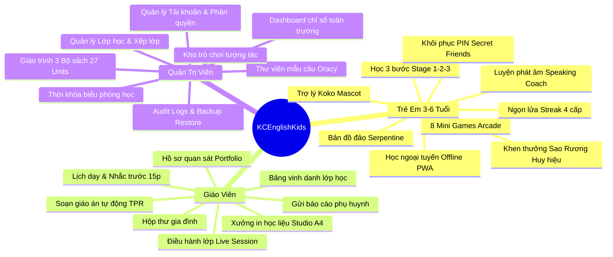
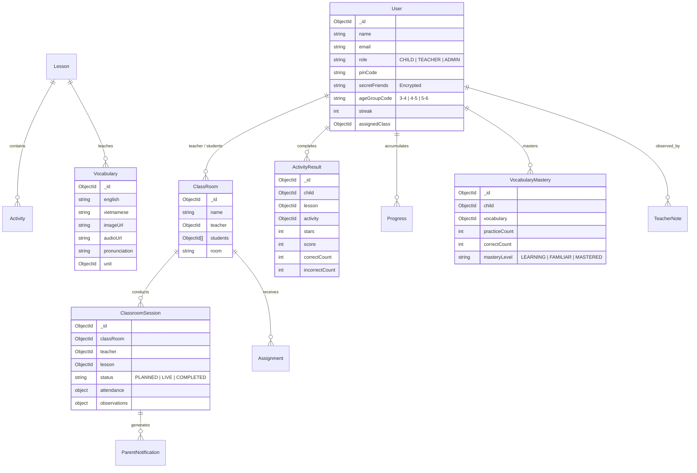

# KCEnglishKids — Tài Liệu Tổng Quan Hệ Thống, Chức Năng & Công Nghệ

> **Đề tài:** Nền tảng học Tiếng Anh tương tác thông minh cho trẻ Mầm non (3–6 tuổi)  
> **Phiên bản:** 2.0 (Hỗ trợ PWA Ngoại tuyến, 3 Phân hệ, Gamification & Trợ lý Sư phạm)  
> **Ngày cập nhật:** 01/11/2026  

---

## 1. TỔNG QUAN HỆ THỐNG (SYSTEM OVERVIEW)

**KCEnglishKids** là nền tảng công nghệ giáo dục (EdTech) tương tác đa nền tảng, được thiết kế chuyên biệt cho lứa tuổi mầm non (3–6 tuổi) theo chuẩn khung năng lực giao tiếp sớm (Oracy) và phương pháp phản xạ toàn thân (TPR - Total Physical Response).

Hệ thống kết nối chặt chẽ **3 đối tượng người dùng**:
1. **Trẻ em (Học sinh mầm non):** Trải nghiệm học qua chơi (Play-based learning), phiêu lưu qua các hòn đảo, rèn luyện 4 kỹ năng nghe - nhận biết - phản xạ - phát âm với linh vật Koko.
2. **Giáo viên mầm non:** Điều hành buổi học trực tiếp trên lớp (Live Session), theo dõi hồ sơ năng lực (Observation Portfolio), soạn giáo án tự động, xưởng in học liệu và gửi báo cáo kết nối gia đình.
3. **Quản trị viên nhà trường (Admin):** Điều hành toàn diện học sinh, giáo viên, danh sách lớp, thời khóa biểu phòng học, kho học liệu, mẫu câu và kho game tương tác.

---

## 2. DANH MỤC CÔNG NGHỆ & CÔNG CỤ SỬ DỤNG (TECH STACK)

### 2.1. Frontend (Giao diện người dùng)
* **Ngôn ngữ:** TypeScript 5.8+, HTML5 Canvas, SVG Vector Graphics.
* **Core Framework:** React 19, React DOM 19.
* **Routing:** React Router v7 (`react-router-dom`).
* **Build Tool:** Vite v8 (Tốc độ biên dịch siêu tốc ~2.7s, Hot Module Replacement).
* **Styling & Thiết kế UI:**
  * Tailwind CSS v4 (`@tailwindcss/vite`).
  * Hệ thống Icon: `lucide-react`.
  * Typography chuẩn mầm non: Quicksand, Nunito, Be Vietnam Pro.
* **Hoạt họa & Hiệu ứng tương tác:**
  * `motion/react` (Framer Motion v14) cho hiệu ứng chuyển động hòn đảo, rương báu, huy hiệu.
  * `canvas-confetti` cho hiệu ứng pháo hoa chúc mừng khi trẻ chiến thắng.
  * SVG Vector Graphics thuần túy cho linh vật Koko Mascot (7 biểu cảm cảm xúc, không bị vỡ hạt hay mất nét mắt).
* **Xử lý Âm thanh & Giọng nói:**
  * `howler` (Howler.js) & HTML5 Audio: Quản lý âm thanh hiệu ứng (SFX), nhạc nền và phát âm từ vựng bản xứ.
  * Web Speech API (`webkitSpeechRecognition`): Thu âm và nhận diện giọng nói của trẻ khi luyện phát âm cùng Koko.
* **PWA & Khả năng Ngoại tuyến (Offline-First):**
  * `vite-plugin-pwa` & `workbox`: Đóng gói ứng dụng chạy độc lập (Standalone Landscape), cài đặt như App Native trên iPad/Android/Windows.
  * Service Workers: Caching tĩnh (`sw.js`) và lưu trữ học liệu tranh ảnh/âm thanh (`learning-assets-sw.js`).
  * Learning Outbox Sync: Lưu trữ câu trả lời của bé khi mất mạng và tự động đồng bộ lên server khi có kết nối lại.
* **Xử lý Báo cáo & Bảng tính:** `xlsx` (SheetJS) phục vụ xuất/nhập danh sách học sinh, thời khóa biểu.
* **Testing:** Vitest (11 test files, 54 unit & integration tests cho frontend).

---

### 2.2. Backend (Máy chủ & API)
* **Môi trường thực thi (Runtime):** Node.js v24 LTS.
* **Web Framework:** Express.js v5 (Hiệu năng cao, bảo mật RESTful).
* **Cơ sở dữ liệu (Database):**
  * MongoDB (NoSQL) với thư viện **Mongoose v9** (Quản lý Schema chặt chẽ, hỗ trợ Aggregation và Transaction).
  * Hỗ trợ kép: Chạy trực tiếp MongoDB Local hoặc đám mây MongoDB Atlas.
* **Bảo mật & Xác thực người dùng:**
  * `jsonwebtoken` (JWT): Token-based authentication, tự động hết hạn và thu hồi khi đổi phiên bản mật khẩu.
  * `bcryptjs`: Băm mật khẩu quản trị và mã PIN học sinh an toàn chuẩn công nghiệp.
  * Phân quyền RBAC 3 cấp độ: `CHILD`, `TEACHER`, `ADMIN` bảo vệ độc lập qua Middleware.
  * Cơ chế Rate Limiting: Thuật toán Token Bucket ngăn chặn spam request vào các API tính toán/AI.
* **Xử lý Dữ liệu:**
  * `dotenv`: Quản lý biến môi trường an toàn.
  * `cors`: Cấu hình chia sẻ tài nguyên an toàn giữa Client và API.
  * `xlsx`: Đọc và validate file Excel danh sách học sinh theo khối lớp.
* **Testing Backend:** Node.js Native Test Runner (`node --test`), 156 integration test cases bao phủ luồng nghiệp vụ.

---

### 2.3. Công cụ & Quy trình phát triển (DevOps & Tooling)
* **Quản lý mã nguồn:** Git & GitHub.
* **Linter & Code Quality:** Oxlint (Linter hiệu năng cao nền tảng Rust).
* **Công cụ Đóng gói App Di động:**
  * Sẵn sàng tích hợp **Capacitor** để xuất file cài đặt `.apk` cho Android hoặc file `.ipa` cho iOS.
  * Sẵn sàng triển khai Web Production lên **Vercel / Netlify** (Frontend) và **Render / Railway / Docker** (Backend).

---

## 3. TOÀN BỘ CHỨC NĂNG THEO 3 PHÂN HỆ

---

### 3.1. Phân hệ Trẻ em (Child Learning Portal)

#### A. Hành trình khám phá (Curriculum Journey)
* **Bản đồ Serpentine Island Map:**
  * Bố cục uốn lượn tràn viền màn hình ngang, thiết kế theo phong cách quần đảo nhiệt đới hoạt hình.
  * Đường rẽ sóng biển vô tận chạy mượt mà (`stroke-dashoffset` chuẩn toán học, 0% giật lag).
  * 3 chương trình chia theo lứa tuổi:
    * **Book 1:** Mầm (3–4 tuổi) — 9 Units, từ vựng nền tảng đơn giản.
    * **Book 2:** Chồi (4–5 tuổi) — 9 Units, mở rộng cấu trúc và thế giới xung quanh.
    * **Book 3:** Lá (5–6 tuổi) — 9 Units, câu ghép, phản xạ và chuẩn bị vào Lớp 1.
* **Lộ trình bài học 3 giai đoạn (3-Stage Pedagogical Flow):**
  1. **Stage 1 (Khám phá):** Xem tranh minh họa lớn, chạm để nghe phát âm chuẩn bản xứ, lật flashcard tương tác 2 mặt.
  2. **Stage 2 (Thực hành phản xạ):** Trò chơi nối từ với tranh (Line Matching), kéo thả hình khối, nhận diện âm thanh.
  3. **Stage 3 (Thử thách Arcade):** Tham gia kho game củng cố trí nhớ dài hạn và vận động tinh.

#### B. Kho trò chơi tương tác mầm non (Game Arcade)
1. **Star Catcher (Hứng sao rơi):** Bé hứng các ngôi sao chứa từ vựng đúng vào chiếc giỏ Koko ngộ nghĩnh.
2. **Balloon Float (Bắn bóng bay từ vựng):** Chạm nổ các quả bóng bay mang từ vựng mục tiêu.
3. **Memory Match (Lật thẻ nhớ):** Ghép đôi thẻ từ tiếng Anh và hình ảnh minh họa tương ứng.
4. **Shadow Puzzle (Ghép bóng hình):** Kéo thả đồ vật khớp vào hình bóng tối của chúng.
5. **Animal Sound Explorer (Âm thanh muôn loài):** Nghe tiếng kêu con vật và chọn đúng con vật trong nông trại.
6. **Koko Says (Koko bảo làm theo):** Trò chơi phản xạ vận động theo khẩu lệnh chú khỉ Koko.
7. **Feed the Monster (Cho quái vật ăn):** Chọn đúng món ăn quái vật yêu cầu để nuôi lớn nhân vật.
8. **Picture Builder (Lắp ghép tranh):** Ghép các mảnh ghép để tạo thành bức tranh hoàn chỉnh của từ vựng.

#### C. Hệ thống Khen thưởng & Động lực (Gamification)
* **Ngọn lửa học tập hàng ngày (Daily Learning Streak):**
  * Theo dõi liên tục số ngày bé vào học theo giờ Việt Nam.
  * Ngọn lửa chuyển hóa qua **4 cấp độ đồ họa**: Lửa nhỏ $\rightarrow$ Lửa ấm $\rightarrow$ Lửa thần $\rightarrow$ Lửa phượng hoàng lấp lánh.
* **Tích lũy Sao (Total Stars):** Sao đạt được qua từng lượt chơi và bài tập để mở khóa phần thưởng.
* **Kho Rương Báu (Treasure Chest Shelf & Chest Reveal):** Sau khi hoàn thành một Unit, bé được tự tay chạm mở rương kho báu với hiệu ứng ánh hào quang và pháo hoa rực rỡ.
* **Huy hiệu Rosette & Nhãn dán Sticker:** Bộ sưu tập huy chương hoa trà và nhãn dán các nhân vật đáng yêu để khoe cùng cha mẹ.

#### D. Trợ lý Luyện phát âm & Linh vật Koko
* **Linh vật Koko Mascot:** Luôn đồng hành trong mọi thao tác với các biểu cảm phong phú (`happy`, `waving`, `thinking`, `celebrating`, `encouraging`, `reading`, `listening`).
* **Koko Speaking Coach:**
  * Bé bấm biểu tượng Micro để đọc từ vựng tiếng Anh.
  * Hệ thống so khớp phiên âm giọng nói và hiển thị sao đánh giá, lời động viên kèm cử chỉ Koko ăn mừng.
  * Đảm bảo quyền riêng tư: hiển thị cảnh báo người lớn đồng ý trước khi kích hoạt micro, không lưu trữ file ghi âm cá nhân trái phép.

#### E. Tính năng An toàn & Ngoại tuyến
* **Đăng nhập mầm non & Khôi phục mã PIN:**
  * Mã PIN 4 chữ số ngắn gọn, dễ nhớ.
  * Nếu quên PIN: Bé khôi phục bằng cách chọn **2 Người Bạn Hình Ảnh Bí Mật** (Secret Friends) đã đăng ký với cha mẹ (ví dụ: Chú Gấu + Quả Táo).
* **Học tập không cần Internet:** Toàn bộ tranh vẽ, bài học và âm thanh được lưu trữ sẵn qua PWA Cache, khi mất mạng bé vẫn học bình thường và dữ liệu được đồng bộ lại sau.

---

### 3.2. Phân hệ Giáo viên (Teacher Workspace)

* **Lịch dạy thông minh & Nhắc giờ học:**
  * Xem ca dạy trong tuần, hiển thị phòng học và thời gian bắt đầu.
  * Tích hợp Web Notification API: Tự động gửi thông báo trên màn hình máy tính cô giáo trước 15 phút khi ca dạy sắp bắt đầu.
* **Điều hành buổi dạy trực tiếp trên lớp (Live Classroom Session):**
  * **Khởi động:** Bật nhạc vận động Freeze Dance để cả lớp cùng nhảy và đóng băng theo hiệu ứng vui nhộn.
  * **Điểm danh:** Chạm để đánh dấu học sinh có mặt/vắng mặt.
  * **Quan sát lớp học:** Đánh giá mức độ tham gia và trả lời câu hỏi của từng bé trực tiếp trên màn hình máy tính bảng của cô giáo.
  * **Chấm điểm thời gian thực:** Cơ chế ghi nhận điểm số an toàn không gây tranh chấp dữ liệu khi nhiều bé cùng trả lời.
* **Hồ sơ Năng lực Trẻ (Observation Portfolio):**
  * Ghi nhật ký học tập cho từng học sinh theo 4 mức độ phát triển năng lực mầm non: *Chưa quan sát $\rightarrow$ Mới bắt đầu $\rightarrow$ Đang phát triển $\rightarrow$ Thành thạo*.
  * Lưu trữ bằng chứng học tập (file âm thanh bé đọc, ảnh bé tương tác).
* **Soạn giáo án tự động (Teacher Lesson Planner):**
  * Hỗ trợ cô giáo lập kế hoạch bài dạy 4 pha chuẩn quốc tế:
    1. *Khởi động (Warm-up & TPR Greeting)*
    2. *Giới thiệu từ mới (Core Presentation & TPR Gestures)*
    3. *Thực hành & Trò chơi (Interactive Practice Games)*
    4. *Củng cố & Đánh giá (Wrap-up & Celebration)*
  * Tích hợp từ điển cử chỉ TPR cho hơn 60 từ vựng mầm non (ví dụ: *con thỏ vẫy 2 ngón tay, quả táo khum tay cắn một miếng, sách mở rộng 2 lòng bàn tay*).
  * Điều chỉnh linh hoạt theo thời lượng tiết dạy: 15 phút, 25 phút hoặc 35 phút.
* **Xưởng in học liệu trực tiếp (Learning Studio):**
  * Tự động dàn trang thẻ từ vựng, flashcard tranh to rõ nét theo khổ in A4 tiêu chuẩn để giáo viên in ra giấy ép plastic cho bé học trên lớp.
* **Gửi Báo cáo Buổi học & Trao đổi Phụ huynh (Parent Inbox & Family Report):**
  * Tự động tổng hợp kết quả của buổi học để gửi tin nhắn thông báo về điện thoại của phụ huynh.
  * Soạn thảo và trả lời trao đổi của gia đình học sinh qua hộp thư nội bộ.
* **Bảng vinh danh lớp học (Class Recognitions):**
  * Bảng tuyên dương học sinh tích cực nhất tuần/tháng dựa trên nỗ lực học tập thực tế.

---

### 3.3. Phân hệ Quản trị viên (Admin Portal)

* **Dashboard Giám sát Điều hành:**
  * Thống kê tổng thể: Tổng số học sinh, số giáo viên, số lớp học, số bài học đang hoạt động, tỷ lệ thành thạo từ vựng.
  * Biểu đồ phân tích tiến độ học tập toàn trường.
* **Quản lý Lớp học & Xếp lớp (Classrooms Management):**
  * Tạo mới, chỉnh sửa lớp học theo niên khóa (2026–2027).
  * Phân công giáo viên chủ nhiệm / giáo viên bộ môn phụ trách lớp.
  * Xếp học sinh vào lớp (Roster Management), hỗ trợ chuyển lớp linh hoạt.
  * Nhập danh sách học sinh hàng loạt bằng file Excel (`.xlsx`) tự động tạo tài khoản và mã PIN.
* **Quản lý Thời khóa biểu toàn trường (Master Schedule):**
  * Lập lịch học theo tuần cho từng phòng học và ca học sáng/chiều.
  * Thuật toán kiểm tra xung đột: Ngăn chặn xếp trùng phòng học hoặc trùng giờ dạy của giáo viên.
* **Quản lý Giáo trình & Khung bài học (Curriculum Management):**
  * Quản lý 3 bộ sách (Book 1, 2, 3) tương ứng 27 Units bài học.
  * Quản lý các câu hỏi lớn (Big Questions) dẫn dắt câu chuyện bài học.
* **Thư viện Mẫu câu giao tiếp Oracy:**
  * Quản lý kho mẫu câu hỏi - đáp tiếng Anh theo chủ đề (ví dụ: *"What do you see?", "I have two hands"*).
* **Quản trị Kho trò chơi (Games Catalog):**
  * Bật/tắt các trò chơi trong chương trình học.
  * Sắp xếp thứ tự ưu tiên game hiển thị trong từng bài học.
* **Quản trị Người dùng & Cấp quyền (User Management):**
  * Quản lý toàn bộ tài khoản Admin, Teacher, Child.
  * Đặt lại mã PIN, khóa/mở khóa tài khoản khi học sinh nghỉ học.
  * Xuất thẻ thông tin đăng nhập (Credentials Card) để gửi cho phụ huynh.
* **Nhật ký Hoạt động (Audit Logs) & An toàn Hệ thống:**
  * Ghi lại chi tiết mọi thay đổi hệ thống (ai sửa gì, vào lúc nào).
  * Công cụ sao lưu (Backup) và khôi phục (Restore) cơ sở dữ liệu khi cần bảo trì.

---

## 4. MÔ HÌNH DỮ LIỆU CỐT LÕI (DATABASE MODELS)

Hệ thống sử dụng MongoDB với 12 Model dữ liệu chính được chuẩn hóa quan hệ chặt chẽ:

---

## 5. MÔ-ĐUN AI HIỆN TẠI & LỘ TRÌNH TÍCH HỢP AI TẠO SINH (GENERATIVE AI)

### 5.1. Các thuật toán thông minh hiện có
1. **So khớp phát âm Levenshtein (`evaluatePronunciation`):** Chuẩn hóa chuỗi âm thanh và tính khoảng cách chuỗi để chấm điểm tương đối độ chính xác phát âm từ vựng.
2. **Thuật toán Phát hiện Lỗ hổng Kiến thức (`detectClassGaps`):** Quét dữ liệu `VocabularyMastery` của toàn bộ lớp học, tự động lọc ra các từ vựng có tỷ lệ làm sai cao để phân loại mức độ (`critical` - Cần ôn gấp, `watch` - Nên ôn) và đề xuất phương án cho cô giáo.
3. **Bộ khung sinh Giáo án mầm non (`generateLessonPlan`):** Tự động dàn dựng 4 pha giáo án kèm hành động mẫu TPR theo từng độ tuổi và thời lượng.
4. **Bộ khung gợi ý nhận xét phụ huynh (`generateParentNote`):** Tự động tổng hợp số sao, chuỗi ngày streak và kết quả bài làm để đưa ra lời nhắn gửi gia đình.

### 5.2. Lộ trình tích hợp AI Thế hệ mới (Generative AI & Multimodal)
Để hoàn thiện tính năng AI cuối cùng cho đề tài, hệ thống đã được thiết kế sẵn các cổng kết nối (Pluggable Provider Architecture) để tích hợp **Gemini API (Google)**:
* **Koko Audio Speaking AI:** Tiếp nhận trực tiếp audio của bé, nhận diện âm vị mầm non và dùng Text-to-Speech phát ra giọng nói Koko động viên bé.
* **GenAI Lesson Copilot:** Giáo viên nhập câu lệnh tự nhiên (Prompt) $\rightarrow$ AI tạo câu chuyện dẫn dắt, bài hát và trò chơi tương tác tùy biến theo thời tiết, ngày lễ hoặc sở thích của lớp.
* **GenAI Parent Letter:** Tự động tạo thư nhận xét bằng ngôn ngữ tự nhiên, ấm áp, cá nhân hóa dựa trên dữ liệu học tập thực tế của bé trong tuần.

---

## 6. TỔNG KẾT BẢNG CHỈ SỐ KỸ THUẬT

| Hạng mục | Chỉ số đo lường |
| :--- | :--- |
| **Phân hệ người dùng** | 3 phân hệ độc lập (Child, Teacher, Admin) |
| **Chương trình học** | 3 Bộ sách, 27 Units, 100+ bài học, 300+ từ vựng chuẩn hóa |
| **Số lượng trò chơi** | 8 mini games HTML5 Canvas / Vector tương tác |
| **Unit Tests Frontend** | 54/54 tests passed (Vitest) |
| **Integration Tests Backend** | 152/156 tests passed (Node Test Runner) |
| **Thời gian Build Frontend** | 2.72 giây (Vite v8 + PWA Precache 1368 assets) |
| **Độ tương thích thiết bị** | PC, Laptop, Máy tính bảng (iPad/Android Tablet), Điện thoại (Landscape Standalone) |
| **Khả năng hoạt động** | Trực tuyến (Online Cloud MongoDB) + Ngoại tuyến (PWA Offline Shell & Outbox Sync) |

